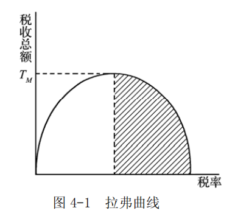
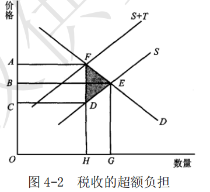

# Chapter 4 · Principles of taxation

> **The central question of this chapter**: by what right does the government tax, and by what standard is a tax system designed (how are fairness and efficiency weighed)? Once a tax has been collected, on whom does the burden finally fall — is the legal taxpayer the real bearer? And is it true that the higher the rate, the more the government collects?

## The arc of this chapter

The four questions of tax theory each have their own decade of birth; laid out along the timeline, the skeleton of this chapter stands up. The first question — "by what right does the state tax, and how is taxation made legitimate" — is an old question of classical political economy: Adam Smith in 1776 put forward the four canons of taxation in Book V of *The Wealth of Nations* (equality, certainty, convenience, economy), and Wagner at the end of the 19th century expanded them into four groups of nine principles covering fiscal policy, the national economy, social justice and tax administration, in which the principle of "taxation according to ability" evolved into the modern progressive rate — the marginal-utility school supplied its theoretical ground (the equal-sacrifice doctrine: making taxpayers of different incomes sacrifice equal amounts of utility necessarily requires the higher-income taxpayer to bear the higher rate). The second question — "how much does taxation itself destroy" — is a question of twentieth-century welfare economics: Dupuit, analysing public works in 1844, had already seen that a tax pushing price away from cost destroys part of the value of transactions, Marshall's consumer-surplus tool turned this into a geometric figure, Harberger in the 1950s and 60s generalised it into a computable "triangle", and tax neutrality went from a benchmark idea to a principle of design; Ramsey in 1927, answering the question Pigou posed — "how to raise a given revenue with the least distortion" — proved that the answer is, remarkably, "tax the inelastic goods heavily" — efficiency and fairness collided head-on here for the first time. The third question — "on whom does the burden finally fall" — is the problem of tax incidence: the legal taxpayer and the real bearer can be separated, and the degree of shifting is decided by the elasticities of supply and demand; this is the incidence analysis running from Ricardo to Marshall, and the tool for understanding real arguments such as "who actually bears the VAT". The fourth question is the supply-side answer to the stagflation of the 1970s: Laffer in 1974 (the story as told is that he drew it on a napkin in a Washington restaurant) drew the inverted-U relation between the tax rate and total revenue, Reagan cut taxes on that basis in 1981, and the controversy it ignited — "is the US economy on the forbidden segment of the curve" — has not ended to this day. The concepts section of this chapter runs along "rate structure — price relation — neutrality benchmark — shifting mechanism — aggregate curve", with optimal tax theory as the closing synthesis — it fits the first four questions into a single optimisation framework (Ramsey's commodity taxes, Mirrlees's income tax of 1971), and it is at once the floor and the ceiling of modern tax theory.

## Core concepts

### Progressive tax rates

A progressive tax rate divides the taxable object into several grades by the size of its amount, prescribes a corresponding rate for each grade from low to high, and the larger the amount of the taxable object, the higher the rate. By the method of computation it divides further into the full-progression rate and the excess-progression rate: the full-progression rate taxes the entire amount of the taxable object uniformly at the highest grade rate it reaches; the excess-progression rate divides the taxable object into grades by amount, applies each grade's own rate to each grade and computes the tax for each separately, so that the same amount of taxable object is subject to several rates at once. It is generally held that progressive rates help embody the principle of taxing by ability and help achieve a fair redistribution of income.

Why does "taxation by ability" require progression and not merely proportion? The sacrifice doctrine of the nineteenth century gave the clearest argument: by diminishing marginal utility, one yuan means more utility to a low-income earner than to a high-income earner; to make taxpayers of different incomes sacrifice equal totals of utility (Mill's equal sacrifice, Pigou's least aggregate sacrifice), the high-income earner must pay at a higher proportion — the progressive tax is the fair form derived from utility theory. And the difference between full progression and excess progression is a "critical point" level technical question in tax design: under full progression, taxable income that just crosses a grade bracket means paying a large chunk more tax (the cliff effect of earning one yuan more and the tax jumping by thousands), and it invites the manipulation of income near the critical point; excess progression, computed grade by grade, removes the cliff at the price of administrative complexity. Modern income taxes generally use excess progression; China's individual income tax applies a seven-bracket excess-progressive schedule of 3%–45% to comprehensive income (after the 2018 amendment, in force from 2019). The opposite concepts of progression must also be put in place: the proportional rate (one rate all the way) and the regressive rate (where the low-income earner's real burden rate is higher) — many commodity taxes are regressive because the consumption spending of low-income earners takes a larger share of their budgets, and this is the first scene of the efficiency–fairness conflict that the optimal tax theory of section 6 has to reconcile.

### Taxes inside and outside the price

Taking the relation of the tax to the price as the standard, taxes divide into taxes inside the price and taxes outside the price. A tax inside the price is one whose amount is contained in the commodity's price, so that the buyer pays the tax due when buying the commodity: with the rate given, the higher the price the larger the tax, and when the rate changes but the price does not, the higher rate brings the higher revenue; the tax inside the price is realised through the price and is closely tied to the level of the price — the consumption tax belongs here. A tax outside the price is a tax levied on the buyer in addition to the commodity's price: the price contains no tax, and the buyer, besides paying the price, pays the tax separately on the basis of the price paid.

This distinction looks like a technical detail, but it actually decides two things: the visibility of the tax and the tax elasticity of the price. The tax inside the price hides the tax in the price, and the consumer's act of paying and the act of taxing merge into one — this is both an administrative convenience (in China the consumption tax is levied ad valorem at the production stage, realised along with the price) and a deadening of perception: a rate rise shows up directly as a price rise, and the taxpayer does not necessarily notice paying more tax. The tax outside the price separates price and tax; on the invoice the commodity amount and the tax amount are listed apart — China's VAT works this way. Every sum of tax that the VAT seller "collects on behalf of the state" is written on the face of the invoice, and this is not only for the consumer's information but the operational foundation of the VAT credit chain: each downstream stage credits the tax charged by the upstream stage against its invoice, and chain management requires the tax amount to be identifiable. The international comparison of the two modes also shows what is at stake: the US retail sales tax is customarily added outside the price — an item marked at 10 dollars costs 10.7 at the till; the European VAT, like China's practice, quotes the tax-inclusive price. The same tax burden, wrapped inside the price or outside it, produces wholly different psychological sensations in the taxpayer — tax psychology (the study of "tax salience" and of "framing effects") has confirmed that tax-exclusive pricing lowers resistance to taxation, which is no small matter for understanding the political feasibility of tax reform.

### Tax neutrality

Tax neutrality means that the government's taxation does not distort the operation of the market mechanism, or, in other words, does not alter the existing allocation of resources in the private sector. If taxation changes the consumption behaviour of consumers who aim at maximum utility, or the production behaviour of producers who aim at maximum profit, and thereby changes the private sector's pre-tax allocation of resources, those changing effects are the non-neutrality of taxation.

The value of tax neutrality lies not in "it can be achieved in reality" but in its being the baseline against which every tax system is measured — as a vacuum is to a physics experiment. Any tax with a base of transaction value or of income changes relative prices or relative returns, and thereby changes behaviour; the only undistorting tax is the lump-sum tax (the poll tax), which varies with no economic behaviour whatsoever. But the poll tax is unacceptable on grounds of fairness — it treats the millionaire and the beggar alike — and the Thatcher government's replacement of the local property tax by the "Community Charge" (the poll tax) in 1989–1990 provoked mass refusal to pay and riots, and it was abolished in 1991. This case sets out the real predicament of the neutrality concept with perfect clarity: the tax that is perfect in efficiency is often infeasible in fairness, and every real tax system makes a second-best choice in the gap between the two. The practical use of the neutrality principle is therefore "comparative" rather than "absolute": given the revenue target and the fairness constraints, choose as far as possible the tax base and the rate structure with the smaller distortion — a broad base with low rates distorts less than a narrow base with high rates (the same revenue, fewer activities squeezed out), and this is the theoretical source of the VAT's "broad base" reform and of the worldwide trend toward "broad base, low rate". It is at the same time the yardstick for evaluating tax preferences: every exemption or preference is a deliberate non-neutrality, and its justification must come from the externality or the policy goal it means to correct; otherwise it is using the fiscal instrument to distort the market.

### Tax shifting

Tax shifting is the economic phenomenon by which, in the course of commodity exchange, the taxpayer transfers the tax burden to the buyer or to the supplier by raising the selling price or by pressing down the purchase price. In the broad sense it comprises two parts, the transfer of the tax burden and its final incidence: shifting is directly bound up with the rise and fall of prices, is a redistribution of the tax burden among the economic subjects, and is also the taxpayer's autonomous act of defending its own interest. The ways of shifting are forward shifting (raising the sale price and passing it to the buyer), backward shifting (pressing down the purchase price and passing it to the supplier), mixed shifting (forward and backward together), diffusion (absorbing it by improving technology and management) and capitalisation (a tax on a durable asset is discounted into the asset's price and borne once for all by the buyer).

The question this concept answers is an old one: Ricardo argued that a tax on landlords is borne by the landlords (land cannot be moved), and that a tax on profits lands finally on profits; Marshall made the question precise — incidence depends on the comparison of the elasticities of supply and demand. Its modern meaning can be seen in an everyday dispute: the VAT is legally paid by the firm, but the firm's "paying" is not the firm's "bearing" — the tax on the invoice enters the sale price and is finally borne by consumers in every purchase; conversely, for the heavy consumption tax on tobacco, the manufacturer cannot necessarily shift the whole burden (a price rise damps sales), and the incidence is divided among the manufacturer's profits, the distributors and the consumers according to elasticity. Capitalisation is the most counter-intuitive form of shifting: the present values of all future years of an annual tax on land are discounted once into the land's current price — the buyer in effect pays the seller's entire future tax — and this explains why a change in the tax system can deliver a violent one-time shock to asset prices, and it is also the distributional effect watched most closely in the property-tax debate: someone who has already bought a home at high prices faces the new tax with no way to "shift it away".

### The Laffer curve

The Laffer curve reflects the relation between the tax rate and total tax revenue; it was put forward by the supply-side economist Arthur Laffer (in 1974, the story as told is that he drew it on a napkin in a Washington restaurant for a White House aide), and it is one of the theoretical grounds of the supply-side school's proposal to cut rates in order to stimulate production and growth. As in figure 4-1, the horizontal axis is the tax rate and the vertical axis total revenue, and the curve is an inverted U that first rises and then falls: total revenue rises with the rate, but once the rate passes a certain point the two turn negatively related. The ideas it contains are:

- A high rate does not necessarily collect high revenue, and high taxation is not necessarily high efficiency — a high rate damps the initiative of production and of operation, causing output to fall and the tax base to shrink.
- The same revenue can be raised at two different rates, and the lower of the two promotes the development of production in the long run.
- In theory there exists an optimal combination of rate and revenue.

The economic core of this curve is in fact nothing new (Dupuit's tax analysis of 1844 already contained the same thought: a rate too high destroys the tax base); its historical influence comes from the political timing of the 1970s: stagflation left Keynesian demand management speechless, the supply-side school offered the hope that "tax cuts can pay for themselves", and Reagan's tax cut of 1981 (the top marginal rate from 70% down to 50%, and further to 28% in 1986) became its practice. The empirical point at issue is only one: is the real economy on the downward segment (the "forbidden zone") of the curve? The answer most studies give is — for most tax bases, no: within the range of post-war US rates, tax cuts have rarely financed themselves fully; but for particular tax bases (capital gains, the taxable income of the very highest earners — because tax evasion, avoidance and the intertemporal shifting of income are highly rate-sensitive), the downward segment has genuinely existed. A vivid and serious case comes from Sweden: at the end of the 1970s its stacked marginal rates could exceed 100%, and in 1976 the children's author Astrid Lindgren published the satirical story *Pomperipossa in Monismania* — in the story a writer's marginal rate reaches 102%, so that writing more actually loses money — the piece stirred public indignation and influenced the general election that year, and the next year Sweden amended its tax law and flattened such stacked ultra-high marginal rates. A rate so high that it destroys the incentive to work and to declare income is the political version of the curve's right half.

## Problems and analysis

### What distinguishes taxation from other fiscal revenue? — compulsion, gratuitousness, fixity

The basic characteristics of taxation comprise three aspects: compulsion, gratuitousness and fixity. These "three characters" are the basic features that distinguish taxation from other forms of fiscal revenue; fiscal revenue that does not possess all three at once does not count as taxation.

- Compulsion: taxation is levied by virtue of the state's political power and enforced through promulgated decrees; no unit or individual may resist it.
- Gratuitousness: once the state has collected the tax, the money belongs to the state; it need neither be repaid nor be matched by any direct consideration to the taxpayer.
- Fixity: before collection, the object of taxation and the uniform rate or amount are fixed in legal form, and only the prescribed standard may be levied.

Each of the three characters stands against a "neighbouring category". Compulsion separates taxation from government bonds and from voluntary donation — a bond is contractual credit that can be declined; a tax cannot be refused. Gratuitousness separates taxation from fees and from land conveyance receipts — a fee corresponds to a specific service (paying for a certificate), while tax payments are not matched one-to-one with any specific service (this is exactly why the "benefit principle" gives way in real tax systems to the "ability principle": public goods such as national defence and justice cannot be priced per head). Fixity separates taxation from fines and from apportionments — a fine can stretch with the intensity of enforcement, while a tax must be fixed by law in advance, and this is precisely the meaning of the constitution's "citizens have the duty to pay taxes in accordance with the law" and of the principle of statutory taxation in the Legislation Law (made explicit in 2015); what historically destroyed fixity was "tax reductions beyond authority" and "tax farming", and the price paid was predictability and fairness. Together the three characters answer a more fundamental question: why can public goods not be supplied by voluntary exchange (the free-riding of chapter 1), while taxation can — because only taxation at once possesses the three properties of "compulsory coverage of everyone, universality tied to ability, and rules fixed in advance", and that breaks the free-riding equilibrium.

### Why does a tax create excess burden? — the Harberger triangle

The theory of the excess burden of taxation was first set out by Harberger using Marshall's cardinal utility theory, and it later came to be called the Marshall–Harberger theory of excess burden.

Figure 4-2 shows the market for one commodity: D is the demand curve, S the supply curve, the pre-tax equilibrium is at E, output OG, price OB. Suppose the government levies a specific (per-unit) tax on the commodity; the supply curve shifts left to $S+T$, the after-tax equilibrium is at F, output falls to OH, and the price rises to OA. Tax revenue equals the quantity sold times the rate per unit, that is, the area ACDF; the loss of consumer surplus is ABEF, the loss of producer surplus is BCDE, and the two together are ACDEF — evidently larger than the ACDF the government receives. The difference between the two, the triangle FDE, is the excess burden of the tax: the taxpayer has not only paid the tax, but also bears, through the rise in price and the fall in consumption, a net loss the government never collected (consumption is forced into second-best substitutes, choice is distorted). The requirement of economic efficiency in taxation is to minimise the area of this "Harberger triangle". Three lines of attack are available: tax goods whose supply and demand elasticities are zero (behaviour unchanged, no triangle); tax all goods at the same proportion (no distortion of relative prices among goods); tax income (acting uniformly on all income, leaving the choice among goods unchanged).

The three lines point to the same principle: the root of excess burden is the distortion of relative prices, and the size of the distortion is proportional to the behavioural response (elasticity). This also explains why, at the same rate, a broad base distorts less than a narrow one, and why the shift to the VAT (removing the disturbance to relative prices caused by repeated taxation of intermediate stages) has been the mainstream of worldwide tax reform. But each of the three "burden-lightening" schemes has hidden reefs, left for the optimal taxation section to unfold — the efficiency prescription is often the fairness lesion.

### Can the tax burden be shifted away? — four conditions

On the premise that prices can float freely, the degree of tax shifting is constrained by several factors:

- **Elasticities of supply and demand**. Commodities with a large supply elasticity and a small demand elasticity shift easily; commodities with a small supply elasticity and a large demand elasticity shift poorly. Whoever is insensitive to price, whoever concedes in the bargain, on them the burden falls.
- **The character of the tax**. Taxes on commodities shift easily, taxes on income generally hardly shift — the main channel of shifting is changing prices, so the VAT, the consumption tax and customs duties, being closely tied to price, travel that channel easily, while taxes on income, remote from price, have no way to start.
- **The breadth of the tax's coverage**. A broad coverage shifts easily (the consumer cannot find an unmarked substitute and can only accept the rise); a narrow coverage shifts poorly (one switch to a substitute and the price rise loses the customer).
- **The trade-off between shifting and profit**. Full shifting requires raising the sale price to a certain level, and a price rise damps sales and thereby total profit; the seller must compare the gain from shifting with the loss of sales, and if the latter exceeds the former, prefers to bear part of the tax itself to keep the sales.

The four conditions can be unified into one sentence of bargaining language: shifting is a game between the taxpayer and the counterparty, and the chips are their respective elasticities (their options of exit). The policy lesson it gives is quite practical — pinning "tax regulation" on the nominal taxpayer often comes to nothing: a luxury tax levied on the manufacturers is not necessarily borne by them (the US luxury car tax of 1990 ended up pressing on autoworkers' employment and was repealed), tobacco and alcohol taxes land on consumers (both goods have low demand elasticity and broad coverage), and a tax on land is almost wholly capitalised into the land price and absorbed by the seller. In designing a tax system it is far from enough to ask "on whom is the bill written"; one must ask "on whom does the structure of elasticities make the burden finally fall".

### Does a higher rate always collect more? — the Laffer curve in three sentences

On the general relation between tax rates, tax revenue and economic growth, the Laffer curve carries three implications:

- **A high rate does not necessarily collect high revenue**. Revenue first rises with the rate, and after the rate passes a certain point turns negatively related: a high rate damps initiative and saps economic vitality, causing production to stagnate or fall and the tax base to shrink; a high rate also tends to come with excessive exemptions and deductions, making the tax system unfair.
- **The same revenue can correspond to two rates**. A moderate low rate reduces revenue in the short run, but in the long run promotes production and widens the tax base, and so favours the growth of revenue.
- **In theory there exists an optimal rate**. The rate that maximises total revenue sits at the top of the curve; "the optimal combination is rare in practice, but the curve proves its possibility, and it is the ideal goal of tax design".

The correct use of the three sentences differs in each case. The first is a warning: once the rate has entered the downward segment, further taxation backfires — Sweden's marginal rates above 100% are a textbook instance. The second is the language of reform: at the same revenue choose the lower rate and invite the "hidden activities" back — the argument of China's 2018 individual income tax amendment, which raised the basic deduction and added special additional deductions, is exactly "lowering the marginal burden on labour income". The third is the most easily misused: the peak is the rate that maximises government revenue, not the rate that maximises social welfare — a government that presses the economy onto the peak collects the most, but is not necessarily doing society the most good; the reason the supply-side school's political influence surged is precisely the persuasive force of conflating the "revenue peak" with the "growth optimum". Judging whether an economy is near the peak requires, empirically, watching how the elasticity of revenue responds to changes in the rate — and that leads the topic on to optimal tax theory.

## Synthetic essay

### What is optimal tax theory? — from the Ramsey rule to Mirrlees's income tax

Optimal tax theory takes the efficiency of resource allocation and the fairness of income distribution as its criteria, and analyses the construction of an economically reasonable tax system. The ideal optimum assumes that in building the tax system the government knows everything about taxpayers (their ability to pay, their preference structures and so on) and has unlimited administrative capacity; in reality government information is incomplete and administrative capacity limited, and what optimal tax theory studies is precisely how, under this asymmetry of information, the government should tax so as to satisfy both the requirement of efficiency and the principle of fairness.

The foundations of the theory have three aspects: individual preferences and the structure of technology and markets are clearly specified (preferences can be described by a utility function, technology generally has returns to scale, and markets are usually perfectly competitive); the government must raise a given revenue through a limited set of tax instruments with low administrative cost — the lump-sum tax, being unrelated to economic decisions, is generally ruled out (being infeasible or unfair), so any feasible tax instrument is connected with individual consumption; and in a many-person model, with a social welfare function (an aggregation of individual utilities) as the standard, the optimal tax system is chosen from the limited set of tax instruments. Its main contents are:

- **Direct and indirect taxes complement rather than replace each other** — the two tax systems each have their strengths and weaknesses.
- **The choice of tax-system pattern depends on the government's policy goals**: where distributive fairness is primary, choose a system with the income tax as the main body; where economic efficiency is primary, choose a system with the commodity tax as the main body.
- **The inverse-elasticity proposition (the Ramsey rule)**: when the demands for various goods are mutually independent, the commodity tax rate should be inversely proportional to each good's own price elasticity.
- **Optimal commodity taxation requires levying distortionary taxes**: with incomplete government information and limited administrative capacity, taxing commodities by the Ramsey rule cannot guarantee efficiency in production, so other distortionary taxes must also be levied; and to give commodity taxes a redistributive function, distortionary commodity taxes must likewise be levied.
- **The marginal rate of the income tax cannot be too high**: an income tax of moderate progression already achieves redistribution, while an excessively high marginal rate both loses efficiency and does nothing for the fairness goal.
- **The optimal income tax schedule is inverted-U shaped**: from the overall standpoint of fairness and efficiency, the marginal rate on middle incomes can be somewhat higher, while low incomes and high incomes are subject to relatively lower rates.

The right way to open these conclusions is to read them as a tightrope walk between "two impossibles". The first impossible comes from the efficiency side: Ramsey proved in 1927, answering Pigou's question, that the commodity tax structure with the least distortion for a given revenue is "heavy tax on the inelastic" — lay the burden hard on salt, on grain, on the goods one cannot do without, because their behavioural response is smallest. But this efficiency solution is a disaster in fairness: what is least elastic is precisely the necessities of the poor, and taxed by the Ramsey rule the system turns regressive across the board. The second impossible comes from the fairness side: the optimal degree of progression of the linear income tax depends on the elasticity of labour supply, and Mirrlees's nonlinear model of 1971 (the 1996 Nobel Prize), using separability and the incentive-compatibility constraint, derived that the optimal marginal rate on the highest incomes should be quite low (approaching zero in the extreme case) — because a heavy tax on the highest incomes distorts only their marginal decisions and recovers little tax. Adding the two impossibles gives the theory's actual shape: commodity taxes and income taxes complement each other (commodity taxes manage efficiency and supplement the income tax's redistribution; their regressivity is offset by differentiated rates and by the overall fairness of fiscal expenditure), and the income tax uses moderate rather than extreme progression (the inverted-U structure in the statement that "the marginal rate on middle incomes can be higher" is less a normative conclusion than the typical shape of the marginal-rate curve under the efficiency–fairness trade-off — the optimal schedule Saez estimated with US data in 2001 is exactly this shape). The British tax review chaired by Mirrlees in 2011 (the Mirrlees Review, *Tax by Design*) turned this body of theory into a systematic blueprint for real reform — and China's 2018 individual income tax reform (combining comprehensiveness with classification, with special additional deductions) and the consolidation of VAT rates stand on the same theoretical extension line.

## Limitations and further work

The theory of this chapter was rewritten in three directions.

First, the Laffer controversy turned from a political slogan into the measurement of elasticities. After the tax-cut wave of the 1980s, the macro evidence did not support "the US economy as a whole being on the right-hand segment of the curve": what the Reagan cuts brought was an expanding deficit, not self-financing revenue. But as research was refined, the "local Laffer effect" was confirmed — the realisation behaviour under capital gains tax, and the avoidance and income-shifting of high earners, are highly rate-sensitive (Feldstein extended the taxpayer's real response to taxation from labour supply to avoidance behaviour, showing that its elasticity is far larger than traditional estimates), and Diamond and Saez's calculation of 2011 put the optimal top marginal rate for the United States at around 70% — far above the current level and far below that of the 1970s; international comparisons found that some European countries are actually running near their own Laffer peak (Trabandt and Uhlig's estimates for OECD countries, 2011). The Laffer curve has settled from a political emblem of "tax cuts are justified" into a technical framework of "revenue elasticity must be measured base by base".

Second, optimal tax theory was reworked by information economics and by behavioural economics. The core assumption of the Mirrlees framework (ability is unobservable and can only be screened through income) put the "information structure" into tax design, and this merged tax theory with the rest of mechanism design; behavioural taxation found that beyond the response to the rate itself, taxpayers have framing responses (mental accounting, the deadening of tax salience — touched on in this chapter's section on taxes inside and outside the price), and nudges and default options were introduced into the design of tax compliance and of savings policy. Progress in distributional accounting (Piketty, Saez and Zucman's measurement of high incomes and of the concentration of wealth) extended "the progressivity of the tax system" from annual income to wealth and to intergenerational transfers, and the wealth tax, the inheritance tax and the global minimum corporate tax (the 2021 OECD/G20 two-pillar agreement, with more than 140 jurisdictions taking part) became the contemporary frontier of optimal taxation — the theoretical question is unchanged (how to tax wealth under the constraint of capital mobility), but the instrument is now international tax coordination.

Third, the Chinese experience supplied this body of theory with a set of tests of its own: the full transformation of the VAT (the consumption-type VAT in 2009, the "business tax to VAT" reform of 2012–2016 bringing services into the credit chain) was a large experiment in "neutralising reform" — removing double taxation is removing the distortion of relative prices between goods and services; the 2018 individual income tax introduced special additional deductions and comprehensive assessment, the Chinese-language practice of optimal income taxation's principles of "broad base, moderate progression, deductions by ability"; and after the principle of statutory taxation entered the Legislation Law in 2015, the successive enacting of laws for each tax has been the institutionalisation of "fixity" among the three characters. Research on the effects of these reforms (such as the impact of business-tax-to-VAT on the division of labour in services and on firms' tax burdens, and the labour supply response to the income tax reform) is still accumulating, but the direction agrees with this chapter's theoretical prediction: distortion falls as the base widens and as rates are set moderately.

## References

- Chen Gong, *Public Finance* (10th edition) — the source of the structure across fiscal functions, expenditure, taxation, debt, budget and deficit.
- The full list is on the [bibliography](/reference/参考书目).
- [Wikipedia · Taxation](https://en.wikipedia.org/wiki/Taxation)
- [State Taxation Administration](https://www.chinatax.gov.cn/)

<!-- BACKLINKS-AUTO -->
## Related pages

- [History](/finance/History)
- [Readme](/finance/Readme)
