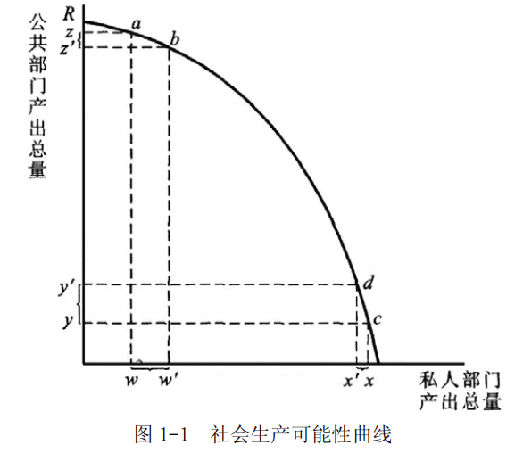
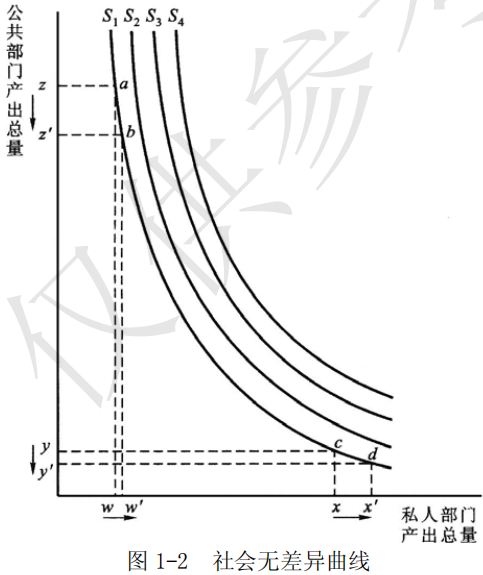
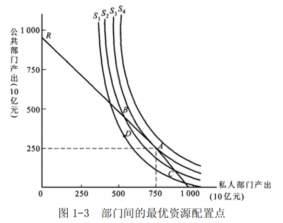

# Chapter 1 · Functions of public finance

> **The central question of this chapter**: a market economy has already arranged most things through prices — why does the government still need to collect taxes and spend money? Which things should public finance actually handle, and why are those things precisely the ones the market cannot do? And the sharpest question of all: once the government steps in, who corrects the government's failures?

## The arc of this chapter

This chapter is the general outline of the whole book, and the questions it must answer correspond, in the history of public finance, to exactly two opposite victories. The first was the victory of the concept of market failure. The tasks Adam Smith assigned to the state in 1776 were still only national defence, the administration of justice and a little public engineering (Book V of *The Wealth of Nations*), and for more than a hundred years afterwards, "small government, narrow finance" was the mainstream consensus. The turning point came between the late 19th century and the mid-20th century: Pigou's *The Economics of Welfare* (1920) wrote externalities into formal theory, proving that the price mechanism gives wrong signals in cases such as pollution and public goods; the Great Depression then made "the economy as a whole can stay out of balance for long" an undeniable fact. By the time Musgrave published *The Theory of Public Finance* in 1959, public finance was no longer just "the accountant that raises money for the state" — it was explicitly given three functions: resource allocation, income distribution and economic stabilisation. Chinese textbooks add a fourth, the "economic development function", and that addition is not decoration: for a developing country, the structure of fiscal expenditure is itself part of industrial policy and of the growth strategy, so stabilisation and development have to be stated separately. The second victory was that of public-choice theory. The previous victory had invited the government on stage, but from the 1960s the public-choice school, represented by Buchanan and Tullock, pressed the question: on what ground do we assume that a government once in office necessarily acts for the public interest? Politicians, bureaucrats, voters, interest groups — every one pursues its own interest under constraints. The source of that questioning can in fact be traced back to the tradition of Knut Wicksell's doctoral dissertation in 1896 — he insisted that "a good fiscal rule must first survive the test of unanimity", Buchanan developed it into a complete research programme, and won the Nobel Prize in Economic Sciences in 1986. So the internal order of this chapter is deliberate: first four concepts (free-riding, voting rules, rent-seeking, government failure) build up the double question "why the market cannot do without government, and why government cannot be relied on", then "public social needs" and "the functions of public finance" give the positive answer, and finally a two-sector indifference analysis turns "the boundary between government and market" into a geometric picture that can actually be drawn. The necessity of government comes from market failure, the boundary of government comes from government failure — the two sentences together are the complete starting point of modern public finance.

## Core concepts

### Free-riding behaviour

Free-riding behaviour is the consumption or use of a public good while bearing no cost at all; a person who behaves this way — that is, who has the motive to let others pay while enjoying the benefit of the public good — is called a free rider. The free-rider phenomenon arises from the non-excludability and non-rivalry of the production and consumption of public goods, and its consequence is usually under-supply of the public good.

This concept is necessary because it exposes a blind spot in the market price mechanism: prices can guide the flow of resources only on the premise that "no payment, no goods" — excludability. And public goods are precisely the things that cannot do this. National defence is the most extreme example: an army protects everyone inside the border, protecting one more person costs nothing extra (non-rivalry), and no single non-payer can be excluded from the protection (non-excludability), so every rational person waits for others to pay and enjoys the benefit for free. Samuelson's *The Pure Theory of Public Expenditure* (1954) turned this property into a formal model, with the conclusion that decentralised pricing cannot bring public goods to an efficient level of supply; Olson's *The Logic of Collective Action* (1965) supplied the behavioural link: the larger the group, the smaller each member's share of the contribution, and the more stubborn the deadlock of "nobody exerts effort, everybody benefits" — the hallway bulb in a residential block broken for years without anyone changing it, the high-seas fishery being over-harvested, public broadcasting kept alive by a handful of donors, are all everyday versions of the same mechanism. From this follows the key inference of public finance: goods of this kind can only be provided by the government out of a compulsory, universal source of funds (taxes). But note the boundary of the concept's applicability — non-excludability can change with technology: after cable television appeared, the "television signal" turned from a public good into an excludable paid product, and toll roads and addressable charging lowered the exclusion cost of roads and broadcasting; and "provided by government" does not mean "produced by government" (the government provides national defence, while firms manufacture the equipment). Treating free-riding as a universal reason for every occasion will misread both the possibilities of technology and the possibilities of institutions.

### Voting rules

Voting rules are the rules of a public-choice procedure for taking collective decisions by vote, of two kinds: the unanimity rule and the majority rule. The unanimity rule holds that a policy or proposal passes only when every voter approves it unanimously — the rule most in line with the requirements of the public interest, since a proposal that passes unanimously cannot harm anyone — but in substance it is a one-vote veto system, its decision cost is extremely high, and it is hard to implement in practice. The majority rule holds that a policy or proposal passes when it wins the approval of more than half the voters, and divides further into the simple majority rule and the qualified majority rule (such as more than 2/3 or 3/4); its decision cost is low, but it can lead to cycling votes, and it cannot reflect the intensity of individual preferences.

Why must public finance depend on voting rather than on the market price? Because a public good has no "one price per thing" decision channel: you cannot buy only the air-defence part of national defence and refuse to pay for the army. So a public decision must compress a thousand different individual preferences into a single choice, and voting is that compressor. And compression necessarily loses information, and how each of the two rules loses it is worth seeing clearly. The unanimity rule was first put forward by Wicksell in 1896 as the test of "fair taxation", and Buchanan and Tullock gave it a precise economic reading in *The Calculus of Consent* (1962): unanimity drives "external costs" (the possibility that someone else decides for you and harms you) down to zero, but the decision cost rises steeply with the number of people — the veto of the five permanent members of the UN Security Council is bought at the price that any substantial action can be paralysed. The majority rule is the everyday reality (parliamentary votes, village-committee resolutions), and its two faults can be worked out in this chapter. The first is cycling votes (the paradox Condorcet had already found in 1785): three people, three preference orders — A ranks park, seaside, mountains; B ranks seaside, mountains, park; C ranks mountains, park, seaside — in pairwise votes the park beats the seaside, the seaside beats the mountains, and the mountains again beat the park, so majority rule produces no determinate answer. Worse is agenda manipulation: since the outcome cycles with the order of voting, whoever gets to decide which pair is voted on first effectively decides the result — Arrow's impossibility theorem (1951) pushed this to the limit: any voting rule satisfying a few basic requirements of fairness must be self-contradictory for some combinations of preferences. The second is that the intensity of preferences is invisible: however violently you oppose something, you have only one vote. As a supplement, the median voter theorem (proved by Black in 1948, extended by Downs in *An Economic Theory of Democracy*, 1957) says that what finally wins under majority rule is the preference of the median voter — this explains why party programmes always drift toward the middle, and anticipates the distributional consequence in chapter 2 of "fiscal expenditure leaning toward the items the median-income voter cares about". Real institutions bargain between the two rules: constitutional amendments use a two-thirds majority, the Council of the EU uses the double qualified majority of "55% of member states plus 65% of the population" — designs that want both to avoid the paralysis of a veto and to raise the threshold so as to protect minorities.

### Rent-seeking behaviour

Rent-seeking behaviour is the practice of obtaining some monopoly right or concession through activities such as lobbying the government, in order to earn super-normal profits or rents. Certain forms of government intervention — granting licences, authorisations, approvals, concessions and the like — create the conditions for rent-seeking to arise. The more rent-seeking there is, the greater the waste of social resources.

The word "rent" is a legacy of classical economics: in Ricardo's theory of rent, rent is the return to land, a factor of fixed supply, and is of a wholly different character from the returns to labour and to capital. Rent-seeking theory generalised the word — any super-normal profit obtained not through production and exchange but through creating artificial scarcity is rent. What makes it sharp is an accounting fact: every hour an entrepreneur spends improving a product creates new value, whereas every hour spent obtaining an approval only transfers other people's value to himself, and what is transferred is often less than what was consumed — the lobbying costs, the smoothing costs and the costs of maintaining the relationship all sink, and the net social loss is positive. Tullock first computed this account in 1967 when analysing the welfare costs of monopoly and tariffs (the social cost of monopoly is far larger than the deadweight-loss triangle, because the resources spent contesting the monopoly position must be counted too), and Krueger's 1974 paper on foreign-trade regulation coined the term *rent-seeking* outright. The most typical setting in reality is licences and permits: a taxi licence turns industry entry into artificial scarcity, the licence price can be bid to a sky-high figure, and that piece of paper does the passenger no direct good; India's post-independence "License Raj" turned every step of industrial investment into an approval, and a generation of entrepreneurial talent was spent in queues and in greasing. China started reforming the administrative-approval system in 2001, rolled out the "streamline administration, delegate power, improve service" reforms from 2015, and fully implemented the negative-list system for market access in 2018 — the theoretical basis lies exactly here: for every entry restriction the government creates, it creates another pool of potential rent, and the resource consumption of rent-seeking and corruption comes with it. The distinction to be made is that not every licence is a breeding ground for rent-seeking — access requirements in safety, environmental protection and financial prudence have legitimate reasons of their own; rent-seeking critique is aimed at regulation that trades in scarcity for rent, not at regulation justified by externalities.

### Government failure

Government failure is where the government's activity or intervention measures lack efficiency, or, in other words, the government makes decisions that lower economic efficiency, or cannot implement policies that would improve it. It shows up mainly in five aspects:

- Shortage and excess. If the government fixes a price at a non-equilibrium level, the result is either a shortage or an excess — fixing the ceiling too low produces unavailability (as the shrinking housing stock under rent control shows), fixing it too high produces unsold stock.
- Insufficient information. The government does not necessarily know all the costs and benefits of its policies, nor are the consequences of the policies very clear, which makes policy evaluation difficult. Hayek pointed out in 1945 that the local knowledge scattered among countless market participants cannot in any case be fully aggregated by any central body.
- Bureaucracy. The government decision process may be highly rigid, with much duplicated work and much red tape.
- Lack of market incentives. Government intervention cancels or offsets market forces, and so may cancel certain beneficial incentives — Kornai's "soft budget constraint", put forward when he analysed the socialist shortage economy (*The Economics of Shortage*, 1980), is the extreme version: a unit whose losses are covered by the finance has no reason to economise; a government department's "if I save this year my budget gets cut next year" is the milder version of the same logic.
- Frequent change in government policy. Policy measures change too often, firms find it hard to plan production and business activities, and economic efficiency suffers.

The function of this concept is to balance the previous sentence. Market failure proved the necessity of government intervention, but "necessary" does not equal "intervention is better" — the operation that corrects market failure has a failure rate of its own. Setting market failure and government failure side by side turns the question of public finance from "do we want government" into "what should go to government, what should not, and how": intervention holds only when the expected benefit of government correction exceeds the government's own cost of failure. This framework also explains the worldwide waves of privatisation, deregulation and government reinvention since the 1980s: not a return to laissez-faire, but a cost-benefit comparison of market and of government on each specific function.

## Problems and analysis

### Where is the "public" in public social needs? — five features and their origin

Public social needs are relative to private individual needs, and point to needs such as the society's provision of safety, order, basic citizens' rights and the conditions for economic development. They include the needs of the government carrying out its functions and of certain social functions, such as national defence, culture and education, health, and the protection of the ecological environment, as well as investment in infrastructure, basic industries and pillar industries and in risk-bearing industries; in the broad sense they also include the various measures taken to regulate the operation of a market economy. They have five features:

- Non-additivity. Public social needs are the common needs of the social public in production, life and work, not the mathematical sum of individual or personal needs.
- Non-differentiation. The public goods supplied to satisfy public social needs can be enjoyed without differentiation by every member of society together, and the enjoyment of one or some members does not exclude the others.
- Asymmetric cost. Social members enjoy public goods without paying a price, or paying only a small fee that is asymmetric to the cost of provision.
- Externality. Public goods generally have external effects — the consumption act of one consumer or the production act of one producer brings benefit or loss to others, and thereby causes over-supply or under-supply of the public good.
- Social surplus product character. The material means of satisfying public social needs can come only from the surplus part of social product; if the surplus product appears in value form, then it can only be a draw from the "M" part.

Each of the five features rules out a misunderstanding of its own. "Non-additivity" rules out the calculation that understands public needs as a simple addition of individual needs — the national defence the whole nation needs is not the sum of a gun for each person, it is a need that arises only for "society as a whole", which is what determines that it can only be expressed through political procedure and not through market aggregation (this is exactly why the section on voting rules exists). "Non-differentiation" and "asymmetric cost" say the same thing about the character of the product: the apple in your house is gone when you eat it, but the street lamp lights you and your neighbour alike; the billionaire and the low-income earner enjoy the same line of national defence, and the cost they pay for it (taxes) is not proportional to the benefit they enjoy — the market's "a penny for a penny" correspondence breaks down here as a whole. "Externality" links those points to economic analysis: the benefit of a public good spills over to non-payers, the supplier cannot recover the cost, and so supply is insufficient; conversely, goods with negative externalities are over-supplied. "Social surplus product character" is a hard constraint coming from Marx's reproduction formulas — total social product must first replace the consumption of means of production (C) and the reproduction of labour power (V), and only what is left, M, can be taken to support the army, schools and the government itself; it reminds us of a plain truth: the upper limit of fiscal revenue is not set by the government's subjective wishes but by the surplus of productivity, and this is the floor that recurs again and again in the later discussion of tax principles and of the scale of public finance.

### What should public finance actually do? — the four functions and the reasons behind them

The functions of public finance are the functions inherent in finance as an economic category. Under the conditions of a socialist market economy, the functions of public finance can be summarised in four aspects:

- The resource-allocation function. The government mainly mobilises social resources through taxation and supplies public goods through fiscal expenditure, achieving a reasonable flow and allocation of economic resources.
- The income-distribution function. By taxing or not taxing, or taxing more or less, the different income groups, and by making expenditure items that increase the income of the lower-income groups, the government corrects the state of income distribution produced by market activity.
- The economic-stabilisation function. The government runs a deficit budget in periods of unemployment and depression and a surplus budget in periods of full employment and heavy inflationary pressure, smoothing economic fluctuations.
- The economic-development function. Mainly through preferential tax policies and by adjusting the expenditure structure, with economic growth as the core and structural adjustment as the focus, the government promotes the sustained development of the social economy.

These four are not a haphazard list; they correspond one-to-one with four kinds of market failure: misallocation corresponds to public goods and externalities (which is why the object of the allocation function is "things the market does not supply"); distributional deterioration corresponds to the result of the market allocating by factor endowment without regard to fairness; economic fluctuation corresponds to an imbalance of the aggregate — the price mechanism can adjust relative prices but cannot guarantee that aggregate demand is exactly equal to aggregate supply (Keynes's diagnosis in 1936); the development gap corresponds to the structural problems peculiar to developing countries — investment in basic industries has long cycles and large externalities, and spontaneous market allocation systematically under-estimates it. This fourfold division has a clear genealogy: Musgrave proposed the first three in 1959, and the fourth was added by the Chinese public-finance community for the reality of developing countries — the reason being that for a developed country "development" is largely contained in stabilisation policy, while for an economy such as China's, the structure of fiscal expenditure (the shares of education, research and infrastructure) is itself the main character of the growth narrative. In reading the division of functions, note also its negative implication: everything outside the four functions should in principle be left to the market. "What public finance does not do" is also part of function theory, and it is the half most easily forgotten.

### Why do government agencies run inefficiently? — the double absence of competition and of incentives

Public-choice theory holds that the main reasons for the inefficiency of government agencies are the absence of competition and the absence of incentives to reduce costs.

- Inefficiency from the absence of competition. First, there is little competition among government staff: most officials and ordinary staff are appointed or recruited level by level, and "avoiding errors and mistakes" becomes the code of conduct, so nobody bears the efficiency pressure that employees in a competitive firm bear. Second, there is little competition among government departments: the services each department provides are specific, so the efficiency of behaviour inside a department cannot be directly evaluated, and it is also hard to design a mechanism that puts departments in competition with one another — you cannot "decide not to use the civil-affairs bureau and go to another one instead".
- Inefficiency from the absence of incentives to reduce costs. Objectively, most government activities are not costed at all, and even when they are the costing is hard to make accurate; combined with the inward expansion impulse of government institutions, public goods are often over-provided and resources are wasted. Subjectively, each department generally holds a monopoly over the services it provides, has no incentive to raise quality, and may even use its monopoly position to conceal the real cost information, so that external supervision is hard to carry out.

The weight of this analysis lies in its resonance with Niskanen's 1971 model of bureaucratic budget maximisation: the bureaucrat's utility (pay, prestige, scope of jurisdiction) grows with the budget, while the information needed to approve the budget is precisely what the bureaucrat holds — so the scale of government has a tendency to self-inflate, and the cycle of "spending to prove one exists" is hard to break from inside. Compare the private-sector employee's "do badly and you are dismissed" with the government department's "permanent establishment stability", the firm's "save on costs and you get a share" with the department's "surplus this year means a cut next year", and the absence of the two mechanisms (competition, incentive) is no longer an abstract assertion. But a fair word is owed: this diagnosis describes a government under no accountability mechanism, not every government. Performance budgeting, information disclosure, outsourcing of public services, independent evaluation bodies — all of these are institutional experiments around rebuilding competition and incentive; their results are uneven, which is exactly why the problem cannot be closed off with the single sentence "government is inherently inefficient", but is the governance problem of "how to give cost awareness to organisations that are not tested by the market".

## Synthetic essay

### How much of the whole society's resources go to government and how much to the market? — indifference analysis of optimal allocation between sectors

The whole society can be divided into the government sector (public sector) and the market sector (private sector). Given and scarce social and economic resources, how many resources each of the two sectors allocates bears not only on the limits of government economic activity but on the efficiency of resource allocation for the whole society. Given the pattern of preferences of social members and effective demand, there may be some optimal combination of resource allocation between the two sectors. The analysis by the indifference method follows.

**(1) The social production possibility curve**

In figure 1-1, R is the production possibility curve of the whole society, and it links the marginal rate of transformation between the production of private goods and of public goods to the scarce productive resources available to that society: it shows the various combinations of private and public goods that can be produced when the society's land, labour and capital, limited in quantity and quality, are fully employed at a given point in time. The higher the position of the curve, the greater the society's productive potential.

**(2) The social indifference curves**

In figure 1-2, each social indifference curve S1, S2, S3, S4 represents a certain level of satisfaction and shows the society's marginal rate of substitution between the consumption of private goods and of public goods; the higher the curve, the higher the level of social welfare it represents.

**(3) The optimal point of inter-sectoral resource allocation**

Placing R and S in the same coordinate system (figure 1-3), R and S3 are tangent at point A, which is the optimal allocation of resources between sectors: the market sector outputs 750 billion yuan, the government sector 250 billion yuan (this is a textbook example). At point A, the marginal rate of transformation between private-goods production and public-goods production equals the marginal rate of substitution of social consumption, and society obtains maximum welfare.

**(4) The actual allocation can deviate from the optimum.** Point B over-allocates resources to the public sector, point C over-allocates them to the private sector, but B and C are both on R, representing fully employed resources; point D lies inside R, indicating under-utilised resources.

**(5) The allocation changes over time.** First, the optimum stays unchanged while the actual allocation moves (for instance sliding from the optimum to a non-optimum, or the reverse); second, R and S themselves move (changes in the quantity and quality of resources move R, changes in preferences or in income distribution move S), forming new optimum points.

The value of this picture is not in its answer (750 and 250 are merely teaching numbers) but in the fact that it translates a question of political philosophy into a problem in geometry. "The boundary between government and market" is no longer a contest of slogans but the tangency condition "marginal rate of transformation equals marginal rate of substitution" — the point where the marginal evaluation of social utility is exactly equal between one more unit of tax turned over to the government to produce public goods and that same unit of resources left in the market to produce private goods is the boundary. It also gives coordinates for three diseases: disease of type B (government too large, as when a planned economy puts almost all resources in the public sector), disease of type C (the public-goods backlog, as when infrastructure and public services lag for a long time), disease of type D (idle resources, as with severe unemployment). Any debate about the scale of public finance in any economy is essentially asking: which point are we at right now, and which way should we move.

### Why does government fail? — the full public-choice diagnosis

Government failure is where the government's activity or intervention measures lack efficiency, or where the government makes decisions that lower economic efficiency, or cannot implement policies that would improve it. Public-choice theory attributes the causes to three kinds: the inefficiency of government decision-making, the inefficiency of government agency operation, and the inefficiency of government intervention.

**(1) The inefficiency of government decision-making.** Public-choice theory analyses political decision-making with economic models, and points out that democratic procedure does not necessarily produce optimal government efficiency.

- Defects of voting rules. The majority rule is not necessarily an effective method of collective decision-making: first, when there are more than two proposals cycling votes appear and the vote has no final outcome; second, the rules laid down to eliminate cycling make "the power to fix the voting procedure precisely the power to decide the voting result" — the agenda manipulator decides the outcome; third, the majority rule cannot reflect the intensity of preferences, however strong the preference, one person casts only one vote.
- The motives of the actors in the political market. The government is made up of politicians and officials, and the basic behavioural motive of a politician is also the maximisation of personal interest (re-election, power, prestige). Pursuing personal goals does not necessarily serve the public interest, and the interests of the mass of voters may be damaged thereby.
- The existence of interest groups. An interest group (pressure group) is an organised body with common goals that attempts to influence public policy. Government policy is often made under the interaction of several powerful interest groups; they sway proposals and votes through campaign contributions, outside lobbying and the like, causing the government to make decisions unfavourable to the public.

**(2) The inefficiency of government agency operation.** It shows up in the absence of competition and in the absence of incentives to reduce costs, the mechanisms being those analysed in the previous section: there is little competition both among staff and among departments, and objectively costs are not counted, while subjectively the monopoly over services removes the motivation for both quality improvement and cost saving.

**(3) The inefficiency of government intervention.** To ensure social and economic order the government must make and enforce laws and regulations, but certain forms of intervention — granting licences, quotas, permits, authorisations, approvals, concessions — simultaneously create the conditions for rent-seeking: the institution artificially creates scarcity, scarcity creates potential rent, rent draws in rent-seeking, and rent-seeking consumes social resources that could have been used productively. The more the government regulates, the more artificial scarcity there is, and the larger the surface of opportunity for rent-seeking.

Read the three causes together, and the contribution of public-choice theory is an assumption of "the continuity of human nature": politicians, bureaucrats, voters and the people inside firms are the same kind of person, all seeking benefit and avoiding harm under constraints; the difference is not in the morality of the motives but in the structure of the constraints — in the market, the pursuit of private gain is disciplined by competition and by prices, whereas in the political process the same private gain faces relaxed constraints. "Government failure" is therefore not a moral accusation against the government but an engineering question about the design of constraints: what rules (hard budget constraints, terms and accountability, transparency of decision procedures, cost-benefit review of access and of regulation) can put the people in the political process under a discipline like that of the market? This is also the second theoretical support it provides, after the theory of market failure, for a "limited but effective government".

## Limitations and further work

This chapter's framework — market failure proves the necessity of government, government failure limits the boundary of government — is the most durable pair of concepts in twentieth-century public finance, but it has itself gone through three important rounds of correction and critique.

The first round is against the normative character of "market failure". Samuelson's 1954 model proved that the decentralised supply of public goods is inefficient, but it assumed the existence of a referee who knows everyone's preferences; a market failure measured against that standard does not guarantee that the real government can do better — this is the critique of the "nirvana fallacy" (Demsetz and others extended it from their critique of the standard competitive model): comparing an ideal state with a real institution always produces the conclusion "intervene", whereas intervention is itself a real institution. The calibration is to compare real feasible institutions with real feasible alternative institutions, and this principle later became the starting point of comparative institutional analysis (comparative institutional economics).

The second round is against the one-sidedness of the public-choice school itself. Modelling every politician and bureaucrat as a self-interested maximiser is likewise a one-sided generalisation: the fiscal quality of the Nordic countries, the industrial-policy performance of the East Asian development states (Japan's MITI, Korea's planning agencies) cannot be forced into a model in which bureaucrats are necessarily inefficient. The direction of correction is to endogenise "government quality" — differences in institutions and in constraints make the same motives produce different results; Acemoglu and Robinson's *Why Nations Fail* (2012) turned the contrast between "inclusive and extractive institutions" into an explanatory framework, which is essentially a historical extension of Buchanan's question (rules come before choice within rules).

The third round comes from the reforming of evidence methods and of behavioural science. Traditional function theory says "government should provide public goods", but rarely answers "how much to spend, which projects are really effective". From the 1990s, development economics brought randomised controlled trials into the evaluation of public projects (Banerjee, Duflo, Kremer, the 2019 Nobel Prize), allowing the "marginal utility of fiscal expenditure" to be measured project by project for the first time; behavioural economics points out that real voters are neither wholly rational nor wholly selfish, and "nudging" (Thaler and Sunstein, 2008) shows that public policy can be improved at low cost — behavioural public economics has thereby become the fastest-growing branch. For China the real-world version of this line is the reform of budget performance management (the 2018 *Opinions on Comprehensively Implementing Budget Performance Management*) and the reform of the division of fiscal responsibilities and expenditure duties; the expenditure, taxation, debt and budget dealt with in the later chapters of this book are all the specific mechanisms developed under this overall framework.

## References

- Chen Gong, *Public Finance* (10th edition) — the source of the structure across fiscal functions, expenditure, taxation, debt, budget and deficit.
- The full list is on the [bibliography](/reference/参考书目).
- [Wikipedia · Public finance](https://en.wikipedia.org/wiki/Public_finance)
- [Wikipedia · Government budget](https://en.wikipedia.org/wiki/Government_budget)

<!-- BACKLINKS-AUTO -->
## Related pages

- [History](/finance/History)
- [Readme](/finance/Readme)
