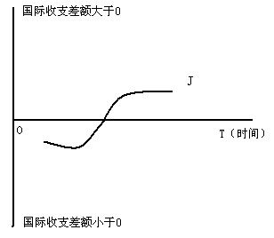

# Chapter 5 Balance of payments analysis

> **Core question of this chapter**: how does the ledger of a country's external economic dealings get kept? What do a "surplus" and a "deficit" on paper actually mean? When the accounts go wrong, which road works — devaluation, austerity, or controls — and what does each cost?

## Thread of the chapter

The history of balance of payments adjustment theory is a relay race in which each generation of theory rules for a generation. The price-specie flow mechanism (Hume, 1752) was the gold standard's answer: a trade surplus brings in gold and silver, prices rise, competitiveness falls, and the imbalance swings back by itself — adjustment runs entirely through price, and the government need do nothing. After the gold standard collapsed and the automatic mechanism with it, the elasticity approach was born in the 1930s: Robinson in 1937 carried Marshall's elasticity tools into the foreign exchange market and systematised the Marshall–Lerner condition that "the sum of the elasticities of demand for imports and exports must exceed 1 before devaluation improves the balance," putting the burden of adjustment on the exchange rate. After the Second World War, when Keynesian macroeconomics ruled, Alexander's absorption approach of 1952 rewrote the balance of payments as a part of the national income identity — a deficit is domestic absorption exceeding output — and the instruments of adjustment broadened from "adjusting prices" to "adjusting income and absorption" (demand management). In the 1960s, with the monetarist revival, the monetary approach of Mundell and Johnson claimed that a surplus or deficit is essentially an imbalance between domestic money supply and money demand, that a deficit is "the overflow of excess money," and that controlling domestic credit goes to the root. The three generations do not replace one another but add layer upon layer: the elasticity approach looks at local prices, the absorption approach at aggregate demand, the monetary approach at the stock of money, and this chapter unfolds along that logic. Running in parallel is the institutionalisation of statistical standards: the IMF has issued its *Balance of Payments Manual* (BPM) since 1948, and the fifth edition of 1993 and the sixth edition of 2009 (BPM6) fixed the standard format of every country's balance of payments statement today — when reading the concepts in the concepts section, remember that all of them are embedded in the frame of that manual.

## Core concepts

### The balance of payments

The concept of the balance of payments comes in a narrow and a broad sense. The narrow balance of payments means the transfer of assets arising over a given period (usually one year) in a country's dealings with other countries in trade, services, capital and the like, characterised by counting only transactions with present or future foreign exchange receipts and payments. The broad balance of payments means, in a given period, all economic transactions between an economy and the rest of the world: transactions in goods, services and income; transactions in financial assets and liabilities; and gratuitous transfers (real and financial assets one party provides to another without payment). The economies of today essentially all use the broad concept.

The evolution from narrow to broad is itself the key to the concept: the narrow definition held sway in years when exchange controls were universal and international transactions almost always came with foreign exchange settlement, so "does foreign exchange move in or out" was the boundary of the ledger; after the war, transactions that did not settle immediately in foreign exchange — capital flows, barter trade, gratuitous aid — grew daily in scale, and had the boundary stayed at "foreign exchange receipts and payments" the ledger would have been gravely distorted, so the IMF's manual moved the boundary to "economic transactions" as such (all transactions between residents and non-residents), whether or not they involve foreign exchange. Two easily confused points. First, the balance of payments is a "flow" and not a "stock" — it records transactions over a period, set against "international indebtedness" (the stock of external claims and obligations at one point in time), just as an income statement is set against a balance sheet. Second, "residents" are classified by place of residence and not by nationality — the trade of a foreign-owned subsidiary in China is part of China's balance of payments, while the trade of an overseas subsidiary of a Chinese company is not.

### Credit and debit items

Credit items are the items in the balance of payments statement that record a decrease in a country's assets or an increase in its liabilities, meaning the export of domestic goods and services or an inflow of foreign financial assets. Debit items record an increase in assets or a decrease in liabilities, meaning the import of domestic goods and services or an outflow of financial assets to foreign hands.

Double-entry bookkeeping is the basic skill for reading the statement: every transaction is entered on both sides — export a consignment of goods and the goods account is credited (goods leave the country), while according to how the counterparty pays, an increase in foreign exchange assets (debit) or an increase in the counterparty's liabilities (credit) is entered. So the whole statement always balances in the accounting sense (the international version of "every debit must have a credit, and the amounts must be equal"), and a so-called "surplus" or "deficit" is never an imbalance of the whole statement but an imbalance between the deliberately drawn "above-the-line items" (such as the current account) and the "below-the-line items" (the financing instruments) — where the line is drawn is a choice of analytical stance (look at trade competitiveness with the current account, look at fund flows with the overall balance). A quick rule for direction: anything that brings in foreign exchange goes on the credit side (exports, a foreigner buying domestic shares), anything that sends out foreign exchange goes on the debit side (imports, buying foreign bonds).

### Official reserves

Official reserves are the foreign exchange reserve assets and the external claims held by a country's central bank or other official monetary authorities, including monetary gold, foreign exchange, special drawing rights (SDR) at the IMF and ordinary drawing rights (reserve positions).

The role of official reserves in the statement is that of the "settlement item": when the net transactions of the private sector do not balance, the gap is finally absorbed by an increase or a decrease in official reserves — a surplus accumulates reserves, a deficit consumes them. The comparability of the four classes of assets differs: foreign exchange reserves are the great bulk but carry exchange rate and credit risk (a depreciation of the reserve currency is a mark-to-market loss); gold is revalued at market prices and swings sharply; the SDR is a unit of account created by the IMF (valued since 2016 in a basket of five currencies — dollar, euro, renminbi, yen and sterling, with the renminbi joining in 2016) which cannot be used directly in private transactions but only through exchanges arranged with the IMF; reserve positions are members' drawing right of a "demand deposit" character at the IMF. The question of the appropriate size of reserves (how much is enough) is taken up in the problems and analysis section.

## Problems and analysis

### The J-curve effect: why does devaluation first worsen and then improve the balance?

The J-curve effect is the phenomenon whereby after a devaluation the trade balance first worsens and only after a period of time improves — the dynamic path of the balance of payments after devaluation, first down then up, tracing the shape of the letter J.

As Figure 5-1 shows, because of time lags exports and imports respond slowly to the change in relative prices brought by devaluation: in the short run after devaluation, export revenue in foreign currency terms actually falls (the volume has not yet risen while the price cut has already happened) and import spending in domestic currency terms rises at once (the volume has not yet been squeezed while the price has already risen), so the trade balance worsens first. After a period of time, when the adjustment of trade volumes to the change in price is complete — exports rising, imports suppressed, the increase in export revenue exceeding the fall in foreign exchange earnings caused by the devaluation — the trade balance gradually improves. The micro-structure of the lag can be split into four parts: recognition lag (it takes time for buyers and sellers to notice the price change), decision lag (re-signing contracts, changing suppliers), delivery lag (the order-to-delivery cycle) and substitution lag (production adjustment and the switching of consumption habits), with an empirical length of about six months to a year (Magee's systematic study of 1973). After sterling was devalued 14% in 1967 the trade balance worsened for about a year before improving — the classic empirical case of the J curve; after the Plaza Accord of 1985 the yen appreciated sharply and Japan's surplus rose rather than fell (time lags plus a "reverse J-curve" effect), an isomorphic case on the appreciation side.

There are three countermeasures. First, the devaluing country needs ample foreign exchange reserves to get through the lag period, so as not to be forced into a second devaluation or external rescue at the trough of the worsening balance. Second, strengthen the transmission of information by disclosing exchange rate and market information to import and export firms promptly, compressing the length of the recognition and decision lags. Third, use tax concessions and other incentives for export firms to shorten the substitution lag and speed up the adjustment of supply.

### The mechanism and conditions by which devaluation affects exports and imports

**(1) The mechanism that promotes exports**: when there is a trade deficit, a formal devaluation of the currency makes the foreign-currency price of the country's export goods fall, helping exports expand:

$$\text{Trade deficit} \rightarrow \text{devaluation of the currency} \rightarrow \text{export prices fall} \rightarrow \text{export volume rises} \rightarrow \text{balance of payments improves}$$

**(2) The mechanism that restrains imports**: devaluation makes the domestic-currency price of imported goods rise, and the high price restrains consumption, helping compress imports:

$$\text{Trade deficit} \rightarrow \text{devaluation of the currency} \rightarrow \text{import prices rise} \rightarrow \text{import volume falls} \rightarrow \text{balance of payments improves}$$

One rises and the other falls, working in both directions: exports expand, imports are squeezed, and the balance of payments improves.

**(3) The conditions for the mechanisms to work**: the counterpart must not retaliate (competitive devaluations cancel each other out — the currency wars of the 1930s are the cautionary tale); devaluation outward must run faster than devaluation inward (if domestic inflation swallows the cost advantage, the devaluation comes to nothing); and the Marshall–Lerner condition must hold — the absolute value of the sum of the export and import demand price elasticities must exceed 1, that is, exports and imports must respond to price changes sensitively enough (with insufficient elasticity, devaluation worsens the balance, because the adjustment in quantity cannot keep up with the loss in price). In addition, devaluation carries the J-curve effect; and in most cases devaluation worsens a country's terms of trade (the same quantity of exports brings back fewer imports) — only when demand elasticity exceeds supply elasticity do the terms of trade improve. "Adjusting the balance by devaluation" has never been free.

### Derivation and policy implications of the absorption approach

**Notation**: $Y$ national income, $C$ consumption, $I$ investment, $G$ government spending, $X$ exports, $M$ imports, $BOP$ balance of payments balance, $A$ absorption (aggregate domestic demand).

**Derivation**: start from the national income identity of an open economy:

$$Y = C + I + G + (X - M)$$

Rearranging gives $X - M = Y - (C + I + G)$. Setting $BOP = X - M$ (ignoring capital flows and transfers) and $A = C + I + G$ gives the core formula of the absorption approach:

$$BOP = Y - A$$

**Meaning**: the balance of payments equals national income minus domestic absorption. If $Y > A$ (output exceeds domestic demand) there is a surplus — the excess output can only be exported; if $Y < A$ there is a deficit — the excess demand can only be met by imports. An imbalance in the balance of payments is restated as an imbalance of aggregates: a deficit is not a "trade problem" but a macro problem of "spending more than is produced."

**Policy implications**: two paths of adjustment correspond to two situations. Adjust income $Y$: reallocate idle resources to the export sector and raise productivity — suitable for an economy with idle resources, though structural adjustment has a long lag. Adjust absorption $A$: fiscal and monetary tightening (compressing consumption, investment and government spending when in deficit) or expansion (when in surplus) — it works fast, but squeezing absorption usually squeezes output with it (unemployment, slower growth), and it does not touch the contradiction between "importing capital equipment to raise productivity" and "a worsening balance in the short run." When Alexander proposed the frame in 1952 he also gave an absorption interpretation of devaluation: the channel through which devaluation improves the balance is not only relative prices (the emphasis of the elasticity approach) but also the redistribution of income and absorption that devaluation brings — a direct superseding of the elasticity approach. The absorption approach binds closely to macroeconomic policy, but it leans on the goods market, ignores monetary factors, and takes no account of capital flows, fitting the analysis of demand-management adjustment in economies without capital flows.

### The basic contents of the current account

By the IMF's classification the current account has four parts: goods, services, income and current transfers. Goods: general goods, goods for processing, goods repairs, goods procured in ports by carriers, non-monetary gold (gold held as a store of value). Services: transport (sea, air and other), travel (business and personal), communications, construction, insurance, financial services, computer and information services, royalties and licence fees (copyright and the like), other business services (merchanting and trade-related services, operating leasing, other professional and technical services), personal, cultural and recreational services and government services not included elsewhere. Income: two sub-items, labour income (compensation of employees) and investment income (earnings from direct investment, portfolio investment and other investment). Current transfers: transfers of government at all levels and transfers of other sectors (such as workers' remittances). A note on classification: the fifth edition of the *Balance of Payments Manual* (1993) used the word "income"; the sixth edition of 2009 renamed it "primary income" and renamed current transfers "secondary income," and economies now compile statements under BPM6 — when reading old and new statements, reconcile the classification first.

## Extended discussion

### The economic meaning reflected in the state of the balance of payments

**(1) It reflects a country's economic strength and place in the world economy.** Measured by the scale of transactions, an economy of great size and large external dealings naturally ranks higher in the international economy; an economy with limited flows has little room for adjustment and falls into trouble easily. Measured by surpluses and deficits, a large sustained surplus is usually read as a sign of strong competitiveness, and a sustained deficit as a sign that something is wrong — but the reading has to look at the composition of the surplus or deficit: a surplus earned by competitive exports and a surplus formed by massive borrowing (inflows of borrowed funds) differ utterly in sustainability, the latter implying a future burden of interest and principal and the hidden risk of exchange swings.

**(2) It determines the movement of a country's currency and exchange rate.** With a deficit the demand for foreign exchange exceeds supply and the domestic currency is in excess supply, so the currency's rate tends to fall; a surplus works the other way. In analysing this, pay special attention to the "structure of causes" of the surplus or deficit: an exchange rate grounded in competitiveness and a current surplus has fundamental support, while a "strong currency" grounded in short-term capital inflows can reverse at any time — the exchange rates of Southeast Asian countries around 1997 were exactly the latter case.

**(3) It determines a country's capacity to finance and its credit standing.** Borrowing capacity in the international capital market is proportional to repayment capacity, and repayment capacity depends on the current account, the capital and financial account and the state of official reserves: a country with large surpluses on both accounts borrows easily, through many channels and on high credit; otherwise borrowing is difficult, and in the extreme the country falls into a complete cut-off of financing — the market exclusion in a sovereign debt crisis is exactly that state.

**(4) It reflects the state and change of economic structure.** What a country trades with the world (tangible output or intangible) shows its economic structure; the sustained rise in the share of intangible output (services and investment income) in transactions reflects the trend of the international economy toward services and finance.

**(5) It affects domestic growth and development.** Exporting output drains domestic resources and lowers market supply, while the foreign exchange brought back expands the domestic money supply and may add to price pressure while stimulating expansion; massive imports have the opposite effect. From this comes the saying "exports export unemployment, imports import unemployment," though the actual effect depends on the marginal propensity to import: the larger the propensity, the smaller the foreign trade multiplier effect of exports. In addition, the massive inflow and outflow of short- and long-term capital is a part of the contemporary balance of payments that must not be ignored — the benefits and risks of capital flows to an economy (liquidity convenience and sudden stops) coexist, so the understanding of foreign capital must be more all-round.

### Adjustment of imbalances in the balance of payments

An imbalance in the balance of payments is a state in which the balance of the current account cannot be offset by the balance of the capital and financial account and reserve assets of foreign exchange must be drawn on for adjustment — the external economy has run into a problem that must be regulated. The theories of adjustment number three generations, each with its own boundary of applicability.

**(1) The elasticity approach.** Within a partial equilibrium frame it uses changes in the exchange rate to adjust the relative prices of exports and imports: in deficit, devalue the currency so that the foreign currency price of exports falls and exports rise, while the domestic currency price of imports rises and imports are squeezed. Conditions for it to work: no retaliation; devaluation outward faster than domestic inflation; and the Marshall–Lerner condition (the absolute value of the sum of import and export demand elasticities exceeding 1). The approach carries the J-curve effect; in most cases devaluation worsens the terms of trade, which improves only if demand elasticity exceeds supply elasticity. The method itself couples poorly with national income — it is partial equilibrium analysis, blind to the feedback of devaluation through the income channel.

**(2) The absorption approach.** Analysis inside the Keynesian macro frame (derivation in problems and analysis), with the core formula $BOP = Y - A$: adjust income (reallocate resources, raise aggregate productive capacity, with idle resources required) or adjust absorption (compress consumption, investment and government spending when in deficit). It couples well with macroeconomic policy, but compressing absorption carries a cost in output and employment, the contradiction between importing capital equipment to raise productivity and the short-run balance, and problems of time lag; in both theory and policy it ignores the role of money in adjustment.

**(3) The monetary approach.** The core idea: the balance of payments is essentially a monetary phenomenon. Domestic money supply is composed of domestic credit and international reserves ($MS = DC + R$), and the change in reserves (that is, the change in the balance of payments) equals money demand in excess of domestic credit creation — if credit issue exceeds money demand, reserves flow out and the balance worsens; controlling credit issue and selling reserve assets are the two great levers of adjustment. The monetary approach puts on the table the deepest problem of the three generations: a deficit is not a disease of the trade sector but a disease of the money sector — squeezing credit goes to the root, but the side effects are slower growth and pressure on employment (the cost of austerity). In the 1970s it became for a time the standard prescription of IMF programme lending ("austerity for rescue"), and its cost in growth is precisely the origin of the "austerity and growth — can they both be had" quarrel in every crisis since.

Besides the theoretical methods, two classes of direct instruments operate in practice. Foreign exchange control: the government regulates international settlement and the buying and selling of foreign exchange by decree (export earnings must be sold to designated banks at the official rate, import payments require approval, movements of the currency across the border and personal use of foreign exchange are restricted), with the aim of concentrating the use of foreign exchange, controlling imports, and maintaining balance and exchange rate stability — it works directly, but at the cost of distorting resource allocation and breeding black markets, and countries that run it long tend to reduce it. Other policy measures: voluntary export restraints, import deposits, import licensing and approval, sanitary and quarantine systems, import monopoly, discriminatory procurement and taxation (encouraging exports and restricting imports from the trade angle); preferential policies to attract inflows of foreign capital (balancing the accounts from the capital and financial side); and irregular instruments such as ultra-protectionism. The fuller the toolbox, the more care is owed to the accounting of the costs of combining instruments — every instrument trades some domestic distortion for external balance.

## Limits and what follows

The three generations of adjustment theory in this chapter now face, together, a world where "capital flows come first." First, **the financial account has become the main body of movements in the balance**: the turnover of a few days on the global foreign exchange market exceeds a full year of world trade (per the BIS triennial survey), and the daily movement of exchange rates is decided by asset transactions rather than trade flows — the imbalances of the two great crises since the 1990s (Asian 1997, global 2008) were both capital-account events, and the "trade perspective" of the elasticity and absorption approaches can explain only their slow variables. Second, **the dispute over global imbalances and the "savings glut"**: at its peak around 2000 the US current account deficit was about 6% of GDP, and in 2005 Bernanke attributed it to a "global savings glut" in emerging markets — which side should adjust, the surplus countries or the deficit countries, rose from a technical question to a political question of international macroeconomic coordination; for China, on the surplus side, the exchange reform of 2005, the rebalancing after 2008 and the end of the "double surplus" (the current account surplus falling from about 10% of GDP in 2007 to around 2%, per the State Administration of Foreign Exchange) were a real-world rerun of the absorption logic: adjusting absorption (expanding domestic demand) while adjusting the exchange rate. Third, **the revival form of the monetary approach under free capital flows** is the first-generation model of currency crises (Krugman 1979: the combination of sustained credit over-issue and a fixed exchange rate must end with reserves exhausted) — together with the impossible trinity of Chapter 8 it forms the theoretical bed for understanding contemporary currency crises (Mexico 1994, Thailand 1997, Turkey 2018). The habit of reading the statements must also be updated: BPM6 treats "errors and omissions" and their share of the accounts as a barometer of capital flight, and the data themselves have become an object of regulation — balance of payments analysis is turning from "trade economics" into "balance sheet economics."

## Reference material

- Krugman and Obstfeld, *International Economics* — the mainstream framework for trade theory and open macroeconomics.
- Gao Hongye, *Western Economics* (macro volume) — the domestic textbook wording of the balance of payments and exchange rate chapters.
- The full bibliography is on the [bibliography](/reference/参考书目).
- [Wikipedia · Balance of payments](https://en.wikipedia.org/wiki/Balance_of_payments)

<!-- BACKLINKS-AUTO -->
## Related pages

- [History](/international/History)
- [Readme](/international/Readme)
