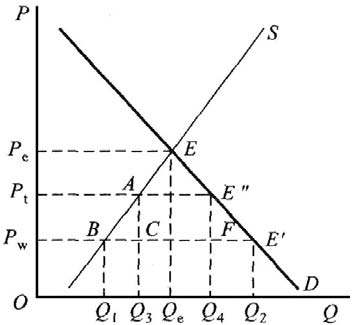
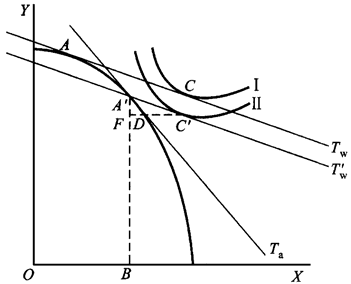
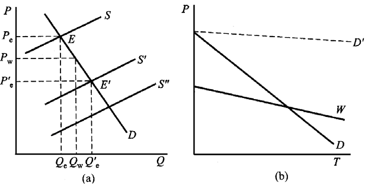
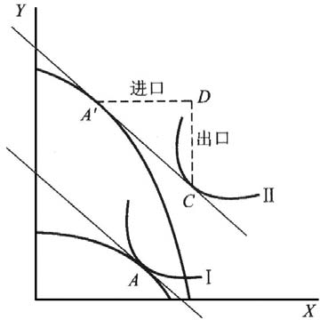

# Chapter 4 International trade policy analysis

> **Core question of this chapter**: if free trade is mutually beneficial, why do virtually all countries practise some degree of protection? Who exactly loses from a tariff, and who gains? Can the case for protecting "infant industries" stand up to scrutiny?

## Thread of the chapter

The coexistence of free trade theory and protectionist practice began from the first day of the theory's birth. Smith and Ricardo were making the case for free trade while protectionism was looking for its own theory: Alexander Hamilton, the first US secretary of the treasury, argued in his *Report on Manufactures* (1791) for tariff protection of the newborn American manufacturing sector — the earliest systematic statement of the infant industry argument (half a century before List, and aimed at the then "relatively backward" United States); List of the German historical school, in *The National System of Political Economy* (1841), developed the argument into a system, setting "national political economy" against Smith's "worldist political economy" and advocating graduated protection according to the stage of development, with a direct audience of pre-industrial Germany. The economic formalization of the protection argument was completed by Mill: in 1848 he gave the test conditions for an infant industry (present disadvantage, future advantage); Bastable added a cost-benefit test in 1891 (the present value of future profits must be able to compensate the current cost of protection); and Kemp in 1964 further distinguished internal and external economies (an industry with external economies is worth protecting even if it does not pay for itself, because it teaches the whole society). The modern form is the "learning by doing" externality (Arrow 1962): the learning effect arises only in the doing, so without initial protection the activity can never get started — the justification of protection moved from "national sentiment" to "market failure". The technical core of this chapter is the partial- and general-equilibrium welfare analysis of a small country's tariff: it uses the simplest possible geometry to prove the price of protection, and it provides a template for assessing the welfare consequences of any trade policy.

## Core concepts

### Tariff and non-tariff barriers

A tariff barrier is a trade measure that imposes duties on imported goods (especially high duties) in order to protect the domestic market and support the development of domestic industries. By levying high import duties it raises the cost of imported goods and weakens their competitiveness, and so serves to protect domestic production and the domestic market.

A non-tariff barrier is the counterpart of a "tariff barrier" and means every import-restricting measure other than tariffs; it is divided into two broad classes, direct and indirect. Direct non-tariff barriers are those where the importing country directly specifies the quantity or value of imported goods, such as import quotas, import licensing and "voluntary" export restraints. Indirect non-tariff barriers do not specify quantities or values directly, but affect imports indirectly through various strict regulations, such as import deposit systems, minimum price systems, customs valuation systems, and complicated and harsh technical standards, sanitary and safety inspection, and packaging and labelling requirements.

The economic difference between the two classes of barrier is more than formal. A tariff is a "price-type" instrument: it works through the price mechanism, the government obtains tariff revenue, the cost of protection is made explicit in price form, and under the WTO it is constrained and must be written into the tariff concession schedule — transparent and negotiable. Most non-tariff barriers are "quantity-type" or "concealed" instruments: a quota hands the rent to whoever gets the licence (an importer, or a foreign exporter — the rent from a "voluntary" export restraint flows straight abroad, as when the US voluntary export restraint on Japanese cars in 1981 made Japanese firms move upmarket and raise unit profit); technical standards and inspection hide themselves behind the names of "safety" and "sanitation", and are hard both to measure and to sue over — precisely because tariffs have been cut down round after round under the GATT/WTO framework, non-tariff barriers have become the main battlefield of contemporary protectionism (by the number of notified technical trade barriers they already make up the large majority of notified trade measures, per WTO annual statistics).

### Dumping

Dumping is the practice of an exporter selling goods on the international market at a price below that of the domestic market, or even below cost. Dumping is in substance a form of price discrimination: a firm charges different prices to consumers in different markets in order to maximize revenue, and as long as a good has different demand elasticities in the domestic and international markets the firm has an incentive to dump.

Two basic conditions are needed for dumping to occur: the market must be imperfectly competitive, with the firm as price maker rather than price taker; and the markets must be mutually separated, so that residents of one country cannot buy back the exported goods at low cost and pocket the difference (otherwise the two market prices would converge automatically and the discrimination could not be sustained). By purpose and duration there are three kinds: incidental dumping (clearing stock or testing the market), short-run or intermittent dumping (a predatory strategy of crushing a rival and then raising the price), and long-run or continuous dumping (sustained price discrimination, common among firms where the difference in elasticity between domestic and foreign markets is stable). The harm of dumping to the importing country: it obstructs the development of related industries, distorts market order, and threatens and suppresses the restructuring of industries and the establishment of new ones. An institutional piece has to be added: anti-dumping under the WTO framework is not "against low prices" but a three-condition finding under strict procedure — the existence of dumping (the export price below normal value), the existence of injury (material injury or a threat thereof to the importing country's industry), and the establishment of causation — but in practice anti-dumping has been widely used as a strategic protectionist instrument (the large-scale anti-dumping actions against Chinese steel and photovoltaics in various countries), and this degeneration from "defensive to offensive instrument" is one of the central issues of contemporary trade friction.

### Infant industry

If an industry cannot compete with foreign ones because of insufficient technology, low labour productivity and costs above world-market levels, but after continuing to produce for some time under protection such as tariffs and subsidies it can then become profitable and independent under free trade conditions, forming a comparative advantage and developing healthily, then it is an infant industry.

The most critical word in the definition is "can": the justification of protection depends entirely on whether the condition of future independence holds. The Mill test checks "present disadvantage, future advantage" (can it become strong later?), the Bastable test checks "is it worth it" (can the present value of future profits compensate the present cost of protection — if the money earned after future independence, discounted back, does not even cover the losses of the protection period, it is not worth subsidizing the whole society), and the Kemp test points to the decisive role of external economies: if the "skill learned" by the pioneer spills over to later imitators (workers changing jobs, technology diffusing), the pioneer may never recover its learning cost on its own, and in that case society is still worth subsidizing even if the Bastable test fails — because the beneficiary is the whole industry, not the pioneer. The three tests progress step by step, and each step exposes a fresh layer of operational difficulty: future advantage requires prediction, the present value of profits depends on the discount rate, and external economies have to be identified — the question "which industries are infant industries" is asked again in every country's industrial policy debate.

## Problems and analysis

### The welfare analysis of a small country's tariff: who pays for the tariff?

A small country is one that is only a price taker and not a price maker in international markets — its changes in exports and imports do not affect world prices.

**(1) Partial equilibrium analysis**

In Figure 4-1, $P_e$ and $Q_e$ are the equilibrium price and output under autarky, $P_w$ is the free trade price, $P_t$ is the domestic price after the tariff is levied, $Q_1Q_2$ is the import volume under free trade, and $Q_3Q_4$ is the import volume after the levy. The economic effects: the protection effect $Q_1Q_3$ (domestic production grows under protection, its size depending on the elasticity of supply); the consumption effect $Q_2Q_4$ (the domestic price rises, demand contracts); the trade effect is the sum of the two; the tax effect is the tariff revenue $ACFE^{''}$; the balance of payments effect is the reduction in external payments brought by the fall in imports $(Q_1Q_3+Q_2Q_4)\cdot OP_w$.

**(2) Change in welfare**

Consumer surplus falls by $P_wP_tE^{''}E^{'}$, and where it goes constitutes the complete ledger of protection: $P_wP_tAB$ becomes producer surplus (domestic producers are subsidized), $Q_3Q_4\cdot P_wP_t$ (that is, $ACFE^{''}$) becomes government revenue, and the remaining two triangles $ABC$ and $FE^{''}E^{'}$ go to nobody — they are deadweight loss (the cost of the production and consumption distortions). Conclusion: a small country's import tariff necessarily reduces that country's welfare, and the net flow of redistribution is "consumers pay, producers and the government receive".

**(3) General equilibrium analysis**

After a tariff is levied on product X, the production point moves from $A$ to $A^{'}$ (the price of X rises, resources shift towards X), the country exchanges at international prices and the consumer exchanges at the taxed domestic price. As Figure 4-2 shows, before the levy the production point is $A$ and the consumption point $C$; after the levy the production point is $A^{'}$ and the consumption point $C^{'}$. The Y of $A^{'}F$ could have been exchanged for the X of $FC^{'}$ at international prices, but because of the tariff it can buy only $FD$, and $DC^{'}$ is the tariff, so the welfare level (the indifference curve) falls. The general equilibrium view adds the lesson partial equilibrium cannot see: a tariff distorts not only the market of the protected product, but, through reallocation of resources and the worsening of the actual terms of exchange, spreads across the whole economy.

The best empirical footnote to this geometry today is the US Section 301 tariffs on China in 2018: the studies of Amiti-Redding-Weinstein and of Fajgelbaum and colleagues consistently find that the tariffs were passed through almost entirely into US import prices and onto the consumer, a textbook case of rare historical kind where "domestic consumers pay"; while the Smoot-Hawley Tariff Act of 1930 (which pushed the average duty on more than twenty thousand goods to a twentieth-century peak) triggered retaliation from other countries and deepened the collapse of world trade in the 1930s, and is the historical footnote to the negative general-equilibrium externality of tariffs.

## Extended discussion

### The basic content and evaluation of the infant industry argument

**(1) Basic content**

An industry with a potential comparative advantage, when in its infant stage, is developed through protection and thereby obtains a real comparative advantage, becoming independent in the free market. The standards of judgement are the Mill standard, the Bastable standard and the Kemp standard (see the concept section — the progression of the three is: can it become strong, is it worth it, and does the spillover mean the private cost of learning is never recovered).

**(2) Partial equilibrium analysis**

In Figure 4-3(a) the infant industry's initial supply curve sits high (high cost), and at the low international price of free trade domestic production cannot supply the market at all, with demand met entirely by imports; under effective protection domestic productive capacity rises and the supply curve shifts right — at some point domestic production begins to enter the market, satisfying demand together with imports; continued rightward shift stops imports; with productive capacity raised further the industry may enter the ranks of exporters. Figure 4-3(b) then shows that a rising-cost industry cannot be protected as an infant industry: if the relation of the cost curve to the world price line means domestic cost can never fall below the international price (the case where the demand curve $D$ lies above or against the world price line), protection has only cost and no prospect.

**(3) General equilibrium analysis**

In Figure 4-4, X is a labour-intensive product and Y a capital-intensive one. Before protection the country's comparative advantage lies in producing and exporting X; after protection expands the production possibility curve, the comparative advantage converts to producing and exporting Y, the industrial structure completes its upgrading and the purpose of protection is achieved. After the conversion the production point is $A^{'}$ and the consumption point $C$: the country exports $CD$ of Y and imports $A^{'}D$ of X, and welfare rises as the indifference curve shifts out. The general-equilibrium picture connects with the product life-cycle theory of Chapter 3: the macro goal of infant industry protection is to "build a comparative advantage", so that the static logic of endowments gives way to a dynamic logic of accumulation.

**(4) Policy implications and evaluation**

For a relatively backward country there is a necessity in giving infant industries protection: under the same rules of the game countries have different productive capacities, and excessive free trade may ossify a backward country's position in the low end of the division of labour. But the purpose of protection is to make the protected ultimately independent — infant industry protection is not the protection of backwardness. This principle's historical scorecard is famous on both sides: South Korea's heavy protection of steel in the 1970s (the World Bank once assessed POSCO as it was being built to be "uncompetitive"), of autos and of shipbuilding finally produced world-class industries and is often cited as a success; while Latin America's import-substitution industrialization bred high costs, low efficiency and rent-seeking under long-running closed protection and ended in the debt crisis of the 1980s, the failure side. The lesson of comparing the two is not "does protection work" but the design of protection: is there a clear exit timetable and performance standard (South Korea made export performance the condition of subsidy — underperform and it is withdrawn), is what is being protected "learning" or "the firm" (a subsidy tied to exports protects capability, one tied to losses protects inertia), and is there competition domestically (maintaining several competitors inside the protected market, so that protection does not become a breeding ground for monopoly). The contemporary counterparts are China's new energy vehicles and photovoltaics: the industrial policy and subsidy debates are continuous, but both have completed their cost learning in the form of ferocious domestic competition plus global export expansion, showing that the "protection plus competition" combination is far more effective than simply building a wall.

## Limits and what follows

The boundaries of protection theory are being redrawn by contemporary research in three directions. First, **the distributional politics of protection**: the Stolper-Samuelson theorem predicts that trade harms owners of the scarce factor, and the Autor-Dorn-Hanson work on the "China shock" confirmed that employment and wage losses in US regions exposed to import competition were concentrated and durable — the aggregate gain from free trade is real, but the allocation of gains and losses across groups is asymmetric, which is exactly where protectionism's political energy comes from; compensation for the losers (trade adjustment assistance) is in practice too small in scale and too weak in effect, and the tension between aggregate efficiency and individual fairness is the central difficulty of contemporary trade policy. Second, **an arms race of policy instruments**: with tariffs locked down by the WTO, "post-tariff era" instruments such as industrial subsidies, local content requirements, data localization and export controls have become the main battlefield of great-power competition (the US *CHIPS and Science Act* and *Inflation Reduction Act*, the EU's carbon border adjustment mechanism), and the WTO's current rules constrain them only weakly — the restructuring of subsidy rules is the biggest uncertainty of the multilateral system for the coming decade. Third, **a return of theory to environments of uncertainty**: under the Melitz framework the welfare effects of trade policy are more subtle than in traditional models (a tariff changes at once the set of choices available to exporting firms and the distribution of industry productivity), and "non-efficiency objectives" such as supply chain resilience and the security of critical minerals have entered the policy function — the textbook conclusion that "a small country's tariff necessarily reduces welfare" is not wrong, but it answers a question of efficiency; when security and resilience weights are added to the policy objective function, the answer to "optimal policy" is no longer unique. Understanding that qualification is what keeps one from treating this chapter's geometry as a final verdict on reality.

## Reference material

- Krugman and Obstfeld, *International Economics* — the mainstream framework for trade theory and open macroeconomics.
- The full bibliography is on the [bibliography](/reference/参考书目).
- [Wikipedia · Protectionism](https://en.wikipedia.org/wiki/Protectionism)
- [Wikipedia · Free trade](https://en.wikipedia.org/wiki/Free_trade)
- [World Trade Organization](https://www.wto.org/)

<!-- BACKLINKS-AUTO -->
## Related pages

- [History](/international/History)
- [Readme](/international/Readme)
