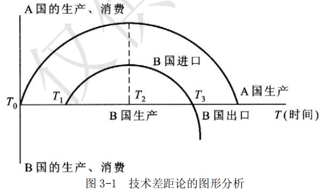
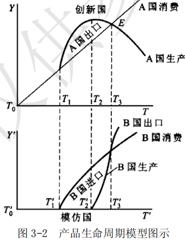
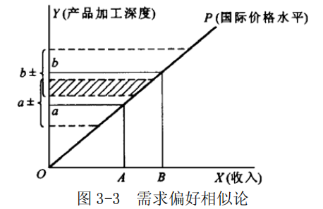
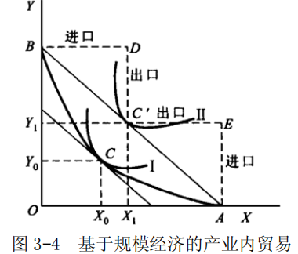

# Chapter 3 Modern and contemporary theory of international trade

> **Core question of this chapter**: if all countries have the same level of technology, what determines trade? Why is the trade between the world's most developed countries the largest? Why does the same country export and import products of the very same industry?

## Thread of the chapter

Ricardo attributed trade to differences in technology (labour productivity), and the twentieth-century neoclassical reform of the theory turned attention to a different kind of difference: factor endowments. Heckscher's 1919 paper posed the question, and his pupil Ohlin completed the system in *Interregional and International Trade* of 1933 (the Nobel Prize in 1977): in a world where two countries have the same level of technology and differ only in the stock of factors, a country exports the goods that intensively use its relatively abundant factor — and so the H-O model became the mainstream of "modern" trade theory. Samuelson in 1948—1949 proved the factor price equalisation theorem (trade can bring the wages and interest rates of two countries into convergence), and the Stolper–Samuelson theorem of 1941 revealed the distributional effects of trade (the abundant factor gains, the scarce factor loses — tariffs nominally help the scarce factor), connecting trade theory for the first time head-on with domestic political economy. The history of the theory then turned to "testing and patching": Leontief in 1953 tested US trade with input-output tables and found that the capital intensity of US exports was actually lower than that of import-competing goods — the counterexample drew a whole string of explanations (human capital, natural resources, reversal of demand, reversal of factor intensity) and also declared that pure endowment theory cannot cover reality. The direction of the patching was to "thaw" the variables that H-O had frozen: Posner's technology gap theory of 1961 and Vernon's product life-cycle theory of 1966 made technology a dynamic variable; Linder's hypothesis of demand preference similarity of 1961 explained trade between developed countries from the demand side; Krugman's new trade theory of 1979—1980 introduced imperfect competition, economies of scale and differentiated products, answering intra-industry trade head-on (together with the Dixit–Stiglitz monopolistic competition frame of 1977); Brander–Spencer's strategic trade policy theory of 1985 carried imperfect competition into policy; and Melitz's heterogeneous firm model of 2003 opened "new new trade theory," refining the grain of the analysis from industry to firm. This chapter unfolds in that order: the H-O model and its counterexamples, the technology gap theory, the product life-cycle theory, intra-industry trade theory.

## Problems and analysis

### The Leontief counterexample: why does the United States export "labour-intensive" products?

**(1) The counterexample is put forward**

After the H-O model was proposed it gradually became the mainstream of international trade theory. After the Second World War, scholars began to test with empirical data whether the model could reflect the actual state of trade; several tests did not support the model, and conclusions contradicting it appeared in succession — the Leontief counterexample is the most famous of them.

**(2) The basic content of the counterexample**

Leontief (creator of the input-output model, Nobel Prize in 1973) analysed US foreign trade in the 1940s—50s by the input-output method, comparing the capital-labour ratio of US export goods with that of import-competing goods (goods the United States both imports and produces itself), and found that the capital-labour ratio of the US export sector was lower than that of the import-competing sector — the basis of the United States' participation in the international division of labour was specialisation in labour-intensive goods, that is, the United States used foreign trade to "dispose of surplus labour and conserve capital." This is exactly the reverse of the H-O prediction that "the United States is capital-abundant and should export capital-intensive goods," and it raised enormous controversy in the profession.

**(3) The debate around the counterexample**

Several explanations appeared in turn. Leontief's own: American workers have about three times the labour productivity of workers in other countries, and multiplying the headcount by three makes the United States the relatively labour-abundant country — which in substance already leads to the concept of "human capital" (later formalised by Kenning, Gissin and others: education and technical training are capital embodied in the person). Reversal of factor intensity: the same good is capital-intensive in a capital-abundant country and labour-intensive in a labour-abundant one (wheat is produced labour-intensively in Africa and mechanised capital-intensively in the United States), so H-O's premise for its prediction fails. In addition there are reversals of demand preference, the tariff structure argument (US tariffs happened to protect labour-intensive industries, distorting the composition of trade), and the natural resources argument (the United States imports large quantities of resource-intensive goods, whose capital input is high because mining itself requires capital, and after removing the natural resource industries the counterexample weakens markedly). The value of the counterexample in the history of the theory is that it opened the empirical tradition of trade theory — each later "patch" has come with new data and new models, and the "theory — test — patch" cycle has continued to the HOV (factor content) tests of today: Trefler in 1995 found a huge deviation between the classic model and the data, but after adding country differences in productivity and a "local preference" correction the factor content frame holds roughly.

### The technology gap theory: how does the lag in imitation create trade?

The technology gap theory holds that the existence of technological differences between trading countries explains why a certain class of trade occurs. The progress of technical innovation is uneven across countries, new products are always born first in developed countries, and other countries must wait a while because of the technology gap before they can imitate production — during that interval trade opportunities exist.

In Figure 3-1 country A is the innovating country and B the imitating one. $T_0 \sim T_1$ is the demand lag: after A invents the new technology, owing to the income level and consumers' awareness of the new product, production and consumption take place only in A. $T_1 \sim T_2$ is the reaction lag: A begins to export and B to import; the length of the lag depends on the speed of the imitator's firms and on conditions of economies of scale, price, market and tariffs. $T_2 \sim T_3$ is the mastering lag: B begins to produce for itself, but limited by its ability to acquire and absorb the technology it produces less than it consumes and still has to import. After $T_3$ B has mastered the technology completely, output rises sharply, and it finally becomes an exporting country. $T_0 \sim T_3$ is called the imitation lag in total, and $T_1 \sim T_3$ is the period of trade between the two countries. The insight of the technology gap theory is that it turns "technology" from the silent premise of comparative advantage into a dynamic variable — trade comes from the time difference in the diffusion of technology, and it lays the step for the product life-cycle theory of the next section.

### Reversal of factor intensity: when does the H-O model fail?

Reversal of factor intensity is the phenomenon in which the same good shows different factor intensities in countries with different endowments: a good is capital-intensive in a capital-rich country and labour-intensive in a labour-rich one (wheat, by large machines and fertiliser in the United States, is capital-intensive, and by hand labour in Africa, labour-intensive).

Its conditions of occurrence: the elasticities of substitution between the factors for the two goods differ greatly, so that the two isoquants intersect twice. H-O's prediction of the trade pattern then fails — the factor "used intensively" in the same good differs between the two countries, so the two countries may export the same good, or a country may even export the good that intensively uses its own scarce factor; the movement of the two countries' factor prices will also be in the same direction rather than converging. The empirical importance of reversal of factor intensity is disputed (Minsker's early test of 1962 on the basis of a CES production function considered it quite common, while later studies hold that it is not common in typical industries), but it is a reminder: any theoretical prediction premised on "factor intensity does not change with endowments" must first clear this hurdle.

## Extended discussion

### The main content and evaluation of the H-O model

**(1) Assumptions**

The core of the H-O model (the Heckscher–Ohlin model, also called the factor endowment theory or the theory of factor proportions) is that differences in factor endowments determine the trade pattern. The assumptions: a 2×2×2 structure (countries A and B, two factors of labour and capital, two goods X and Y); the two countries have the same production functions (the same level of technology); goods and factor markets are perfectly competitive, factors move freely domestically and not internationally; A is relatively capital-rich (low interest rate) and B relatively labour-rich (low wages); transport, demand preference and trade barriers are ignored.

**(2) The basic propositions and the chain of logic**

The core theorem: a country exports the goods that intensively use its relatively abundant factor and imports the goods that intensively use its relatively scarce factor. Unfolded into three propositions: one who specialises in production with a relatively abundant factor is in a favourable position; differences in the proportions of the factor stock cause differences in production cost, and cost differences cause price differences that generate trade; and the result of trade is a narrowing of differences in factor rewards, producing a tendency toward factor price equalisation.

The internal chain of logic: factor endowments → supply of factors → factor prices → production costs → goods prices → international trade. Endowments determine the relative abundance of factors, relative supply influences relative prices, differences in factor prices determine differences in cost, and differences in cost form the absolute difference in goods prices — the absolute difference in prices is the direct basis of international trade. The whole chain is purely neoclassical general equilibrium reasoning, and that is exactly where it parts from the Ricardian model.

**(3) The difference from the Ricardian doctrine of comparative advantage**

Four dimensions. The cause of trade: Ricardo attributes it to differences in labour productivity (technology), H-O to differences in factor endowments. The number of factors: the former one (labour), the latter two (labour and capital). The assumption of productivity: the former different across countries, the latter the same (all differences come from endowments). The basis of value: inside the Ricardian frame, exchange within a country is equivalent while international trade shows non-equivalence (an internal contradiction of the labour theory of value), while inside the H-O frame the two are of the same substance and the principle of exchange is one (the neoclassical frame dissolves the contradiction).

**(4) Policy implications and cases**

The policy points to "playing on inherent advantages and trading from the endowments": Malaysia exporting tin (resource endowment), Middle Eastern countries exporting oil (energy endowment), and China and Southeast Asia in the 1980s—90s playing on their labour endowment advantage with exports of apparel and light-industry goods — each country locates its comparative advantage chain according to its endowments.

**(5) Evaluation**

Contributions: it explains the causes and pattern of trade from a country's basic endowment of economic resources, replaces the labour theory of value with neo-classical general equilibrium, and lays the frame for analysis of the distributional effects of trade (factor price equalisation, the Stolper–Samuelson theorem) — an important development of traditional trade theory. Limits: endowment is not a sufficient condition for trade (technology, demand and economies of scale all act); static analysis excludes technical progress and the dynamic evolution of endowments themselves (capital accumulates, human capital forms — "endowment" itself is a function of development); it is insufficiently attentive to demand factors (the demand explanations of the Leontief paradox and Linder's hypothesis of similar demand both strike at that shortcoming); and the Leontief counterexample contradicts the model's classic prediction.

### The product life-cycle theory: how is comparative advantage "relayed" between countries?

**(1) Main content**

The life cycle of a product refers to the period a product passes through of introduction, growth, maturity and decline. Vernon in 1966 combined the cycle with international trade, holding that technological gaps between countries change comparative advantage and make it develop from static to dynamic — transferring from one (class of) country to another, with the production advantage following, so the pattern of international trade changes. The four stages: in the first stage the innovating country, with a broad market, highly skilled technical personnel and heavy R&D spending, completes the innovation and monopolises production and the market; in the second stage foreign countries begin to imitate and the innovator's products lose competitiveness there; in the third stage foreign imitators begin exporting to a third country and the innovator's exports fall sharply; in the fourth stage foreign products enter the innovating country's market and the innovator turns from exporter to importer, the product completing its cycle there while beginning a new cycle in the imitating countries.

**(2) The graphical explanation**

As Figure 3-2 shows: at $T_0$ the innovating country begins to produce and consume, at $T_1$ production exceeds consumption and exports begin, at $T_2$ exports peak, then fall owing to imitation elsewhere, and at $T_3$ exports reach zero, after which the country turns to imports. The imitating country's curve lags: before $T_1^{'}$ it does not know the product or does not consume it, at $T_1^{'}$ it begins to import and consume, at $T_2^{'}$ its firms judge it profitable and begin imitating production, at $T_3^{'}$ it becomes self-sufficient and stops importing, and after $T_3^{'}$ it exports at lower cost on scale or another comparative advantage. The horizontal distance between $T_1$ and $T_1^{'}$ depends on the income gap between the innovating and imitating countries; the distance between $T_3$ and $T_3^{'}$ shows that the imitating country exports first to a third country and then back to the innovating country. The life cycle of a product is a baton: beginning with innovative production in advanced countries, transferring to relatively less advanced countries, then transmitted to still less advanced ones, creating profit as much as possible through the lengthening of the cycle.

**(3) The dynamic significance**

First, it examines the transfer of comparative advantage between countries under a technology gap, moving the doctrine of comparative advantage and the H-O model out of static analysis and into the dynamic stage. Second, it implies the idea that the factor intensity of a product changes with the stage of the cycle: the innovation stage requires heavy R&D spending (knowledge-intensive in technology), the mature stage turns to expansion of scale (capital-intensive), and after standardisation competition is concentrated on cost (labour-intensive) — this provides a coordinate for relatively less advanced countries to determine their timing of entry into the international division of labour and their path of upgrading: at which stage of the cycle to enter, and when to climb to the next. Third, less advanced countries must continually examine the change in their own factor advantages to meet new challenges: as the economy advances, original comparative advantages change, and failure to adjust the mode of participation from a dynamic perspective obstructs development. Radios, pocket calculators and colour televisions all walked this path in the second half of the twentieth century — invented and first produced in the United States, relayed to Japan, then to Korea and Southeast Asia.

**(4) Evaluation**

The life-cycle theory brings management, technology and external economies into the trade model, an important step in making static theory dynamic. But economic life is full of uncertainty and industrial environments differ across countries, so the cycling of the life cycle is not a universal or necessary phenomenon; the theory also carries an implicit tendency of "fixed ranks" — the United States is always cast as the innovator — while in reality the sources of innovation have pluralised (Japan, Korea and China in turn becoming innovating subjects). The more fundamental correction comes from the change in the organisation of contemporary production: the global placement of multinationals scatters R&D, production and sales across several countries at once, and the narrative of "in which country the product completes its cycle" has been replaced by global value chains — the product's "cycle" is no longer passed between countries in sequence but unfolds simultaneously inside the firm, and the cycle itself is compressed sharply (semiconductors a generation every two years, fast fashion a new line every few weeks).

### Intra-industry trade theory: why do similar countries exchange similar products?

Intra-industry trade is the phenomenon of a country exporting and importing products of the same industry at the same time, an important part of modern trade theory.

**(1) Assumptions**

Intra-industry trade theory starts from the static, emphasising the causes and results of intra-industry trade rather than its process; it takes an imperfectly competitive market as its premise (closer to the reality of the modern world economy); the economy has economies of scale, taken as an important source of the gains from trade; and it pays more attention than other theories to the role of demand, considering both the cases of identical and different demand.

**(2) Intra-industry trade in homogeneous products**

Product homogeneity means products are perfectly substitutable for one another (a very high cross-price elasticity of demand and entirely the same consumption preferences). Such products generally belong to the object of inter-industry trade, but because of market location, the timing of market entry and the like, trade in identical products exists in reality, including cross-trade in bulk products (such as the back and forth of electricity across a border), trade of a co-operation or technological character (contractual joint production exchanging products by share), transit trade, import and export of the same kind of product (of different specifications and grades, such as oil graded by octane number), seasonal trade (fruit of the northern and southern hemispheres flowing out of season against each other), and intra-industry trade inside multinationals.

**(3) Intra-industry trade in differentiated products**

Product differentiation means products are similar but not entirely identical: not perfectly substitutable but still substitutable, with cross-elasticity lower than for homogeneous products and similar inputs in production — most intra-industry trade belongs to this class. Differentiated products fall into three kinds: horizontal differences (different combinations of the same attributes, such as cigarette brands of the same quality), technical differences (new products made by new technology) and vertical differences (differences in quality, such as grades of the same kind of product).

**(4) Intra-industry trade on the hypothesis of demand preference similarity**

Linder's hypothesis of demand preference similarity of 1961 explains intra-industry trade from the demand side: international trade is an extension of domestic trade, and firms first satisfy the domestic market they know well; per capita income determines a country's structure of demand, and where incomes are similar the barriers between markets are small and trade readily occurs.

In Figure 3-3, at a given international price level, demand overlaps between countries of similar income: A and B are the two countries' different income levels, OP is the world price line, and a and b are typical depths of processing at the two income levels (consumption is diverse, and the depth of processing is a region); the overlapping region of consumption is the depth of processing both consume — and the overlap of demand is the foundation of intra-industry trade. This theory answers directly the question left by the previous chapter: why trade occurs mainly between developed countries — not because their endowments differ much, but precisely because their structures of demand are similar and there are many differentiated products to exchange.

**(5) Intra-industry trade based on economies of scale**

In Figure 3-4 countries A and B have the same production possibility curves, convex toward the origin (the feature of economies of scale), and specialisation is entirely arbitrary: suppose A specialises in producing X and B in Y, with output OA and OB; B exports $C^{'}D$ of Y to obtain BD of X, and A exports $C^{'}E$ of X to obtain AE of Y, the indifference curves moving from I to II and welfare rising — but this rise comes from production at scale, not from differences in endowments. This is exactly the core of Krugman's new trade theory: with imperfect competition in which economies of scale and differentiated products coexist, even if the two countries are identical in every respect, specialisation and mutual trade still raise both countries' welfare — the source of trade can be "acquired specialisation" rather than "innate difference." In 1980 Krugman further proved the "home market effect": countries with a large market become net exporters of differentiated products, which explains the concentration of industry location in large markets.

**(6) Evaluation**

Intra-industry trade theory is a critique and an extension of traditional trade theory: its assumptions fit reality better (imperfect competition, economies of scale), it brings the demand side into the analysis, and economies of scale are a real source of gains that every country pursues, so it is closer to the reality of the surge in trade between developed countries after the war; it is a supplement to and a development of the doctrine of comparative advantage. Its limit is that it remains essentially static, and the distribution of the gains from trade (which firms and which workers gain or lose) is dealt with properly only in the heterogeneous firm models after Melitz: in 2003 Melitz proved that trade liberalisation makes high-productivity firms expand exports while low-productivity firms contract and exit, raising industry average productivity — part of the benefit of trade comes from a reshuffling between firms, and this "extensive margin" perspective has become the analytical base of contemporary trade policy (the competition policy effects of trade agreements, firm heterogeneity and the fixed costs of export).

## Limits and what follows

The theoretical group of this chapter keeps growing in two directions. First, **the synthesis of endowments, technology and economies of scale in quantitative models**: the contemporary statement of the H-O frame (Vanek's 1968 HOV factor content model) and the Eaton–Kortum model of technological heterogeneity now coexist inside the same system of equations, and Antweiler–Trefler in 2002 found that the trade data of about half of all industries support "endowment logic," with industries of increasing returns running on endowment logic too — "which theory is right" is giving way to "which logic runs in which industry." Second, **the "new new" perspective from industry to firm**: after Melitz, the fixed costs of export, the distribution of firm productivity and intra-firm trade of multinationals have become the focus of the analysis (Antràs brings the theory of property rights to the boundary of the firm, explaining why some stages stay inside the firm and some are outsourced); the gravity model (Tinbergen's creation in 1962, with a structural foundation given by Anderson–van Wincoop in 2003) has become the empirical workhorse of policy assessment for its striking explanatory power (every doubling of distance roughly halves trade — a distance elasticity of about −1). Strategic trade policy theory (Brander–Spencer 1985: under oligopolistic competition, subsidising domestic firms can transfer monopoly rents) is elegant in logic, but its information requirements are almost unbearable and retaliation by the counterpart and WTO rules necessarily follow — the subsidy dispute between Airbus and Boeing, running for thirty years and ending in 2021 with a truce in which both sides suspended retaliatory tariffs, is the best footnote to a theory that "looks workable and burns the hand when used."

## Reference material

- Krugman and Obstfeld, *International Economics* — the mainstream framework for trade theory and open macroeconomics.
- The full bibliography is on the [bibliography](/reference/参考书目).
- [Wikipedia · Free trade](https://en.wikipedia.org/wiki/Free_trade)
- [Wikipedia · Protectionism](https://en.wikipedia.org/wiki/Protectionism)

<!-- BACKLINKS-AUTO -->
## Related pages

- [History](/international/History)
- [Readme](/international/Readme)
