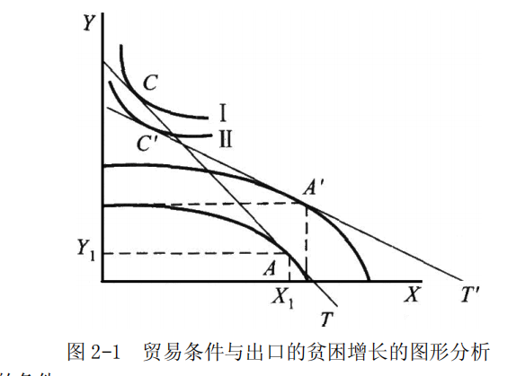
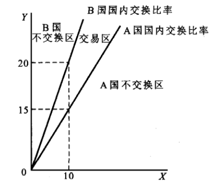

# Chapter 2 Pure theory of international trade

> **Core question of this chapter**: if a country is dearer than every other country in every product, does it still have a right to take part in international trade? How large are the gains from trade, and how are they divided? Why do some countries end up poorer the more they export?

## Thread of the chapter

The wellspring of pure trade theory is the settlement of accounts with mercantilism. Mercantilism (the dominant creed of the fifteenth to eighteenth centuries) treated gold and silver as the only form of wealth and advocated exporting a great deal, importing little, and accumulating surpluses; Hume's "price-specie flow mechanism" of 1752 showed for the first time that surpluses cannot accumulate indefinitely (inflows of gold and silver raise prices and weaken export competitiveness, so the system swings back on its own), while Smith's *Wealth of Nations* of 1776 struck at the principle of division of labour head-on: if every country happens to have some product whose cost is lower than the others' — absolute advantage — then countries that specialise in what they do best and trade will all profit, and mercantilism's "cheap sales and dear sales are what pay" collapses from within. The real theoretical leap was Ricardo's *Principles of Political Economy and Taxation* of 1817: Torrens had in fact already put forward the idea of comparative advantage in 1815, and Ricardo forged it into a complete doctrine with the numerical example of exchanging British woolen cloth for Portuguese wine — even if one country is behind in every respect, as long as relative costs differ, the two countries can still profit by dividing labour on the rule of "of two advantages take the greater, of two disadvantages take the lesser." The result is so counter-intuitive and so solid that it stands among the propositions of economics that time has tested hardest (Samuelson once reported that, were he to name one social-science proposition that is both true and non-trivial, he would choose comparative advantage). But Ricardo said only that "the rate of exchange falls inside some interval"; the law of reciprocal demand, given by Mill in 1848, answers where exactly the terms of trade settle, and Marshall and Edgeworth geometricise it with offer curves; Haberler in 1936 replaced the labour theory of value with opportunity cost, freeing the whole doctrine from the most fragile link in the Ricardian frame. The ordering of the concepts in this chapter follows that thread: absolute advantage (Smith's generalisation of division of labour), comparative advantage (Ricardo's relative differences), offer curves and terms of trade (the Mill–Marshall division of the gains), and finally export-led growth that impoverishes, showing that the division of the gains from trade can run in the other direction too.

## Core concepts

### Absolute advantage

Absolute advantage is the gain from trade obtained when the two trading parties produce according to their respective absolute advantages and then exchange products. Smith held that every country has absolutely favourable conditions of production suited to certain specific products, under which the cost of production is lower than abroad; if countries specialise in the products in which they hold an absolute advantage and exchange them, each gains and the overall welfare level of the world rises.

What is "epoch-making" about the doctrine of absolute advantage is not its conclusion but its battlefield: it redefines international trade from mercantilism's "zero-sum game" as an extension of the division of labour — trade is not that one side gains while the other loses, but like domestic division of labour it makes both sides produce more. But note its explanatory blind spot: Smith requires that countries "all have" absolutely advantageous products, so for a country that is behind in everything the theory implies it ought not to take part in the international division of labour — which fits neither the facts (the most backward countries trade heavily) nor the observed mutual trade between advanced countries. Comparative advantage is what completes that piece of the puzzle.

### Comparative advantage

Comparative advantage is the gain from trade obtained when the two trading parties produce and exchange products according to their respective comparative advantages. The theory was first put forward by Torrens and developed into a complete doctrine by Ricardo. Ricardo pointed out that if country A has a lower cost than country B in producing any product (absolute advantage) and B is at an absolute disadvantage in every product, then if A specialises in the product of its greater advantage and B specialises in the product of its lesser disadvantage, both countries can still profit from division of labour and trade — "of two advantages take the greater, of two disadvantages take the lesser."

The essence of comparative advantage is a relative difference in opportunity cost. In Ricardian numbers: Britain needs 100 men-years of labour to produce one unit of woolen cloth and 120 to produce one unit of wine; Portugal needs only 90 and 80 respectively. Portugal is stronger in both, but cloth is cheaper by only one tenth (90/100), whereas wine is cheaper by a third (80/120) — cloth has a higher relative cost in Portugal. The optimal arrangement is therefore for Portugal to go all in on wine and Britain all in on cloth: because "one more unit of wine" costs Portugal less cloth than it costs Britain, the relative price of wine differs between the two countries, and exchange lets both obtain more of both products with the same labour. Note that this argument needs no strong assumptions such as "labour is the only factor" or "labour determines value" — it needs only a difference in increasing opportunity cost, which is exactly the significance of Haberler's 1936 reconstruction of the doctrine with opportunity cost: separating the solid part of the theory (the difference in relative cost) from the fragile part (the labour theory of value).

### Offer curves

Offer curves, also called curves of conditions of supply or curves of reciprocal demand, were put forward by Marshall and Edgeworth and show the path of the quantities a country is willing to export to other countries in order to import a given quantity of a commodity — that is, the export quantity it is willing to offer for each level of import quantity. The intersection of the two countries' offer curves determines the international price at which goods are exchanged (the rate of exchange).

An offer curve is the geometric form of Mill's "law of reciprocal demand": the determination of the terms of trade depends on neither cost (supply) alone nor demand alone, but on the comparison of the intensity of the two countries' mutual demand — the more intensely one country demands the other's products, the more the rate of exchange moves against itself. The shape of an offer curve is jointly determined by the substitution and income effects (the direction in which the export quantity changes when the price changes depends on which of the two is stronger), so it may bend backwards; the intersection of the two countries' curves is the equilibrium terms of trade, and shifts in demand or economic growth shift the curves and thereby change the terms of trade — this is precisely the graphical mechanism of export-led growth that impoverishes, discussed below: growth shifts the offer curve, and if the equilibrium terms of trade after the shift deteriorate sharply enough, growth actually lowers welfare.

### Terms of trade

Terms of trade, also called the "rate of exchange" or the "trade ratio," is the ratio between the prices of a country's exports and the prices of its imports over a given period, usually computed as the ratio of the export price index to the import price index:

$$\text{Terms of trade coefficient}=\frac{\text{Export price index}}{\text{Import price index}}\times 100$$

A coefficient above 100 means the terms of trade have improved, so the same quantity of exports brings back more imports; below 100 they have deteriorated.

The terms of trade is the most used "referee statistic" in international economics because it compresses the division of the gains from trade into a single number: the more favourable the rate of exchange for a country, the higher its terms of trade. But three definitional traps must be watched when reading it. First, it is a "price" statistic, not a "welfare" statistic — deterioration of the terms of trade may come from a rise in domestic export productivity (export prices fall while profit rates do not), and welfare need not be harmed. Second, the total-value form of the terms of trade overstates the effect of rising import prices for intermediates in the age of value chains (rising prices of imported components also raise export prices, and numerator and denominator offset each other). Third, the hypothesis that Prebisch and Singer put forward in 1950 — that the terms of trade of primary products relative to manufactures shows a long-run tendency to deteriorate — made the terms of trade a central statistic in the North–South argument, and although later empirical work has continued to dispute whether the trend exists and why (the uneven distribution of technical progress between the two classes of goods, and the effect of Engel's law on the demand for primary goods), the policy intuition that "developing countries should beware of a vicious cycle of making up for price with volume" has entered most development policies.

## Problems and analysis

### Growth through exports that impoverishes: why does exporting more make a country poorer?

Growth through exports that impoverishes describes a situation in a large economy in which growth in the export sector causes a sharp deterioration in the terms of trade, the negative effect of the deterioration on welfare outweighs the positive effect of the growth itself, and the country's net social welfare falls because of the growth.

**(1) Graphical analysis**

As Figure 2-1 shows, an outward shift of the production possibility curve means expanded productive capacity: the production point moves from $A$ to $A^{'}$, and production moves from the first curve to the second; but the world price line $T$ rotates to $T^{'}$ as exports surge — the rise in exports pushes down the relative price of the country's export goods and reduces the slope. The result is that the quantity exported rises, yet the imports brought back for the same quantity of exports fall, and the indifference curve through the new equilibrium point lies below the original one: the whole benefit of the growth is swallowed by the deterioration of the terms of trade, and net welfare falls. Mechanically this is a consequence of "the large country's offer curve shifting": when exports hold a large share of the world market, domestic expansion of supply is itself downward pressure on the world price.

**(2) Conditions under which export-led growth impoverishes**

The four conditions must all be present: the exporting country is a developing country with a single-commodity structure; the export product is a primary or labour-intensive product holding a large share of the world market, so that any increase in exports pushes down the world price; the demand elasticity of the product is small, so a price cut does not bring a commensurate rise in volume sold; and the national economy is highly dependent on that export, so that after the price falls a larger export volume is still needed to make up the loss of revenue.

**(3) Policy implications and evaluation**

First, a country with a single-commodity structure following an export-oriented path may face "the more exports, the lower the price," which shows that industrial structure must be adjusted and upgraded over the long run. Second, export-led growth that impoverishes is only one of several possible situations at particular stages of economic development, not a general law and certainly not an inevitable product of growth — the more common counterpart in practice is the vulnerability of resource exporters to world price swings (the "resource curse" debate about oil and minerals), and the policy answer is export diversification and upgrading of domestic industry, not a return to closure.

### The possible range of bilateral trade prices and the division of gains (the 2×2 model)

**(1) The possible range of trade prices**

Suppose the world contains only countries A and B, each producing two goods, X and Y, under free trade; that labour moves freely within a country but not internationally; that costs are constant with no economies of scale and transport and insurance costs ignored; and that the distribution of income is unaffected by trade. Before division of labour the two countries' output per unit of labour is:

|       | X  | Y  |
|:-----:|:--:|:--:|
| A     | 10 | 15 |
| B     | 10 | 20 |

Country A holds no absolute advantage in either X or Y, but A's relative cost of producing X is lower (one unit of X costs only the giving up of 1.5 units of Y, while B must give up 2 units of Y), so A's comparative advantage lies in X and B's in Y. After trade, A exchanges X for Y and B exchanges Y for X. The price range is bounded by the two countries' domestic rates of exchange: A's domestic ratio is $10X :15Y$, and A will enter the market only if 10 units of X can be exchanged for more than 15 units of Y; B's domestic ratio is $20Y :10X$, and B will enter the market only if 10 units of X can be exchanged for fewer than 20 units of Y. The region between the two domestic ratio lines (Figure 2-2) is the price range within which trade can take place — if the ratio falls outside the range, one country will rather exchange domestically than trade.

**(2) Division of the gains**

As Figure 2-2 shows, the actual rate of exchange must fall within the range bounded by the two countries' domestic rates of exchange, and the terms-of-trade line crosses the open segment $AB$; which ray it falls on depends on the intensity of the parties' mutual demand (Mill's law). The closer the rate of exchange to point A (A's domestic ratio), the more the division of the gains favours B — A's share approaches zero; the closer to B, the reverse. This "division within a range" frame explains the core of real trade negotiation: negotiation is a fight over where inside the range the rate of exchange will settle.

## Extended discussion

### Basic content and evaluation of Ricardo's doctrine of comparative advantage

**(1) Assumptions**

Six assumptions mark the boundaries of the model: the world consists of countries A and B, each producing two goods, X and Y, with labour the only factor of input; goods and factor markets are perfectly competitive and the two countries trade freely; factors move freely within a country and not at all internationally; the labour theory of value is the basis, with homogeneous labour, full employment and equal remuneration; unit production costs are constant with no economies of scale and transport and insurance costs ignored; and the distribution of income is unaffected by trade. On these premises the doctrine attempts to prove that the basis of international trade is comparative advantage rather than absolute advantage.

**(2) Basic content**

Trade can still occur between two countries whose productive capacity is unequal — country A lower in cost in every product, B higher in all — because the gap in labour productivity between the two countries is not the same in every product. The country with the absolute advantage need not produce every product, and should concentrate on the one in which its domestic advantage is greatest; the country with the absolute disadvantage need not cease production altogether, and should only stop producing the product in which its domestic disadvantage is greatest. Through free exchange each participating country saves social labour and increases consumption, and world output rises because of division of labour.

**(3) Evaluation**

An evaluation starting from the practice of international trade: the doctrine of comparative advantage reveals that trade is mutually beneficial, proving that countries can profit by exporting goods of relatively low cost and importing goods of relatively high cost — this is its main contribution. But its assumptions are too stringent and do not fit international reality (such as factors not moving internationally at all); according to the doctrine, the greater the difference in comparative advantage the more likely trade is to occur, so present-day trade should happen mainly between developed and developing countries, whereas in fact most international trade has long occurred between developed economies of similar income and development level (historically about seven tenths of the total, though the share has fallen markedly in recent years with the rise of emerging economies, according to WTO statistics) — the mismatch between theory and pattern leads on to the similarity of demand hypothesis in Chapter 3; the doctrine holds that free trade is mutually beneficial, but in reality every country practises protection to some extent, which shows that aggregate mutual benefit and the domestic distribution of it are two different things (trade has winners and losers, and the Stolper–Samuelson theorem is the modern strictening of that criticism).

An evaluation starting from the labour theory of value: first, the same good shows two rates of exchange on the domestic and international markets, which contradicts the labour theory of value that Ricardo himself upheld — "equivalent exchange" seems to fail in international exchange, and Marx's discussion of "international value" treats this contradiction systematically; second, the doctrine does not reveal the fundamental reason trade occurs — whether or not there is comparative advantage, as long as goods can realise their value and firms can recover costs and earn an average profit, trade will take place, so attributing it to the pursuit of super-normal (comparative) gain does not fit the actual sequence of firms' decisions; third, the doctrine implies that "the more backward a country, the more it benefits from trade," and ignores the direction of the flow of value in international exchange and the problem of non-equivalent exchange — this is the deeper reason it could not be wholly accepted by the economics profession of relatively backward countries.

## Limits and what follows

The contemporary fate of the Ricardian frame is the history of a simplification that turned out to be a strength. Modern reconstructions with a single factor and a continuum of goods (Dornbusch–Fischer–Samuelson 1977) let comparative advantage handle any number of goods, and the Eaton–Kortum model of 2002 further introduces random differences in the technology distribution across countries, becoming the workhorse frame of contemporary quantitative trade analysis (measuring the welfare loss from tariffs and geographical barriers) — both authors still work with Ricardian relative productivity, only swapping "two countries and two goods" for "the technological parameters of the world's countries." And its two key assumptions have evolved in the opposite direction in reality: the assumption that factors do not move has been dismantled by capital flows, multinational firms and global value chains — an export good embeds imported intermediates, and "comparative advantage" is increasingly "placed" by multinational firms rather than "endowed" to countries (task trade and value-added trade research); and the assumption of unchanged technology has been overturned by endogenous growth and learning by doing — comparative advantage can be generated dynamically through policy support and accumulation (Korea's path from textiles to semiconductors), which also provides the theoretical interface for the infant-industry protection of Chapter 4. Finally, the "empirical testing of the theory of comparative advantage" is a literature of its own: direct tests of the Ricardian model (MacDougall's 1951 comparison of US and British exports) hold in direction, while more refined tests show that differences in productivity explain exports far better than factor endowments — this two-hundred-year-old gentleman remains the benchmark that empirical trade research cannot go around.

## Reference material

- Krugman and Obstfeld, *International Economics* — the mainstream framework for trade theory and open macroeconomics.
- The full bibliography is on the [bibliography](/reference/参考书目).
- [Wikipedia · Comparative advantage](https://en.wikipedia.org/wiki/Theory_of_comparative_advantage)
- [Wikipedia · Gains from trade](https://en.wikipedia.org/wiki/Gains_from_trade)

<!-- BACKLINKS-AUTO -->
## Related pages

- [History](/international/History)
- [Readme](/international/Readme)
