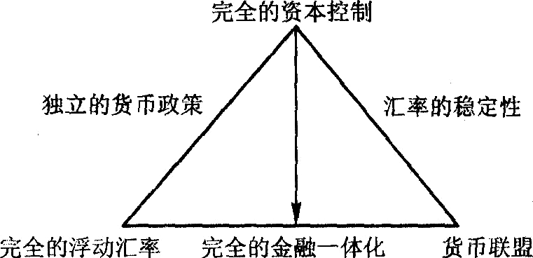
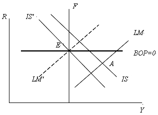
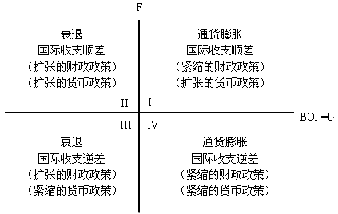

# Chapter 8 Internal and external equilibrium of the macroeconomy

> **Core question of this chapter**: an open economy wants employment and stable prices at home while keeping the balance of payments from running away — why do those two objectives so often fight? How many policy instruments are enough? Why do exchange rate regimes, monetary policy and capital mobility admit "only two of three"?

## Thread of the chapter

The theory of internal and external equilibrium was born of a concrete policy bind. In 1951 Meade, in *The Balance of Payments*, put forward the "Meade conflict": under fixed exchange rates and without using expenditure-switching policy, if the economy stands in a state where unemployment and deficit coexist (or inflation and surplus), then a single demand-management policy must fail on one side or the other — expand demand to save employment and the deficit gets worse; contract demand to balance the accounts and unemployment gets worse. Tinbergen in 1952 gave the theoretical basis of the cure: to achieve N independent economic objectives at least N independent policy instruments are needed. Swan in 1955 drew the idea as a pair of curves (the Swan diagram), assigning expenditure increase and decrease policy to one end and the exchange rate (expenditure switching) to the other; Mundell in 1962 pushed one step further — instruments differ in their relative effectiveness for objectives, fiscal instruments are most effective for the internal objective and monetary instruments for the external, so assign instruments by comparative advantage ("assignment by comparative advantage," or effective market classification), and two instruments suffice for two objectives to converge. Plotted inside the IS-LM-BP frame, that assignment idea becomes the Mundell–Fleming model (1962—1963): given the exchange rate regime and capital mobility, the effects of fiscal and monetary policy are systematically shaped — under fixed rates fiscal policy is powerful and monetary policy impotent (cancelled by exchange rate intervention), under floating rates the reverse. The impossible trinity is the terminus of that theoretical line: monetary independence, exchange rate stability and free capital mobility cannot all be had (Krugman popularised it in 1999 with *The Return of Depression Economics*, from which "the impossible triangle" entered popular vocabulary; Frankel gave a systematic statement the same year). This chapter first lays two concepts as groundwork (the trade multiplier and the marginal propensity to import — openness makes the multiplier smaller and couples internal and external equilibrium more tightly), then presents in turn the process of internal and external equilibrium and the policy combinations.

## Core concepts

### The trade multiplier

The trade multiplier refers to the role of the multiplier in the study of foreign trade, exploring the relation between foreign trade and national income and employment. In the formula of the trade multiplier it is the reciprocal of the sum of the marginal propensity to save and the marginal propensity to import:

$$K_T = \frac{1}{MPS + MPM}$$

($MPS$ is the marginal propensity to save, $MPM$ the marginal propensity to import). The principle of the trade multiplier states that, when the sum of the marginal propensity to save and the marginal propensity to import is less than 1, increasing exports helps raise effective demand and add to national income and employment.

The mechanism of the multiplier is the circulation of income through several rounds: 100 yuan of exports becomes domestic income, and the income recipients consume, save and buy imports according to their marginal propensities, of which saving and imports are "leakages" — money leaves the pool of the income circulation; each round leaks a part, and the circulation goes on until the new demand is drained out, the cumulative increase in national income being exactly $100/(MPS+MPM)$. The investment multiplier of a closed economy is $1/MPS$; openness adds the import leakage, so the trade multiplier must be smaller — the more open an economy, the smaller the share of each unit of export stimulus that stays at home (multiples are small in highly open small economies such as Singapore and Luxembourg, and relatively large in continental economies such as the United States and Japan). This is the first channel of "internal-external coupling": exports change national income through the multiplier, and national income in turn acts back on the trade balance through the marginal propensity to import — every internal policy "leaks" onto the external account through this chain, and internal and external equilibrium are thus tied into one web.

### The marginal propensity to import

The marginal propensity to import is the ratio of a change in imports to the change in income that caused it, that is, the increase in imports per unit increase in national income, usually written as $m$. National income affects the volume of imports because, when income rises, consumption (especially of goods of higher quality and more dependent on imports) rises and more goods are bought from abroad, raising imports; the reverse happens with a fall. A large marginal propensity to import means a large share of each unit of new national income goes to imports, and the multiplier's stimulus to the economy is small; the smaller, the larger the stimulus.

The policy weight of this coefficient is far greater than its definition suggests. First, it is "the leakage rate of imports": China's marginal propensity to import is lower than that of most economies of comparable openness, so the same expansion of exports sets a longer domestic circulation of income in motion — one micro reason why the export-oriented strategy has worked so well in China. Second, it determines "whether other countries' growth can be freeloaded on": when one country's income grows and its imports rise, they become export demand for its trading partners — a large country with a high marginal propensity to import spills its growth out to the world, and China's expansive growth after joining the WTO in the 2000s pulled global commodity and capital goods markets harder than any event of its scale ("import spillover"). Third, it is the interface of policy coordination: when all countries tighten at once, their mutual import demand contracts together and the multiplier chain resonates globally, amplifying the downturn (the lesson of the 1930s, the echo in the collapse of trade in 2009) — the mechanism of "beggar-my-neighbour" is hidden inside the marginal propensity to import.

## Problems and analysis

### Derivation of the formula of the trade multiplier

**Notation**: $Y$ national income, $C$ consumption, $I$ investment, $G$ government spending, $X$ exports, $M$ imports, $S$ savings, $T$ taxation, $K_T$ the trade multiplier, $MPS$ the marginal propensity to save, $MPM$ the marginal propensity to import.

**Derivation**: equilibrium in an open economy requires aggregate demand to equal aggregate supply — $Y = C + I + G + X$ (the expenditure side), $Y = C + S + T + M$ (the income side). Setting taxation equal to government spending ($T = G$) simplifies the equilibrium condition to:

$$I + X = S + M$$

that is, "the sum of injections equals the sum of leakages": investment and exports inject into the circulation of income, savings and imports leak from it. Taking increments of the equilibrium:

$$dI + dX = dS + dM$$

Introducing the marginal propensities $dS = MPS \cdot dY$ and $dM = MPM \cdot dY$ gives:

$$dI + dX = (MPS + MPM) \cdot dY$$

Solving for the change in national income:

$$dY = \frac{dI + dX}{MPS + MPM}$$

Assume investment and savings are unchanged ($dI = dS = 0$) and consider only the effect of a change in exports:

$$dY = \frac{dX}{MPS + MPM},\qquad K_T = \frac{dY}{dX} = \frac{1}{MPS + MPM}$$

With no saving leakage ($MPS = 0$) it reduces to $K_T = 1/MPM$. The meaning of the formula: the leakage rate (saving plus imports) is the denominator of the multiplier — the larger $MPS$ or $MPM$, the smaller $K_T$. Compared with the investment multiplier $K_I = 1/MPS$, the trade multiplier is usually smaller (there is one more leakage channel). The whole derivation turns Keynes's intuition of "why exports can drive employment" into a computable formula, and provides a quantitative language for policy coordination (assessing the shock of a fall in exports on GDP, estimating the import leakage of a stimulus plan).

### The meaning of the impossible trinity (the trilemma)

The main content of the law of the impossible trinity (the trilemma): each side of the triangle represents a policy objective — monetary independence, exchange rate stability (in practice, fixed exchange rates) and full freedom of capital movement. Each of the three has its attractions, but no country can achieve all three sides at once; each "two-side combination" corresponds to the institutional form of the remaining vertex, namely full capital control, a monetary union (or currency board) and a fully floating exchange rate.

Figure 8-1 is a diagram of the impossible trinity. If a country's monetary policy is fully independent while capital moves freely across borders, it cannot maintain a fixed exchange rate — the rate must float: given fully free capital movement, only one of a fixed exchange rate and monetary independence can be chosen. The logical core is the incompatibility of arbitrage and monetary sovereignty: with a fixed rate and free capital movement, the domestic interest rate must follow the anchor country's rate, otherwise the interest differential attracts capital flows that break the fixed parity — monetary independence then exists only in name (the standard case is the 1992 European Exchange Rate Mechanism crisis: Britain wanted to cut rates to save itself from recession, the Bundesbank refused, capital fled and broke the sterling parity, and after "Black Wednesday" Britain left the mechanism and turned to floating). The three sides each have their real-world representative: the United States chose monetary independence plus free capital movement (giving up exchange rate stability, floating freely); Hong Kong chose exchange rate stability plus free capital movement (giving up monetary independence, with a linked exchange rate and rates passively following the dollar); the Chinese mainland has long chosen monetary independence plus exchange rate stability (giving up full capital mobility, with only limited opening of the capital account). The value of the trilemma lies in turning "which exchange rate regime to choose" from a question of preference into a question of constraints — every argument about exchange rate regimes must in the end come down to "which corner do you give up." Rey's proposed correction after the 1997 Asian financial crisis and the 2008 global crisis, the "global financial cycle," holds that even with floating rates, global risk appetite (the US monetary cycle) will synchronise financial conditions across countries, so independent monetary policy is still hampered under financial openness — "the trilemma may become a dilemma." But this correction does not overturn the accounting identity of the triangle; it shows that the side "free capital movement" itself exports constraints: the more thoroughly it is given up, the more policy space the global financial cycle carries away.

## Extended discussion

### The process of internal and external equilibrium and the combination of policies

**(1) The meaning of internal and external equilibrium and the policies of adjustment**

Internal equilibrium means domestic aggregate supply equals aggregate demand, that is, full employment of resources and stable prices are achieved along with a warranted rate of growth; external equilibrium means the country's inflows from and outflows to external economies are equal, with the balance of payments balanced. Achieving both at once is difficult, and when there is an imbalance adjustment must restore balance so that the economy grows in balance.

The policies of adjustment fall into three classes. Expenditure-changing policy: adjust aggregate demand by changing aggregate spending, including fiscal means, monetary means and exchange rate policy. Expenditure-switching policy: policy that can affect the international competitiveness of traded goods and, by changing the composition of expenditure, raise domestic income relative to spending — such as exchange rate adjustment, tariffs, export subsidies and import quotas. Economic regulation: direct legal control of the running of the economy so that it moves in a prescribed direction (foreign exchange control, import approval and the like — direct in effect but distorting of resource allocation, and a supplement to the other two rather than a substitute).

**(2) The process of adjustment under fixed exchange rates**

Suppose internal and external equilibrium depends only on changes in visible trade, and can be analysed with the IS-LM-BP model. In Figure 8-2 the economy stands in a state where inflation and a balance of payments deficit coexist: first use contractionary fiscal policy against inflation, shifting the IS curve left to $IS^{'}$ through point E and achieving internal equilibrium; but the interest rate then falls and capital flows out, so the deficit worsens instead — next use contractionary monetary policy, shifting the LM curve left to $LM^{'}$ through point E, so the rate recovers, capital returns, import demand contracts, and the economy restores internal and external equilibrium at once. This order of "fiscal first, monetary support" is the graphical form of Mundell's assignment: the two instruments take their places in turn and the two objectives each converge.

**(3) Automatic adjustment under floating exchange rates**

If rates float, the process of adjustment differs: when internal and external imbalance arises, the floating regime produces automatic adjustment — the change in the exchange rate acts at once on the goods market (relative prices change exports and imports) and on the capital market (expectations and arbitrage flows), and the three markets of goods, capital and foreign exchange move toward equilibrium through a process of their own, so neither internal nor external equilibrium needs instrument by instrument intervention. The cost of automation is volatility of the exchange rate itself (overshooting, misalignment and financial stability — see "Limits and what follows").

**(4) The Swan diagram and the combination of policies**

In Figure 8-3 the BOP line represents a country's external equilibrium under a given combination of exchange rate and domestic expenditure, with surplus above the line and deficit below; the F line represents domestic equilibrium under the same conditions, with recession and unemployment to its left and over-employment and inflation to its right; the point where the two lines cross is the only point at which internal and external equilibrium are achieved together. The four quadrants make up a diagnostic chart of imbalance: in quadrant I inflation and surplus coexist, and by the Mundell assignment one should take contractionary fiscal plus expansionary monetary; in quadrant II recession and surplus coexist, expansionary fiscal plus expansionary monetary; in quadrant III recession and deficit coexist, expansionary fiscal plus contractionary monetary; in quadrant IV inflation and deficit coexist, contractionary fiscal plus contractionary monetary. The principle of the combination is precisely "effective market classification": fiscal instruments are relatively effective for internal equilibrium (they manage the inside), monetary instruments relatively effective for external equilibrium (they manage the outside) — the interest rate acts both on domestic demand and on capital flows, so monetary policy wears two hats at once and is more directly external. Take quadrant III (recession plus deficit) to walk through the logic: expansionary fiscal policy stimulates domestic demand and creates employment (treating the inside), contractionary monetary policy raises rates, attracts capital inflows and restrains imports (treating the outside); the two policies point in opposite directions and can therefore advance together without cancelling each other — this is the solution to the Meade conflict under the condition of "two instruments."

Contemporary application of the Swan–Mundell frame still runs on this logic: China's 2010s combination of "proactive fiscal policy plus a prudent, slightly tight constraint on macro leverage" against "downward pressure on the economy plus pressure from capital outflow" shares the grammar of the four-quadrant chart; the 1992–93 European Exchange Rate Mechanism crisis is the textbook of the reverse case — with rates fixed Britain could not cut rates on its own to save itself from recession, the exchange rate corner locked the monetary instrument, combination was out of the question, and the episode ended with withdrawal from the mechanism and a turn to floating.

## Limits and what follows

The boundaries of the frame in this chapter correspond one by one to its assumptions, and contemporary research has advanced at four points. First, **the micro-foundation of the Mundell–Fleming model**: MF's static expectations and price rigidity met the Lucas critique in the 1970s, and the Obstfeld–Rogoff Redux model of 1995 rebuilt open macroeconomics on intertemporal optimisation and monopolistic competition (the "new open economics") — most MF conclusions keep their qualitative validity inside the new frame but gain the ability to assess welfare, and the standard for judging policy effects rose from "does output recover" to "does welfare improve." Second, **the emergence of the financial channel**: after 2008, research found a powerful "global financial cycle" beside the exchange rate channel — dollar funding conditions, cross-border bank leverage and risk appetite drive the credit and asset prices of countries in synchrony (Rey 2013), and floating rates cannot isolate external shocks, so the discount on "floating for independence" in the trilemma grows; macroprudential policy (the modern form of capital flow management instruments) has accordingly been taken into the IMF's policy toolbox alongside monetary policy. Third, **the return of optimal currency area theory**: Mundell's 1961 optimal currency area theory (the criteria of factor mobility, openness, industrial diversity and the like deciding whether a group of countries should share a currency) was quoted repeatedly at the birth of the euro, and the euro debt crisis of 2010—2015, with its "asymmetric shocks without a fiscal union," verified exactly its warning — the theory of internal and external equilibrium pays for the extreme case of "giving up the domestic currency" in the form of a crisis. Fourth, **the continuing test in the Chinese context**: the Chinese combination of limited capital account opening plus managed floating plus monetary independence is the triangle's "intermediate solution," and questions of its sustainability (the counterweight to the disappearance of intermediate regimes), the design of the macroprudential framework for cross-border capital flows (whole-calibre macroprudential management of cross-border financing, the counter-cyclical factor), all rewrite the discrete "two of three" picture in the textbook. The next chapter of the theory of internal and external equilibrium will most probably be written by "the speed and sequence of financial opening."

## Reference material

- Krugman and Obstfeld, *International Economics* — the mainstream framework for trade theory and open macroeconomics.
- The full bibliography is on the [bibliography](/reference/参考书目).
- [Wikipedia · IS–LM model](https://en.wikipedia.org/wiki/IS%E2%80%93LM_model)
- [International Monetary Fund](https://www.imf.org/en/Home)

<!-- BACKLINKS-AUTO -->
## Related pages

- [History](/international/History)
- [Readme](/international/Readme)
