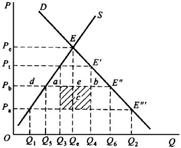

# Chapter 9 Economic integration and the international economic order

> **Core question of this chapter**: if several countries form a customs union and exempt each other from tariffs, is that necessarily a good thing? Why does the WTO make "most-favoured-nation treatment" its first principle, and yet grant exceptions for regional trade agreements? Where are the multilateral trading system's current troubles?

## Thread of the chapter

The theoretical starting point of economic integration is a paper that threw cold water. Post-war Europe sought peace and reconstruction through integration: the Coal and Steel Community of 1951, the *Treaty of Rome* of 1957 establishing the European Economic Community, with the customs union as the core device of integration. The mainstream intuition of the day held that "moving towards free trade" must improve welfare, but Viner's *The Customs Union Issue* (1950) proved that a customs union's "free inside, uniform tariff outside" is a second-best arrangement rather than free trade — it produces both trade creation (low-cost production between members replacing the home country's high-cost production, improving welfare) and trade diversion (production between members replacing what used to be lower-cost trade with non-members, reducing welfare), and the net effect depends on the comparison of the two. This insight of the "second best" (echoing the generalization of Lipsey and Lancaster in 1956) laid the foundation for all later welfare analysis of regional integration. The forms of integration advance in depth: preferential trade arrangement → free trade area (no tariffs inside, but each member keeps its own external tariff, requiring rules of origin to prevent "trade deflection") → customs union (uniform external tariff, no certificates of origin needed) → common market (free movement of factors) → economic and monetary union (policy coordination and even a common currency); Balassa's classificatory framework of 1961 is still in use. Practice produced a regionalist wave in the 1990s (the North American Free Trade Agreement entered into force in 1994), and the surge in regional agreements created a "spaghetti bowl" of overlapping rules, while on the multilateral side: GATT was "applied provisionally" for 47 years after 1947, and through eight rounds of negotiation (especially the Uruguay Round, 1986-1994) tariffs were cut substantially and the coverage extended to services and intellectual property, with the WTO established in 1995 and a quasi-judicial dispute settlement mechanism. The other face of the international economic order is North-South relations: Prebisch's centre-periphery thesis, the 1974 UN General Assembly *Declaration on the Establishment of a New International Economic Order* and the setting up of the generalized system of preferences (GSP) are the historical nodes at which developing countries sought a rewriting of the rules. This chapter's concept section gives the two supports of trade creation/diversion and the customs union; the extended discussion develops the welfare and dynamic effects of a customs union and the principles and content of the WTO.

## Core concepts

### Trade creation and trade diversion

Trade creation is the counterpart of "trade diversion": after two or more countries form a customs union, trade between the members replaces what was previously each country's domestic production and consumption — creating new trade. Trade diversion is the counterpart of "trade creation": preferential arrangements among union members make trade between members replace what used to be their trade with non-members, rather than creating new trade.

Separate the two with numbers. Let the home country levy a tariff of 3 yuan per unit on apples: the lowest-cost country in the world, A, quotes 5 yuan (8 yuan with duty), the candidate partner B quotes 7 yuan (10 yuan with duty), and domestic production costs 10 yuan. Before the union the import choice is A (8 yuan is cheapest), and the domestic producer is also pressed below 10 yuan with no profit to make. After a union with B, B becomes 7 yuan duty-free and A stays 8 yuan with duty: first, the part where the country turns from domestic production to imports from B is trade creation — efficient external production replaces inefficient domestic production, a pure welfare gain; second, the part where imports shift from A to B is trade diversion — production moves from the genuinely lowest-cost country to the second-lowest-cost country that "wins by tariff preference", and global allocative efficiency falls (the country's consumers still benefit from the duty-free entry, but A's output and global efficiency are harmed, and the government loses tariff revenue). To judge the sign of a union's welfare, look at the ratio of the two: if creation exceeds diversion the net welfare is positive, otherwise negative. The rule of thumb: the higher the share of pre-union trade that was already between the members, the higher the members' average tariff, and the smaller the cost gap between members and non-members, the more creation prevails — when the "circle of friends" already occupies most of the business, enlarging the circle creates more than rerouting diverts.

### Customs union

A customs union is an alliance of two or more countries drawn into a single customs area: within the area tariffs and non-tariff barriers are abolished between the members and free trade obtains, while non-member countries are met with a uniform tariff and trade restrictions. It is a form of regional economic integration that goes further than a free trade area, and its feature is that in cancelling import tariffs between themselves the members also establish a common tariff, so that the flow of products between the member economies no longer requires a certificate of origin.

"No certificate of origin needed" is exactly the essential dividing line between a customs union and a free trade area, and the reasoning lies in the problem of "trade deflection": in a free trade area (such as the North American Free Trade Agreement) each member's external tariff differs, and without a restriction an importer could enter through the member with the lowest external tariff (importing through Mexico at low duty, for instance) and then resell duty-free into a high-tariff member (the United States), so that the area's whole external trade policy is "diluted" to the lowest barrier — rules of origin (a good must attain a certain proportion of value added or processing standard inside a member economy before it can enjoy the intra-area exemption) are the sluice against deflection, at the cost of the administrative burden of proving compliance and of new protectionism (the origin standards themselves can be designed to be harsh). A customs union has a uniform external tariff, the deflection problem disappears and certificates of origin become unnecessary with it — but the price is that the members surrender trade-policy sovereignty (the tariff is the tax with the strongest symbolic claim to sovereignty). Each step up in integration trades a layer of sovereignty for a layer of efficiency, and this "sovereignty-for-efficiency exchange line" runs through the EU's whole history from the common market to the euro, and it is the substance of the Brexit debate.

## Extended discussion

### The content and economic effects of a customs union

**(1) Content**

A customs union is where the members reduce or abolish tariffs between themselves; residents of member countries can then consume goods at lower cost and have more choices, and the welfare of the members or of the union as a whole may rise. Outward they apply a uniform (or progressively uniform) external tariff, and tariff revenue is distributed in agreed proportions. The main policy measures: a uniform customs tariff, abolition of internal tariffs; export subsidy policy to strengthen the international competitiveness of products; a uniform external trade policy, developing trade relations with non-member countries in the name of the union; abolition of trade restrictions and free trade within the union, with a uniform tariff and quota regime applied to non-member countries.

**(2) Diagrammatic analysis**

As Figure 9-1 shows, let the country be small, with $D$ and $S$ as the demand and supply curves. Without a tariff the country imports from the low-cost country A: at the price $P_a$ it imports $Q_1Q_2$, and the higher-cost country B is excluded from trade. After a tariff is imposed that raises the price to $P_t$, imports fall to $Q_3Q_4$. If at this point the country forms a customs union with B, with no tariff between them, country A is excluded instead, and the country imports $Q_5Q_6$ from B at the price $P_b$.

**(3) Welfare analysis**

After the union with B, the price falls from the tariff price $P_t$ to $P_b$: consumer surplus rises by $a+b+d+e$ (that is, $P_bP_tE^{'}E^{''}$), of which $d$ is the loss of the country's producer surplus and $e$ is the transfer of tariff revenue, so net welfare is $a+b$ (the trade creation part). But compared with a union with A: imports must shift from A to B, so consumers get $P_aP_bE^{''}E^{'''}$ less, and part $c$ of the original tariff revenue is lost (transferred to B's producers) — if the country had unioned with A, the lowest-cost country, there would be trade creation and no trade diversion. The decision rule the diagram gives: prefer to union with the most efficient partner.

**(4) Economic effects: static and dynamic**

Static effects are the comparison of trade creation and trade diversion (see the concepts and the diagrammatic analysis). There are four dynamic effects: promoting the economic development of the members — the enlargement of market size and production scale brings economies of scale and lower costs; after trade barriers are removed the members can engage in a wider international division of labour, free movement of goods improves resource allocation and promotes growth. Improving market structure — free trade within the union strengthens competition, promotes combinations and mergers of firms seeking competitiveness, and production concentration and market structure evolve accordingly (stronger competition is a gain, deeper monopoly is a risk, and competition policy must be used to offset it). Stimulating investment — a large market with lower risk and instability induces member firms to invest more; the large contrast between the trading environment inside and outside the union also makes non-member firms invest more in the members in order to get around the barriers and reach the large market (this is exactly what drove US firms to invest heavily in the European single market in the 1980s and 1990s). Spillover effects — the economic growth of members raises their import demand, which in turn pushes non-member countries to export more to the members (the dividends of integration are not locked entirely inside the circle).

### The principles and basic content of the WTO

**(1) Six principles**

Non-discrimination: also called the principle of "no differential treatment", embodied in the two provisions of most-favoured-nation treatment and national treatment. Most-favoured-nation treatment means that any preference or exemption granted by a party to the agreement to any third party, now or in the future, is also granted to the other party to the agreement; what the WTO applies is unconditional most-favoured-nation treatment, with the aim of preventing discrimination between members and ensuring equal trade opportunities. National treatment means that the contracting parties guarantee that the other party's natural persons, legal persons and merchants enjoy treatment equal to that of domestic parties inside the territory (the WTO's national treatment applies only to the marketing of imported goods in the domestic market), with the aim of letting foreign products compete with domestic ones on equal terms and making sure the results of tariff concessions are truly delivered. The spirit of the two combined is "no discrimination inside or out, no difference between members" — turning international trade from coercive bilateralism into rule-based multilateralism.

Tariff concession: the contracting parties progressively lower tariffs through negotiation on the basis of mutual concessions, reach tariff concession schedules, and no contracting party may unilaterally amend the rates. This institutionalizes "tariff binding": once the schedule is locked in through negotiation it becomes a legal commitment, and any withdrawal requires compensatory negotiation — trade policy thereby gains a legally predictable boundary.

Abolition of quantitative restrictions: the contracting parties may protect domestic products only through tariffs and generally may not impose import or export restrictions, aimed chiefly at outright import prohibitions, quota administration and import licensing — quantitative restrictions are more concealed and more destructive than tariffs (they cut off the regulating function of the price mechanism entirely), so they are prohibited in principle.

Anti-dumping and the restriction of export subsidies: export dumping is prohibited, and members suffering injury may levy anti-dumping duties when dumping causes or threatens serious injury; export subsidies are prohibited (for manufactured goods), and export subsidies on primary products are limited to what has been committed to. This is the "exception clause" of the free trade principle — it puts retaliatory measures inside a cage of procedure and standards (three conditions for finding, transparent procedure) to prevent them from degenerating into arbitrary protection.

Transparency: the contracting parties' governments must publish the basic laws and regulations on foreign trade so that other contracting governments and merchants can be aware of them, preventing undisclosed discriminatory trade — transparency is the precondition for enforcing every other principle.

Consultation and mediation: when a contracting party lodges a protest with another party over the implementation of the agreement, the latter should give full consideration and consult; dispute settlement is not a legal sanction for breach but a resolution of the dispute through consultation, keeping the balance of rights and obligations. (After the Uruguay Round the dispute settlement mechanism became highly judicialized: two-tier review by a panel and an appellate body, binding rulings, and authorized retaliation if a losing party does not comply — this is the biggest difference between the GATT's provisional regime and the WTO's permanent one.)

**(2) Basic content**

Core provisions: the contracting parties grant one another unconditional most-favoured-nation treatment and tariff concessions in tariffs and trade. Main institutional norms: the rules for national treatment, customs valuation, subsidies, exchange arrangements, import quantitative restrictions and similar trade policies. Procedural provisions: the scope of application of documents, the formalities for accession and withdrawal, the amendment of tariff negotiations and concessions. Special and differential treatment: trade and development preferences as generous as possible for developing countries (the legal basis of the generalized system of preferences comes from here).

**(3) The present state of the system**

The WTO system's current troubles are concentrated in three places: the dispute settlement appellate body has been defunct since 2019 because members' appointment of judges was blocked, so a dispute can appeal into a "no ruling" state and the tooth of multilateral discipline is temporarily dulled; the Doha Round (launched in 2001, with development as its theme) has been stalled for years by the divergence over agricultural subsidies between advanced members and market access between developing members, the era of large-scale multilateral negotiation has paused, and rule-making has moved offsite (to regional and plurilateral agreements); new issues such as industrial subsidies, state-owned enterprises and digital trade have no current rules and collide head-on with great-power industrial policy competition. The multilateral system's "rule deficit" is exactly the soil into which regional agreements (the RCEP and CPTPP of the next chapter) and unilateral instruments (tariffs, export controls) flow back.

## Limits and what follows

The analytical framework of integration and the multilateral system is being rewritten by three trends. First, **the "deep waters" of regionalism**: newer-generation agreements (CPTPP 2018, the EU-Japan EPA 2019, the United States-Mexico-Canada Agreement 2020) extend their coverage from border measures (tariffs) into behind-the-border territory (state-owned enterprise rules, data flows, labour and environmental standards), and the welfare analysis of "deep integration" can no longer use only the Viner framework — the gains from rule convergence (lower compliance costs, locking in domestic reform) and the sovereignty cost (contracting policy space) need new dimensions of assessment; the entry into force of the RCEP in 2022 (15 countries, the world's largest free trade area at roughly a third of global population and GDP) marks Asia's other answer on a "shallow rules, wide coverage" path. Second, **the "friend-shoring" restructuring**: the great-power trade wars since 2018 and the practice of sanctions since 2022 show integration moving from an "efficiency logic" to a double objective of "efficiency × security" — the "de-risking" of supply chains (the EU's wording) and friend-shoring write geopolitical variables into location choice, and a new constraint function has appeared in the customs union theory's "cost-minimizing" world; this turn poses a fundamental challenge to the multilateral most-favoured-nation principle (discrimination becomes a policy instrument again). Third, **the WTO's reform agenda**: restoring the appellate body (the *Multi-Partite Interim Appeal Arbitration Arrangement*, MPIA, is the transitional substitute), the Agreement on Fisheries Subsidies (adopted in 2022, the WTO's first new agreement centred on sustainable development), the plurilateral e-commerce negotiations and the modernization of subsidy rules — if the multilateral system cannot update its rules to cover new forms of trade, the regional agreements' spaghetti bowl will only become denser. Judgement of this configuration determines judgement of the next chapter: whether globalization deepens, slows (slowbalisation) or forks (friend-shoring blocs) depends halfway on how these institutions evolve in the years ahead.

## Reference material

- Krugman and Obstfeld, *International Economics* — the mainstream framework for trade theory and open macroeconomics.
- The full bibliography is on the [bibliography](/reference/参考书目).
- [Wikipedia · Customs union](https://en.wikipedia.org/wiki/Customs_union)
- [Wikipedia · World Trade Organization](https://en.wikipedia.org/wiki/World_Trade_Organization)
- [World Trade Organization](https://www.wto.org/)

<!-- BACKLINKS-AUTO -->
## Related pages

- [History](/international/History)
- [Readme](/international/Readme)
