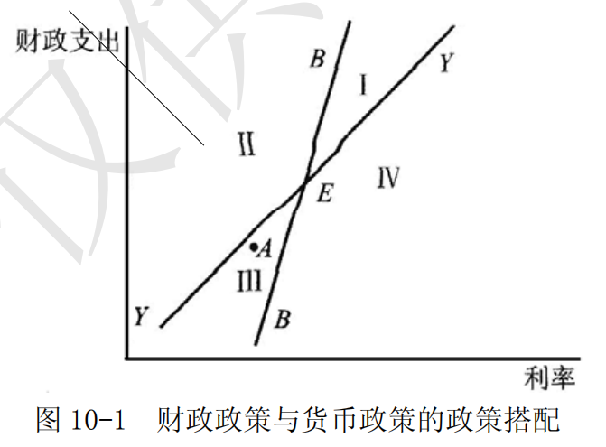

# Chapter 10. Internal–external equilibrium theory

> **The core question of this chapter**: how are internal equilibrium and external equilibrium to be achieved at the same time? What do the Tinbergen rule and Meade's conflict mean? How should policy be combined?

## The arc of this chapter

The first two decades of post-war macroeconomics were the study of a closed economy: Bretton Woods pinned the exchange rates, and Keynesian demand management minded only domestic affairs. But with Europe recovering in the 1950s and the dollar first scarce and then in excess, the balance of payments became a policy problem to face every day — hence this chapter's three-step advance. The first step was Meade (1951), who found the problem: under fixed rates, using the two aggregate instruments of fiscal and monetary policy to pursue internal and external equilibrium at once often produces a bind of "loosen one, tighten the other, and be stuck between them," namely Meade's conflict. The second step was Tinbergen (1952), who gave the counting rule: for however many independent goals there are, there must be at least as many independent instruments — whence "two goals, two instruments" became the charter of policy mix. The third step was Mundell (1962), who solved the pairing: it is not enough to have two instruments, they must be paired correctly — assign internal equilibrium to fiscal policy and external equilibrium to monetary policy, and the economy converges rather than diverges. This chapter sits at the junction of Chapter 7's monetary policy and Chapter 8's exchange rate theory: it is precisely because fixed rates tie up the exchange rate instrument that this whole body of pairing wisdom was forced out.

## Core concepts

### Expenditure-changing policy

Expenditure-changing policy refers to macroeconomic policy that achieves the goal of internal equilibrium by influencing domestic income and domestic aggregate expenditure, or by controlling the money supply to contract or expand domestic investment and consumption and thus aggregate demand, so as to adjust domestic aggregate supply and aggregate demand.
Expenditure-changing policy consists mainly of the demand management policies indicated by Keynesian theory, that is fiscal policy and monetary policy. Implementing expenditure-changing policy achieves the purpose of changing the level of expenditure relative to income.
If the aim is to adjust the balance of payments, fiscal and monetary policy must still act through changing the macro economy as a whole to influence export-import demand and export supply, in order to reach the goal of external equilibrium. Obviously the effort expenditure-changing policy makes toward external equilibrium inflicts a heavy shock on the domestic economy, and the cost of adjustment is too great.

### Expenditure-switching policy

Expenditure-switching policy refers to policy that can affect the international competitiveness of traded goods and, by changing the composition of expenditure, raises domestic income relative to expenditure.
It includes mainly exchange rate policy and direct control measures such as tariffs, export subsidies and import quotas. In the narrow sense, expenditure-switching policy refers exclusively to exchange rate policy.

The division of labour between it and expenditure-changing policy is this chapter's fulcrum: changing policy alters the "aggregate" of expenditure (how much is spent), switching policy alters the "composition" of expenditure (whether it is spent on domestic or imported goods). Internal and external equilibrium need two instruments precisely because aggregate and composition are two independent dimensions.

### The Tinbergen rule

The Tinbergen rule is the principle of allocating policy goals to policy instruments, proposed by the Dutch economist Jan Tinbergen. Tinbergen was one of the joint winners of the inaugural 1969 economics prize.
Its basic content is: to achieve one independent economic goal, at least one independent and effective policy instrument is needed; to achieve n mutually independent goals, at least n independent and effective policy instruments are needed. This principle supplies the basis for combining different policies to achieve internal and external equilibrium at the same time.

### Meade's conflict

Meade's conflict refers to the situation in which, in certain cases, using expenditure-changing policy alone — monetary and fiscal policy — to pursue internal and external equilibrium produces a conflict between a country's internal and external equilibrium. In an open economic environment, macroeconomic policy must not only achieve internal equilibrium, that is currency stability, but also external equilibrium, that is keeping the balance of payments in balance, so as to achieve economic growth and full employment. Normally internal equilibrium is pursued with fiscal and monetary policy and external equilibrium with exchange rate policy. Under a fixed exchange rate regime the exchange rate instrument cannot be used. To employ fiscal and monetary policy to reach internal and external equilibrium simultaneously, the orientations of policy often conflict. But when a balance of payments deficit coexists with a weak domestic economy, or a surplus coexists with domestic inflation, both fiscal and monetary policy are stuck between horns, which economics calls Meade's conflict. To avoid Meade's conflict, different policies are needed for different goals, that is the so-called Tinbergen rule must be satisfied: to achieve n economic goals, n policy instruments must be at hand. Then to resolve Meade's conflict and achieve internal and external equilibrium at the same time, the two policy instruments must be used in combination.

### Internal and external equilibrium

Internal and external equilibrium refers to the economy's equilibrium inwards and outwards.
By achieving internal equilibrium is meant mainly that domestic aggregate supply equals aggregate demand, so that resources are fully allocated and prices are stable, while at the same time assured economic growth is obtained.
By achieving external equilibrium is meant mainly that the economic inflows and outflows between a country and the outside economy are equal, that is the balance of payments is in a balanced state. But it is relatively difficult for a country to achieve internal and external equilibrium at the same time.
When a country's economy is out of equilibrium it needs to adjust, to restore internal and external equilibrium and seek steady economic growth.

## Problems and analysis

### What is the basic idea of internal–external equilibrium theory?

Internal–external equilibrium theory refers to Meade's "two goals, two instruments" theoretical model: if a country hopes to achieve the goals of internal and external equilibrium at the same time, it must simultaneously use the two instruments of expenditure-changing and expenditure-switching policy.

- (1) The meanings of internal and external equilibrium

Suppose a country's economy divides into a trading sector producing tradables and a non-trading sector producing non-tradables, then internal equilibrium is defined as domestic demand for goods and services being sufficient to assure full employment without inflation, that is the non-trading market is in a state of equilibrium with supply and demand equal; external equilibrium means the current account is balanced, that is the supply and demand of traded goods are in equilibrium.

- (2) To achieve internal and external equilibrium, the two policy instruments must be combined

The central bank's ultimate goal of regulation lies in achieving internal and external equilibrium. However macro policy may cause a conflict between the two. To avoid "Meade's conflict," different policies are needed for different goals, that is the Tinbergen rule must be satisfied: to achieve however many economic goals there are, the corresponding number of policy instruments must be at hand, and they must cooperate.

- (3) The combination of expenditure-changing and expenditure-switching policy

Expenditure-changing policy consists mainly of the demand management policies indicated by Keynesian theory, used to adjust the level of expenditure. Expenditure-switching policy refers to policy that can affect the competitiveness of tradables and can raise domestic income by adjusting the composition of expenditure, such as exchange rates, tariffs, export subsidies and import quotas. In the narrow sense, expenditure-switching policy refers exclusively to exchange rate policy.

- (4) Operation in practice

Most countries maintain internal equilibrium with monetary policy and maintain external equilibrium by combining exchange rate policy with direct controls. Because:
- ① Fiscal and monetary policy are more conducive to achieving internal equilibrium relative to expenditure-switching policy, while exchange rate policy and direct controls are more effective at regulating external equilibrium.
- ② Combining direct controls with exchange rate policy achieves the unity of aggregate and structural adjustment.

- (5) Evaluation

It should be noted that whether exchange rates and interest rates, used as economic levers, can achieve the intended effect of regulating internal and external equilibrium depends on many factors. Among them the price elasticity of import and export goods, the degree of marketisation of interest rates, and the degree of openness of capital markets are the three comparatively key factors. Whether an appreciation or depreciation of a country's currency can improve the trade balance, and whether a change in interest rates can cause a change in investment demand and the flow of international capital, are decisive for the above policies and their efficacy. In countries where markets are underdeveloped and administrative intervention in the economy is heavy, the efficacy of policy mixes based on market transmission mechanisms is greatly discounted.

## Synthetic essay

### What does Mundell's policy mix theory say?

In 1962, in a report titled *The Proper Use of Monetary and Fiscal Policy to Achieve Internal and External Stability* submitted by Mundell to the International Monetary Fund, the "policy mix theory" was formally proposed. Its distinctive feature is that it stresses the policy position of promoting external equilibrium with monetary policy and internal equilibrium with fiscal policy.

- (1) The main content of the policy mix theory

Mundell held that fiscal and monetary policy have relatively different effects on the balance of payments and on nominal income. Therefore under a fixed exchange rate regime a country still has two independent policy instruments for achieving internal and external economic goals. For instance a contractionary fiscal policy tends to lower interest rates, while a contractionary monetary policy raises them. Other things being equal, a rise in the domestic interest rate improves the capital account balance, while a fall worsens it. It follows that if both fiscal and monetary policy are contractionary, they have different effects on the balance of payments respectively. So as long as fiscal and monetary policy are combined sensibly, it is possible to achieve internal and external equilibrium at the same time.

- (2) A graphical analysis of the policy mix principle

The policy mix principle is shown in figure 10-1: the horizontal axis shows the level of interest rates, representing monetary policy; the vertical axis shows the level of government expenditure, representing fiscal policy. The BB line is the external equilibrium line, and any point on it represents a balance of payments equilibrium reached by a combination of a given interest rate level and government expenditure. YY is the internal equilibrium line, and any point on it represents a combination of interest rate and government expenditure that brings domestic equilibrium about. In figure 10-1: Ⅰ shows a balance of payments surplus with inflation; Ⅱ a deficit with inflation; Ⅲ a deficit with unemployment; Ⅳ a surplus with unemployment.

Now suppose a country's economy is at point A, that is in a state of disequilibrium where unemployment and a balance of payments deficit coexist — neither internally nor externally in equilibrium. There is a policy mix that can adjust the economy to internal and external equilibrium. That is, solve the balance of payments deficit with monetary policy and the unemployment with fiscal policy. Starting from point A, first practise contractionary monetary policy, raising interest rates so as to approach the BB line, achieving a balanced balance of payments; then practise expansionary fiscal policy, increasing government expenditure so as to approach YY, easing domestic unemployment. In this way, alternating contractionary monetary policy and expansionary fiscal policy steps the economy gradually toward complete internal and external equilibrium, and finally reaches the point of complete equilibrium.

- (3) Optimal policy mix design

From this Mundell derived his "assignment principle": under a fixed exchange rate regime, only by assigning the goal of internal equilibrium to fiscal policy and the goal of external equilibrium to monetary policy can complete economic equilibrium be reached. This is Mundell's "policy mix theory" (see table 10-1). Following this line of thought there is an optimal policy mix design:

| State of economic disequilibrium | Inflation with a balance of payments surplus | Unemployment with a surplus | Inflation with a deficit | Unemployment with a deficit |
|:-----------:|:------------------:|:---------------:|:------------------:|:---------------:|
| Optimal policy mix | 1. Contractionary fiscal policy 2. Expansionary monetary policy | 1. Expansionary fiscal policy 2. Expansionary monetary policy | 1. Contractionary fiscal policy 2. Contractionary monetary policy | 1. Expansionary fiscal policy 2. Contractionary monetary policy |

## Limits and what follows

- **The Tinbergen rule was relaxed by later analysis.** Mundell's (1962) principle of effective market classification points out that the number of instruments equaling the number of goals is not a hard constraint: one instrument can affect several goals at once, as long as different goals are assigned to the instrument each responds to most sensitively — later literature generalised this idea into "effective market classification," and also shows that the arithmetic of "how many instruments to how many goals" does not itself solve the problem; what matters is the relative effects of the instruments.
- **The assignment principle depends on the premise of capital mobility.** Mundell's conclusion rests on "changes in interest rates strongly affecting external equilibrium through the capital account." When Western European capital controls were still widespread in the 1960s this premise did not hold in most countries; and today, with capital highly mobile, the same logic compresses policy space. In practice central banks can still use sterilisation to offset foreign exchange accommodation, and the "division of labour" between fiscal and monetary policy is far less clean than the table suggests — China's experience is a clear example.
- **The stage of fixed exchange rates itself has vanished.** The whole chapter's question comes from the fact that under Bretton Woods the exchange rate could not be used as an instrument. After the major currencies turned floating in 1973 the form of Meade's conflict changed: the exchange rate moves on its own, part of the conflict between internal and external equilibrium is absorbed by exchange rate volatility, and the remainder is restated as the "impossible trinity" — the trade-off among monetary independence, exchange rate stability and free capital flows (see Chapter 8's exchange rate theory and Chapter 9's international monetary system). Mundell won the 1999 Nobel Prize in Economics for this pairing theory, and his model has long since evolved from "how to pair" to "how to trade off."

## Further reading

- Cao Longqi, *Finance* (6th edition) — the standard framework for the chapters on money supply and demand, interest rates, the financial system and policy.
- Krugman and Obstfeld, *International Economics* — the mainstream framework for trade theory and the open macro economy.
- The full list is on the [bibliography](/reference/参考书目).
- [Wikipedia · IS–LM model](https://en.wikipedia.org/wiki/IS%E2%80%93LM_model)

<!-- BACKLINKS-AUTO -->
## Related pages

- [History](/monetary/History)
- [Readme](/monetary/Readme)
