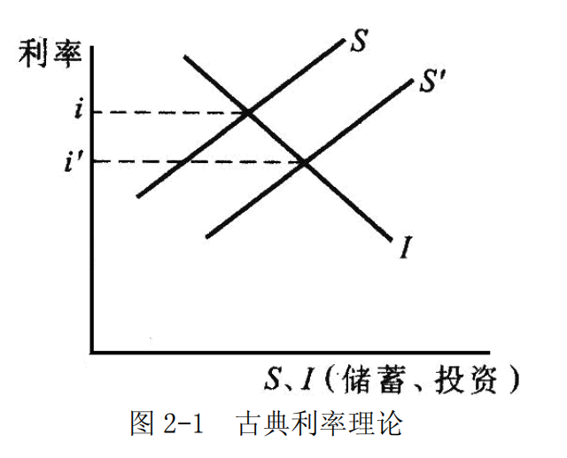
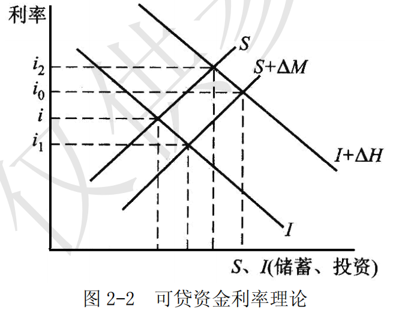
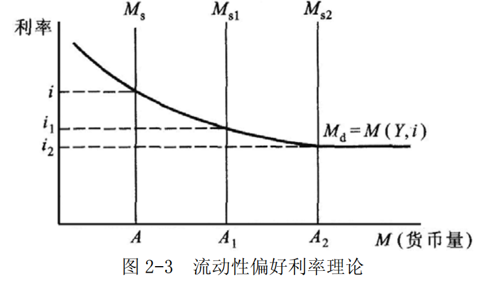
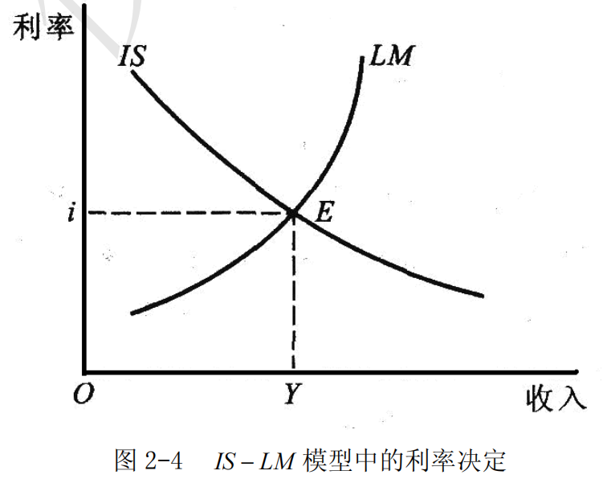

# Chapter 2. Interest rate theory

> **The core question of this chapter**: how is the interest rate determined? What types and structures of interest rates are there? How do interest rate movements affect the economy?

## The arc of this chapter

This chapter first sets out five concepts and then four bodies of theory. The order is not an editorial convenience but is dictated by the object itself: the "interest rate" has never been a single number but a family of prices — different maturities, different risks and different currencies each have their own rate, and among them there must be an anchor that moves them all. So one must first make clear "how a stream of income is converted into a sum of capital" (capitalisation of income), "whether the rate written into the contract and the rate of the true burden are the same thing" (nominal and real), "which member of this family of prices is turned by policy" (the benchmark rate), "where the interest rate differs from the yield actually earned by holding a bond" (interest rate versus yield), and "why there is a separate quotation at the short and long ends of the maturity spectrum" (short and long term). Only once this vocabulary is in place is the theory readable: the four theories are in fact a relay of three questions. The first question came at the turn of the twentieth century — is interest the reward for forgoing consumption? The classical theory (Böhm-Bawerk, Marshall, Fisher's *The Theory of Interest*, 1930) answered "yes": the interest rate is set by the equilibrium of the two real forces of saving and investment. The second question was forced out by the Great Depression: in the 1930s interest rates fell to historic lows while investment still shrank, showing that the chain "a low rate naturally finds borrowers" had snapped. Around 1930 Robertson added bank-created money and hoarding to supply and demand (the loanable funds theory), and Keynes in chapters 13–15 of the *General Theory* (1936) went further, arguing that the interest rate is not the reward for saving at all but the reward for giving up liquidity, determined by the stock supply and demand for money. The third question was how to merge the two lines: Hicks in "Mr Keynes and the Classics" (1937) wrote saving–investment and money supply–demand into one system of equations, and Hansen popularised it as a textbook diagram around 1949 — this is IS-LM. As for the closing section of this chapter on "how interest rates affect the economy and on what conditions", its real-world backdrop is the postwar use of interest rates as the hub of regulation in every country, and an awkward fact exposed by the stagflation of the 1970s — measuring "how dear money is" by the nominal interest rate can give exactly the opposite conclusion (in the 1970s nominal rates ran to double digits while real rates were near zero or negative). Today central banks take a short-term policy rate as their operating anchor (the Federal Reserve's federal funds target rate, the People's Bank of China's 7-day reverse repo rate), and the concepts and theories of this chapter are precisely the preparation for understanding this anchoring mechanism.

## Core concepts

### The capitalisation of income

The capitalisation of income means that, since interest has become the general form of income, anything that yields an income — even if it is not a sum of money lent out, and even if there is no tangible capital behind it at all — can, by comparing its income with the interest rate, be worked backwards into an equivalent capital value.

This seemingly roundabout proposition is the foundation of the whole chapter, because it turns the "interest rate" from a term of a loan contract into a general pricing instrument. The logic is: if a sum of money can earn the rate i wherever it is placed, then the market price of anything with an annual income R — a plot of land, a bond, a firm, a patent — must tend towards R/i; otherwise funds would flow to the side with the higher return. Nineteenth-century economists had already noticed the absurdity of this conversion: land is not capital and rent is not interest, yet land prices do form according to this formula. So capitalisation does not show that land itself bears interest; it shows that in a society where lending relations are universal, every income stream is converted into "the equivalent of how much money". Its practical consequences run through later chapters: Chapter 8 compares the returns on assets in two countries through exchange rates and interest rates, and Chapter 10 values stocks and bonds by discounting — both applications of this formula. As a matter of policy it means that interest rate movements directly revalue every asset — when the Federal Reserve raised rates in 2022 and flattened global risky asset prices, the mechanism was precisely the rise of the i in the denominator.

### Nominal and real interest rates

The nominal interest rate is the rate expressed in money terms, the rate written into loan contracts and securities, that is, the rate observed in financial markets.
The real interest rate is the nominal rate with the factor of price changes (changes in the value of money) stripped out; it is the true cost to the borrower of using funds.
When the general price level is unchanged, the nominal and real rates are equal. With the nominal rate fixed, fluctuations in the price level move the real rate in the opposite direction.
The relationship is:

$$\text{Nominal interest rate}=\text{Real interest rate}+\text{Inflation rate}$$

Or:

$$\text{Real interest rate}=\text{Nominal interest rate}-\text{Inflation rate}$$

One correction must be added at once: this is an approximation. The exact Fisher relation is $(1+\text{nominal rate})=(1+\text{real rate})(1+\text{inflation rate})$; at low inflation the difference is negligible, but at double-digit inflation the error is substantial. It is still usually written as an addition or subtraction because it states the key conclusion most clearly: what determines the true cost is the real rate, and the real rate cannot be read directly off any quotation board — it must be computed by subtracting an inflation expectation that has yet to be published. This is exactly why it is perpetually contested in policy. In the 1970s nominal US rates rose into double digits, yet firms and households did not feel money was dear, because inflation expectations were higher still and real rates were near zero, so borrowing and hoarding real goods both paid; only when Volker forced inflation down did it become clear that real rates had long been underestimated and investment overstimulated. The corresponding Chinese experience is the "indexed savings deposits" during the two rounds of high inflation in 1988 and 1994: when inflation exceeded the one-year deposit rate, real deposit rates turned negative, households shifted into real goods and inflation-indexed subsidies, long-term deposits went begging, and in the end the indexation subsidy rate pushed real rates back into positive territory. This case best shows why this chapter singles out this pair of concepts: the nominal rate is the politically observable quantity, the real rate is the one on which economic decisions are based, and once the two diverge the policy signal is distorted.

### The benchmark rate

The benchmark rate is the rate that leads and influences all other rates; it is also called the "central rate".
The benchmark rate appears mainly as the central bank's rediscount rate, the rate the central bank charges the banks that borrow from it. Changes in the benchmark rate are one of the principal instruments of monetary policy and the core of every country's system of rates. The central bank generally influences banks' borrowing costs by changing this rate, and through them the market rates.

The question this concept handles is: an economy has hundreds of interest rates, and if the monetary authority is to move them it must know where to begin. The textbook takes the rediscount rate as the typical case, reflecting reality before the mid-twentieth century — at that time rediscounting was the central bank's main instrument of control and the discount window was the ordinary channel through which commercial banks obtained reserves. After the 1951 accord between the Federal Reserve and the Treasury gave the Fed independent control of rates, open market operations gradually became the dominant instrument and the anchor moved to the federal funds rate: the central bank no longer set ceilings and floors for bank lending rates but pinned the overnight interbank price of funds to a target and let the other rates rearrange themselves. China's trajectory runs the same way: in 2024 the People's Bank of China explicitly made the 7-day reverse repo operating rate the main policy rate, narrowed the interest rate corridor to 50 basis points on either side of it, faded the policy colour of the medium-term lending facility (MLF), and linked the lending side to the policy rate through the loan prime rate (LPR). In reading this passage, replace "the rediscount rate" with the "overnight policy rate" of whatever market you are in; the concept is unchanged: the essence of the benchmark rate is the one price the authority alone can set directly, with all other rates following through the transmission mechanism — and whether that transmission runs smoothly is precisely what section three of this chapter's "Problems and analysis" and Chapter 7 on monetary policy must test.

### Interest rate and yield

The interest rate is short for the rate of interest, the ratio of the amount of interest to the principal lent over a given period. It expresses the degree of self-expansion of interest-bearing capital and is the yardstick of interest relative to principal.
The yield is the interest paid to the holder of a security plus the rate of price change expressed as a percentage of the purchase price. The formula for the yield from holding a bond from time $t$ to time $t+1$ is:

$RET = \frac{C + P_{t+1} -P_{t}}{P_{t}}$

Here $RET$  is the return from holding the bond from time $t$ to time $t +1$,
$P_{t}$  is the price of the bond at time $t$;
$P_{t+1}$  is the price of the security at time $t +1$;
$C$ is the coupon interest.

The interest rate is the ratio of interest to principal, but it cannot accurately measure the return an investor obtains from holding a security over a given period. The yield can measure it accurately.

The practical use of separating the two concepts is to prevent a common misjudgement: for a ten-year treasury bond with a 3% coupon, when the market price falls to 90, the holder in that year may collect 3 in interest and lose 3 in principal, for a negative yield; while a new buyer's expected yield is above 3%. The first is an ex-post accounting measure, the second an ex-ante decision quantity, and their signs may even disagree. Market commentary describes a bond market plunge as "yields rising"; read as "higher rates are good for investors", this produces exactly the wrong conclusion. The theories later in this chapter and the bond pricing of Chapter 10 all circle the same formula: substitute discounted future cash flows for $P_{t+1}$ and the yield becomes the yield to maturity while price becomes an inverse function of the interest rate — the rule that bond prices move opposite to interest rates has its origin here.

### Short-term and long-term interest rates

The rates in financial markets fall by maturity into short-term and long-term rates.
Short-term rates reflect the lending rates in money markets and long-term rates the lending rates in capital markets; the two markets therefore form different levels of rates, and short-term rates are generally lower than long-term rates. But because the two markets are closely linked, movements in rates cause funds to flow between them, and those flows in turn move rates; rates in the two markets are thus joined together, with short and long rates rising and falling together, though the swings of short-term rates usually exceed those of long-term rates.

"Short is usually below long" needs a qualifier: it is an empirical rule under normal conditions, for which there are three explanations — expected future short rates will rise, long-term lending must be compensated for the sacrifice of liquidity (the liquidity premium), and borrowers and lenders are each attached to their own end of the maturity spectrum (market segmentation and preferred habitat). Each becomes an object of analysis in its own right, in the expectations theory of Chapter 3 and the yield curve of Chapter 10. The qualifier must be stated because inversion is a real phenomenon: US ten-year treasury yields fell below short rates repeatedly in 1969, 1973, 1981, 1989, 2000, 2006, 2019 and 2022, usually because the central bank pushed short rates above the level the market deemed appropriate for the long end; "inversion predicts recession" mostly held in those years, but treating it as a reliable prophecy is unsafe — the 1969 inversion corresponded only to a brief recession, and the inversion beginning in 2022 was not accompanied by a deep recession in the following two years. As for "short swings exceed long swings", the arithmetic reason is blunt: a long rate approximates an average of a whole future run of short rates, and the average of a series must fluctuate less than its components; the short end therefore reflects policy actions and the long end expectations and risk compensation. This supplies the reason why the Keynesian theory below concentrates entirely on the short end, and it foreshadows the later reality that "central banks can only control the front end".

## Problems and analysis

### Can the interest rate really be determined by saving and investment alone? The classical mechanism and its flaw

The main idea of the classical theory of interest is that the interest rate is determined by the equilibrium of the desire to invest and the willingness to save.
Investment is the demand for funds, falling as the rate rises; saving is the supply of funds, rising as the rate rises; the interest rate is the price at which the demand for funds equals the supply, as shown in figure 2-1.

As a rule, on the one hand, the higher the interest rate, the greater the saving. Saving is an increasing function of the interest rate: $S=f(i)$ .
On the other hand, the lower the interest rate, the larger the volume of investment; investment is a decreasing function of the interest rate: $I=q(i)$  .
Both saving and investment are functions of the interest rate.
i is the equilibrium level of the interest rate at which saving and investment are equal.
If saving rises while investment stays unchanged, the equilibrium interest rate falls to $i^{'}$ .

The value of this analysis is that it gives the interest rate an empirical meaning: the equilibrium rate is not decreed by the authorities but is the crossing of two schedules of intentions, and any attempt to push it up or down opens a gap between saving and investment. Its flaws were pointed out on two counts in the 1930s. The first is circular reasoning: investment depends not only on the interest rate but on firms' expectations and capacity utilisation, and saving depends chiefly on income rather than the interest rate — while the level of income is in turn determined by investment. To draw two curves that move only with the interest rate while income is undetermined is logically incomplete. The second is empirical: by 1933 US long-term rates were down to around 3% and investment had almost stopped; "a rate low enough will find borrowers" does not stand against the data. These two criticisms, from Keynes (income and expectations) and Robertson (monetary factors), are exactly the starting points of the next two theories. Seen today, the part of the classical theory still retained is its emphasis on real factors — demographics, fiscal deficits and the pace of technical progress determine the long-run path of the real interest rate. This line of thought revived after 2000 in the debates on the "global saving glut" and "secular stagnation" (Bernanke 2005, Summers 2014), used to explain why long-term rates in developed countries kept falling through the low-inflation decades — something no central bank can decide.

### What happens to the answer once monetary factors are added?

The loanable funds theory of interest is the logical extension and theoretical development of the classical theory, created in the 1930s and 1940s. On the one hand it inherits the classical tradition of analysing interest from long-run real economic factors; on the other it begins to attend to the short-run action of monetary factors, taking flow analysis as its thread.

The loanable funds theory holds that the interest rate is determined by the supply of and demand for loanable funds. The supply of loanable funds includes:
- Total saving $S$
- The newly created money of the banking system $\Delta{M}$ .

The demand for loanable funds includes:
- Total investment $I$;
- The increase in idle money balances held for speculative motives $\Delta{H}$ .

The interest rate brings the supply and demand for funds into equality:

$$I+\Delta{H}=S+\Delta{M}$$

In figure 2-2, $i$ is the classical equilibrium level of the interest rate.
When the supply of loanable funds rises and demand stays unchanged, the rate falls to $i_1$;
when the demand for loanable funds rises and supply stays unchanged, the rate rises to $i_2$;
$i_0$  is the new equilibrium rate at which total loanable funds supply equals total loanable funds demand.
The total of loanable funds is to a great extent under the control of the central bank, so government monetary policy becomes a determinant of the interest rate and must be taken into account.

The key change lies in the two terms $\Delta M$ and $\Delta H$. $\Delta M$ admits that banks can create new purchasing power through credit beyond saving, so that the interest rate is not bound hard by current saving — especially visible in wartime finance and in the investment surges of late-developing countries. $\Delta H$ (hoarding) admits that people may neither consume nor invest but simply hold money still — a slot that does not exist in the classical system. Once these two terms are written into the equation, the central bank enters the determination of the interest rate: the first time in the history of theory that monetary policy was made an endogenous element of the interest rate, with policy implications fully developed in Chapter 7. The theory also has a structural defect pointed out by Tobin and others: the left side of the equation is a flow while the right side mixes in stock adjustments, and $\Delta H$ and $\Delta M$ themselves depend on the interest rate and income, so the question of "who determines whom" is not really solved, only the classical circle enlarged by one turn. It is better used as the language for understanding "tight or loose credit conditions" than as a self-contained equilibrium theory — everyday talk of "tight money" or "the funding picture" uses exactly this vocabulary of flows.

### Is interest the reward for giving up liquidity? Keynes's answer

The liquidity preference theory of interest was put forward by Keynes in the 1930s; it is a monetary theory of interest weighted towards short-run monetary factors.

- (1) Under the liquidity preference theory, money demand falls into three parts:
- (i) Transactions demand for money, a function of income, rising with income;
- (ii) Precautionary demand for money, rising with income and falling as the interest rate rises;
- (iii) Speculative demand for money, a decreasing function of the interest rate. Money demand Md can be written as a function of income Y and the interest rate i: $M_d=M(Y,i)$ .

	Money supply is a policy variable, determined by monetary policy.

As shown in figure 2-3, before full employment is reached, an increase in the money supply lowers the interest rate from $i$  to $i_1$.
When the money supply reaches $A_2$, the rate is $i_2$; there the money demand curve is horizontal and money demand is infinite — the liquidity trap. From this point, however much the money supply grows, the interest rate will fall no further.

The question Keynes answered was: why would anyone hold cash that bears no interest? His answer was that "liquidity itself has value" — the ability to meet the unexpected at any moment and seize future opportunities is a convenience whose cost must be measured in forgone interest. Holding money is therefore an act of asset choice, and the interest rate is the price of that act, no longer the reward for saving. The centre of the theory thus shifts from the lending contract to "the equality of the stock supply and demand for money at a point in time": income determines only transactions demand, and the interest rate is set jointly by the whole quantity of money and liquidity preference. Three notes belong here. First, writing precautionary demand as a function of the interest rate is a later result (Whalen's proof of 1966); Keynes himself preferred to fold it into the income function. Second, speculative demand rests on an implicit judgement — everyone carries a "normal rate" in mind; above it they expect bond prices to fall and hold cash, below it the reverse — a logic that turns the yield formula of section 4 into the microfoundation of interest rate determination. Third, the horizontal stretch in figure 2-3 (the liquidity trap) is not a theoretical ornament but a reality that reappeared in Japan in the 1990s and in Europe and America after 2008: with short-term rates pinned near zero, newly created money is voluntarily held and expansion can no longer push rates down. By the way, $A_2$ is simply the label of a money supply marked on the diagram, to be read as "the money supply grows to that level".

- (2) The differences between the liquidity preference theory and the loanable funds theory are:
- (i) The liquidity preference theory is a short-run monetary theory of interest, stressing the determining role of short-run money supply and demand; the loanable funds theory is a long-run real theory of interest, stressing the role of real economic variables.
- (ii) In the liquidity preference theory the supply of and demand for money are stocks; the loanable funds theory attends to the analysis of flows of money supply and demand over a period.
- (iii) The liquidity preference theory analyses chiefly short-run market rates; the loanable funds theory places the emphasis on the long-run movements of real rates.

The liquidity preference theory and the loanable funds theory do not contradict each other. Every factor that moves the interest rate in the loanable funds theory moves it in the liquidity preference theory too; likewise the supply of and demand for money in the liquidity preference theory form part of the loanable funds theory.

## Synthetic essay

### How do the two markets deliver one interest rate at the same time? The neoclassical synthesis

The level of the interest rate is the question of what determines the quantity of interest — what the rate actually is. The eminent British economist Hicks and the American economist Hansen, building on the classical theory, the loanable funds theory and Keynes's theory of interest, proposed the celebrated $IS-LM$ analysis.

Western economists who use the $IS-LM$ framework to analyse the economy treat the equilibrium of the national economy as the conjunction of equilibrium in real terms and equilibrium in monetary terms, that is, they divide the economy into the goods market and the money market. The $IS$  curve shows the combinations of the interest rate and income at which supply and demand in the goods market are equal; the $LM$  curve shows the combinations at which supply and demand in the money market are equal; the intersection of the $IS$  and $LM$ curves is the combination of the interest rate and income at which both markets are in equilibrium at once. The rate determined at this point is the equilibrium rate and the income determined there the equilibrium income; governed by the two, the whole national economy is in equilibrium.

In figure 2-4, the $IS$  curve shows equilibrium in the goods market $I = S$; the $LM$  curve shows equilibrium in the money market $L=M$; when the two curves are set in the same coordinate plane, their intersection, the equilibrium point $E$, satisfies two conditions at once:
- $I=S$
- $L=M$

Only at the point $E$ can the two markets reach equilibrium simultaneously; the rate $i$ determined there is the equilibrium rate that satisfies both markets' equilibrium conditions at once, and $Y$  is the equilibrium national income under the equilibrium conditions of both markets.

When the $IS$  and $LM$ curves shift, the equilibrium rate necessarily moves with them. Since shifts in $IS$ arise from changes in investment or saving, and shifts in $LM$ from changes in money supply or money demand, changes in any of these variables change the equilibrium rate.

Hicks's contribution was not to invent a new mechanism but to admit that the earlier two theories had each told half the story: the classical and loanable funds theories spoke of the goods market, Keynes of the money market, and the joint solution of the two markets must deliver the interest rate and income together. This exactly cures the circular reasoning flagged in the first section — income is no longer taken as given but solved out jointly with the interest rate from two equations. Note the price of the merger: IS-LM compresses three prices of different maturities and different natures into a single $i$, while in reality the short end is set by policy and the long end by expectations and risk compensation, and the two can move in opposite directions (2022, with the short end surging while the long end stayed calm, is the classic case); a static crossing of curves is helpless before this. Moreover, the Keynesian half absorbed into the diagram is Hicks's 1937 reading of the *General Theory* — expectations were written as deterministic functional relations, while the "radical uncertainty" that chapter 12 of the *General Theory* insists on vanished from the picture. This was the main ground from which the British post-Keynesians of the 1960s and 1970s (Kaldor's Radcliffe Committee papers, Edey and Wood) attacked IS-LM, and the reason Hicks himself, writing "IS-LM: An Explanation" in 1980, expressed dissatisfaction with his own diagram.

### How do interest rates affect a national economy, and on what conditions?

The interest rate is the ratio of the amount of interest to the principal lent over a given period, an important variable in financial activity. Its changes affect the other variables of economic activity through the interests of borrowers and lenders, and thereby affect the economy.

- (1) The influence of interest rates on a national economy shows itself concretely as:
- (i) The effect of interest rates on consumption and saving
		Because the interest rate is the return savers earn on interest-bearing assets, a higher rate raises that return, increases the opportunity cost of current consumption, leads households to cut current consumption and increase saving, and also reduces cash holdings and increases the supply of interest-bearing assets. High rates also shrink firms' scale of production, which lowers household income, purchasing power and consumption.

		Here one must guard against stating the conclusion as one-way. A rise in rates produces at once a substitution effect (future consumption becomes cheaper, so turn to saving) and an income effect (savers' future income is fatter, so they dare consume more); the two run in opposite directions and the net effect is hard to settle empirically. The consensus across cross-country household data is that the elasticity of saving to the interest rate is small: the rate rises of the 1980s in many countries produced no marked rise in saving rates, and during the long decline of developed-country rates from 1990 to 2010 household saving rates did not contract as classical theory predicts (the US personal saving rate in fact climbed sharply after 2005). Admitting the small elasticity is what makes intelligible why policy must work through harder channels — not "get households to save more" but make borrowing to buy homes or build plants dearer; see the investment and financial channels below.

- (ii) The effect of interest rates on investment
			 The interest rate is a cost of firm investment: the higher the rate, the larger the cost, the lower the returns to production and investment, and the smaller the scale of investment. Conversely, low rates cut investment costs and increase the volume of investment.

- (iii) The effect of interest rates on inflation
			 In a society with a fairly high degree of marketisation, high rates can restrain excessive investment and so prevent inflation; in a slump, lowering rates can prevent excessive contraction.

- (iv) Interest rates and financial institutions
		Movements in interest rates prompt banks and other financial institutions to adjust the structure of their assets and liabilities, seeking to increase returns or contain costs under the new rates. This influence makes it possible for the central bank to use interest rates to affect the volume and direction of credit and thereby regulate the macro economy.

		Point (iv) gained a concrete lesson after 2008: bank assets are mostly medium- and long-term fixed-rate loans while liabilities are short floating-rate deposits, so a low-rate environment squeezes net interest margins while encouraging banks to "borrow short and lend long" to earn the maturity spread. The failure of Silicon Valley Bank in 2022–2023 was exactly the dark side of this structure: the rate rises turned long-term securities on the asset side into unrealised losses while deposit costs on the liability side rose and deposits fled at the same time — movements in interest rates were no longer "an opportunity to adjust structure" but became directly a question of solvency. Chapter 6 on financial regulation and this passage of the present chapter join precisely here.

- (v) Interest rates and external economic activity
		In a country open to the outside, the economy is closely tied to the world market, and movements in interest rates affect its external economic activity in two ways:
		- one is the effect on imports and exports;
		- the other is the effect on the outflow and inflow of capital.

		When rates are high, firms' production costs rise, product prices climb, export competitiveness declines and exports shrink, producing a deficit in foreign trade.
		Conversely, lower rates strengthen the competitiveness of export producers and improve the country's trade balance. As for capital flows, attracted by high rates foreign capital flows in quickly, especially short-term arbitrage capital; this may temporarily ease the pressure on the balance of payments, but an inflow of foreign capital at high rates also brings many ill consequences — imported inflation, heavy burdens of principal and interest — which may worsen the balance of payments. The regulatory and economic influence of interest rates, given the complexity and variety of their determinants, cannot be fully explained by these few headings; only the main points can be sketched.

		The real force of the capital-flow branch after 1997 far exceeded the textbook's imagination: interest differentials and exchange rate expectations jointly decide the coming and going of short-term capital, and its speed can make the combination "raise rates first to attract funds, then defend the exchange rate" fail on both counts (the internal–external equilibrium theory of Chapter 1 and the crisis cases of Chapter 8). Russia and Argentina in the early 1990s pushed rates into the hundreds of percentage points to defend their currencies, the Southeast Asian countries raised rates sharply in 1997 to hold their pegs, and the Bank of Japan's slow exit from negative rates in 2024 produced a violent repricing of the yen and the carry trade — cases showing that point (v) is not the last of the five influences but often the first to go off.

- (2) The conditions that circumscribe the working of interest rates

		Whether the effects above operate, and how large they are, depends on whether the conditions for interest rates to work effectively are present, and to what degree. The conditions are complex, and may be summed up under the following main heads:

- (i) The degree of independence of the micro agents in a national economy, and their sensitivity to interest rates.
		Interest rate regulation works by affecting the interests of micro agents; whether those agents are independent decision-making economic entities bears on the effectiveness of their budget constraints and on whether they can respond promptly and quickly to movements in rates.

- (ii) The degree of development of financial markets.
		How developed a country's financial markets are is the precondition for rates to transmit information quickly between markets and guide the flow of funds.

- (iii) The structure of interest rates, the degree of marketisation of interest rate determination, and whether the central bank takes the interest rate as an instrument of macro regulation also affect the working of interest rates.
		Whether rates reflect market supply and demand directly and truthfully, and whether the central bank can influence market rates through its instruments, determine whether rates can serve as an instrument for regulating the macro economy, and to what degree.

These three conditions correspond exactly to the debates in China in the 1980s and 1990s: state-owned enterprises and local governments were then quite insensitive to interest rates (soft budget constraints, Kornai's concept), and whenever rates rose they demanded fiscal interest subsidies, so "regulating investment through rates" could not hold at the micro level. The path of reform was therefore not to adjust rates first but to harden constraints first, develop the interbank and bond markets, and only then liberalise rate controls step by step — the interbank offered market freed in 1996, Shanghai interbank offered rates (Shibor) quoted from 2007, the floor on lending rates removed in July 2013, the floating ceiling on deposit rates lifted in October 2015, and the loan prime rate (LPR) reformed in August 2019 to a formation mechanism of "policy rate plus a spread". This timeline is exactly the process by which the three conditions above were created one after another, and it shows why the closing section of this chapter matters: the mechanisms of interest rate theory are written on paper; whether they can be used depends on whether a set of institutions is in place.

## Limits and what follows

- **The four theories were never merged into a universally accepted model; today they divide the work by purpose.** Modern central banking practice and mainstream textbooks (such as Mishkin's *The Economics of Money, Banking and Financial Markets*) use them roughly as follows: what policy can directly control is explained by liquidity preference (the short end is set by money supply and demand and policy); the tightness of funds and credit expansion by loanable funds (the flow perspective); and the drift of long-term rates by real factors (saving–investment, demographics and technology — the lineage of the "natural rate", from Wicksell through Modigliani to Bernanke's post-2005 "global saving glut" and Summers's "secular stagnation"). The disagreement is concentrated on the long end: the sustained fall of long-term rates in developed countries from 2000 to 2015 is attributed to a saving glut, a shortage of safe assets (Caballero and others), or quantitative easing compressing term premia, and the camps' evidence has yet to convince one another.
- **IS-LM became the centre of the textbook while being disowned by its inventor.** After 1980 Hicks repeatedly voiced his dissatisfaction, on the ground that the framework erased time, the structure of production and uncertainty. The stagflation of the 1970s exposed a more direct problem: the static simultaneous solution presumes the inflation rate is exogenous, whereas at high inflation the difference between nominal and real rates (this chapter's second concept) decides whether the whole diagram shifts at all — Dornbusch and Fischer's 1986 textbook wrote inflation expectations formally into IS-LM precisely to make up this lesson, while Lucas's 1976 critique questioned from the foundations whether such policy analysis, with its historically estimated coefficients, could still hold after a change of policy rule.
- **The liquidity trap turned from assumption into observation, and the boundary of interest rate policy was redrawn.** Japan adopted the zero interest rate policy from 1999 and introduced negative rates and yield curve control in 2016; the euro area's deposit facility rate went negative from 2014; the United States sat at zero from 2008 to 2015 and from 2020 to 2022. The lesson of this experience is not that "interest rate theory has failed" but that the conclusion of this chapter's section on short and long terms is magnified: the central bank can hold down the short end, while the long end must be reached through committed expectations and asset purchases that bear on the term premium. Whether unconventional instruments raised inflation expectations, and whether their side effects (on bank margins, on asset prices, on fiscal discipline) were worth it, remain contested among scholars and central banks — a debate that already leaves interest rate theory proper for Chapter 7 on monetary policy and Chapter 6 on financial regulation.
- **China's system of rates swapped in a new structure over a decade or so, and this chapter's definition of the "benchmark" needs updating on the spot.** The textbook gives the rediscount rate as the typical form of the benchmark rate; today's chain is: the policy rate (the 7-day reverse repo operating rate, made the main policy rate from 2024, with the corridor narrowed to 50 basis points around it) → money market rates (DR007, Shibor) → the bond yield curve → the LPR (loan prime rate, in one-year and over-five-year tenors, quoted monthly as "policy rate plus a spread") → deposit rates (their ceiling set since September 2022 with reference to the ten-year treasury yield and the demand deposit rate). The regulatory colour of quantity instruments (the reserve requirement ratio) is visibly fainter than in 2003–2015. So in reading this chapter, read "the benchmark rate is the rediscount rate" as "the benchmark rate is the short-term policy rate the central bank can control"; and the constraint of "the degree of interest rate marketisation" named in the closing section has entered a new stage in China — "formally liberalised, transmission still under construction". The debates since 2023 over cuts in deposit rates, the adjustment of rates on outstanding mortgages and the asymmetric cuts of the LPR are fought precisely over which link of this chapter's transmission chain is still missing.

## References

- Cao Longqi, *Finance* (6th edition) — the standard framework for the chapters on money supply and demand, interest rates, the financial system and policy.
- Mishkin, *The Economics of Money, Banking and Financial Markets* — an empirical perspective on money demand and the transmission mechanism.
- The full list is in the [bibliography](/reference/参考书目).
- [Wikipedia · Yield curve](https://en.wikipedia.org/wiki/Yield_curve)
- [Wikipedia · Term structure of interest rates](https://en.wikipedia.org/wiki/Term_structure_of_interest_rates)

<!-- BACKLINKS-AUTO -->
## Related pages

- [History](/monetary/History)
- [Readme](/monetary/Readme)
