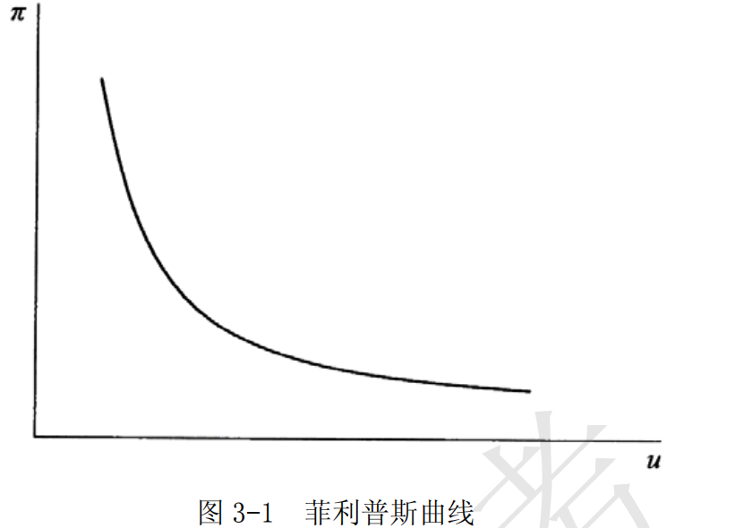

# Chapter 3. Inflation and deflation

> **The core question of this chapter**: how are inflation and deflation measured? What are their causes? What effects do they have on the economy? How are they to be governed?

## The arc of this chapter

Inflation only became a routine phenomenon in the twentieth century, and this chapter's four questions (measurement, causes, effects, treatment) grew along that timeline. Measurement gets its own section because the choice of index itself decides the conclusion: price indices were first used in union negotiations (Britain 1744, the US Bureau of Labor Statistics compiling the CPI from 1913), and the difference in scope among the CPI, the PPI and the GDP deflator means that the "inflation rate" for the same year can differ by more than a percentage point. The quarrel over causes followed the ills of the age: in the post-war rebuilding years price rises were attributed to demand-pull ("too much money chasing too few goods"), and Keynesianism therefore took the Phillips curve (wage data from 1958, rewritten by Samuelson and Solow in 1960 into an inflation-unemployment menu) as a policy instrument; under the oil shocks of the 1970s prices rose while unemployment rose too, so cost-push and inflation inertia became the mainstream explanations, and Friedman's and Phelps's (1968) "natural rate" hypothesis was confirmed by the data at the same time. The evolution of treatments was likewise driven by failures: income policy (wage and price controls) appeared briefly after Nixon froze wages and prices in 1971, Volcker turned to monetary contraction in 1979 and bought back credibility with a severe recession, and thereafter countries made inflation targeting the default arrangement. Deflation is the reverse lesson of this framework: Fisher's (1933) debt-deflation theory explains how falling prices in the Great Depression aggravated real debt, and Japan's long deflation after the 1990s and China's 1998-2002 (deflation while maintaining high growth) show that "falling prices necessarily mean a bad economy" needs correcting - which is also why this chapter's point (5) deliberately leaves an exception.

## Core concepts

### The Phillips curve

The Phillips curve is named after the British economist A. W. Phillips, who first proposed it. Phillips's original 1958 study described a negative correlation between the unemployment rate and the growth rate of money wages; the economics profession only later often extended it into a short-run substitution relation between the inflation rate and the unemployment rate, and used it to explain the relation among the general price level, the unemployment rate and aggregate demand.

Different schools hold different views on the exact shape of the Phillips curve.
The widely accepted view is:
- In the short run, the short-run Phillips curve slopes down to the right
- The long-run Phillips curve is a vertical line, showing that no substitution relation exists between the unemployment rate and the inflation rate.

Note that the curve went through two changes of identity. The first was switching from the wage growth rate to the rate of price increase - because firms pass wage costs on to prices, the two are approximately comparable, but this switch turned a statistical regularity into a policy menu (which is exactly what Samuelson and Solow used it for in 1960). The second was adding expectations: Friedman and Phelps (1968) pointed out that workers will in the end demand nominal wages that catch up with prices, so that any stable inflation rate corresponds to the same unemployment rate only, the short-run curve can shift, and the long-run curve is vertical. The historical value of this curve lies not in the equation but in what it shows - a statistical regularity without a micro mechanism (how expectations form) underneath it will be used by policymakers until it turns around and bites them.
### Inflation

In western economics textbooks inflation is usually defined as the phenomenon of a sustained rise in the general level of money prices of goods and services.
This definition contains the following points:
- (1) It stresses taking the prices of goods and services as the object of study, in order to distinguish them from the prices of shares, bonds and other financial assets.
- (2) It stresses "money prices", that is the prices of each unit of good or service stated in money, to make clear that inflation analysis concerns the relation between goods and services and money, not the comparison between goods and services among themselves.
- (3) It stresses the "general level", indicating that the focus here is on general price-level fluctuation, and not merely regional or price fluctuation within some class of goods and services.
- (4) Regarding "sustained rise", it stresses that inflation is not an accidental jump in prices but a "process", and one that has an upward trend.

These four points are really drawing the boundary of "inflation", and each corresponds to a class of common misjudgement. Excluding asset prices is to avoid counting share and housing bubbles into the cost of living (this is also the definitional question in the pre-2008 dispute over "is it inflation or an asset bubble?"); stressing money-denominated prices is because a change in relative prices (some good getting dearer) means something entirely different from a general price rise; stressing the "general level" is to separate structural price rises from general ones; and stressing "sustained" separates one-off price reforms, tax adjustments and disaster shocks from inflation in the true sense - in both 1988 and 2007 China saw a single-year CPI spike, and judging whether it was a one-off shock or an inflation process decided directly whether to use contractionary policy or to wait for adjustment. Classified by the size of the rise, the customary categories are mild inflation (single digits), accelerating or galloping inflation (dozens to hundreds of percentage points) and hyperinflation (prices doubling on a daily basis); the last appeared in 1920s Germany, 1940s China, 2008 Zimbabwe and Venezuela after 2017, and it shows best that the core mechanism of inflation is the simultaneous collapse of money and of confidence.
### The consumer price index

The consumer price index is a price index that reflects in aggregate the trend and degree of change in the prices of residents' consumer goods and service items over a given period. Because it is directly connected with the daily life of the public, it has a superiority over other indicators in testing the effects of inflation that is hard to match.

But it is a fixed-basket price index, and therefore carries three kinds of systematic bias: substitution bias (after relative prices change, consumers switch to cheaper goods, while the index still counts against the old basket), new-good bias (new goods are not counted before they enter the basket), and quality bias (a price rise may correspond to a quality improvement). The Boskin Commission (1996, US) estimated that the CPI then overstated the cost of living by about 0.8-1.1 percentage points a year, a figure that directly affects the indexing of US social security and the computation of the retirement age. Two other indicators sit alongside it: the GDP deflator covers all domestic goods and services and its basket adjusts automatically with the output structure, but it lacks monthly frequency; the producer price index (PPI) reflects the factory-gate stage, usually leading the CPI, but whether it passes through depends on the competitive structure. Central banks' operating targets also diverge at this point: the Federal Reserve watches the personal consumption expenditure deflator (PCE, chain-weighted and including the implicit expenditure on health insurance), the euro area and the UK watch the harmonised CPI (HICP, excluding owner-occupied imputed rent), and China takes the CPI increase as its main regulatory target - the same phrase "keep prices stable" does not mean the same thing on different indices. In addition, food carries a heavy weight in China's CPI (about a third), and price swings in pork and vegetables alone can move the year-on-year reading considerably, which is also why "food inflation" so often becomes the focus of policy debate in China. The bulletin gives two readings: year-on-year compares with the same month of the previous year, used to see the trend and strip out season; month-on-month compares with the previous month, used to see short-run swings, and is sensitive to seasonal factors. Categories such as pork and vegetables, which are heavy-weighted and highly seasonal, give different stories under the two readings.
### The forced saving effect

If government raises funds for construction by borrowing from the central bank and thereby causing an issue of extra money, it forcibly increases investment demand across society, and the result will be a rise in prices. With the public's nominal income unchanged, consumption and savings carried out in the old pattern and quantity both fall in real terms by the corresponding amount as prices rise, and the part that is lost is roughly equivalent to the part by which government realised its income through inflation. Government savings realised this way are forced savings.

Another name for this concept is the "inflation tax": government takes real resources by creating money, its tax base is the money held by the public, and the tax rate is the inflation rate. The premise for it to hold is that the public does not get the price rise back - that is, that monetary illusion or a lag in contract adjustment exists. This also explains how it unravels itself under high inflation: Kagan's (1956) study of six hyperinflations found that when prices rise people immediately dump money for goods, real money balances shrink rapidly, and so the tax base of the inflation tax collapses as the rate rises, so that government actually receives little in the way of real resources. The 1980s debate in developing countries over "does inflation help accumulation" and China's end-1980s discussion of fiscal overdrafts on the central bank were both really arguing over how strong this effect is.
### The income distribution effect

Since the sources of income differ greatly across strata of society, when the general price level rises some people's real income falls while others' real income actually rises. This redistribution of income caused by rising prices is the income distribution effect of inflation.

As to who wins and who loses, the rule can be arranged by "whether the contract is written in stone": those living on fixed nominal income (pensioners, staff on fixed salaries, holders of cash) are hurt first; debtors repay with depreciated money while creditors receive the same sum but can buy back less with it, so wealth transfers from creditors to debtors; those with bargaining power, who can raise wages to keep pace with prices, and sectors that can adjust product prices quickly are barely affected; holders of real assets such as housing rise in value along with prices. From this one can see that the real force of inflation lies not in "everyone getting poorer" but in transferring income away from those least able to bargain and least able to adjust - which is also why, politically, it is more hidden and more unfair than taxation.
### Stagflation

Stagflation is where the economic process does not show a mutual "substitution" between unemployment and inflation but rather economic stagnation accompanying inflation, a high inflation rate accompanying a high unemployment rate. This shows that the description and derivation of the Phillips curve do not always hold.

Stagflation in the 1970s is one of the most important empirical events in macroeconomics: when the old curve could only offer the option "either inflation or unemployment", reality delivered both at once, and demand management thereby failed - stimulus worsened inflation, contraction worsened unemployment. There were two theoretical ways out: one conceded supply shocks (rising oil and food prices shifting the aggregate supply curve left), the other conceded expectations (once inflation expectations rise, the short-run curve shifts right as a whole, so the same unemployment rate requires a higher inflation). These two entered the AD-AS framework and the expectations-augmented Phillips curve respectively, and they directly gave rise to Volcker-style credibility rebuilding and later inflation targeting.
### The asset structure adjustment effect

The asset structure adjustment effect, also called the wealth distribution effect, refers to the phenomenon in which the values of the different constituent parts of a household's property rise and fall as a result of rising prices.
A household's wealth or assets consist of two parts:
- Real assets
- Financial assets

Many households also carry debts, such as car loans, mortgages and bank consumer loans.
So a household's net property is the difference between its asset value and its debt value.
In an inflationary environment, the money value of real assets rises and falls roughly in step with the inflation rate;
Financial assets are more complicated: for instance the correlation between the shares among them and inflation is highly uncertain. The common feature of financial assets in money creditors' and debtors' positions is that they have a definite money amount.
When prices rise the real money amount falls; when prices fall the real money amount rises. In this field the usual way to prevent inflation losses is to raise the interest rate or to use a floating rate. Generally speaking, small depositors and bondholders are most easily hit by inflation. As for large creditors, they can not only take all kinds of measures to avoid the losses inflation brings, but they are often large debtors at the same time and can enjoy the great benefits inflation brings.
## Problems and analysis

### How is demand-pull inflation formed? How should it be governed?

- (1) The causes of demand-pull inflation

The demand-pull inflation hypothesis explains the mechanism of inflation's formation by the existence of excessive demand for products and services in the economic system. Its basic point is that when the balance between aggregate demand and aggregate supply is one of shortage, excessive demand pulls the price level up. Because in real life supply appears as the goods and services in the market while demand appears as the money used for buying and paying, this kind of inflation also has a colloquial name: "too much money chasing too few goods".

- (2) Countermeasures for governing demand-pull inflation

	- ① Aiming at the causes of demand-pull inflation, the countermeasure is without doubt macro contractionary policy:
		contractionary monetary policy and contractionary fiscal policy. Contractionary monetary policy, in the trade terminology of the banking industry, is called tightening the money supply or tightening credit. The basic content of contractionary fiscal policy, as for that, is cutting government expenditure and raising taxes.

	- ② Facing demand-pull inflation, increasing effective supply is also a way of governing it.
		Some countries adopt "supply policies", whose main measure is cutting taxes, that is lowering the marginal tax rate so as to stimulate investment and stimulate output.
### If there is no excessive demand, can prices still rise? The mechanism and countermeasures of cost-push inflation

Cost-push inflation, also called cost-driven inflation, is a hypothesis that analyses the mechanism of inflation's formation with emphasis on the supply or cost side.
Its causes can be reduced to two points:

- (1) Wage-push inflation
	Wage-push inflation takes the existence of powerful trade unions, and hence of an imperfectly competitive labour market, as its assumed premise. When wages are fixed by collective bargaining between unions and employers, such wages will be above competitive wages. Facing high wages, firms raise product prices because of the increased cost of labour in order to maintain their profit level. This is the price rise set off by a wage rise. A wage rise causes a price rise, and the price rise in turn causes a wage rise - in western economics this is called the wage-price spiral.

	For the causes of wage-push inflation the countermeasure is contractionary income policy: setting wage-price guide lines and controlling the wage growth rate of each sector by them; controlling or freezing wages; levying special taxes according to the excess wage growth rate, and so on. If the cause of the wage rise is widened from "the existence of an imperfectly competitive labour market" to any cause whatsoever, this claim has broader significance.

- (2) Profit-push inflation
	The premise condition for profit-push inflation is that an imperfectly competitive market for the sale of goods and services exists. For example in utilities such as gas, electricity, telephones, railways and communications, sellers may manipulate prices to earn monopoly profits, which increases the cost of the general sectors. The price policies of many developed industrial countries include as their basic content enacting anti-monopoly laws to restrain monopoly high prices. Whether wage-push or profit-push inflation, the purpose of proposing such theoretical models is to explain that price rises can occur even in the absence of demand-pull.
## Synthetic essay

### How does a sustained fall in prices hurt the economy?

Deflation is a sustained decline in the price level that the economic process mostly accompanies with negative economic growth; deflation is also unstable, and the trend of soft prices affects the real economy in the following respects:

- (1) The effect on investment

	Deflation raises the real interest rate somewhat, and the real cost of social investment rises with it, producing an effect of reducing investment. At the same time, under falling prices the expected future replacement cost of investment projects tends to fall, which postpones current investment. This is a heavy constraint on many newly started projects.
	
	On the other hand, deflation lowers the expected return on investment. In a deflationary situation a rational investor expects prices to fall further, and the firm's expected profit falls with it. This lowers the propensity to invest. Deflation is also often accompanied by a shrinking securities market. Falling company profits push share prices down, and the shrinking of the securities market in turn aggravates firms' difficulty in raising funds.

- (2) The effect on consumption

Falling prices have two effects on consumption:
- First, the price effect.
	Falling prices let consumers obtain goods and services of equal quantity and quality at lower prices, while the expectation that prices will fall further pushes them to postpone consumption.
- Second, the income effect.
	Employment expectations and wage income tend to fall as economic growth slows, and the reduction in income makes consumers cut back consumption spending.

- (3) The effect on income redistribution

	The wealth distribution effect in a deflationary period is exactly the reverse of the inflationary period. In a deflationary situation, though the nominal interest rate is very low, because prices grow negatively the real interest rate is much higher than in an inflationary period. A high real interest rate favours creditors and is unfavourable to debtors.

- (4) The effect on workers' wages

	In a deflationary situation, if the cut in workers' nominal wage income lags behind the fall in prices, then real wages will not fall; if a severe recession occurs, it often weakens firms' ability to pay and also forces them to cut wages.

- (5) Deflation and economic growth

	In most cases soft and falling prices are combined with sluggish or negative economic growth, but this is not inevitable. China, for instance, has had deflation coexisting with economic growth.

China's 1998-2002 experience is worth spelling out separately: that was a stretch in which insufficient demand (falling exports after the Asian financial crisis, state-enterprise reform and layoffs, over-supply of consumer goods) coexisted with growth, and the fall in prices came mainly from relative improvement on the supply side and the end of the shortage economy, while real GDP still grew by about 8%. This shows that the claim "deflation necessarily means depression" is conditional - only when falling prices are driven by debt contraction and deteriorating expectations does the self-reinforcing spiral get started. Fisher's (1933) debt-deflation theory describes exactly the latter case: prices fall → nominal debt unchanged but real debt heavier → debtors forced to dump assets → prices fall further; Richard Koo explained Japan's 1990s with the "balance-sheet recession", whose mechanism is the same as Fisher's - firms' and households' objectives shift from profit maximisation to debt minimisation, so that no matter how easy monetary policy is, money cannot be borrowed out, and that is precisely the scene in which the zero lower bound and quantitative easing appear.

## Limits and what follows

- **Measurement itself affects the conclusion.** The CPI overstatement the Boskin Commission pointed out means the number "inflation rate" is not objectively given; whether energy and food are included (core inflation), how owner-occupied housing is handled (the CPI uses imputed rent or excludes owner-occupied housing, varying by country), how weights are updated (chain-weighting or not) all make the same year yield different inflation readings. Policy must therefore declare which index it is watching first, otherwise "stable prices" cannot be verified. This is also the deeper reason the 2021-2022 dispute over "was inflation transitory?" could not be reconciled: the part pushed up by supply shocks does fall back, while index weights and contract adjustment harden part of a temporary shock into expectations.
- **The slope of the Phillips curve changes with the era, so policy cannot rely on a fixed menu.** Friedman's and Phelps's 1968 expectations correction had already been confirmed by 1970s stagflation; and between the mid-1990s and the 2010s most advanced economies showed "low unemployment without inflation", the curve flattening noticeably - several estimates pushed the slope close to zero, and the inflation rebound of 2021-2022 made it steep again (the explanation of the curve shifting from "globalisation and a weakened labour market" to "supply shocks and de-anchored expectations"). This means that treating the inflation-unemployment substitution as a permanent policy instrument is the usage of this chapter most in need of caution.
- **The evidence for treatments comes mainly from two experiments.** One was income policy: Nixon's 1971-1974 wage and price freeze held the reading down at first, but after the freeze was lifted inflation rebounded with interest, and it is widely held that it only postponed rather than solved the problem; but the "wage restraint" achieved through social dialogue in Norway, the Netherlands and other countries in the 1980s, combined with central bank contraction, worked comparatively well - the difference being whether a credible monetary contraction stood behind it (this corresponds in theory to "inflation is a game that needs a consensus to end"). The other was Volcker contraction: at the price of two recessions, in 1980 and 1981-1982, and an unemployment rate that reached 10%, it pulled US inflation from about 13% in 1980 to about 3% in 1983. The sacrifice-ratio dispute (how much of annual output must be given up per percentage point of inflation cut, with estimates across schools falling roughly between 1.5 and 5, and depending on whether credibility is established first) still has no consensus, but the value of central bank independence and credibility was established thereby.
- **The conventional toolkit for governing deflation fails at the zero lower bound, so modern analysis has turned to the management of expectations.** Nominal interest rates cannot be pushed much below zero, so central banks switch to quantitative easing, negative rates and yield curve control, whose core mechanism is to make the promise "future will be easy for a long time" real, thereby raising expected inflation and lowering the real interest rate - this is widely seen as a reverse application of this chapter's "demand-pull" logic. China's 1998-2002 offered another path: by expanding supply and demand together through infrastructure investment, the commodification of housing and the external demand that followed WTO accession, prices were low without falling into a debt-deflation spiral, and this experience is usually read as "growth itself is the best anti-deflation policy".

## Further reading

- Cao Longqi, *Finance* (6th edition) - the standard framework for the chapters on money supply and demand, interest rates, the financial system and policy.
- The full list is on the [bibliography](/reference/参考书目).
- [Wikipedia · Inflation](https://en.wikipedia.org/wiki/Inflation)
- [Wikipedia · Deflation](https://en.wikipedia.org/wiki/Deflation)

<!-- BACKLINKS-AUTO -->
## Related pages

- [knowledge](/knowledge)
- [History](/monetary/History)
- [Readme](/monetary/Readme)
