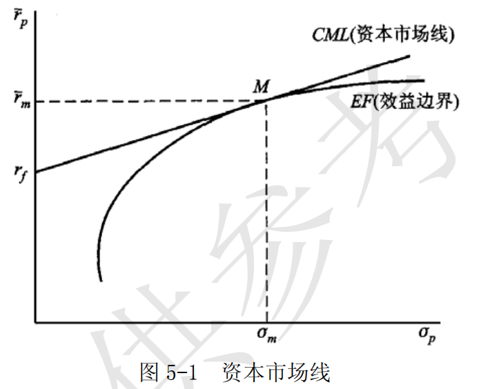

# Chapter 5 The financial market

> **The central questions of this chapter**: what types and functions does a financial market have? How does the money market differ from the capital market? How are financial instruments innovated? How are risk and return priced?

## The outline of this chapter

The markets and instruments of this chapter were built batch by batch, and almost every one of them corresponds to a concrete nuisance. The prototype of the exchange-based securities market was the centralized trading in Amsterdam of shares in the Dutch East India Company (VOC), founded in 1602 — the problem was not that firms lacked money, but that merchants who had put capital into sea voyages could not exit, so a place was needed that could turn illiquid equity into transferable certificates; the London origin is coarser (in 1792 twenty-four brokers signed under a buttonwood tree on Wall Street, because the official market in Philadelphia refused them the trading of government bonds), but it too was born to solve the problem of government bonds and bank shares finding "no counterparty". The futures-and-options branch comes from farm products: the seasonality of grain production and the volatility of its price made budgeting hard for traders and processors alike; Japan's Dojima rice market in the eighteenth century already had officially certified futures contracts and "long and short" trading, the Chicago Board of Trade (CBOT) was founded in 1848 and in 1865 issued standardized contracts together with a margin and settlement system — and it is precisely these two institutional inventions, "standardization + central counterparty", that are the substance of what distinguishes futures from forwards. The remaining instruments appeared in a cluster only after the collapse of the Bretton Woods system and the take-off of inflation in the 1970s: in 1972 the International Monetary Market of the Chicago Mercantile Exchange launched currency futures (exchange rates were no longer fixed, and firms for the first time needed to buy insurance systematically), interest-rate futures were listed in 1974–1977 (the same applies to interest-rate volatility), in April 1973 the Chicago Board Options Exchange began trading transferable options and in the same year Black and Scholes gave the pricing formula, and in 1981 Salomon Brothers matched the World Bank with IBM for the first widely known currency swap (both sides wanted to bypass the market regulation they were under and to cash in a comparative advantage) — arranged chronologically, the four derivatives among the core concepts of this chapter fall exactly in the order "exchange-rate volatility → interest-rate volatility → nonlinear risk → cashing in a comparative advantage". Asset pricing theory was assembled in the same period: Markowitz (1952) wrote risk as variance, Modigliani and Miller (1958) gave the no-arbitrage method, Sharpe (1964), Lintner (1965) and Mossin (1966) produced the CAPM, and Fama (1970) consolidated the efficient market hypothesis — these five things explain the entire structure of the four questions under "Problems and analysis" of this chapter. China's path is a list of regulation and market building alternating: treasury bills resumed issuance in 1981, the Shanghai and Shenzhen stock exchanges opened one after the other in 1990, centralized supervision was established in 1992–1993, the national interbank call market was founded in 1996 and the interbank bond market in June 1997 (commercial banks were required to withdraw from exchange repo), futures exchanges were cleaned up, consolidated and merged into three in 1999–2000, the split-share reform came in 2005, the Shibor quotation system started in 2007, the ChiNext board in 2009, the CSI 300 stock index futures in 2010, the STAR Market and the registration-system pilot in 2019, the Beijing Stock Exchange in 2021, and full implementation of the registration system for share issuance in February 2023. Seen together, the point of this chapter is not to remember which market is called what, but to see clearly the conditions under which each type of instrument comes into being: a transferable price, a set of default handling mechanisms, and a counterparty willing to bear risk — lacking any one of the three, the instrument is only a concept on paper.

## Core concepts

### Financial instruments

A financial instrument, also called a financial asset, is a written document that can certify the amount, maturity and price of a financial transaction, and it has legally binding force on the rights and obligations of both the creditor and the debtor.
Financial instruments should generally have the basic features of liquidity, risk and rate of return.
Liquidity is the ability of a financial instrument to be converted into cash quickly without suffering a loss;
Risk is the possibility that, under the influence of credit risk and market risk, the buyer of a financial instrument suffers an economic loss;
The rate of return is the ratio of the income obtained from holding the financial instrument to the principal.

The phrase "written document" needs updating today: the overwhelming majority of financial instruments long ago ceased to exist on paper, and their substance is a **transferable contractual right backed by legal enforcement**. This settles three entry points for the analysis of financial instruments. First, whether something can be transferred is decided by law and by the registration and settlement system, not by technology — whether the same receivable can be sliced up and sold depends on whether there is a true sale and a bankruptcy-remote arrangement (see the section on asset securitization in Chapter 4). Second, liquidity and risk are not mutually independent attributes: "converting into cash quickly without a loss" presumes that two-way quotations persist in the market, and quotations are the first thing to disappear in a panic. On 16 September 2008 the Reserve Primary Fund, because it held Lehman Brothers commercial paper, fell to a net asset value of 0.97 dollars per share (breaking below its one-dollar face value from 16 September 2008 onwards), and the U.S. commercial paper market froze that week — a textbook case of an asset that is "near cash suddenly losing its liquidity"; the same logic shows up in China in the interbank and non-standardized assets during the June 2013 "money famine" and in the redemption wave on wealth-management products during the bond adjustment of November 2022. Third, a rate of return only carries information when it is stated together with risk — this is the entire reason for the fourth section of this chapter (risk and return) and for the CAPM. As for the two terms "financial instrument" and "financial asset": the former stresses instrumentality and contractual structure (the issuer's perspective), the latter is an accounting and regulatory classification of held assets (the holder's perspective); textbooks use them interchangeably, and the reader can switch between them according to context.

### The money market

The money market is the market for the financing of short-term funds within one year and less, including such sub-markets as the interbank call market, the interbank bond market, the market for large negotiable certificates of deposit, the commercial paper market and the treasury bill market. The instruments of this market have very short maturities and are close to money, so it is called the money market. The money market is an important venue for financial institutions to adjust their liquidity, and it is the basis of the central bank's monetary policy operations.

The four words "close to money" are the key to understanding the interface between this chapter and the earlier ones: what participants in the money market borrow is not funds but **the surplus or shortage of reserves and cash**, so the interest rate of this market is the one the central bank can manipulate directly (both the benchmark rate of Chapter 2 and the open market operations of Chapter 7 land here). For the same reason it is extremely sensitive to credit quality: the spread between treasury bills and interbank certificates of deposit is normally tiny, but on 16–17 September 2019 U.S. repo rates jumped overnight from 2% to about 10% intraday (tax deadlines, treasury bill settlement and banks' cut-back of repo under new regulatory rules together drained reserves), which shows that this "near-money" channel must be maintained with ample reserves; the wholesale surge in U.S. dollar money market rates in March 2020, when the Federal Reserve had to step in with unlimited repo and the Money Market Mutual Fund Liquidity Facility (MMLF), is the extreme version of the same event. China's interbank call and repo markets have, since 1996 (the call trading center) and 1997 (the interbank bond market), been the actual vehicle of the policy rate; DR007 (the weighted rate of seven-day repos conducted by depository institutions with interest-rate bonds as collateral) has become the preferred indicator for observing funding conditions, and this is precisely where the positioning of "basis of central bank operations" is realized. One qualification is needed on the classification of the "interbank bond market": this market trades both seven-day repos and thirty-year government bonds, so by maturity it straddles both concepts of this chapter at once, and listing it wholesale under the money market is a statement about its function as a "venue for liquidity management".

### The capital market

The capital market generally refers to the market for transactions with maturities of more than one year, and it includes mainly the stock market and the bond market, meeting the medium- and long-term investment needs of industrial and commercial firms and the need of the government to finance fiscal deficits.
Because the trading horizon is long and the funds are used mainly to form real capital, it is called the capital market.

The emphasis of this definition lies in its second half: what the capital market handles are **promises that reach across an uncertain future**, so its price is not a "price of funds" but a "judgment about the future". This brings two features that must be distinguished from the money market. First, the amplitude of price fluctuation is large and cannot be eliminated by maturity — a share has no maturity date, so any change in its discount rate or growth expectations goes directly into the price, which is why the exchange-rate theory of Chapter 8 and the asset pricing of this chapter share the logic of being "expectation-led"; second, the survival of the market depends on the two-way flow of issuance and exit, and if there is financing without return and clearing, valuation will come uncoupled from cash flow. The reform history of China's capital market has revolved around this point: when the exchanges were set up in the early 1990s they were positioned as a financing channel to relieve the difficulties of state-owned enterprises, the 2005 split-share reform addressed the structural defect of "same share, different rights, with non-tradable shares in the majority", margin trading and off-exchange leverage magnified trading in 2013–2015, and the STAR Market of 2019 and the full registration system of 2023 moved pricing power from approval to disclosure and market-based book-building, while the delisting system, long weak over the same period, is the one link that has not yet closed. Another contemporary change is that the boundary of "more than one year" is itself being blurred by policy operations: from 2024 the People's Bank of China has included buying and selling government bonds in the open market among its liquidity adjustment tools, so that medium- and long-term bonds now also take on the role of a money-market instrument — another instance of the line between the two concepts of this chapter being movable.

### Forwards

A forward is an agreement to buy or sell a certain amount of a certain asset at a certain price at a certain time in the determinate future.
In a forward contract, the asset that the two parties agree to buy and sell is called the underlying asset, the agreed price is called the contract price, the party that agrees to sell the underlying asset at the agreed price is called the short side, and the party that agrees to buy the underlying asset at the agreed price is called the long side. Forward contracts are used very widely in the foreign exchange market, because they can quite effectively hedge the risk of exchange-rate volatility.

The difference between forwards and futures (the next concept) is often told as "over-the-counter versus on-exchange", but the real cost lies elsewhere: a forward is a bilateral credit contract, so its price contains not only the risk of the underlying asset but also the counterparty's default risk and the collateral arrangement on top of it. This is why this seemingly primitive instrument has still not been replaced by standardized products — what a firm needs is an amount and a date that fit its own cash flow exactly, whereas futures offer only integer multiples of a standard contract. Chinese firms will find that the availability of forwards is itself affected by regulation: after the interbank foreign exchange market was established in 1997, RMB foreign exchange forwards were introduced, currency swaps were launched at the same time after the July 2005 exchange-rate reform, and RMB foreign exchange options got started in 2010, while participants were long confined to institutional clients and members of the interbank market, so corporate hedging has to pass through the bank layer, and the quotations include the bank's position costs and capital occupation. Only with this understood can one read the policy meaning of the multi-ministry drive of the 2020s to "lower the exchange-rate hedging costs of firms and extend derivatives services to small and medium-sized firms": a forward is not hard to design; what is hard is getting those willing to sell insurance to be willing to sell it in small amounts to scattered customers.

### Futures

A futures contract is a standardized contract of purchase and sale that developed on the basis of the forward contract.
The main difference between the two is that the futures contract is a standardized contract issued by the exchange, traded centrally on the exchange, and its performance is guaranteed by the exchange.

The technical content of "the exchange guarantees performance" is daily mark-to-market settlement and central counterparty clearing: the exchange inserts itself between the buyers and the sellers, becoming "the seller to all buyers and the buyer to all sellers", transfers margin day by day at the settlement price, the losing side must top up its margin, and otherwise it is forcibly closed out. This mechanism (whose embryo was the 1865 CBOT design) concentrates default risk from the counterparty onto the clearing house, and it brings two consequences that the analysis later in this chapter cannot go around. First, leverage is made explicit: a few percentage points of margin suffice to hold a notional position, so a small adverse price movement can wipe out the whole equity — the February 1995 "327 treasury bond futures" episode was precisely an exploitation of the manipulation of the cash-futures spread and of market position, magnifying losses under the margin system and ultimately leading to treasury bond futures being suspended for nearly eighteen years (they were restarted only in March 2015), and the regulatory tone of China's futures market since then (position limits, large-holder reporting, price limits) was all shaped by this history. Second, the risk does not disappear but is transferred: when sharp short-term price swings make margin calls themselves into selling pressure, the clearing mechanism bites back on its holders. The September–October 2022 crisis of liability-driven investment (LDI) in British pensions is the latest example — interest-rate swaps and futures held to hedge rising rates were called for billions of pounds of additional margin as long-end yields surged, long government bonds had to be dumped, yields rose further, and the loop ran until the Bank of England entered to buy bonds. Futures and swaps make "hedging" hold for an individual position, yet at the systemic level they create a new dependence on liquidity.

### Swaps

A swap is a transaction in which the two parties reach an agreement and, within a certain term, convert each other's currency types, the bases on which they borrow and lend, and other assets.
Swap agreements are mainly of two kinds, the currency swap and the interest-rate swap. A currency swap is one in which the two parties exchange two currencies at an agreed exchange rate and further agree to buy back each other's original currencies at that rate within a certain future period. An interest-rate swap is one in which the two parties exchange the interest income (expense) on the claims (debts) they hold. The principal values of these two claims (debts) are the same, but their interest payment terms differ, and through the exchange the different needs of both sides can be met.

The reason swaps exploded after 1981 is that what they solve is "cashing in a comparative advantage" and not "price insurance": two borrowers with different credit ratings do not have the same relative financing cost in fixed versus floating or in different currency markets, so each borrows in the market where it has the advantage and then swaps back into the liability it needs, and both are cheaper than borrowing directly — the 1981 currency swap between the World Bank and IBM is of exactly this kind (the World Bank wanted low-cost Swiss franc and Deutsche mark funds, IBM needed to convert fixed-rate borrowing outside the United States into floating rate). A caution is due here: the economic meaning of a swap differs from both the forward and the future — in essence it is a packaged string of forward contracts, so its risk exposure accumulates over time rather than being settled day by day. Before 2008, over-the-counter swaps had almost no central counterparty, no margin, and a runaway scale of notional principal (according to Bank for International Settlements statistics, the notional amount of global over-the-counter interest-rate derivatives had already reached the order of about 300 trillion dollars by mid-2007), and the U.S. International Group's (AIG) financial products division needing a government rescue in September 2008 after the margin clauses of credit default swaps were triggered was precisely the price of this structure. Post-crisis reform rewrote this concept of the chapter directly: at the September 2009 G20 Pittsburgh Summit it was pledged that standardized interest-rate swaps be cleared through a central counterparty, and the seventh title of the U.S. Dodd-Frank Act and the EU's European Market Infrastructure Regulation (EMIR) built up in turn the systems of central clearing, margin and trade reporting. China's RMB interest-rate swap was launched in the interbank market in 2006 (no margin required, concluded by inquiry and master agreement), and after 2014 central clearing pilots were introduced step by step, while its credit derivatives and swap market developed clearly later than the expansion of the bond stock over the same period — which is also one reason why the debt risk of local governments and property developers has been hard to price and diversify. Incidentally, about the LIBOR in the example of this section: that quotation benchmark was retired because of the manipulation scandals after 2008 and the shrinkage of the interbank lending market (publication stopped in stages from 2021 to 2023), and the dollar switched to new benchmarks such as the Secured Overnight Financing Rate (SOFR, published from April 2018), so the reference rates on the floating legs of the instruments of this chapter were reset — the largest technical restructuring of swap and futures pricing in recent years.

### Options

An option contract confers on its holder (that is, the buyer of the option) a right, so that it may (but need not) buy (call option) from, or sell (put option) to, the seller of the option contract a certain amount of an asset at an agreed price within the period agreed for the future.
To obtain this right the holder of the contract has to pay a certain option premium.

The option is the only one of the five instruments of this chapter whose "rights and obligations are asymmetric", and it is for that reason the hardest one to handle conceptually: the gains and losses of both sides of a forward, a future and a swap are symmetric, whereas the option buyer exchanges a limited cost (the premium) for the distribution of returns on the right side or the left side. To price it one cannot rely on "supply and demand" but must rely on replication — construct a portfolio out of the underlying asset and borrowing such that its payoff equals the option's in every state, and the cost of that portfolio is the option price (a concretization of the no-arbitrage logic, see "The methodological background of financial engineering" in this chapter). Black and Scholes (1973, with Merton giving the rigorous version the same year) derived the continuous-time pricing formula along exactly this line of thought, on the premises that the underlying price follows a geometric Brownian motion, that there are no frictions, and that the position can be rebalanced continuously; the deviation of these four conditions from reality is the source of the later "implied volatility smile" (implied volatilities at the same expiry for different strike prices are not the same, and this has persisted since the crash in U.S. stocks of October 1987) and of skew risk, and it is also the reason volatility itself became a tradable asset class. At the institutional level there is one more distinction worth remembering: American options can be exercised on any day before expiry and European options only on the expiry date; index options are mostly European while single-stock options are mostly American, and China's SSE 50 ETF option (February 2015, the first on-exchange equity option) is European, while commodity options (soybean meal, corn and the like from 2019) are American — the treatment of spreads and of margin differs accordingly. For policy discussion, the option offers a perspective no other instrument can give: it puts a direct price on "how big the uncertainty is", so the implied volatility of CSI 300 index options is often read as a gauge of market panic, and together with the inflation expectation surveys of Chapter 3 and the currency option risk reversals of Chapter 8 it forms three routes to "making expectations observable".

## Problems and analysis

### How does venture capital put money into a company that has no profits yet?

Venture capital refers to capital operated by venture capital funds, and the investment process of venture capital is broadly divided into five steps:

- (1) Deal origination, that is, the venture capitalist learns of a potential investment opportunity.
- (2) Screening of investment opportunities, that is, selecting from among many potential opportunities a small part for further analysis.
- (3) Evaluation, that is, assessing the potential risk and return of the selected projects. If the result of the evaluation is acceptable, the venture capitalist and the entrepreneur enter together the fourth step of deal design.
- (4) Deal design. Deal design includes deciding the amount, form and price of the investment. Once the deal is completed, the last step is entered — investment management.
- (5) Post-investment management. The key of post-investment management is to bring the firm into the operation of the capital market so that the necessary mergers and acquisitions and the listing can be realized smoothly.

Of the five steps the most important are (4) and (5), for they are precisely where venture capital differs from "buying a few shares and waiting for them to rise". The problem step (4) has to handle is: if the judgment cannot be made before investing, then defer the judgment and write it into the contract — staged investing (adding on at milestones, with the option to stop the loss at any time), convertible preferred shares or convertible bonds (priority in liquidation, converting into common shares after growth to share the upside), board seats and one-vote vetoes (the right to information and to intervene), and the vesting of founder equity in tranches with non-compete clauses. Step (5) points out a premise often overlooked: the reason this set of contracts can deliver high returns is that an exit channel exists that can turn book equity into cash. Steps (1)–(3) are therefore only a question of how the cost of screening is allocated: because the failure rate of projects is extremely high (the industry often quotes a distribution of "two or three out of ten succeed"), venture capital must take on a power-law character, with a few successful projects covering all the costs, and this also explains why it demands high growth rates and an ending of "listable or acquirable". Taken together, points (4) and (5) explain the structural conclusion of this chapter: venture capital and the capital market are interdependent — without a smooth issuance and M&A market, step (5) fails, and however fine the protective clauses of step (4), they cannot save the pricing. The U.S. Small Business Investment Company Act of 1958 and the cut of the capital gains tax from 49.5% to 28% in 1978–1979, together with allowing pension funds to enter venture capital (the interpretive revision of the prudent-person rule of the Employee Retirement Income Security Act in 1979), were followed by the two waves led by the Apple listing of 1981 and the Netscape listing after 1995 — in every case "exit channel + tax system" moved first and the scale of investment moved after. The corresponding chain in China is: the State Council approved the founding of China New Technology Venture Capital Corporation in 1985, domestic institutions rose after 1993 (such as Shenzhen Capital Group, founded in 1999), the ChiNext board of 2009 provided an exit outlet, the STAR Market and the registration system of 2019 wrote "unprofitable firms may be listed" into the rules, and after 2014 government guidance funds (which entered their founding peak around 2015 and by the mid-2020s already occupied the main share of primary-market fundraising) displaced part of the dollar funds; while the 2018 new asset management rules restricting maturity mismatch and nesting, the tightening of regulation in some industries after 2021 and the narrowing of the overseas listing channel directly compressed step (5), and the ensuing "surge of buyback and valuation-adjustment disputes" (the Haifu case of 2012 established the adjudicating idea that "a bet with the company is void, a bet with the shareholder is valid", refined by the Minutes of the National Courts' Civil and Commercial Trial Work Conference of 2019) is precisely the legal reaction after the exit is blocked. This whole string of facts and steps (4) and (5) of this chapter are the two sides of one and the same proposition.

### Does a high return always come with a high risk? How is risk quantified?

- (1) Risk and return are a pair of contradictions that any investor must consider in decision-making; investment and return are symmetric — high risk with high return, low risk with low return — and all returns must be adjusted for risk.
	In 1952 Markowitz first described the relation between risk and return in relatively precise mathematical language, laying the foundation of asset pricing theory.

- (2) Every investor, before investing, must form an expectation of the return, so from the mathematical standpoint the expected return is usually expressed as the expected rate of return of the investment.
	Because investment faces the uncertainty of the future, the expected rate of return is the investor's overall estimate, made before investing, of the rate of return under the various uncertain situations of the future. From the mathematical standpoint, the expected rate of return is in fact the mathematical expectation of the random variable that is the rate of return, and the formula is: $E(r)=\sum_{i=1}^{n}r_{i}P(i)$

	Where $E(r)$ denotes the expected rate of return of a certain asset; $i=1,2,3,\cdots,n$; $n$ denotes the $n$ possible situations that may be encountered, $r_i$ denotes the rate of return of the asset in the $i$-th situation; $P(i)$ denotes the probability that the $i$-th situation occurs, and the sum of the probabilities of the $n$ situations equals 1.

- (3) Risk is the possibility of a loss in investment value; it reflects in substance the uncertainty of future return, and the size of the risk can be expressed by the deviation from the expected return.
	Mathematically the concept of variance can be used for quantitative analysis. Introducing the mathematical concept of variance, the risk can be analyzed quantitatively. The formula of the variance is: $\sigma^{2}=\sum_{i=1}^{n}\left(r_{i}-E(r)\right)^{2} P(i)$

	In practice it is customary to use the square root of the variance, that is the standard deviation, to measure risk, namely:

	$$\text{Standard deviation}=\sigma=\sqrt{\sigma^{2}}$$

The slogan "high risk, high return" needs two qualifications, otherwise it will be repeatedly refuted by evidence. First, only the non-diversifiable part of risk gets priced (see the next question); for a single asset, a large standard deviation does not necessarily correspond to a high expected return — a stock with persistently high volatility can keep underperforming a low-volatility portfolio, and this phenomenon (the low-volatility anomaly, see the discussion in Blume 1970 and in Baker, Bradley and Wurgler 2011) has been one of the counter-examples to the CAPM all along. Second, measuring risk with variance assumes by default a strong hypothesis: that the distribution of returns is symmetric, and that investors care only about the mean and the second moment, volatility. But real asset return distributions are leptokurtic, fat-tailed and negatively skewed (the fall of over 20% in U.S. stocks in a single day on 19 October 1987, the four circuit breakers of March 2020, and the thousand-stock limit-down of the A-share market in June–July 2015 are all nearly impossible under the normality assumption), so practice must add downside and tail measures (Value at Risk VaR, Conditional Value at Risk CVaR, maximum drawdown), and the April 1993 report of the Group of Thirty on derivatives and the 1996 Basel Committee amendment on internal models for market risk took exactly this road. There is also a more fundamental disagreement: all the probabilities here are "objectively given distributions", but the uncertainty of reality is often such that not even a distribution can be written down (Knight's distinction of risk from uncertainty, 1921; Keynes, The General Theory, Chapter 12), which is precisely why a "Limitations and beyond" section still has to be kept after the four questions of this chapter.

### Why does diversifying the investment reduce risk? Can it eliminate all risk?

- (1) A basic assumption of finance is that the investor is risk-averse, and one effective way of controlling risk is to diversify the investment, that is, the investor can lower risk by constructing a diversified portfolio of investment assets. This principle can be explained through the formula for the expected return of a portfolio and the risk covariance formula of portfolio assets.

- (2) The expected return of a portfolio is the weighted average of the expected returns of all the assets in the portfolio.
	The formula for calculating the expected return of a portfolio is:

	$$E(r_p)=\sum_{i=1}^{m}E(r_{i})A_{i}$$
	Where $E(r_p)$ is the expected return of the portfolio;
	$A_{i}$ is the proportion of the $i$-th asset in total assets;
	$m$ is the number of asset types in the portfolio.

	Since the expected return is a weighted average, increasing the number of asset types and spreading them out by weight does not lower the expected return of the portfolio; what gets diluted is the idiosyncratic risk of a single asset — it enters the portfolio variance as the square of the weight ($A_i^2\sigma_i^2$), and as the number of assets increases it falls much faster than the expected return. This is the exact meaning of "buying several more lowers the risk, but need not come at the price of earning less".

- (3) The risk covariance formula shows: the risk of a portfolio is related not only to the risk of each single asset, and is not only the simple weighted average of the standard deviations of the single assets, but also to the interrelations among the various assets. When investors choose assets with low mutual correlation to form a portfolio, the risk is smaller.

	The formula for the standard deviation of the return on a portfolio is:

	$$\sigma_{\mathrm{P}}=\sqrt{\sum_{j=1}^{m} \sum_{k=1}^{m} A_{\mathrm{j}} A_{\mathrm{k}} \sigma_{\mathrm{jk}}}$$

	$m$ is the number of asset types in the portfolio;
	$A_j$ is the proportion of asset $j$ in the portfolio;
	$A_k$ is the proportion of asset $k$ in the portfolio;
	$\sigma_{jk}$ is the covariance of the returns of the two assets $j$ and $k$. Covariance, so called, reflects the degree to which two assets move together, and its formula is:

	 $$\sigma_{jk}=r_{jk}\sigma_{j}\sigma_{k}$$

	Where $r_{jk}$ is the correlation coefficient of the returns of asset $j$ and asset $k$ (usually written $\rho_{jk}$ in the literature).

The covariance of a portfolio reflects the degree to which the assets of the portfolio move together, so the smaller the covariance of the portfolio, the smaller the risk of investing in it. The covariance of the portfolio depends in turn on the correlation coefficients among the assets of the portfolio: the lower the correlation among them, the lower the coefficient, and the lower the risk of the portfolio. This principle shows that risk can be reduced by a diversified portfolio.

The key step is to pull the double summation apart: the $m$ terms contain $m$ variance terms and $m(m-1)$ covariance terms, and if the assets are equally weighted, then

$$\sigma_p^2=\frac{1}{m}\overline{\sigma^2}+\left(1-\frac{1}{m}\right)\overline{cov}$$

That is, the portfolio variance is "the average variance divided by $m$" plus "the average covariance multiplied by $(1-1/m)$". As $m$ grows the first term tends to zero, while the second tends to a non-zero limit — **the average covariance**. This is the answer to the question: diversification can only eliminate the part that is uncorrelated with one another (idiosyncratic risk, unsystematic risk), and cannot eliminate the part brought by common factors (systematic risk); and beyond a few dozen names the marginal benefit of adding more is minuscule (empirical estimates usually put the limit somewhere between two or three dozen and over a hundred, depending on how correlated the individual stocks are). This conclusion touches three other concepts of this chapter directly. First, it is what lets the CAPM pay only for systematic risk (the next question). Second, it explains why the tendency of correlations toward 1 during a crisis is especially fatal: in 2008 and in March 2020 stocks, corporate bonds, commodities and private real estate all fell together, and the diversification computed in advance failed (a rise in the correlation coefficient is a rise in $\overline{cov}$); when the inputs of the Markowitz framework come from historical estimates, they are distorted precisely at the moment they are needed most. Third, it gives the difference between "diversification" and "asset allocation across major classes": buying more names inside one major class is almost useless, while crossing classes (stocks against government bonds, maturity and currency, and the cross-border allocation discussed in Chapter 8) is what changes $\overline{cov}$; the spread of "dollar-cost averaging into a basket of stocks through funds" in China between 2005 and 2015 and the disputes over net-value drawdowns of equity-bearing wealth management after 2022 both largely come from investors mistaking "a large number of names" for "a low correlation".

### What problem does the CAPM want to solve? What is its cost?

- (1) The CAPM, the capital asset pricing model, is built on portfolio theory and seeks the equilibrium price of each capital asset when the capital market is in a state of equilibrium. That is, assuming that people hold the same expectations of the expected rate of return and of risk, and that all choose the optimal portfolio according to the principle of diversification, what is the risk premium of a security when equilibrium is reached?

- (2) Under the above assumptions, when the capital market is in equilibrium, an analysis of the collective behavior of investors yields the equilibrium prices of all efficient securities and portfolios, that is, the capital market line, as shown in Figure 5-1.

In Figure 5-1, $r_{f}$ denotes the risk-free lending rate, and the tangency point $M$ is the market portfolio of securities, which in theory should include all listed marketable securities. The ray $r_{f}M$ is the capital market line, representing all the efficient investment opportunities in the securities market for the investor, or, for all investors, the best risk-return combination. Although everyone would like to get above the capital market line, competitive forces will push asset prices to move so that everyone ends up at some point on the line.
The formula of the CML is:

$$E(r_{p})=r_{f}+\frac{E(r_m)-r_f}{\sigma_{m}}\sigma_{p}$$

$$\text{The slope of the CML}=\frac{E(r_m)-r_f}{\sigma_m}$$

The basic idea of the CAPM is this: the reward for bearing risk at equilibrium — since investors are risk-averse, the total of the risk premiums of all risky assets must be positive.

- (3) The risk premium of a single security is proportional to the degree of its contribution to market risk, and what measures the risk of a single security is its $\beta$ value. The $\beta$ value reflects the sensitivity of a single security to market movements. According to the CAPM, at equilibrium the risk premium of any asset equals its $\beta$ value multiplied by the risk premium of the market portfolio. The equation is:
$$E(r_j)-r_f=\beta_j[E(r_m)-r_f]$$

Or:

$$E(r_j)=r_f + \beta_j[E(r_m)-r_f]$$

- (4) The CAPM uses the equilibrium approach and provides a theoretical basis for the pricing of assets in the financial market. This model has been widely applied in the practice of investment management and corporate finance, but there are also some problems, the main one being that the market portfolio in the model includes all assets, which is hard to simulate accurately in empirical research.

The contribution of this model lies in turning a constraint into an instrument: since diversification can eliminate idiosyncratic risk, the market in the long run will pay only for risk that cannot be diversified, and the pricing problem is thereby reduced to one dimension — how much $\beta$ you are exposed to. The difficulty mentioned in point (4) has a proper name: the Roll critique (Roll, 1977) points out that the true market portfolio should include all wealth — stocks, bonds, real estate, human capital and the rest — and it can never be observed, so any "test of the CAPM" is in fact testing the proxy index one has chosen, and the model itself can be neither confirmed nor falsified. The empirical history of the following forty years unfolded largely according to that prophecy: Fama (Eugene Fama) and French (Kenneth French, 1992, 1993), contemporaries of the CAPM, explained the cross-section of stock returns far better than $\beta$ did with the two variables of size and book-to-market ratio; the measured returns of low-$\beta$ portfolios were higher than the model predicted and those of high-$\beta$ portfolios lower (the line for the market portfolio is measured flatter); and from the 1980s onward the "anomalies" of momentum (Jegadeesh and Titman, 1993), value and earnings quality accumulated to the point where luck could hardly explain them. The academic response split into two branches: one kept extending the factors (Carhart's 1997 four factors, Fama and French's 2015 five factors, then Hou-Xue-Zhang's q-factor model and the debate of the 2020s over whether the "factor zoo" needs multiple-testing corrections — Harvey, Liu and Zhu 2016 argue that new factors need a stricter statistical threshold); the other gave up the equilibrium diagram and switched to the no-arbitrage arbitrage pricing theory (Ross, 1976) and the consumption capital asset pricing model (Lucas 1978, Breeden 1979), the latter defining risk as "the co-movement of marginal utility in bad times", but it got stuck on Mehra and Prescott's (1985) "equity premium puzzle" (a reasonable coefficient of risk aversion cannot explain an equity premium as high as about 6 percentage points, and the long-run risk models of Campbell and Cochrane (1999), Barro (2006) and others were the patch made for that). The practical value of the CAPM therefore lies not in predictive accuracy but in providing one unified pricing well: the weighted average cost of capital (WACC) in company valuation, the allowed rate of return in utility and financial regulation, the Treynor and Jensen measures in the performance evaluation of fund managers, and the discount rate in mergers and acquisitions still take $\beta$ as the default yardstick — and what this chapter really needs the reader to take away is precisely this judgment: who takes the CAPM as a cost parameter, and on what occasion.

## Comprehensive discussion

### What functions does the financial market perform in the running of the economy?

- (1) The development of financial markets promotes the scale and efficiency of the transformation of saving into investment, provides ample liquidity for financial assets, and promotes the continuous innovation of financial instruments

In a modern economy in which the division of labor keeps deepening and economies of scale matter more and more, the smooth transformation of saving into investment bears on whether the whole real economy can run in a good cycle. The traditional financial system relied on financial intermediation or indirect finance centered on commercial banks to perform its functions, but with the development of information technology and the intensifying of competition, the capital market has shown strong vitality both in lowering transaction costs and in handling information. Moreover, financial markets can, through flexible trading, increase the liquidity of traditional financial instruments.

The development of financial markets has not only created the conditions for the expansion of the scale of financial assets, but also promoted the innovation of financial instruments. A financial instrument is a set of standardized contracts combining expected return and risk; diversified financial instruments allow the risks inherent in the production technology of an economy to be partitioned more finely, so that investors with different attitudes toward risk and expected return can find the investment that best fits their needs, while at the same time the diversified financing needs of the issuers of financial instruments can also be satisfied as far as possible, which helps raise the efficiency of the transformation of saving into investment.

- (2) The asset pricing mechanism of the financial market can guide the rational flow of funds, feed back the actual running of the economy, and thereby raise the efficiency of resource use

For the investment activity of microeconomic agents such as firms, one basic principle is the pursuit of "a net present value greater than zero", that is, the sum of the discounted values of the future cash flows of an investment should be greater than the investment outlay of the current period; the trading in the financial market can reflect the supply and demand of funds in the financial market and the risk preferences of the different investment agents, and thereby determine the rates of return of the different financial assets, that is, the discount rates on future income, forming asset prices and guiding funds and real resources into more rational flows.

- (3) The development of the financial market provides the basis for the establishment of the system of indirect financial regulation

The establishment of the system of indirect financial regulation must rely on a developed financial market to transmit the central bank's policy signals, so that the behavior of the micro agents can be guided through the price changes of the financial market. Among the central bank's monetary policy instruments, open market operations with short-term treasury bonds as the main trading instrument are the most important means; the central bank thereby injects and withdraws base money, affecting the excess reserves of commercial banks and the interbank call rate, and in turn the credit-creating capacity of financial institutions. At the same time, inside a developed financial market, because of the effect of arbitrage, the sub-markets are highly correlated with one another, so changes in the money market will be reflected quickly in the capital market, and through the market movements of the capital market the range of monetary policy's influence is further extended. As the proportion of the various financial assets in the reserve positions and liquidity holdings of financial institutions rises, financial institutions will intervene more widely in the running of the financial market, and the range and force of the central bank's open market operations will keep being strengthened along with the development of the financial market.

- (4) The development of the stock market provides an effective window for evaluating the operating condition of firms and a venue for firms to carry out a strategy of capital operation

The development of the stock market provides the market value of listed firms. The change in the market value of a listed firm can reflect not only the level of its net assets but also its future earning power. The change in market value is continuous, so by observing it continuously investors can judge the firm's operating condition more accurately, and through the buying and selling of shares they bring external market pressure to bear on the firm's management. In addition, the development of the stock market promotes the finer division of the property rights of firms, which helps the asset restructuring of listed firms and realizes the efficient flow and integration of economic resources.

The common premise of the four functions is "that prices carry information", and this is precisely where the contemporary debate is fiercest. Item (2) depends on the no-arbitrage of section 3 and on the formation of expectations in section 5: if prices are dominated by short-term money, leverage and liquidity shocks, they are no longer a reliable source of discount rates and instead become an amplifier of wrong signals — the abnormal volatility of China's stock market in June–July 2015 (forced liquidation of off-exchange leverage setting off a downward spiral, with the discussion of a stabilization mechanism and a leveling arrangement continuing to this day) and the chain liquidation of micro-cap and quantitative strategies at the start of 2024 are two demonstrations of the same mechanism. Item (3) carries an extra layer of institutional condition in China: the withdrawal of commercial banks from the exchanges and the founding of the interbank market in 1996–1997 were precisely to give open market operations and interest-rate transmission an institutional carrier (Chapter 7, monetary policy), and the inclusion of government bond trading in the policy toolbox in 2024 and the discussion around 2025 of a "Chinese version of yield curve management" are attempts to extend this function to the long end. The market-value signal of item (4) is distorted when the delisting and short-selling mechanisms are inadequate: if bad firms will not be pushed out and the cost of fraud is below its payoff, market value is no longer "a window on operating condition" but may be merely a function of the scale of financing — this is also why the registration-system reform since 2019 and the new Securities Law in force from March 2020 (establishing the registration system and the securities class action / representative litigation with Chinese characteristics, and greatly raising the cost of illegality) put their weight on the two ends of information disclosure and delisting. Item (1) is in turn conditional on the "five steps of venture capital" of section 5 of this chapter: when liquidity is insufficient, innovative capital dares not enter, and the function of "promoting innovation" is in fact the downstream result of the other three.

### What is the methodological background of financial engineering? Why does it price by "no arbitrage" rather than by supply and demand?

Financial engineering refers to the process, from the 1980s onward, in which the financial sector combines modern financial theory with engineering and technical methods and, in response to the different risk preferences of investors, creatively designs, develops and applies new financial products.

Financial engineering is a new interdisciplinary subject, and its theory and methods are built on the basis of modern financial theory, information technology and engineering methods.

- (1) The portfolio theory proposed by Markowitz in 1952 defined risk and return from a mathematical standpoint and brought mathematical tools into financial research;

In 1958 Modigliani and Miller proposed the MM theorem, which provided modern financial theory with a "no-arbitrage equilibrium" method different from the supply-and-demand analysis of traditional economics. By "no-arbitrage equilibrium" is meant that when the price of some asset violates the "one price law" of "same value, same price", the market is in disequilibrium and an arbitrage opportunity appears, and the arbitrage motive of market participants drives the market to equilibrium; in a state of market equilibrium no arbitrage opportunity exists, and hence it is called "no-arbitrage equilibrium". The basic method of financial analysis is to combine the "position" in a certain financial asset (that is, the holding of or the shortage of a certain asset) with the positions of the other financial assets in the market, constructing a portfolio position that at market equilibrium cannot produce a profit without bearing risk, and from this to compute the value of that position at market equilibrium, that is, the equilibrium price.

- (2) The development of information technology provided the material conditions that financial engineering needs. For example, the spread of computers and the improvement of large-scale computation and data processing

capability have provided effective means for the practical application of portfolio theory and for financial engineering to develop and implement various new financial products and to solve financial and accounting problems; the development of communications technology has made information spread rapidly across the country and the globe, linking the financial markets into one. All of this has greatly lowered the transaction costs of the financial market and raised the efficiency of the market.

- (3) "Financial engineers", supported by the above theoretical and technical conditions, drew on modern engineering and technical methods and creatively designed various new financial instruments for the different risk preferences and risk-bearing capacities of market investors, giving them specific liquidity and risk-return combinations.

The reason "no arbitrage" could replace supply-and-demand analysis as the default method of pricing is hard: most financial instruments have no independent supply and demand curves — for a structured product sliced into tranches from a number of bonds, its "demand" is only its spread relative to the already tradable portfolios, and its "supply" can be replicated at will, so the only price that can hold is the one at which "no risk-free profit is replicated". What supply and demand determine is the non-replicable part such as the risk premium and the liquidity premium (this is exactly what the CAPM and the arbitrage pricing theory set out to handle), while what no arbitrage determines is the replicable part — the coexistence of the two pricing logics is the boundary in this chapter most easily lost in reading. The boundary of this methodology was exposed in 2007–2008: no-arbitrage pricing assumes that the replicating portfolio can be rebalanced continuously and that usable repo and collateral exist (that is, no frictions), while in the crisis the shortage of collateral and the margin rules broke "same value, same price" badly (the price differences at which different bonds of the same issuer trade, the divergence between credit default swaps and cash spreads). The more direct methodological criticism is that the model's parameters (default correlation, the stability of volatility) are themselves estimated from history, and structured products fail precisely in states not covered by history. This is also why "off-balance-sheet business and securitization" in Chapter 4 and this section must be read together: financial engineering solved "how to compute" technically, but did not answer "who bears it when the computation is wrong" — the Volcker Rule and the centralized clearing of derivatives in the U.S. Dodd-Frank Act of 2010, and the Bank of England's emergency intervention in the UK LDI episode of November 2022, are institutional responses to the latter half of the question.

## Limitations and beyond

- **The pricing part of this chapter stops at the CAPM, and what comes after it is already a landscape of multiple competitors.** The failure of the single-factor model in the cross-section (see the previous section) drove factor models, consumption-based pricing and behavioral finance to grow each on its own: Shiller (1981) put excess volatility on the table by showing that "the volatility of real dividends and of share prices far exceeds what the dividends realized afterwards can explain"; the prospect theory of Kahneman and Tversky (1979) and the behavioral finance research pushed forward by Thaler (Richard Thaler, Nobel Memorial Prize in Economic Sciences 2017) explained the psychological mechanisms of "disposition effect, loss aversion, overconfidence" that push prices away from their no-arbitrage values; Fama and French (1996) argued that most anomalies can be explained by multi-factor risk compensation, suggesting that part of the "abnormal" may be just the product of data mining. The more robust consensus at present is: factor models are used as tools in asset management and investment practice, but no one any longer treats them as a description of equilibrium. At the same time the market structure itself has changed — after 2000 the share of electronic trading rose above eighty percent, and high-frequency market making, dark pools, the "flash crash" in U.S. stocks on 6 May 2010 and the January 2021 confrontation of GameStop retail traders against short-selling funds together turned "who provides the liquidity, and who amplifies the crash" into a new object of study, none of which lies within the framework of this chapter.
- **The institutional face of the derivatives market was rewritten after 2008, and the concepts of this chapter need to be reread under the new rules.** Over-the-counter interest-rate derivatives before the crisis were private agreements with no central counterparty and no margin (according to Bank for International Settlements statistics, the notional amount of global over-the-counter derivatives still reached the order of 600 trillion dollars at the end of 2022, of which interest-rate products accounted for more than eighty percent), and after the 2009 Pittsburgh Summit the direction turned to standardization with central clearing, margin and trade reporting (the U.S. seventh title, the EU EMIR, and China's interbank central clearing pilots from 2014 together with the related authorizations in the 2023 draft of the Financial Stability Law). Benchmark reform was another matter: LIBOR was retired because of the manipulation scandals (exposed one after another from 2012, with several banks fined billions of dollars), and secured overnight rates such as SOFR took over the reference of new floating-rate debt and interest-rate swaps (completed in stages from 2021 to 2023), which turned the "benchmark fallback" clauses of the stock of contracts overnight from a technical detail into legal and audit questions. After the June 2013 "money famine" in China, the abnormal stock market volatility of 2015 and the 2016 bond market proxy-holding episode (the redemption risk triggered by the "Guohai Securities rubber-stamp proxy holding" affair at the end of December 2016), trade reporting, proxy holding and leverage limits in the interbank and bond markets were likewise tightened greatly — the judgment that "the more standardized the financial instrument the better", which this chapter takes by default, must be completed from the regulatory standpoint with one more sentence: standardization also transfers the risk onto the common clearing house and onto the small group of primary dealers who provide liquidity.
- **"Financial deepening necessarily raises efficiency" needs conditions attached.** The financial repression theory of McKinnon (1973) and Shaw (1973) was once the prescription for market building in developing countries (liberalize interest rates, develop direct finance), but the results of Korea's interest-rate liberalization in the mid-1980s, Japan's capital market deregulation in the 1980s and the liberalization practice of Latin America in the 1970s and 1980s differed enormously: Chile's liberalization was accompanied by the banking crisis of 1981–1982, Argentina's experiment of the late 1970s ended in inflation and currency substitution, while Korea completed high growth while keeping credit directed. Contemporary explanations turn the order around: what market efficiency depends on is the institutional stock of information disclosure, bankruptcy enforcement, accounting and investor protection (the law and finance series by La Porta and others from 1998 onward, and the literature on enforcement capacity and contract enforcement after the 2000s), not "liberalization is effective by itself". This explains why China's registration-system reform between 2019 and 2023 advanced together with class actions and delisting arrangements, rather than, like the early liberalization advice, opening only the issuance end.
- **A special structure of China's financial market is still at work: the layering of the market is determined by the access of financial institutions, not by price.** The segmentation of the exchange market and the interbank market (the two-market pattern formed after commercial banks withdrew from the exchanges in 1997), the residual shadow of the "dual track" of interest rates in the credit market (the transmission from policy rate to market rate to lending rate is still being opened up, with the LPR reform of 2019 and the self-regulated adjustment of deposit rates from 2024), the long-run narrowness of the credit spreads among bond issuers (the risk pricing between interest-rate bonds, state-owned enterprise credit bonds and private enterprise bonds began to open up only after 2018), and the market-based disposal of the debt risks of local government financing vehicles and property developers (the shock of the Yongmei and Huachen default events of 2018–2020 to regional spreads and refinancing) all show that the mechanism of "price guiding the allocation of resources" described in this chapter is only partly realized in China. When looking at the four functions of this chapter, one should treat them as criteria of judgment and not as a description of the status quo, so as not to conclude that "the functions are already in place".

## References

- Cao Longqi, *Finance* (6th edition) — the common framework of the chapters on money supply and demand, interest rates, the financial system and policy.
- The full list is on the [bibliography](/reference/参考书目).
- [Wikipedia · Financial market](https://en.wikipedia.org/wiki/Financial_market)
- [Wikipedia · Money market](https://en.wikipedia.org/wiki/Money_market)

<!-- BACKLINKS-AUTO -->
## Related pages

- [History](/monetary/History)
- [Readme](/monetary/Readme)
