#  Chapter 1 Introduction

## Section 1  The object of study of western economics

### 1. The origin of economics

1.  Economics arises from objectively existing scarcity, and from the need for choice that scarcity creates.
2.  Goods that satisfy human wants:
	 -  Free goods (unlimited)
	 -  Economic goods (limited)

### 2. The definition of economics

- Economics is the science which studies human behaviour as a relationship between ends and scarce means which have alternative uses. — Lionel Robbins, British economist
- By the widely accepted definition, economics studies the allocation of scarce resources among unlimited and competing uses. It is the social science that studies how people and society seek to satisfy their material needs and wants, since what is at their disposal does not allow them to satisfy every wish. — *International Encyclopedia of the Social Sciences*
- Economics studies how people and society make their ultimate choices: with or without the use of money, to use scarce productive resources that have alternative uses to produce various commodities now or in the future, and to distribute those commodities among the members and groups of society for consumption.

The questions economics should study:
1.  What goods and services to produce, and how much of each? (microeconomics)
2.  By what methods to produce these goods and services? (microeconomics)
3.  How is the supply of goods distributed among the members of society? (microeconomics)
4.  Are a country's resources fully employed, or is some of them left idle and so wasted? (macroeconomics)
5.  Is the purchasing power of money and savings constant, or does it fall through inflation? (macroeconomics)
6.  Is a society's capacity to produce goods always growing, or has it still not changed? (macroeconomics)

Ten principles of economics:
1. People face trade-offs, which shows that scarcity exists and that choice is necessary. (principle of choice)
2. The cost of something is what you give up to get it. What is given up is the opportunity cost — the price paid when choosing. (principle of choice)
3. Rational people think at the margin. This shows how people think when choosing. The margin is the increment: in choosing, people weigh the added cost against the added benefit. (principle of choice)
4. People respond to incentives. In choosing, people act from their own interest and respond differently to different stimuli. (principle of choice)
5. Trade can make everyone better off. This shows the relation among people in an economy.
6. Markets are usually a good way of organizing economic activity. This shows the effectiveness of the market mechanism.
7. Government can sometimes improve market outcomes — that is, it can overcome the defects inherent in the market mechanism.
8. A country's standard of living depends on its ability to produce goods and services.
9. Prices rise when the government prints too much money.
10. Society faces a short-run trade-off between inflation and unemployment.

## Section 2 Microeconomics and macroeconomics

### 1. Microeconomics

Microeconomics takes the individual economic unit as its object of study: the economic behavior of the individual unit, and how the single magnitudes of the corresponding economic variables are determined.

### 2. Macroeconomics

Macroeconomics takes the whole of national economic activity as its object of examination: the determination and the changes of the relevant aggregates in the economy.

## Section 3 Positive economics and normative economics

### 1. Positive economics and normative economics

#### Positive economics

Positive economics tries to stand above and outside all value judgements, concerning itself only with establishing laws of the relations among economic things, and, under the workings of those laws, analyzing and predicting the effects of people's economic behavior.

Features:
1. It answers the question "what is".
2. What it studies is objective, and whether its conclusions are correct can be tested against the facts of experience.

#### Normative economics

Normative economics rests on given value judgements, puts forward standards as the criteria for analyzing and handling economic problems, as the premises on which economic theory is built and the basis on which economic policy is made, and studies how to meet those standards.

Features:
1. It answers the question "what ought to be".
2. What it studies is not objective, and the conclusions it reaches cannot be tested against the facts of experience.

The "value" in the value judgement of which western economists speak is not value in the sense of the value of a commodity; it means the social value of an economic thing — whether the thing is good or bad. A value judgement judges whether a given economic matter is good or bad, that is, whether it has value for society.

Western economists hold that for economics to become a true science it must set the question of value judgement aside and make itself positive.
1. The basic question of whether the ends pursued are right or wrong is not one that economics as a science can itself settle.
2. Positive economics and normative economics are interrelated: we make decisions on the basis of positive economics, but under the guidance of normative economics. That is to say, decision-making is guided by value judgements, but rests on positive economics.

The basic content of both microeconomics and macroeconomics belongs to positive economics.

### 2. The method of positive economics

Western economists hold that to study economic problems with the methods of positive economics is to put forward theories that explain economic phenomena, to test theory against facts, and to make predictions from theory.

Composition of a theory:
1. Definitions
2. Assumptions
3. Predictions

Terms:
1. A definition fixes the explicit meaning of the various variables economics studies.
2. A variable is a magnitude that can take different values.
	1. An endogenous variable is one determined by economic forces.
	2. An exogenous variable is one determined by non-economic factors (politics).
	3. A stock is the value of a variable existing at a point in time.
	4. A flow is the value of the change in a variable over a period.
 3. An assumption states the conditions under which the theory applies.
 4. A hypothesis is a statement of the relation between two or more variables — a theory not yet proven.
 5. A prediction is a forecast of the future made from the hypothesis.

---

# Chapter 2 Demand, supply, and equilibrium price

> What microeconomics has to solve is the problem of allocating resources. In a market economy this problem is solved through the price mechanism, so the core of microeconomics is the theory of price.

## Section 1 Demand and supply

### 1. Basic theory of demand

#### Demand

Demand is the quantity of a good that households (consumers) are willing and able to buy at each price level, over a given period.

Two conditions must hold for demand:
1. A desire to buy
2. An ability to buy

#### The demand schedule

A table of the relation between the price of a good and the quantity demanded is called the demand schedule.

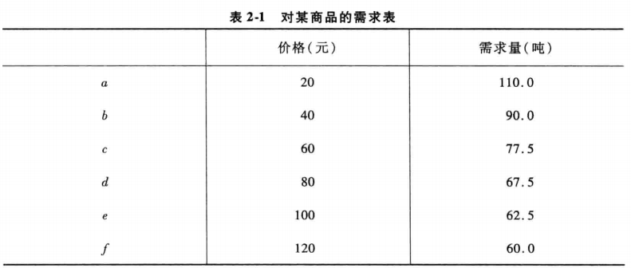

#### The demand curve

With the quantity demanded on the horizontal axis and price on the vertical, D is the demand curve.

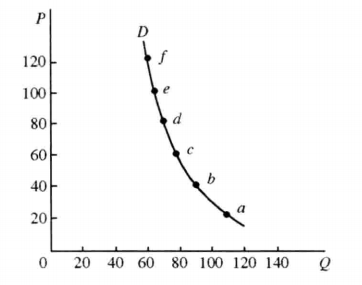

The demand curve:
1. The demand curve is a line sloping downward to the right, showing that price and quantity demanded move in opposite directions: other things equal, the quantity demanded falls as price rises and rises as price falls. This is the law of demand of western economics.
2. The law of demand holds for goods in general; for certain special goods it need not apply.

Other factors affecting demand:.
1. The prices of related goods
2. Consumers' income
3. Changes in consumption fashion
4. Consumers' expectations of the future

#### The demand function:

Holding the other factors constant and considering only the relation between a good's own price and the quantity demanded of it, with $P$ standing for price, the demand function is:

$$
D = f(P)
$$

#### A change in quantity demanded

When the other factors affecting demand are unchanged, a change in quantity demanded caused by a change in the good's own price is a movement along the same demand curve. This is called a change in quantity demanded.

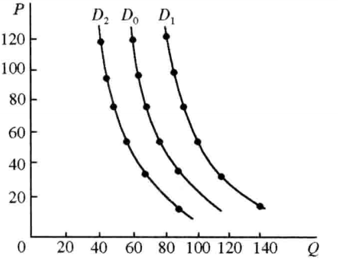

### 2. Basic theory of supply

Supply in western economics is the quantity of a good that firms (producers) are willing and able to sell at each price level over a given period.

Two necessary conditions:
1. A willingness to sell
2. An ability to supply

#### The supply schedule

A table showing the relation between the price of a good and the quantity supplied is called the supply schedule.

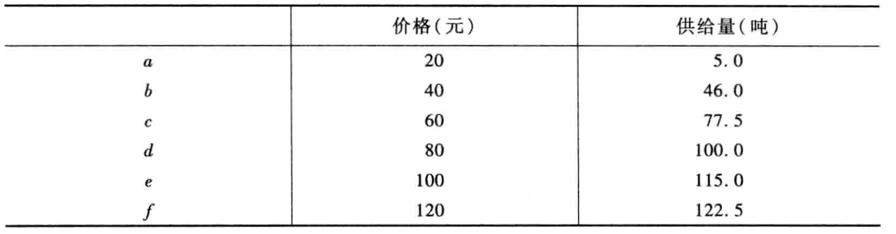

#### The supply curve

With quantity supplied on the horizontal axis and price on the vertical, S is the supply curve.

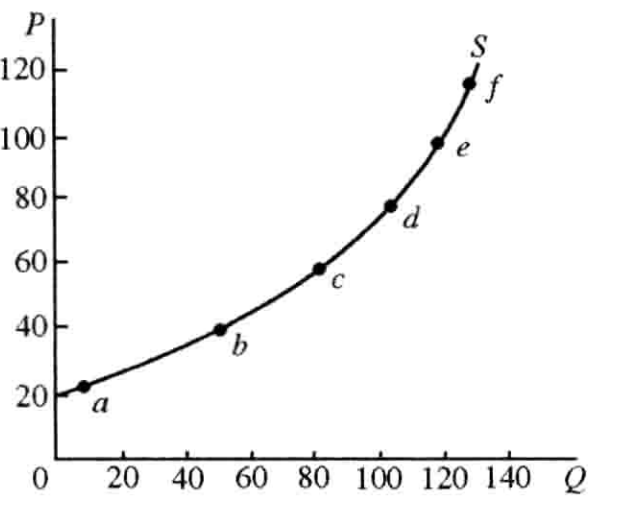

#### The supply function

Holding the other factors constant and considering only the relation between a good's own price and the quantity supplied of it, with $P$ standing for price:

$$
S = f(P)
$$

#### A change in supply

When the good's own price is unchanged, a change in supply caused by changes in the other factors is a shift of the whole supply curve.

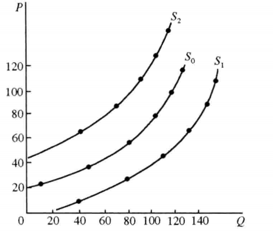

## Section 2 The determination and the movement of the equilibrium price

### 1. The determination of the equilibrium price

Equilibrium is a term from physics. When a body simultaneously receives two external forces in opposite directions and the two forces happen to be equal, the body, the forces on it being equal, rests in a state of equilibrium — that state is equilibrium.

Equilibrium in western economics:
1. Partial equilibrium analyzes the determination of the price at which supply and demand for one good or one factor of production are in equilibrium, on the assumption that all else is unchanged.
2. General equilibrium analyzes the determination of prices at which the supply and demand of all goods and factors of production are simultaneously in equilibrium, on the assumption that the supplies, demands and prices of all goods and factors influence one another.

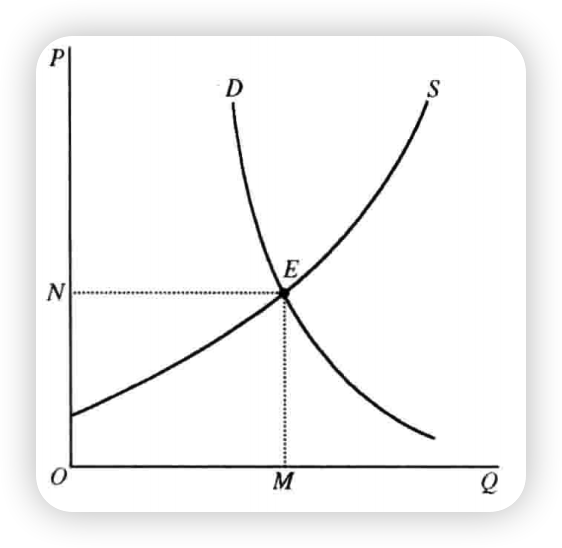

The formation of the equilibrium price

1. Market price above the equilibrium price
 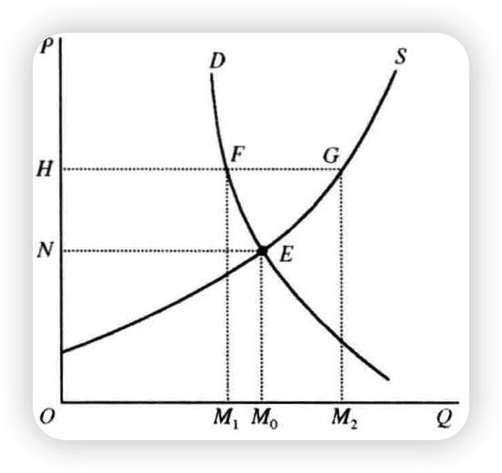

2. Market price below the equilibrium price

 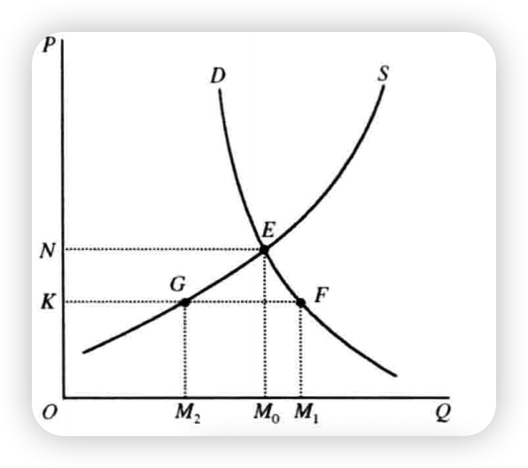

### The effect of changes in demand and supply on equilibrium

The equilibrium of price and quantity on the market is determined by the two forces of demand and supply, so a change in either will shift the equilibrium.

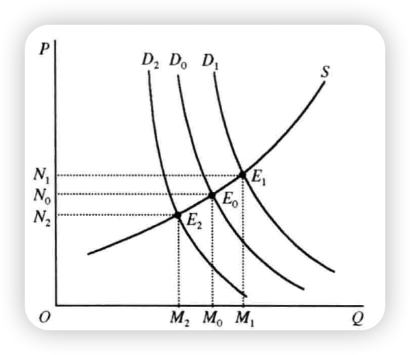

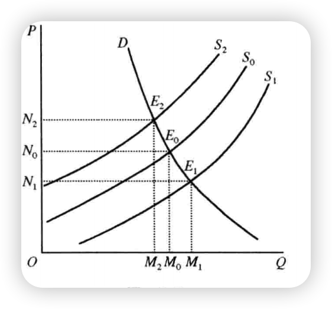

 A change in demand moves the equilibrium price and the equilibrium quantity in the same direction.
1. First, an increase in demand raises the equilibrium price, and a decrease in demand lowers it.
2. Second, an increase in demand raises the equilibrium quantity, and a decrease in demand lowers it.

A change in supply moves the equilibrium price in the opposite direction, and the equilibrium quantity in the same direction.
3. Third, an increase in supply lowers the equilibrium price, and a decrease in supply raises it.
4. Fourth, an increase in supply raises the equilibrium quantity, and a decrease in supply lowers it.

### Applying equilibrium price theory: support prices and ceiling prices

#### Support price

A support price is the minimum price that the government sets for the products of an industry in order to support that industry's production.

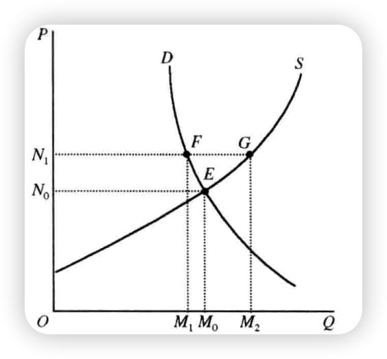

#### Ceiling price

A ceiling price is the maximum price that the government sets for certain daily necessities in order to restrain their prices from rising.

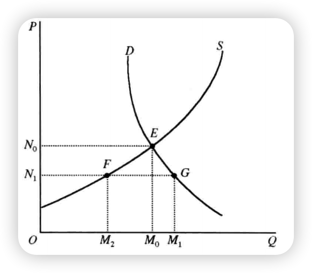

## Section 3 The theory of elasticity

The theory of elasticity explains the relation between the rate of change of price and the rate of change of the quantity demanded (or supplied).

### 1. Elasticity of demand

Elasticity of demand:
1. Price elasticity of demand — the relation between a change in quantity demanded and a change in price
2. Income elasticity of demand — the relation between a change in quantity demanded and a change in income
3. Cross elasticity of demand — the relation between a change in quantity demanded and a change in the price of another good

The price elasticity of demand measures the rate of change of quantity demanded caused by a given rate of change of price — that is, how strongly the quantity demanded responds to a change in price.

$$
Coefficient of price elasticity of demand = \frac{Percentage change in quantity demanded}{Percentage change in price}
$$

Coefficient formula:

$$
E_d = \frac{\Delta{Q}}{Q}/\frac{\Delta{P}}{P} = \frac{\Delta{Q}}{\Delta{P}}/\frac{Q}{P} = \frac{\Delta{Q}}{\Delta{p}}\cdot\frac{P}{Q}
$$

$Ed$ is the elasticity coefficient of demand.
$P$ is price.
$\Delta{P}$ is the change in price.
$Q$ is the quantity demanded.
$\Delta{Q}$ is the change in demand.

By the size of the elasticity coefficient, five cases can be distinguished:
1. Perfectly inelastic demand $E_d = 0$ . In this case, however the price changes, the quantity demanded does not change. The demand curve is a vertical line. (the $D_1$ curve)
2. Unit elasticity of demand $E_d = 1$ . In this case, the quantity demanded changes by the same proportion as the price. The demand curve is a rectangular hyperbola. (the $D_2$ curve)
3. Perfectly elastic demand, $E_d \to \infty$  (the $D_3$ curve)

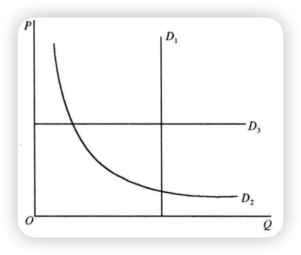
The three above rarely appear in reality.

4. Inelastic demand $1 > E_d  > 0$ . The quantity demanded changes by a smaller proportion than the price.

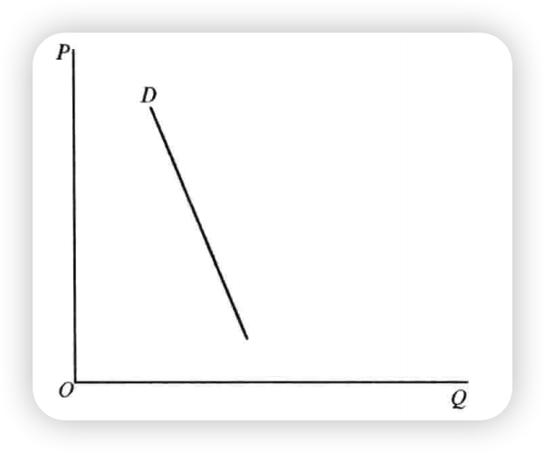
5. Elastic demand $\infty > E_d > 1$ . In this case the quantity demanded changes by a larger proportion than the price.

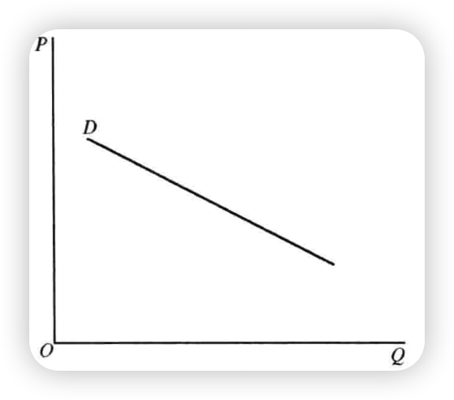

Factors affecting the elasticity of demand:
1. How badly people need the good. In general, the elasticity of demand for necessities is small, and the elasticity of demand for luxuries is large.
2. How substitutable the good itself is. In general, the more easily a good is substituted for, the larger its elasticity of demand; the less easily, the smaller.
3. How many uses the good has. In general, goods with many uses have a large elasticity of demand; goods with few uses, a small one.
4. How long the good is used. In general, non-durables have a large elasticity of demand, durables a small one.

When the price of a good changes, the size of its elasticity of demand is closely bound up with what happens to the total revenue from selling the good.

If demand for a good is elastic, price and total revenue move in opposite directions: revenue falls as price rises, and rises as price falls.

If demand for a good is inelastic, price and total revenue move in the same direction: revenue rises as price rises, and falls as price falls.

The income elasticity of demand measures the rate of change of quantity demanded caused by a given rate of change of income — how strongly demand responds to a change in income.

$$
Coefficient of income elasticity of demand = \frac{Percentage change in quantity demanded}{Percentage change in income}
$$
Coefficient formula for income elasticity of demand:

$$
E_m = \frac{\Delta{Q}}{Q}/\frac{\Delta{Y}}{Y} = \frac{\Delta{Q}}{\Delta{Y}}/\frac{Q}{Y} = \frac{\Delta{Q}}{\Delta{Y}}\cdot\frac{Y}{Q}
$$

$E_m$ is the income-elasticity coefficient of demand
$Y$ is income
$\Delta{Y}$ is the change in income
$Q$ is the quantity demanded
$\Delta{Q}$ is the change in demand

### 2. Elasticity of supply

Supply elasticity means the price elasticity of supply: it measures the rate of change of quantity supplied caused by a given rate of change of price — how strongly the quantity supplied responds to a change in price.

$$
Coefficient of elasticity of supply = \frac{Percentage change in quantity supplied}{Percentage change in price}
$$

$$
E_s = \frac{\Delta{Q}}{Q}/\frac{\Delta{P}}{P} = \frac{\Delta{Q}}{\Delta{p}}/\frac{Q}{P} = \frac{\Delta{Q}}{\Delta{P}}\cdot\frac{P}{Q}
$$

Price and quantity supplied move in the same direction, so the elasticity coefficient of supply is positive.

Five cases of supply elasticity:
1. Perfectly inelastic supply ( $E_s = 0$ : however the price changes, the quantity supplied does not change)
2. Perfectly elastic supply ( $E_s \to \infty$ : at the given price, supply is unlimited)
3. Unit elasticity of supply ( $E_s = 1$ : quantity supplied changes by the same proportion as price)
4. Elastic supply ( $\infty > E_s > 1$ : quantity supplied changes by a larger proportion than price)
5. Inelastic supply ( $1 > E_s > 0$ : quantity supplied changes by a smaller proportion than price)

The usual case is elastic or inelastic supply.

The factors governing the size of a good's supply elasticity are chiefly the length of the period:
1. In the short run, when some factors of production cannot be adjusted to market demand, the supply of every good is inelastic.
2. In the long run, when all factors of production can be adjusted to market demand, the supply of every good is elastic.

### Applying elasticity theory: the cobweb theorem

Static equilibrium analysis: if the analysis of equilibrium introduces no time element in examining the conditions under which equilibrium forms and is stable, it is static equilibrium analysis.

Dynamic equilibrium analysis: if the analysis of equilibrium introduces the time element and examines the process by which the state of equilibrium changes, it is dynamic equilibrium analysis.

The cobweb theorem is a kind of dynamic equilibrium analysis. It uses elasticity theory to examine the effect of price fluctuations on output in the next cycle, and the resulting movement of equilibrium.

The goods the cobweb theorem studies have these features:
1. Once their production has begun, a certain time must pass before they can be produced, and during that time production cannot be changed.
2. This period's price depends on this period's output $P_t = f( Q_t )$
3. This period's output depends on the previous period's price $Q_t = f\left(P_{t-1}\right)$

By the relation between the elasticity of supply and the elasticity of demand, the cobweb theorem studies the movement of equilibrium in three cases:
1. First case: elasticity of supply less than elasticity of demand $E_{s}<E_{d}$ , the converging cobweb

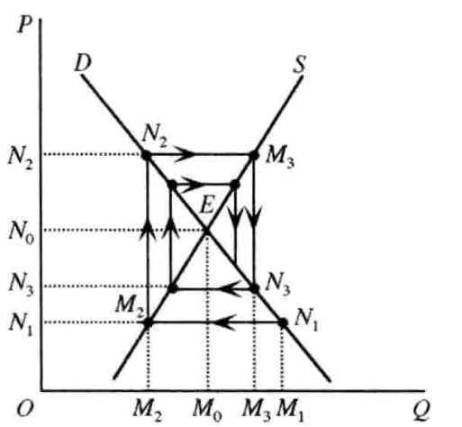

2. Second case: elasticity of supply greater than elasticity of demand ($E_{s} > E_{d}$), the diverging cobweb

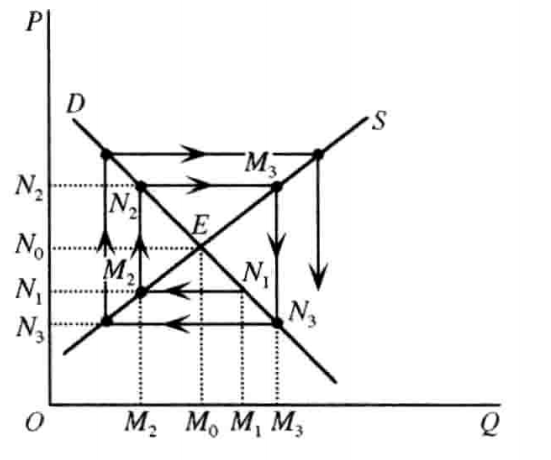

3. Third case: elasticity of supply equal to elasticity of demand ($E_s = E_d$ ), the closed cobweb

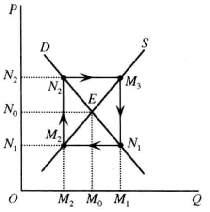

---

# Chapter 3 The theory of consumer behavior

The object of study is the consumer, also called the household — an economic unit capable of making unified consumption decisions. It may be one person or a family of several. The household supplies factors of production and receives income, aiming at the greatest possible satisfaction — that is, maximizing utility. The theory of consumer behavior studies how, with a given income, the consumer reaches maximum utility.

Consumer behavior:
1.  Cardinal utility theory — utility can be measured and summed, so the size of utility can be expressed in cardinals. Consumer behavior is analyzed with marginal utility.
2. Ordinal utility theory — utility cannot be measured or summed, so the degree and order of satisfaction can only be expressed in ordinals. Consumer behavior is analyzed with indifference curves.

## Section 1 Marginal-utility analysis

### 1. Wants and utility

The starting point for studying consumer behavior is the want; the destination is the satisfaction of the want, that is, utility.

A want is a sense of lack together with the desire to have it satisfied. Western economists regard the want as a psychological phenomenon.

The American psychologist Maslow's five-level model:
1. Physiological needs
2. Safety needs
3. Belonging and love
4. Esteem
5. Self-actualization

The German economist Gossen's two laws of wants:
1. The law of diminishing intensity of wants: within a given period, the intensity of a person's want for a good diminishes as the quantity of that good increases.
2. The law of diminishing enjoyment: as the want is satisfied, the enjoyment a person derives diminishes.

Utility is the satisfaction a person derives from consuming a good.

Western economists stress the subjectivity of utility: utility itself carries no ethical meaning and has no objective standard.

### 2. Marginal-utility theory

Total utility is the total degree of satisfaction derived from consuming a given quantity of a good.

Marginal utility is the addition to satisfaction from each additional unit consumed.

The difference between what a consumer is willing to pay for a good and what he actually pays is consumers' surplus.

### 3. Consumer equilibrium

The principle of consumer equilibrium:
If the consumer's money income is fixed and the prices of all goods on the market are known, then the consumer must so arrange purchases that the marginal utility of each good bought is proportional to the price paid for it — that is, the marginal utility obtained from each unit of money is equal.

Let:
$M$ be income
$X, Y$ the goods consumed
$P_X, P_Y$ the prices of goods $X$ and $Y$
$MU_X, MU_Y$ the marginal utilities of goods $X$ and $Y$
$Q_X, Q_Y$ the quantities of goods $X$ and $Y$ bought.

$$
P_X \cdot Q_X + P_Y \cdot Q_Y = M
$$

This says income is limited: spending on goods can be no more than income, and no less — less than income would not reach maximum utility.

$$
\frac{MU_X}{P_X} = \frac{MU_Y}{P_X}
$$

The ratios of marginal utility to price are equal for all goods: each unit of money, whether spent on good $X$ or on good $Y$, yields the same marginal utility.

## Section 2 Indifference-curve analysis

### 1. The indifference curve

An indifference curve shows combinations of different quantities of two goods (or two groups of goods) that yield the consumer the same utility.

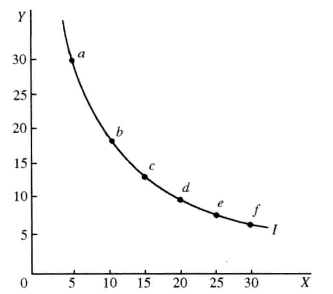

Features of indifference curves:
1. First, an indifference curve slopes downward to the right; its slope is negative.
2. Second, infinitely many indifference curves can be drawn in one plane. The further the curve from the origin, the higher the level of satisfaction it represents; the nearer, the lower.
3. Third, no two indifference curves in the same plane can ever cross: at a crossing the two curves would represent the same level of satisfaction, contradicting the second feature.
4. Fourth, an indifference curve is convex to the origin (MRS).

The marginal rate of substitution (MRS) is the ratio, as the consumer keeps the same level of satisfaction, of the quantity of one good added to the quantity of the other that must be given up.

$$
	MRS_{XY} = \frac{\Delta{Y}}{\Delta{X}}
$$

The marginal rate of substitution is diminishing: as one good is successively added, the quantity of the other that people are willing to sacrifice diminishes. This is the law of the diminishing marginal rate of substitution.

The marginal rate of substitution is in fact the slope of the indifference curve.

### 2. Consumer equilibrium

The consumption-possibility line, also called the budget line or the equal-expenditure line, shows the greatest combinations of quantities of goods the consumer can buy, given income and prices.

The condition of consumer equilibrium is:

$$
\frac{MU_X}{MU_Y} = \frac{P_X}{P_Y}
$$

---

# Chapter 4 The theory of production

The producer is called the firm: an economic unit capable of making unified production decisions, taking in sole proprietorships, partnerships and corporations.
The theory of production assumes the firm's aim is to maximize profit — at a given output, to minimize cost; at a given cost, to maximize output.

Profit maximization involves two questions:
1. One is the physical, technical relation between the factors of production employed and the output produced.
2. The other is the economic relation between the cost of the inputs used and the technology and the revenue.

## Section 1 Production and the laws of production

### 1. The production function

Production is the act of combining factors of production to make products; production is also the process of turning input into output.

Factors of production are the various resources used in production.
1. Labor $L$
2. Capital $K$
3. Land or natural resources $N$
4. Entrepreneurship $E$

$Q$ stands for total output

$$
Q = f(L,K,N,E)
$$

Considering only labor and capital

$$
Q = f(L,K)
$$

If both inputs are increased by a factor of $\lambda$, output also increases by $\lambda$.
Linear homogeneous production function:

$$
\lambda{Q} = f(\lambda{L},\lambda{K})
$$

### 2. The law of diminishing marginal returns and the rational employment of a factor

How changes in the quantity of a factor employed affect output:
1. One case is that all factors of production change in the same proportion.
2. The other is that all other factors are fixed and only one factor's quantity changes. (This is the case the law of diminishing marginal returns studies.)

Western economists use the law of diminishing marginal returns to analyze the rational employment of a single factor of production.

$Q$ is the quantity of the factor employed

$\Delta{Q}$ is the increment of the factor

Total product: $TP$

Average product: $AP$

Marginal product: $MP$

$$
TP = AP\cdot{Q}
$$

$$
AP = \frac{TP}{Q}
$$

$$
MP = \frac{\Delta{TP}}{\Delta{Q}}
$$

1. First, as labor is added, total product, average product and marginal product at first all rise, and after each reaches a certain point they begin respectively to fall.
2. Second, the marginal-product curve must intersect the average-product curve at the average product's highest point. Before the crossing, average product is rising and marginal product exceeds average product; after the crossing, average product is falling and marginal product is below average product; at the crossing, average product is at its maximum and marginal product equals average product.
3. Third, when marginal product is zero, total product is at its maximum; thereafter, when marginal product turns negative, total product absolutely declines.

### 3. Economies of scale

Economies of scale concern the change in output caused by changing all factors of production together, and so changing the scale of production.

As the factors of production are increased and the scale of production expands, the change in returns passes roughly through three stages:
1. In the first stage, returns rise by a larger proportion than the scale expands — the stage of increasing returns to scale.
2. In the second stage, returns rise by the same proportion as the scale expands — a brief transition from increasing to constant returns, called the stage of constant returns to scale.
3. In the third stage, returns rise by a smaller proportion than the scale expands, or even fall absolutely — the stage of decreasing returns to scale.

Internal economies are the additions to returns that a firm derives from within itself as its scale of production expands.

External economies are the additions to returns that the expansion of a whole industry brings to an individual firm.

## Section 2 Cost and revenue analysis

### 1. Cost

Cost is also called the expense of production.

Western economists divide cost in two:
1. One is the actual outlay on the various factors used in production — accounting cost.
2. The other is what is given up to obtain something — opportunity cost.

In western economics cost includes both accounting cost and opportunity cost; their sum is economic cost.

Accounting profit: total revenue minus accounting cost.
Economic profit: total revenue minus economic cost — that is, minus both accounting cost and opportunity cost.

$$
Economic profit = Total revenue - Opportunity cost - Accounting cost
Accounting profit = Total revenue - Accounting cost
$$

The profit maximization the firm pursues is the maximization of economic profit.

Costs:
1. Total cost ( $TC$ )
2. Average cost ( $AC$ )
3. Marginal cost ( $MC$ )

$Q$ is the quantity of the product
$\Delta{Q}$ is the increment of the product
$$
TC =AC \cdot Q
$$

$$
AC =\frac{TC}{Q}
$$

$$
MC =\frac{\Delta{TC}}{\Delta Q}
$$

Costs:
1. Short run (short run): in the short run not all factors of production can be adjusted to market demand.
2. Long run (long run): all factors of production can be adjusted to market demand.
3. Very short run (very short run): no factor of production can be adjusted.
4. Very long run (very long run): not only can all factors of production be adjusted, but the state of technology changes.

Short-run costs:
1. Fixed cost ( $FC$ ): the outlay on the fixed factors that the firm must pay in the short run. It does not vary with output and is fixed in the short run.
2. Variable cost ( $VC$ ): the outlay on the variable factors, which varies with output.
3. Short-run total cost ( $STC$ ): the sum of fixed cost and variable cost.
4. Average fixed cost ( $AFC$ ): fixed cost per unit of product. Its rule of movement: as output increases, average fixed cost keeps falling — steeply at first, then ever more gently.
5. Average variable cost ( $AVC$ ): variable cost per unit of product.
6. Short-run average cost ( $SAC$ ): the sum of average fixed cost and average variable cost.
7. Short-run marginal cost ( $SMC$ ): the addition to total cost in the short run from each additional unit of output.
8. Long-run total cost ( $LTC$ ) varies with output; with no output there is no total cost.
9. The long-run average cost curve ( $LAC$ ): a line tangent to infinitely many short-run average cost curves.
10. Long-run marginal cost ( $LMC$ ): a gently-moving U-shaped curve that first falls and then rises.

### 2. Revenue

Revenue is the income a firm receives from selling its product: price times quantity sold.

Kinds:
1. Total revenue ( $TR$ ) — all income
2. Average revenue ( $AR$ ) — income per unit of product sold
3. Marginal revenue ( $MR$ ) — the addition to income from each additional unit sold

$Q$ is the quantity sold, $\Delta{Q}$ the increment of sales
$$
TR = AR \cdot Q
$$

$$
AR =\frac{\mathrm{TR}}{Q}
$$

$$
MR =\frac{\Delta{TR}}{\Delta Q}
$$
$P$ stands for price

$$
TP \cdot P = TR
$$
$$
AP \cdot P = AR
$$
$$
MP \cdot P = MR
$$

### 3. The principle of profit maximization

$P$ stands for profit, $X$ for output, $R$ for revenue, $C$ for cost

$$
P = R(X) - C(X)
$$
Condition for maximum profit
$$
\frac{dP}{dX} = \frac{dR}{dX} - \frac{dC}{dX} = 0
$$

Marginal revenue: $\frac{dR}{dX}$
Marginal cost: $\frac{dC}{dX}$

The condition for maximum profit is marginal revenue equal to marginal cost:

$$
MR = MC
$$

## Section 3 The optimal combination of factors of production

The optimal combination of factors is how to realize profit maximization: how, at a given output, to reach least cost, or at a given cost, to reach greatest output.

### 1. The principle of the optimal combination

The principle is: at a given cost, the ratios of the marginal products of the various factors bought to their prices must be equal — each unit of money, whichever factor it buys, must yield the same marginal product.

Labor: $L$
Capital: $K$
Marginal product of labor: $MP_L$
Price: $P_L$
Quantity bought: $Q_L$
Marginal product of capital: $MP_K$
Price: $P_K$
Quantity bought: $Q_K$
Cost: $C$

$$
P_L \cdot Q_L + P_K \cdot Q_K = C
$$

$$
\frac{MP_L}{P_L} = \frac{MP_K}{P_K}
$$

### 2. Isoquants and the determination of the optimal combination

An iso-quant shows that a fixed quantity of product can be produced with different combinations of the various factors of production it requires.

Features:
1. First, an iso-quant slopes downward to the right; its slope is negative.
2. Second, infinitely many iso-quants can be drawn in one plane.
3. Third, no two iso-quants in the same plane can ever cross: at a crossing the two curves would represent the same output level, contradicting the second feature.
4. Fourth, an iso-quant is convex to the origin.

## Section 4 The production-possibility curve and opportunity cost

### 1. The production-possibility curve

The production-possibility curve is the set of maximum output combinations of two products attainable with given resources.

The marginal rate of transformation ( $MRT$ ): with given resources, to increase the output of one product the output of another must be reduced; the ratio of the quantity of the product added to the quantity of the product given up is the marginal rate of transformation.

$\Delta{X}$ is the addition to product $X$, $\Delta{Y}$ the reduction in product $Y$.
$$
MRT_{XY} = \frac{\Delta{Y}}{\Delta{X}}
$$

### 2. Opportunity cost

Opportunity cost: when a given quantity of resources is used to produce a certain product, the quantity of the other product given up is the opportunity cost of this product.

Using the concept of opportunity cost requires three conditions:
1. First, the resources themselves must have several uses.
2. Second, the resources must be able to flow freely, without restriction.
3. Third, the resources must be fully employed.

---
# Chapter 5 The theory of firm equilibrium

The theory of equilibrium price solved the determination of price and output under perfect competition, and showed how the market mechanism regulates the economy.

The theory of firm equilibrium divides market structure into four types:
1. Perfect competition
2. Monopolistic competition
3. Oligopoly
4. Perfect monopoly

## Section 1 Firm equilibrium under perfect competition

### 1. The conditions of perfect competition

Perfect competition, or pure competition, is a market structure in which competition meets no obstruction or interference.

Conditions:
1. There are many producers and many consumers on the market. Each is a price taker at the going price, not a price maker.
2. There is no product differentiation, so no firm can control price through the distinctiveness of its own product.
3. Third, all factors of production can flow wholly freely, without restriction.
4. Fourth, market information flows freely, and neither side deceives the other.

### 2. The pattern of revenue under perfect competition

Under perfect competition the market price is determined by the supply and demand of the whole industry. Market price equals average revenue.

### 3. Firm equilibrium under perfect competition

Short-run marginal cost curve: $SMC$
Short-run average cost curve: $SAC$
Marginal revenue curve: $MR$
Long-run marginal cost curve: $LMC$
Long-run average cost curve: $LAC$
Average revenue: $AR$

Short-run equilibrium condition:

$$
SMC = MR
$$

Long-run equilibrium condition:

$$
LMC = MR = LAC = AR
$$

## Section 2 Firm equilibrium under perfect monopoly

### 1. The meaning of perfect monopoly

Perfect monopoly (monopoly) is the state in which the market of a whole industry is wholly controlled by a single firm.

Conditions of formation:
1. Natural conditions
2. Legislative conditions

### 2. The pattern of revenue under perfect monopoly

The monopolist is a price maker: its supply affects price, and price and quantity demanded move in opposite directions, so the demand curve slopes downward to the right. The demand curve and the average-revenue curve coincide as one line.

### 3. Firm equilibrium under perfect monopoly

Under perfect monopoly, short-run equilibrium and long-run equilibrium are the same; the condition of equilibrium is in both cases $MR = MC$, and excess monopoly profit exists in both the long run and the short run.

## Section 3 Firm equilibrium under monopolistic competition

### 1. The conditions of monopolistic competition

Monopolistic competition is a market structure that has both monopoly and competition — neither perfect competition nor perfect monopoly.

Conditions:
1. First, the products are differentiated.
2. Second, the number of firms is still fairly large.

### 2. Firm equilibrium under monopolistic competition

Under monopolistic competition, the long-run equilibrium conditions are: $MC = MR$, $AC = AR$

## Section 4 Firm equilibrium under oligopoly

### 1. The meaning of oligopoly

Oligopoly means a small number of sellers.

Kinds of oligopoly:
1.  Pure oligopolies, producing identical products
2. Differentiated oligopolies, producing differentiated products

### 2. The theory of oligopoly

On an oligopoly market, the upper limit of price movement is the monopoly price under perfect monopoly, and the lower limit is the competitive price of long-run equilibrium under perfect competition.

On an oligopoly market, price is often not determined directly by market supply and demand but set administratively by a few oligopolists through agreement or tacit understanding. Such a price is called an administered price.

---
# Chapter 6 The theory of distribution

The theory of distribution answers the question "for whom to produce" — how the product is distributed among the classes of society.
To solve the problem of distribution is to solve the problem of how the prices of the factors of production are determined.

## Section 1 Distribution theory based on marginal productivity

### 1. Marginal productivity

Other things unchanged, the addition to output from employing one more unit of a factor of production is that factor's marginal productivity.

Expressed in physical terms, a factor's marginal productivity can be called its marginal physical product ($MPP$).

Expressed in terms of revenue, it can be called the factor's marginal revenue product ($MRP$).

$$
MRP = MPP \cdot P
$$

### 2. Marginal productivity determines wages and interest

Economic classification:
1. A static economy is one in which none of the factors change; static economics studies precisely the natural laws of such an economy.
2. A dynamic economy is one in which all the factors change; studying these changes and their effects on the economy belongs to the dynamic branch.

By marginal-productivity theory, wages are determined by the marginal productivity of labor, and interest by the marginal productivity of capital.

The theory of distribution aims to show that the distribution system of a market economy is reasonable and just.

## Section 2 Distribution theory based on equilibrium price

### 1. The demand for and supply of factors of production

### 2. The theory of wages

### 3. The theory of interest

### 4. The theory of rent

### 5. The theory of profit

## Section 3 The Lorenz curve and the Gini coefficient

### 1. The Lorenz curve

### 2. Applications of the Lorenz curve

### 3. The Gini coefficient

---

# Chapter 7 National income accounting

## Section 1 Gross domestic product

### 1. The meaning of gross domestic product

### 2. Methods of computing gross domestic product

### 3. The relation among the five aggregates of national income accounting

### 4. Other measures of gross domestic product

### 5. The defects of GDP accounting

## Section 2 Price indices and the unemployment rate

### 1. Price indices

### 2. The unemployment rate

---

# Chapter 8 The determination of national income

## Section 1 Aggregate demand

### 1. The composition of aggregate demand

### 2. The aggregate demand curve

### 3. Shifts of the aggregate demand curve

## Section 2 Aggregate supply

### 1. The long-run aggregate supply curve

### 2. The short-run aggregate supply curve

## Section 3 The aggregate demand–aggregate supply model

### 1. The basic model

### 2. The different states of national-income equilibrium

### 3. The effect of aggregate demand on national-income equilibrium

### 4. The effect of aggregate supply on national-income equilibrium

---

# Chapter 9 Unemployment and inflation

## Section 1 Unemployment

### 1. Natural unemployment

### 2. Cyclical unemployment

### 3. The effects of unemployment

## Section 2 Inflation

### 1. The financial system

### 2. The basics of money

### 3. The basics of inflation

## Section 3 The relation between unemployment and inflation: the Phillips curve

---

# Chapter 10 Business cycle theory

## Section 1 A survey of business cycle theory

### 1. The meaning of the business cycle

### 2. The classification of business cycles

### 3. Explanations of the causes of the business cycle

## Section 2 The theory combining the multiplier and the accelerator

### 1. The acceleration principle

### 2. The theory combining the multiplier and the accelerator

---

# Chapter 11 The theory of economic growth

## Section 1 A survey of growth theory

### 1. The meaning of economic growth

### 2. The main content of growth theory

## Section 2 The Harrod–Domar model

### 1. The basic equation of the Harrod–Domar model

### 2. The conditions of steady growth

### 3. The causes of short-run fluctuation in the economy

### 4. The causes of long-run fluctuation in the economy

## Section 3 The analysis of the factors of growth

### 1. Kendrick's analysis of total factor productivity

### 2. Denison's analysis of the factors of growth

## Section 4  Zero-growth theory

### 1. The limits-to-growth thesis

### 2. Doubts about the value of growth

---

# Chapter 12 Macroeconomic policy

## Section 1 Macroeconomic policy

---

# Chapter 13 A survey of contemporary schools of western economics

---

# Chapter 17 The new institutional school

In contemporary western economics, the new institutional school opposes both the post-Keynesian schools and the schools of monetarism and liberalism.

## Section 1 A survey of the institutional school

### 1. The history of the institutional school

- First stage: from the end of the 19th century to the 1930s, the period when the institutional school took shape around Veblen.
	 Features:
	- It criticized orthodox economics and built an economic theory whose basic content is the study of the evolution of institutions. Veblen held that the economy is one component of the whole social institution, and that economics should therefore study the institutions through which human economic life is carried on. He also saw society as a dynamic process, the economy being one link in the evolution of social institutions, so economics must also study how institutions form and change. Veblen explained the formation of institutions by psychological analysis and their development and evolution by the theory of evolution, and on this basis built an economic theory resting on the cumulative process of evolution of economic institutions.
	- It criticized the ills of capitalist society and proposed to reform capitalism from the side of institutions or structure. In human economic life, he held, there are two institutions: the production-technology institution that satisfies people's material life, and the institution of private property. The trouble with capitalist society lies in the contradiction between these two. The remedy is to replace the rule of the business owner with a "soviet of technicians" made up of engineers, scientists and technologists.
- Second stage: from the 1930s to the 1950s, a transition between the old tradition of Veblen and the new theory of Galbraith.
- Third stage: from the 1950s to the 1980s, the period when the new institutional economics formed and developed.

### 2. The basic features of the institutional school

- First, it fixes on institutions as the object of economic study.
- Second, it studies institutional questions with an evolutionary, holistic method.
- Third, it exposes and criticizes the ills of capitalist society to a degree, and proposes to solve them by structural reform.

### 3. The features of the new institutional school

- The new institutional school stands in a different era from the old and faces different problems. Today, the appearance of stagflation and the simultaneous eruption of many social and economic problems are things history has never seen. In this situation the new school's theoretical work stands closer to reality and must offer new explanations and new remedies for these problems.
- Institutional economics has passed through a long development; today's new institutional theory is more complete and systematic, and the policy aims and measures it puts forward are more concrete and more extensive.
- The new institutional school has been influenced by Keynesianism to a degree. Of course, it holds that Keynesianism did not start from the problem of institutional structure, and so cannot solve the problems of capitalist society at the root.

## Section 2 The theory of the new institutional school

### 1. The theory of the dual system: Galbraith's institutional analysis of contemporary capitalist society

<!-- BACKLINKS-AUTO -->
## Related pages

- [Introduction](/western/导言)
