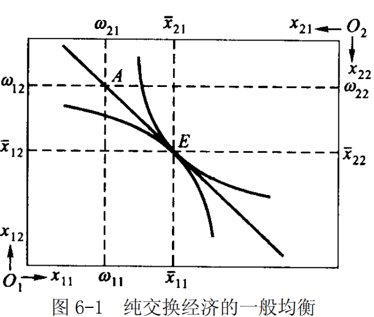

# Chapter 6: General Equilibrium Theory and Welfare Economics

> **Core question of this chapter**: Can all markets reach equilibrium simultaneously? What resource allocation is truly "optimal"? Can efficiency and equity coexist?

## Chapter Overview

The first five chapters each looked at only one market: a single commodity market, a single factor market. But prices are never determined in isolation—a rise in the price of beef pushes demand toward pork, and a rise in the price of pork pushes it back toward mutton. In 1874 Walras took a bold step: he wrote **all** markets into a system of simultaneous equations, letting every price be solved for at once. This is general equilibrium. It is magnificent, and also dangerous: whether a system of equations has a solution at all, Walras himself only fobbed off vaguely with "the number of equations equals the number of unknowns"—this question of existence hung open for eighty years, until Walde (the 1930s) gave a preliminary proof and Arrow and Debreu (1954) settled it thoroughly with a fixed-point theorem (the proof's trick borrowed directly from Nash equilibrium).

General equilibrium says whether markets can clear simultaneously; welfare economics then asks "so what if they clear"—is equilibrium worth pursuing? Pareto offered a deliberately conservative standard: an allocation is optimal if no improvement remains that makes someone better off without making anyone worse off. This standard became popular precisely because it avoids interpersonal comparisons: one need not say how much of A's utility equals how much of B's, only ask "is there still a free lunch?" This chapter first covers general equilibrium (Walras's law, the Edgeworth box), then the three conditions for Pareto optimality, and finally how the two connect: a general equilibrium under perfect competition is exactly Pareto optimal—Smith's "invisible hand" acquired its rigorous theorem form only after 1951 (the two fundamental theorems of welfare economics).

## Core Concepts

### Partial Equilibrium and General Equilibrium

- (1) Partial equilibrium refers to the equilibrium of a specific product or factor market, assuming all other markets remain unchanged. Partial equilibrium analysis studies a single (product or factor) market by isolating the market in question and studying it separately, "extracting" it from the whole set of markets in the interconnected economic system.

Partial equilibrium is the equilibrium state of a single consumer, commodity or factor market, firm, or industry within the economic system. Partial equilibrium analysis considers only the mutual influences and interactions among the factors contained in this particular partial domain, and how they eventually reach an equilibrium state. For example, when studying the equilibrium of a product market, one may assume the supply, demand, and prices of all other products remain unchanged, and consider only how the price and quantity sold of that product reach equilibrium through the opposing forces of its own supply and demand.

- (2) General equilibrium refers to the state in which the supply and demand of all markets in an economic system reach equilibrium simultaneously. General equilibrium analysis starts from the behavior of microeconomic agents, examining the conditions required for the supply and demand of every product and every factor to reach equilibrium simultaneously, along with the corresponding equilibrium prices and the magnitude of equilibrium supply and demand quantities.

According to general equilibrium analysis, the price of a given commodity depends not only on its own supply and demand but is also affected by the prices and supply-demand conditions of other commodities. Thus, the price and supply-demand equilibrium of any commodity can be realized only when the prices and supply-demand of all commodities reach equilibrium simultaneously.

**[Partial Equilibrium vs. General Equilibrium Comparison]**

| Dimension | Partial equilibrium | General equilibrium |
|-----------|---------------------|---------------------|
| Scope of study | Single market (product or factor) | All markets (products + factors) |
| Assumptions | Assumes other markets unchanged | Considers interconnections and mutual influences among markets |
| Analytical method | "Extracts" a single market from the whole for separate study | Analyzes all markets as a unified whole |
| Price determination | Price determined only by own supply and demand | Price determined jointly by the supply and demand of all markets |
| Equilibrium condition | Single market: Supply = Demand | All markets simultaneously: Supply = Demand |
| Complexity | Simple and easy to analyze | Complex, requires a system of simultaneous equations |
| Realism | Approximate analysis, suitable when inter-market linkages are weak | Closer to reality, but difficult to solve |
| Applications | Policy impact analysis for a single market | Economy-wide policy, tax reform, trade analysis |

**Intuitive understanding**:

```
局部均衡：                       一般均衡：
     牛肉市场                         牛肉市场 ←→ 猪肉市场
   供给 = 需求                      供给 = 需求   供给 = 需求
       ↑                               ↑           ↓
   其他市场不变                    羊肉市场 ←→ 鸡肉市场
                                  供给 = 需求   供给 = 需求
```

**Illustrative examples**:

| Situation | Partial equilibrium analysis | General equilibrium analysis |
|-----------|------------------------------|------------------------------|
| Rise in beef prices | Analyze only the beef market: demand ↓ → price ↑ | Simultaneously: beef ↑ → pork demand ↑ → pork ↑ → mutton demand ↑… |
| Tax on gasoline | Analyze only the gasoline market: price ↑ | Simultaneously: gasoline ↑ → car demand ↓ → steel demand ↓ → … |

Partial equilibrium sees "only the trees"; general equilibrium sees "both the trees and the forest." Marshall's supply-and-demand diagram is the tool for the former, Walras's system of equations for the latter—Chapters 1 through 5 used only the former, and this chapter completes the picture.

### Walras's Law

Walras's law, also called Walras's rule, is an identity proposed by the economist Walras within his general equilibrium theory of perfectly competitive markets.
Its basic content is: in a system of perfectly competitive markets, at any price level, the total expenditure of all members of the economic society on purchasing goods and services must equal the total revenue obtained from selling goods and services, and the sum of excess demand for all goods in the market is zero.

$$\sum_{i=1}^{k+r} p_i \cdot x_i = \sum_{i=1}^{k+r} p_i \cdot y_i$$

The significance of this identity for general equilibrium is that it shows the price of some good can always be expressed in terms of the prices of other goods, whether or not the economy is in general equilibrium: when all other markets are in equilibrium, the remaining market must also be in equilibrium. Hence general equilibrium analysis cannot yield the (absolute) prices of all markets. However, if one good is designated as the general numéraire and its price is set to 1, then general equilibrium may admit a determinate solution. It follows that the validity of this law means general equilibrium analysis can yield only relative prices.

From Walras's law it follows that if there are $n$ commodity markets in an economic system and $n-1$ of them are in equilibrium, then the $n$th commodity market must also be in equilibrium. Walras's law not only states that at any price level in an exchange economy the sum of excess demand for all goods by consumers is zero; it can likewise be shown that Walras's law applies not only to purely economic exchange systems, but also to production-and-exchange economic systems, and to monetary economic systems.

### Pareto Optimal State

The Pareto optimal state, also called economic efficiency, refers to a situation in which no one can improve their own welfare without making someone else worse off; such a state is called Pareto optimal. When the allocation of resources in an economic system reaches a Pareto optimal state, the operation of the economy is said to be efficient. Conversely, an outcome that does not satisfy Pareto optimality is inefficient.

The cleverness of this standard lies in its minimalism: it does not claim that the optimal allocation is the "best," only that no "free lunches" remain—every way to make someone better off has been exhausted, and any further improvement must impose a cost on someone. For this same reason it is an efficiency standard, not an equity standard: an allocation that gives all wealth to one person can also be Pareto optimal.

### Conditions for Exchange to Satisfy Pareto Optimality

The condition for exchange to satisfy Pareto optimality means that in the realm of exchange, the marginal rate of substitution between any pair of commodities is equal for every individual consuming those two goods, i.e., $RCS_{12}^{A} = RCS_{12}^B$. At this point society has reached a Pareto optimal allocation of goods, and exchange efficiency is realized. In an Edgeworth box depicting pure exchange, exchange satisfies Pareto optimality when the two consumers' indifference curves are tangent.

### Conditions for Production to Satisfy Pareto Optimality

The condition for production to satisfy Pareto optimality means that for an economy with multiple individuals, multiple commodities, and multiple factors of production, equilibrium requires that in production the marginal rate of technical substitution between any pair of factors is equal across the production of all goods using those two inputs, i.e., $RTS_{LK}^{1} = RTS_{LK}^2$. At this point society has reached Pareto optimality, and production efficiency is realized. Of course, this also realizes general equilibrium in production. In an Edgeworth box depicting production, production satisfies Pareto optimality when the isoquants of the two goods' production are tangent.

### Conditions for Exchange and Production to Satisfy Pareto Optimality Simultaneously

The condition for exchange and production to simultaneously satisfy Pareto optimality means that the marginal rate of substitution between any two goods is equal to the marginal rate of transformation between those two goods in production, i.e., $RCS_{XY}=RPT_{XY}$. If all markets (product markets and factor markets) are perfectly competitive, the ultimate operation of the market mechanism will lead production resources to their optimal allocation. Under the ideal state of Pareto optimality, limited production resources are allocated most efficiently, output is maximized, and the distribution of goods maximizes the total welfare of all members of society.

If a good in the economy can be used for both production and consumption, then the condition for the economy to reach a Pareto optimal state is that the marginal rate of transformation between any two goods equals the marginal rate of substitution for those two goods.

### Product Transformation Rate

The marginal rate of transformation refers to the rate at which the output of one good must be reduced in order to increase the output of another good.
If the change in the output of $X$ is $\Delta{X}$ and the change in the output of $Y$ is $\Delta{Y}$, then the absolute value of their ratio $\left|\Delta{Y}/\Delta{X}\right|$ measures the rate at which one unit of good X is transformed into good Y.

The limit of this ratio is defined as the marginal rate of transformation $MRT$ of good X into good Y, that is:

$$M R T=\lim_{\Delta x \rightarrow 0}\left|\frac{\Delta Y}{\Delta X}\right|=\left|\frac{\mathrm{d} Y}{\mathrm{d} X}\right|$$

The marginal rate of transformation reflects the opportunity cost of product transformation. On a production possibilities curve, the marginal rate of transformation appears as the absolute value of the slope of the production possibilities curve.

## Problems and Analysis

### What is the basic idea of Walras's general equilibrium theory? Where does the "existence" problem get stuck?

- (1) General equilibrium analysis studies all interconnected markets as a single whole, and its basic idea is to extend the equilibrium condition of a single market to multiple markets. The first problem general equilibrium theory must solve is: does there exist a set of prices such that all markets are in equilibrium simultaneously—that is, the so-called existence problem of general equilibrium.

- (2) The French economist Walras established in 1874 an analytical framework later called Walras's general equilibrium theory. This framework assumes that the economy has $k$ products and $r$ factors of production. Thus the economy has $k$ product markets and $r$ factor markets.

- ① Consider product market equilibrium: the demand for products comes from consumers.

  For a particular good, consumer demand depends on the good's own price, the prices of other goods, and consumers' income, among other things. But consumers' income in turn derives from factor prices. Thus the market demand for a good depends on the prices of all products and factors, i.e.:
    $$x_i=x_i(p_1,\cdots,p_k,p_{k+1},\cdots,p_{k+r}),\ (i=1,\cdots,k)$$

  The supply of products comes from firms. A firm's supply likewise depends on the price of that good, the prices of other goods, and costs, while firm costs are themselves determined by factor prices. Thus the market supply of a product also depends on various prices, i.e.:

  $$y_i=y_i(p_1,\cdots,p_k,p_{k+1},\cdots,p_{k+r}),\ (i=1,\cdots,k)$$

  When market demand equals market supply, the market for a product is in equilibrium, i.e.:
  $$x_i=y_i,\ (i=1,\cdots,k)$$

- ② Consider factor market equilibrium. Demand for factors is the derived demand of firms; it depends not only on the prices of the various factors but is also related to the prices of products, i.e.:
  $$x_j=x_j(p_1,\cdots,p_k;p_{k+1},\cdots,p_{k+r}),\ j=k+1,\cdots,k+r$$

  The supply of factors comes from consumers and is a generalization of utility maximization:
  $$y_j=y_j(p_1,\cdots,p_k;p_{k+1},\cdots,p_{k+r}),\ j=k+1,\cdots,k+r$$

  When market demand equals market supply, the factor market is in equilibrium, i.e.:
  $$x_j=y_j,\ j=k+1,\cdots,k+r$$

- ③ If there exist $p_1,\cdots,p_k$ and $p_{k+1},\cdots,p_{k+r}$ such that the equilibrium conditions of the above $k+r$ markets hold, then general equilibrium exists. This problem reduces to whether $k+r$ equations can be solved for $k+r$ prices. Originally Walras held that this depends on whether the $k+r$ equations are independent. But for the whole economic system, however high prices may be, the sum of all incomes must equal the sum of all expenditures:
  $$\sum_{i=1}^{k+r}{p_i}{x_i}=\sum_{i=1}^{k+r}{p_i}{y_i}$$

  This identity is called Walras's law. Because Walras's law holds, there cannot be $k+r$ mutually independent equilibrium equations—only $k+r-1$ of the $k+r$ markets are truly independent. But by taking some good as the "general numéraire" (setting its price to 1) and replacing absolute prices with relative prices, the problem is resolved. On this basis, Walras's general equilibrium theory asserts that a system of relative prices that clears all markets simultaneously does exist.

  Knowing this is worthwhile: Walras's original argument of "counting equations" is not mathematically rigorous; the truly rigorous proof of existence had to wait until eighty years later (see this chapter's "Limitations and Beyond").

### Use an Edgeworth box to illustrate general equilibrium in a pure exchange economy.

(1) The Edgeworth box, named after the British economist Edgeworth, is a box-shaped diagram used to study the optimal allocation of resources.

The diagram reveals how to allocate resources when the total endowment of goods to be consumed, or the total quantity of inputs used in economic activity, is fixed. Assume the economy has only consumers 1 and 2 and goods 1 and 2; its Edgeworth box is shown in Figure 6-1.



(2) A pure exchange economy is one with only exchange and no production. Suppose two consumers in a pure exchange economy trade two goods, where the initial quantity of good $j$ owned by consumer $i$ is $w_{ij}$ and the chosen quantity consumed is $x_{ij}$.

For the whole economy, the quantities of the two goods held by society are respectively:

$$w_1=w_{11} + w_{21}$$

and

$$w_2=w_{12}+w_{22}$$

Suppose the prices of the two goods are $p_1$ and $p_2$. A utility-maximizing consumer determines the optimal consumption quantity at the given price level. Note that the consumer's income here comes from their initial endowment. Consumer 1's behavior can be summarized as:

$$\begin{cases}
\max & u_{1}\left(x_{11}, x_{12}\right) \\
x_{11}, x_{12} & \\
\text { s. t. } & p_{1} x_{11}+p_{2} x_{12}=p_{1} \omega_{11}+p_{2} \omega_{12}
\end{cases}$$

The utility a consumer derives from consuming different combinations of goods can be represented by a series of indifference curves convex to the origin (lower-left corner). Their income constraint $p_{1}x_{11} +p_{2}x_{12}=p_{1}w_{11}+p_{2}w_{12}$ is a straight line with slope $(-p_1/p_2)$ passing through the initial point $(w_{11},w_{12})$. At given prices, the consumer chooses the utility-maximizing bundle on this budget constraint, i.e., the consumption bundle $(\bar{x_{11}},\bar{x_{12}})$ corresponding to the tangency point of the budget line and an indifference curve; the consumer is then in a state of partial equilibrium. Consumer 2 has a similar partial equilibrium.

Clearly, in an Edgeworth box, the second consumer's budget constraint coincides with the first consumer's. Thus, when $(\bar{x_{11}}-w_{11})+(\bar{x_{21}}-w_{21})=0$, the market for the first good is in equilibrium, and the optimal points chosen by the two consumers coincide. The same holds for the second good. But it is not hard to see from the diagram that if the market for the first good is in equilibrium, the market for the second good must also be in equilibrium—this is exactly Walras's law in the two-good case. The price so determined (in fact a relative price) is the general equilibrium price.

### What is a Pareto optimal allocation? What are its main conditions?

- (1) If for a given allocation of resources no Pareto improvements exist at all—that is, at that state no change is possible that makes at least one person better off without making anyone else worse off—then that allocation is called a Pareto optimal state.

- (2) The conditions that must be satisfied to attain a Pareto optimal state are called the Pareto optimality conditions, and they comprise the optimality condition for exchange, the optimality condition for production, and the joint optimality condition for exchange and production.

① The Pareto optimality condition for exchange: in exchange, the marginal rate of substitution between any pair of goods is equal for every individual consuming those two goods, i.e., $RCS_{XY}^A = RCS_{XY}^{B}$.

② The Pareto optimality condition for production: in production, the marginal rate of technical substitution between any pair of factors is equal across all goods produced with those two inputs, i.e., $RTS_{LK}^{X}=RTS_{LK}^{Y}$.

③ The Pareto optimality condition for exchange and production: the marginal rate of transformation between any pair of goods in production equals the marginal rate of substitution for everyone consuming those two goods, i.e., $RCS_{XY}=RPT_{XY}$.

The three conditions each govern one thing: exchange efficiency sends goods to those who value them most, production efficiency sends factors to the producers who use them best, and the joint efficiency of exchange and production makes the economy's output mix exactly the mix people want.

### Why can a perfectly competitive market be in a Pareto optimal state?

- (1) The Pareto optimal state is the general standard for judging the efficiency of the market mechanism.
A Pareto optimal state means that, at a given allocation of resources, no change is possible that makes at least one person better off without making anyone else worse off—that is, no Pareto improvement exists—and such an allocation is then called Pareto optimal.
For an economy to achieve a Pareto optimal state, three necessary conditions must be satisfied:
- ① The marginal rate of substitution between any two goods must be equal for all consumers of those two goods;
- ② The marginal rate of technical substitution between any two factors must be equal for any producer using those two factors;
- ③ The marginal rate of substitution for consumers of any two goods must equal the marginal rate of transformation for producers of those two goods.

- (2) That a perfectly competitive market can always realize a Pareto optimal state can be explained by considering the three necessary conditions one by one. There is only one key mechanism: **perfect competition puts everyone facing the same prices**, so that each person "adjusting marginals to prices" automatically yields "everyone's marginals being equal."
- ① From the exchange optimality condition: under perfect competition, each individual consumer is a price taker, and every consumer adjusts their demand for goods to satisfy $RCS_{XY}=\frac{P_X}{P_Y}$ and thereby maximize utility. Since all consumers are price takers, the quantity of any two goods each buys must make their marginal rate of substitution equal to the common price ratio faced by all consumers. Hence the marginal rate of substitution between any two goods is equal across all consumers.

- ② From the production optimality condition: under perfect competition, each individual producer is a factor-price taker, and every producer adjusts factor demand to satisfy $RTS_{LK}=\frac{P_L}{P_K}$ and thereby maximize profit. Since all producers are factor-price takers, the quantity of any two factors each buys and uses must make their marginal rate of technical substitution equal to the common factor-price ratio faced by all producers. Hence the marginal rate of technical substitution between any two factors is equal across all producers.

- ③ From the joint production-and-exchange optimality condition: the marginal rate of transformation between any two goods in production is the ratio of their marginal costs, and each consumer's marginal rate of substitution between any two goods equals their price ratio. Under perfect competition, the price of any good equals its marginal cost, so the marginal rate of substitution between any two goods equals their marginal rate of transformation.

- (3) In sum, under perfect competition all three necessary conditions for Pareto optimality can be satisfied. In other words, under a perfectly competitive market mechanism, the whole economy can reach a Pareto optimal state, and such an economy must be one of optimal efficiency.

### How does Western microeconomics justify the "invisible hand" principle?

From Adam Smith onward, economists have held that in a perfectly competitive market economy the market mechanism acts like an "invisible hand," constantly adjusting people's economic behavior so that the allocation of resources in the whole economic society reaches a Pareto optimal state.

- (1) Product markets

- ① For consumers, the behavioral goal is to maximize utility. In pursuing maximum utility, thanks to the "invisible hand," consumers ultimately choose among goods with limited income to obtain maximum utility, yielding a downward-sloping demand curve; every point on the curve is an equilibrium point of maximum utility for the consumer.
- ② For producers, the behavioral goal is profit maximization. In pursuing maximum profit, producers necessarily arrive at the optimal combination of factors, producing at the lowest cost, and ultimately yield an upward-sloping supply curve. Every point on the supply curve is an equilibrium point of maximum profit in the market.
- ③ The joint action of the demand and supply curves determines the equilibrium price and quantity in the product market. At this point consumers satisfy their wants as fully as possible, and firms earn maximum profit.

- (2) Factor markets

- ① For firms, in pursuit of maximum profit, factors are used on the principle that the value of the marginal product equals marginal factor cost. From this principle one obtains a downward-sloping factor demand curve.
- ② For factor suppliers, i.e. consumers, in pursuit of utility maximization at a given factor price level, suppliers must equate the marginal utility of "supplying the factor" with the marginal utility of "keeping it for own use," and from this principle one obtains an upward-sloping factor supply curve.
- ③ The intersection of the factor supply and demand curves determines the optimal factor price and the optimal quantity of factors used.

- (3) General equilibrium theory

The preceding analyses of product and factor markets are each based on a single market, so the equilibrium state is a partial equilibrium. At that point, the price of a product or factor is affected only by its own demand and supply conditions, while the prices of other goods and factors are treated as unchanged. In general equilibrium theory, the prices of all goods and factors influence one another. Under certain assumptions, a perfectly competitive market has a general equilibrium, at which all product and factor markets reach equilibrium simultaneously.

- (4) Welfare economics

The preceding argument only shows that the "invisible hand" leads the whole economy to an equilibrium state. But is that equilibrium economically efficient? Welfare economics proposes the Pareto standard for judging welfare levels. At the same time, the general equilibrium of a perfectly competitive market is Pareto optimal: no one is left with any possibility of improving welfare without affecting others. Hence in a perfectly competitive capitalist market economy, when people pursue their private ends they realize, under the guidance of an "invisible hand," the social end of promoting social welfare.

From Smith's prose (1776) to Pareto's standard (around 1906) to the rigorous proofs of this pair of theorems (the 1950s), the "invisible hand" took nearly two centuries to move from intuition to theorem—and every premise under which the theorem holds (perfect competition, no externalities, complete information) is also where the fiercest later debate erupted.

## Derivations and Examples

### What is the condition for a pure exchange economy to satisfy Pareto optimality? Prove your conclusion.

- (1) A pure exchange economy is one with only exchange and no production.
The condition for a pure exchange economy to satisfy Pareto optimality is that the marginal rate of substitution between any pair of goods is equal for every individual consuming those two goods, i.e.:

$$RCS_{XY}^{A}=RCS_{XY}^{B}$$

- (2) If the above condition is not satisfied (i.e. $RCS_{XY}^{A} \ne RCS_{XY}^{B}$), then given the total quantities of the two goods, the two consumers can still improve at least one person's situation through trade without affecting the other.
Suppose $RCS_{XY}^{A} =2$ while $RCS_{XY}^{B} =1$.
This means that, in the first consumer's view, 1 unit of X can substitute for 2 units of Y, whereas in the second consumer's view, 1 unit of X can substitute for 1 unit of Y. If the second consumer now gives up one unit of X, they need 1 unit of Y to return to the original utility level. Handing that unit of X to A, A is willing to give up 2 units of Y. Returning one of those units to B as compensation, then A and B retain their original utility levels and 1 unit of Y remains for them to divide. Hence a Pareto improvement exists. This shows that only when both consumers have equal marginal rates of substitution for any two goods is Pareto optimality attained, so that no Pareto improvement remains.

## Limitations and Beyond

- **Existence was proved; convergence was not.** Arrow and Debreu (1954) proved that a perfectly competitive equilibrium exists under broad conditions—provided strong assumptions such as "futures markets" and "contingent commodities" are permitted. But existence is not attainability: in the theory, equilibrium is found only by a fictional "auctioneer" who repeatedly quotes and trial-and-errors (tâtonnement), and on whether this trial-and-error process always converges to equilibrium, Scarf (1960) gave a counterexample of non-convergence. Equilibrium "exists" mathematically; how markets "find" it still has no fully satisfactory answer.
- **Efficiency and equity were separated by theorem, and stitched back together by reality.** The Second Fundamental Theorem of welfare economics says that any Pareto optimal allocation can be attained by a lump-sum redistribution plus perfect competition—that is, efficiency and equity can coexist. But a lump-sum redistribution requires knowing everyone's endowment and type; in practice only distortionary taxes are available, so equity still costs efficiency. More fundamentally, the Pareto standard is entirely silent on "who deserves what," and Arrow's impossibility theorem (1951) shows that no perfect rule for aggregating individual preferences into social preferences exists—"social optimality" is bound to import value judgments, and economics cannot make that decision for society.
- **From the blackboard to policy.** General equilibrium long stood as a beautiful ivory tower until computable general equilibrium (CGE) models turned it into a policy tool from the 1970s onward: economy-wide impact assessments of tax reform and trade liberalization use precisely a numerical version of Walras's system of equations. Yet routine policy analysis still relies heavily on partial equilibrium—the more important inter-market spillovers are, the harder it is to skip the general-equilibrium accounting.

## References

- Gao Hongye, *Western Economics* (8th ed., microeconomics/macroeconomics volumes, China Renmin University Press)—the main source of this chapter's framework and theoretical exposition.
- See the full bibliography at [Bibliography](/reference/参考书目).
- [Wikipedia · General equilibrium theory](https://en.wikipedia.org/wiki/General_equilibrium_theory)
- [Wikipedia · Pareto efficiency](https://en.wikipedia.org/wiki/Pareto_efficiency)

<!-- BACKLINKS-AUTO -->
## Related Pages

- [Readme](/math/Readme)
- [History](/western/History)
- [Readme](/western/Readme)
- [Introduction](/western/导言)
