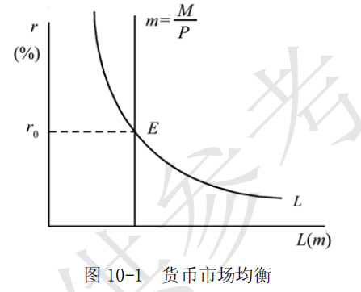

# Chapter 10 General equilibrium of the goods and money markets

> **Core question of this chapter**: How do the goods market (IS curve) and the money market (LM curve) reach equilibrium at the same time? How do the interest rate and income interact? How does monetary policy affect the economy?

## Chapter roadmap

Chapter 9 looked only at the goods market, with the interest rate and prices frozen. But in the *General Theory* money and the interest rate are the leading characters: investment depends on the interest rate, the interest rate is determined by the supply and demand for money, and the demand for money depends on income — the goods market and the money market mesh into a single linked machine. Keynes was not the one who drew the machine as a diagram: Hicks, in *Mr. Keynes and the Classics* (1937), summarized the *General Theory* with two curves, and Hansen after the war turned it into a standard textbook fixture — which is why IS-LM is also called the Hicks-Hansen model, and Keynes himself never drew it.

Each curve governs one market. IS records every income–interest-rate combination at which the goods market is in equilibrium (investment = saving); a higher interest rate cuts investment and so cuts income, hence it slopes down to the right. LM records every combination at which the money market is in equilibrium (money demand = supply); higher income raises money demand and pushes the interest rate up, hence it slopes up to the right. Their intersection is the income and interest rate at which both markets are in equilibrium at once. The model's value is that it lets policy argument be drawn on one diagram: fiscal policy shifts IS, monetary policy shifts LM, and which is more effective depends on the slopes of the two lines — exactly the standard grammar of macro policy debate for the half-century that followed.

## Core concepts

### Marginal efficiency of capital

The marginal efficiency of capital is a discount rate, one that makes the sum of the discounted values of a capital good's expected returns over its life exactly equal to the supply price and replacement cost of that capital good.

That is:

$$R_0 = \frac{R_1}{1+r_c} + \frac{R_2}{(1+r_c)^2} + \cdots + \frac{R_n}{(1+r_c)^n}$$

**[Notation]**
| Symbol | English full name | Meaning |
|------|----------|----------|
| $R_0$ | Supply Price / Replacement Cost | Supply price / replacement cost of the capital good |
| $R_1, \cdots, R_n$ | Expected Returns | Expected returns in each future period |
| $r_c$ | Marginal Efficiency of Capital | Marginal efficiency of capital (discount rate) |
| $n$ | Useful Life | Useful life of the capital good |

The marginal efficiency of capital reflects an investor's estimate of expected returns, and is therefore also called the **expected rate of profit**. As the formula above shows, a fall in expected returns and a rise in replacement cost both make the marginal efficiency of capital decline.

### The investment function

With the marginal efficiency of capital unchanged, investment depends on the interest rate and is a decreasing function of it; investment and the interest rate move in opposite directions.

In formula form:

$$I = I(r)$$

**[Notation]**
| Symbol | English full name | Meaning |
|------|----------|----------|
| $I$ | Investment | Investment demand |
| $r$ | Interest Rate | Interest rate |

**Economic meaning**: a higher interest rate → higher cost of investment → less investment; a lower interest rate → lower cost of investment → more investment.

### The IS curve

**The IS curve is the curve describing the combinations of income and interest rate at which the goods market is in equilibrium.**

**[Meaning of the name]**
| Letter | English full name | Meaning |
|------|----------|----------|
| **I** | **Investment** | **Investment** |
| **S** | **Saving** | **Saving** |

The IS curve shows the trajectory of interest-rate and income combinations when **investment (I) = saving (S)**.

In a two-sector economy, if the saving function is $S = S(Y)$ and the investment function is $I = I(r)$, then the IS curve is:

$$S(Y) = I(r)$$

**[Notation]**
| Symbol | English full name | Meaning |
|------|----------|----------|
| $S$ | Saving / Savings Function | Saving / saving function |
| $Y$ | Income / National Income | Income / national income |
| $I$ | Investment / Investment Function | Investment / investment function |
| $r$ | Interest Rate | Interest rate |

Since equilibrium income and the interest rate move in opposite directions, the IS curve slopes down to the right.

### Liquidity preference

Liquidity preference, also called the preference for liquidity, is the preference people have for holding money. Because money is the most liquid of assets, people develop a preference for it.

The motives giving rise to this preference can be separated as follows:

| Motive | Meaning | Determined by |
|------|------|----------|
| **Transaction motive** | Holding money for everyday transactions | Level of income $Y$ |
| **Precautionary motive** | Holding money to meet unexpected expenditure | Level of income $Y$ |
| **Speculative motive** | Holding money while waiting for favourable investment opportunities | Level of the interest rate $r$ |

The money demand function is:

$$L = L_1(Y) + L_2(r)$$

**[Notation]**
| Symbol | English full name | Meaning |
|------|----------|----------|
| $L$ | Liquidity Preference / Money Demand | Liquidity preference / money demand |
| $L_1(Y)$ | Transaction and Precautionary Demand | Money demand arising from the transaction and precautionary motives |
| $L_2(r)$ | Speculative Demand | Money demand arising from the speculative motive |
| $Y$ | Income / National Income | Income / national income |
| $r$ | Interest Rate | Interest rate |

- $L_1(Y)$ moves in the **same direction** as income ($Y\uparrow \to L_1\uparrow$)
- $L_2(r)$ moves in the **opposite direction** to the interest rate ($r\uparrow \to L_2\downarrow$)

### The liquidity trap

The liquidity trap, also called the Keynesian trap, is a state of the economy in which, when the interest rate is extremely low, people's speculative demand for money tends to infinity, so that the monetary authority can hardly push the interest rate down further and stimulate investment even if it increases the money supply.

### The LM curve

**LM is the curve describing the combinations of interest rate and national income at which the money market is in equilibrium.**

**[Meaning of the name]**
| Letter | English full name | Meaning |
|------|----------|----------|
| **L** | **Liquidity Preference** | **Liquidity preference (money demand)** |
| **M** | **Money Supply** | **Money supply** |

The LM curve shows the trajectory of interest-rate and income combinations when **money demand (L) = money supply (M)**.

In the money market, for a given level of income, the equality of money demand and money supply determines the equilibrium interest rate. But different income levels correspond to different money demand, and so determine different equilibrium interest rates. The correspondence between income and the equilibrium interest rate is the LM curve, given by:

$$L_1(Y) + L_2(r) = m$$

**[Notation]**
| Symbol | English full name | Meaning |
|------|----------|----------|
| $L_1(Y)$ | Transaction and Precautionary Demand | Money demand arising from the transaction and precautionary motives |
| $L_2(r)$ | Speculative Demand | Money demand arising from the speculative motive |
| $m$ / $M$ | Real Money Supply / Money Supply | Real money supply / money supply |

---

**[Goods market vs money market: why IS = goods, LM = money?]**

| Market | Essential question | What is exchanged | Equilibrium condition | Why that name? |
|------|----------|----------|----------|-------------------|
| **Goods market** | How are real goods produced and distributed? | **Goods and services**<br>(consumables, machinery, equipment) | **Saving = investment**<br>($S = I$) | **I**nvestment buys **machinery and equipment** (the real economy) |
| **Money market** | How is money (funds) brought together? | **Money itself**<br>(cash, deposits) | **Money demand = money supply**<br>($L = M$) | **L**iquidity preference holds **cash** (the financial economy) |

---

**[How the two markets relate]**

**1. Goods market → money market**

$$\text{Income } (Y) \uparrow \to \text{transaction demand } (L_1) \uparrow \to \text{total money demand } (L) \uparrow \to \text{interest rate } (r) \uparrow$$

**Transmission**:
- The goods market booms → output and income rise
- People need more money to conduct transactions
- Money demand rises
- With the money supply unchanged, the interest rate is pushed up

**2. Money market → goods market**

$$\text{Interest rate } (r) \uparrow \to \text{cost of investment} \uparrow \to \text{investment } (I) \downarrow \to \text{aggregate demand} \downarrow \to \text{income } (Y) \downarrow$$

**Transmission**:
- The interest rate rises in the money market
- Firms' cost of borrowing to buy equipment rises
- Investment demand falls
- Aggregate demand falls and income falls

---

**[The IS-LM model: both markets in equilibrium at once]**

| Variable | Goods market (IS) | Money market (LM) | Equilibrium at once |
|------|--------------|--------------|----------|
| **Endogenous variable** | Income $Y$ | Interest rate $r$ | $Y^*, r^*$ |
| **Exogenous variable** | Interest rate $r$ (affects investment) | Income $Y$ (affects money demand) | Government spending $G$, money supply $M$ |
| **Equilibrium condition** | $S(Y) = I(r)$ | $L(Y,r) = M$ | Intersection of IS and LM |

**Key insight**:

> The **interest rate** is the **bridge** between the two markets:
> - In the goods market, the interest rate affects investment
> - In the money market, the interest rate is determined by supply and demand

**Schematic diagram**:

```
利率(r)
  ↑
  |       IS
  |      /
  |     /   ← 向右下方倾斜（r↑ → I↓ → Y↓）
  |    /   
  |   ·     ← 均衡点(E)：两个市场同时均衡
  |  / \    
  | /   \   ← 向右上方倾斜（Y↑ → L↑ → r↑）
  |/     LM
  +----------------→ 收入(Y)
          E点：IS与LM的交点
               决定均衡Y*和r*
```

**Summary**: the goods market and the money market affect and constrain each other through the interest rate and income, and only when both markets are in equilibrium at the same time is the whole economy in general equilibrium.

## Questions and analysis

### What is the equilibrium condition of the money market? What criticisms has the theory received?

**[Notation]**
| Symbol | English full name | Meaning |
|------|----------|----------|
| $L_1(Y)$ | Transaction and Precautionary Demand | Money demand arising from the transaction and precautionary motives |
| $L_2(r)$ | Speculative Demand | Money demand arising from the speculative motive |
| $m$ | Real Money Supply | Real money supply |
| $M$ | Nominal Money Supply | Nominal money supply |
| $P$ | Price Level | Price level |
| $r_0$ / $r$ | Interest Rate | Equilibrium level of the interest rate / interest rate |
| $Y$ | Income / National Income | National income |

- (1) According to Keynesian theory, when the supply of money equals the demand for money the money market is in equilibrium, and the equilibrium level of the interest rate is determined accordingly.

	- ①Usually the money supply is regarded as an exogenous variable issued and adjusted by a country's monetary authority, independent of the interest rate in size, denoted $m$. Hence in a diagram with the interest rate on the vertical axis and the quantity of money on the horizontal axis, the money supply curve is a straight line perpendicular to the horizontal axis.
	- ②The Keynesian theory of money demand rests on Keynes's liquidity preference. The transaction motive (the motive to hold some money for everyday transactions), the precautionary motive (the demand for money arising from the need to meet all kinds of unexpected events) and the speculative motive (the motive to hold some money in order to seize favourable opportunities to buy securities) together give rise to money demand. Among them, the money demand arising from the transaction and precautionary motives depends on income and rises with income, denoted $L_1(Y)$; while the money demand arising from the speculative motive moves inversely with the interest rate, denoted $L_2(r)$. Thus money demand can be written $L=L_1(Y)+L_2(r)$.

	- ③The equilibrium condition of the money market can be written $L_1(Y) + L_2(r) = m = \frac{M}{P}$,
	 where $m = \frac{M}{P}$ is real money supply.

**[Nominal money supply vs real money supply]**

| Symbol | English full name | Meaning | Formula |
|------|----------|----------|------|
| $M$ | Nominal Money Supply | Nominal money supply | Total money issued by the central bank (at face value) |
| $P$ | Price Level | Price level | Price index |
| $m$ | Real Money Supply | Real money supply | $m = \frac{M}{P}$ |

**Intuition**:
- Nominal money supply $M$ = "how much money you have on hand"
- Real money supply $m$ = "how much those money can buy"
- Prices rise → the same money buys less → real money supply falls

With the level of income given, the equilibrium condition above determines the equilibrium level of the interest rate $r_0$, as shown in Figure 10-1.



- (2) Keynes's theory of money demand developed Pigou's quantity theory of money to a degree, and in particular pointed out the speculative motive explicitly and thereby highlighted the role of the interest rate.
	But, as some Western scholars have pointed out, Keynes's monetary theory notes only the effect of the interest rate and income on money demand, and overlooks the fact that people's holdings of wealth are also an important determinant of money demand. Moreover, Western scholars hold that Keynes saw the composition of wealth too simply, as if in real society there were only two assets, money and bonds, for people to choose between — all of which remain to be improved.

### What does Keynes's monetary theory say? What determines the interest rate?

**Core idea**: the interest rate is determined by the supply and demand for money, and money demand depends on the three motives for holding money.

---

**(1) Why do people need money? — the three motives**

| Motive | Plain reading | Depends on | Relation to income / interest rate |
|------|----------|--------|------------------|
| **Transaction motive** | Spending day to day on food and drink | Income $Y$ | $Y\uparrow$ → need **more** money |
| **Precautionary motive** | Holding money against emergencies (sickness, car repair) | Income $Y$ | $Y\uparrow$ → need **more** money |
| **Speculative motive** | Holding money while waiting for an investment opportunity | Interest rate $r$ | $r\uparrow$ → need **less** money |

**Money demand function**:
$$L = L_1(Y) + L_2(r)$$

- $L_1(Y)$ = transaction + precautionary demand (rises with income)
- $L_2(r)$ = speculative demand (falls with the interest rate)

**Special case — the Keynesian trap**:
> When the interest rate is extremely low, people expect it to rise only and never fall (bond prices can only fall), so everyone holds money in hand and money demand tends to infinity.

---

**(2) Who determines the money supply? — the central bank**

| Feature | Explanation |
|------|------|
| **Exogenous variable** | Controlled by the central bank, unrelated to the interest rate |
| **Diagram** | Vertical line (quantity supplied fixed) |
| **Classification** | Narrow (cash + demand deposits), broad (+ time deposits) |

---

**(3) How is the interest rate determined? — supply and demand balance**

$$\text{money demand} = \text{money supply}$$

| Situation | Money supply and demand | What people do | Change in the interest rate |
|------|----------|------------|----------|
| Supply > demand | Too much money | Buy securities | Interest rate **↓** |
| Supply < demand | Not enough money | Sell securities | Interest rate **↑** |
| Supply = demand | Just right | Do nothing | Interest rate **stable** |

**In one line**: the interest rate is the **price of money**. Too much money (supply > demand) and the price falls (interest rate ↓); too little (supply < demand) and the price rises (interest rate ↑).

---

**[Detailed account]**

Keynes's monetary theory holds that the nominal interest rate is the opportunity cost of holding money, that money demand falls as the interest rate rises, and that the interest rate is determined so as to make the supply and demand for money equal.

**(1) Demand for money**

Keynes's monetary theory is chiefly a theory of money demand. Keynes held that people demand money because money has the greatest liquidity of all forms of asset, specifically for three motives:

| Motive | Detailed explanation |
|------|----------|
| **Transaction motive** | Holding money for everyday transactions. The higher income, the more transactions and the more money needed. |
| **Precautionary motive** | Holding money to meet unexpected expenditure. The higher income, the greater the precautionary demand for money. |
| **Speculative motive** | Holding money to seize favourable opportunities to buy securities. The higher the interest rate, the greater the opportunity cost of holding money, and the smaller the speculative demand. |

The money demand function is:
$$L = L_1(Y) + L_2(r)$$

where $L_1(Y)$ depends on income and $L_2(r)$ depends on the interest rate. When the interest rate is extremely low the **Keynesian trap** (liquidity trap) arises and money demand tends to infinity.

**(2) Supply of money**

Money supply is a stock concept, with a narrow and a broad reading:
- **Narrow money supply** ($M_1$): coins, banknotes and demand deposits
- **Broad money supply** ($M_2$): coins, banknotes, demand deposits + time deposits
- **Even broader money supply**: also includes liquid assets such as government bonds

The money supply is adjusted by the state through monetary policy and is an **exogenous variable**, its size independent of the interest rate. Hence the money supply curve is a straight line perpendicular to the horizontal axis.

**(3) Determination of the interest rate**

The equilibrium of money supply and money demand determines the equilibrium market interest rate:

- When the market interest rate > the equilibrium interest rate: money supply > money demand, people are holding more money than they wish, and they buy securities, which pushes security prices up and the interest rate down
- When the market interest rate < the equilibrium interest rate: money supply < money demand, people feel they have too little money, and they sell securities, which pushes security prices down and the interest rate up
- When supply and demand for money are equal: the interest rate stops moving and equilibrium is reached

### How does Keynes explain deficient effective demand in a capitalist economy? What policy conclusions does he draw?

According to Keynes's theory, in a capitalist economy national income depends chiefly on the society's aggregate demand, which consists of consumption and investment. It is precisely the deficiency of consumption and investment that makes social demand insufficient, at the point where aggregate supply and aggregate demand are in equilibrium, to realize full employment — that is, deficient effective demand. To explain deficient consumption and deficient investment, Keynes applies three fundamental laws: the law of diminishing marginal propensity to consume, the law of diminishing marginal efficiency of capital, and liquidity preference.

- (1) The law of the diminishing marginal propensity to consume.
> Although people's consumption rises with income, the share of the increase in income spent on additional consumption is ever smaller. Keynes held that the law of the diminishing marginal propensity to consume is determined by the human instinct to save. Because of this law, consumption is deficient.

- (2) The law of the diminishing marginal efficiency of capital.
> The marginal efficiency of capital is the discount rate that makes the sum of the present values of expected returns equal to the price of the capital good; it reflects a firm's expected rate of profit on adding investment. A declining marginal efficiency of capital means that as firms add investment the expected rate of profit falls. Keynes held that investment demand depends on the comparison of the marginal efficiency of capital with the interest rate: for a given interest rate, there is investment only when the marginal efficiency of capital exceeds that rate. But in Keynes's view, because the marginal efficiency of capital declines in the long run, unless the interest rate can be low enough, investment demand in the economic society becomes deficient.

Two causes chiefly give rise to the declining marginal efficiency of capital:
- ①Continual increase in investment must push up the supply price of capital goods, and a rising supply price means higher cost, which lowers the expected rate of profit on investment;
- ②Continual increase in investment increases the quantity of products made, and a greater quantity pushes their market price down, so the expected rate of profit on investment also falls. The declining marginal efficiency of capital often leaves capitalists without confidence about the future, and thereby gives rise to deficient investment demand.

- (3) Liquidity preference.
> Liquidity preference is the psychological preference people have for holding money. Keynes held that people have a preference for holding money because money is the asset of greatest liquidity — it can be used at any time for transactions, at any time to meet the unexpected, and at any time for speculation, so people have a preference for holding it. Once the interest rate falls to a certain level, people expect security prices to have already reached their maximum, and so are willing to hold more money, until the demand for money tends to infinity. As a result, no matter how large the money supply, the interest rate in the money market will not fall further. Because of this psychological law the interest rate stays high, and when the expected rate of profit is below or near the interest rate firms are unwilling to invest, which also leads to deficient investment demand.

From these three psychological laws one sees that deficient effective demand is the key to economic depression and unemployment in capitalist society. From this Keynes advocated that, to maintain full employment, national consumption and national investment must be used to make up for the deficiency of private consumption and private investment in society, stimulating effective demand; in policy terms government should stimulate effective demand by fiscal means such as borrowing, increasing government purchase expenditure, increasing transfer payments and reducing taxes. Keynes argued for the necessity of state intervention in the economy.

## Derivations and worked examples

### Given the consumption function C = 100 + 0.6Y, the investment function I=520-r, money demand L=0.2Y - 4r, and money supply m = 120.

**[Notation]**
| Symbol | English full name | Meaning |
|------|----------|----------|
| $C$ | Consumption | Consumption |
| $Y$ | National Income | National income |
| $I$ / $I(r)$ | Investment | Investment / investment function |
| $r$ | Interest Rate | Interest rate |
| $L$ / $L_1(Y) + L_2(r)$ | Money Demand | Money demand / money demand function |
| $m$ | Real Money Supply | Real money supply |
| $M$ | Nominal Money Supply | Nominal money supply |
| $P$ | Price Level | Price level |
| $S$ / $S(Y)$ | Saving | Saving / saving function |
| $\alpha$ | Autonomous Consumption | Autonomous consumption (intercept) |
| $\beta$ | Marginal Propensity to Consume | Marginal propensity to consume |

- (1) Write the equation of the $IS$ curve.
- (2) Write the equation of the $LM$ curve.
- (3) Write the specific equations of the $IS-LM$ model and solve: what are the equilibrium national income ($Y$) and the equilibrium interest rate ($r$)?
- (4) If autonomous investment rises from 520 to 550, how does equilibrium national income change? Does your result agree with the multiplier theorem? Explain.

Solution:
- (1) Solve for the saving function from the consumption function:

$$S=Y-C=-100+0.4Y$$

and substitute into $I = S$:

$$-100+0.4Y=520-r$$

which gives the equation of the IS curve:

$$Y=1550-2.5r$$

- (2) Substituting the given conditions into $L=m$ gives:

$$0.2Y-4r=120$$

which gives the equation of the LM curve: $Y=600+20r$.

- (3) Solving the equations of the $IS$ and $LM$ curves together, the specific equations of the $IS-LM$ model are:

$$\begin{cases}
Y=1550-2.5r \\
Y=600+20r
\end{cases}$$

Solving this system gives equilibrium national income $Y = 1444.44$ and equilibrium interest rate $r = 42.22$.

- (4) When autonomous investment rises from 520 to 550, the investment function becomes $I = 550 - r$. Repeating the derivation of (1): $-100+0.4Y=550-r$, giving the new IS curve $Y=1625-2.5r$; the LM curve is unchanged. Solving together:

$$\begin{cases}
Y=1625-2.5r \\
Y=600+20r
\end{cases}$$

The new equilibrium is $r'=45.56$ and $Y'=1511.11$, so the increase in equilibrium national income is:

$$\Delta Y = 1511.11-1444.44=66.67$$

From the consumption function $C=100 + 0.6Y$ we see $\beta = 0.6$. If we simply apply the multiplier theorem of Chapter 9

$$\Delta Y=\frac{\Delta I}{1-\beta}$$

then with $\Delta I=30$ we get $\Delta Y'=\frac{30}{1-0.6}=75>66.67=\Delta Y$: within the IS-LM framework the actual increase in income is **smaller** than the simple multiplier would give.

The reason is this: the multiplier theorem holds only inside the goods market, assuming investment does not change with the interest rate — whatever autonomous investment adds, the first round of demand adds by the same amount. But when both markets are in equilibrium at once, rising income pushes up the transaction demand for money, and the interest rate climbs from 42.22 to 45.56, while investment is a decreasing function of the interest rate — the rise in the interest rate "squeezes out" part of the new investment. This squeezed-out investment is the "crowding-out effect": the total magnification of a fiscal expansion in IS-LM must be smaller than the multiplier inside the goods market of Chapter 9.

## Limits and what comes next

- **The dispute over fidelity to the *General Theory*.** IS-LM compresses Keynes into an equilibrium framework: wage rigidity becomes the only opening for unemployment, and expectations and uncertainty are smoothed away. Post-Keynesians (Robinson among them) branded it a betrayal of the Keynesian revolution — telling the story of a book that opposed the equilibrium dogma in the classical language of equilibrium; Hicks himself admitted late in life that the model had stripped out the "time and expectations" that mattered most in the *General Theory*. It is still the best introductory synthesis, but it is a discounted Keynes.
- **The death of the LM curve and the echoes of the liquidity trap.** The Keynesian trap long looked like a textbook curiosity, until Japan parked near a zero interest rate for years in the 1990s and Europe and the US replayed it after 2008 — Krugman and others showed that "monetary policy fails once the interest rate hits zero" was not science fiction, and the flat section of IS-LM again had a real-world referent. But modern new Keynesian models simply deleted LM: the central bank targets the interest rate and adjusts by rule, and the curve is replaced by the "monetary policy rule" (MP curve) — IS-LM retired as an engine, retained as a language.
- **A lasting record as an instrument of explanation.** Eichengreen and Sachs (1985) used IS-LM logic to explain the cross-national differences in the Great Depression: the longer a country clung to the gold standard, the tighter its money and the deeper its fall in output — the test of the 1930s supplied this framework with its most weighty set of observations. In policy debate, whether fiscal expansion crowds out private investment and how much force monetary easing still has deep in a recession are still argued in terms of the slopes of these two curves.

## References

- Gao Hongye, *Western Economics* (8th edn., micro/macro volumes, China Renmin University Press) — the main source of this chapter's framework and theoretical statements.
- For the full bibliography see [References](/reference/参考书目).
- [Wikipedia · IS–LM model](https://en.wikipedia.org/wiki/IS%E2%80%93LM_model)
- [Wikipedia · Money demand](https://en.wikipedia.org/wiki/Money_demand)

<!-- BACKLINKS-AUTO -->
## Related pages

- [Readme](/math/Readme)
- [History](/western/History)
- [Readme](/western/Readme)
