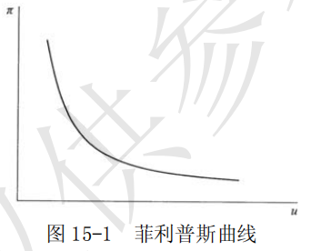

# Chapter 15 · Disagreements in macroeconomics

> **The central question of this chapter**: On what points do Keynesianism, monetarism, supply-side economics and the other schools disagree over policy? Should government intervene in the economy? How does one choose between rules and discretion?

## The arc of this chapter

The history of macroeconomics is half models, half quarrels. The twenty years after the war were Keynesianism's unchallenged reign: IS-LM plus the Phillips curve, intervention taken for granted. The first heavy blow came from Friedman's 1968 presidential address to the American Economic Association: put expectations and the natural rate back into the model and the long-run Phillips curve should be vertical — buying employment with inflation is a deal that cannot be done. Stagflation arrived in the 1970s on schedule, the prophecy was fulfilled, and monetarism moved from heresy to orthodoxy.

The second wave was more thorough. Lucas, Sargent and Wallace pushed "rational expectations" to its limit: if people not only adjust their expectations but foresee everything, then anticipated policy has no effect even in the short run — macroeconomic policy is simply ineffective. New classical macroeconomics thus took the stage, and its method later grew into real business cycle theory, which explains fluctuations as rational agents' optimal responses to technology shocks. The Keynesian reply was not to deny rationality but to accept it and then prove stickiness: Mankiw, Akerlof, Yellen and others showed that the small costs of changing prices, staggered contracts and efficiency wages can still produce macroeconomic failure in a world where everyone is rational — the case for intervention moved from "assumption" to "theorem." This chapter unfolds along that battle line, and the three camps' disagreements land at last on the question Chapter 11 left behind: should government, and can government, stabilise the economy.

## Core concepts

### Monetarism

**[Basic facts]**
| Item | Content |
|------|------|
| **Also called** | the monetarist school |
| **Appeared** | the late 1950s |
| **Birthplace** | the United States |
| **Leading figures** | Friedman, Walters, Parkin, Frisch and others |
| **Theoretical basis** | **the modern quantity theory of money** |
| **Policy position** | **a single-rule monetary policy** |

---

**[Core idea]**

$$\text{a change in the quantity of money} \to \text{changes in the price level and economic activity}$$

| Core view | Explanation |
|----------|------|
| **Money matters most** | the force of money is the main factor explaining changes in output, employment and prices |
| **Money supply is the key** | changes in the quantity of money are the most reliable measure of the force of money |
| **Control the money supply** | inflation, depression and growth alike can be regulated by controlling the quantity of money |
| **The famous dictum** | "inflation is always and everywhere a **monetary phenomenon**" |

---

**[The basic propositions of monetarism]**

| No. | Proposition | Meaning |
|------|------|------|
| ① | Money matters most | the force of money is the main factor explaining changes in output, employment and prices |
| ② | The money supply is the yardstick | changes in the quantity of money are the most reliable measure of the force of money |
| ③ | The monetary authority controls it | inflation, depression or growth can and should be regulated solely through the monetary authority's control of the quantity of money |

---

**[How monetarism differs from Keynesianism]**

| Dimension of comparison | Keynesianism | Monetarism |
|----------|------------|----------|
| **Core concern** | aggregate demand (consumption, investment, government spending) | **the money supply** |
| **Policy instrument** | fiscal policy first | **monetary policy** first |
| **Mode of policy** | discretion (lean against the economic wind) | **a single rule** (a fixed growth rate) |
| **View of markets** | markets can fail; government must intervene | markets adjust themselves; government intervention is opposed |

---

**[The guiding idea of policy]**

Laissez-faire; opposition to government intervention.

> **In short**: too much money in the market → prices rise → inflation. To control inflation → control the money supply.

### The natural rate hypothesis

The natural rate hypothesis refers to the employment rate determined when the labour market reaches equilibrium under competitive conditions, in the absence of monetary disturbances.
Because this employment rate depends on the economy's market structure, social institutions and habits of life, it is given the name "natural rate." Many neo-liberal schools assume that the economy contains a natural employment rate and use their own theories to argue that the economy is frequently in that state. The natural rate is therefore also considered an assumption.

This "assumption" is the answer Friedman (1968) and Phelps handed in to explain the failure of the Phillips curve: any attempt to push unemployment below the natural rate only buys ever-accelerating inflation. It brought the "long run" back into macroeconomics, and it is the benchmark of this chapter's disputes among the schools — grant the natural rate, and the room for short-run policy shrinks to the "unforeseen" part alone.

### The Phillips curve

The Phillips curve is named for the British economist A.W. Phillips, who first proposed it.
His original 1958 study examined the negative correlation between the British unemployment rate and the growth rate of money wages; the economics profession later extended it to the short-run trade-off between the inflation rate and the unemployment rate, and used it to explain the relation between the general price level, unemployment and aggregate demand, as Figure 15-1 shows.

On the precise shape of the Phillips curve the different schools hold different views.
The generally accepted position is:
- in the short run the short-run Phillips curve slopes down to the right;
- the long-run Phillips curve is a vertical line, showing that no trade-off exists between the unemployment rate and the inflation rate.

### The single monetary rule

**[Definition]**

The single monetary rule is monetarism's policy position and the most important theoretical rule of monetarist economics.

**Core meaning**: to keep money from becoming a source of economic disorder and to give the economy a stable environment in which to run, the optimal monetary policy is to hold the money supply at a **fixed growth rate**, **maintained unchanged whether the economy booms or slumps**.

---

**[How the money growth rate is set]**

$$\text{money growth rate} = \text{economic growth rate} + \text{inflation rate}$$

**Example**:
- if the economic growth rate is **3%** and the desired inflation rate is **2%**
- then the money supply grows by **5%** a year (fixed and unchanging)
- **whether the economy overheats or recedes, it grows at 5%**

---

**[Discretion vs a single rule]**

| Dimension of comparison | **Discretion** (Keynesianism) | **Single rule** (monetarism) |
|----------|---------------------------|-------------------------|
| **Practice** | constrict when the economy runs hot, expand when it runs cold | the money growth rate is **fixed and unchanging** |
| **Basis** | judgement of the economy's current state | execution at a preset growth rate |
| **Flexibility** | high | low |
| **Monetarist verdict** | ❌ it amplifies fluctuations (policy lags) | ✅ it gives the economy a stable environment |

---

**[Why a "single rule"?]**

| Reason | Explanation |
|------|------|
| **Policy lags** | policy adopted today may take effect only one or two years later, by which time the economy may have changed |
| **Government is unreliable** | governments are easily tempted by short-term gain into over-stimulating the economy |
| **Expectations adjust** | people form rational expectations, and discretionary policy ends up ineffective |

---

**[A vivid metaphor]**

| Type of policy | Vivid metaphor | Result |
|----------|----------|------|
| **Discretion** | a driver stamping hard on brake and accelerator | motion sickness (volatility intensifies) |
| **Single rule** | cruise control | smooth running (stable growth) |

---

**[The core formula]**

$$\frac{\Delta M}{M} = \text{economic growth rate} + \text{target inflation rate}$$

| Symbol | Meaning |
|------|------|
| $\frac{\Delta M}{M}$ | the money supply growth rate |
| Economic growth rate | the potential GDP growth rate |
| Target inflation rate | the inflation rate one wishes to maintain |

### The rational expectations hypothesis

The rational expectations hypothesis holds that economic agents can form rational estimates of the future movements of economic variables such as prices, interest rates, profits or income. Rational expectations have three features:

- (1) expectations are correct on average;
- (2) economic agents form their expectations of a given economic quantity by making full use of all available information;
- (3) the expectations agents form agree with the predictions of the economic model.

Rational expectations were proposed by Muth (1961) and brought into macroeconomics by Lucas (in the 1970s). It does not require that people never err, only that they stop making the same error systematically — guessing right on average, and leaving no pattern that policy can exploit again and again. It is this last clause that passes the death sentence on "buying employment with surprise inflation."

### Market clearing

Market clearing means that both wages in the labour market and commodity prices in the product market are fully flexible, adjusting quickly in response to supply and demand so as to reach the equilibrium state in which supply equals demand.
Given this flexibility, neither the product market nor the labour market has excess supply, and every market is in, or is tending towards, the state in which supply and demand cancel.

Market clearing is the watershed assumption between the new classicals and the Keynesians: grant it, and a depression can only be a voluntary choice or a passing illusion; deny it, and involuntary unemployment becomes the real problem. Every dispute in this chapter begins with the verdict on this assumption.

### New classical macroeconomics

New classical macroeconomics, also called "the new classical school," is a school of economics that follows the tradition of classical economics and believes in the efficacy of market forces; it holds that if the market mechanism is left to operate spontaneously it can solve a series of macroeconomic problems such as unemployment and recession. Its leading figures include the American economists Robert Lucas, Thomas Sargent, Neil Wallace, Edward Prescott and Robert Barro, and Britain's Patrick Minford.

New classical macroeconomics holds to the assumption of market clearing. New classical macroeconomists hold that wages and prices are fully flexible and adjust quickly. In this way, through continuous adjustment of wages and prices, the quantity supplied is brought to equal the quantity demanded, and markets are continuously in equilibrium, that is, continuously cleared. New classical macroeconomists therefore regard the equilibrium in which supply equals demand as a state that is regularly available.

On the basis of this assumption, new classical macroeconomics opposes government intervention in the economy. The school's purpose is to show that macroeconomic policy is ineffective, even harmful. The monetary business cycle theory of Lucas and others argued from incomplete information that monetary policy is ineffective. The centre of that argument is that an anticipated change in the money supply affects only the price level and not output; only unanticipated changes in the money supply affect output. The new generation of new classical macroeconomists was not satisfied with the proposition that monetary policy is ineffective; they applied the research methods of new classical macroeconomics to fiscal policy analysis and derived the proposition that fiscal policy too is ineffective.

## Problems and analysis

### On what fronts does new classical macroeconomics criticise Keynesianism? How strong are the criticisms?

New classical macroeconomics criticises Keynesian theory mainly on two fronts: empirical testing and theoretical consistency.

- (1) On empirical testing, new classical macroeconomics used the analytical techniques of econometrics to test the shape of the Phillips curve thoroughly, in order to refute Keynesian theory. Because of the existence of stagflation, the results of the tests favoured the new classicals.

- (2) On the theoretical front, first, new classical macroeconomics pointed out three great errors of Keynesian theory.
	- First, irrational expectations. In Keynesian theory the expectations of economic agents are usually assumed to be constant, depending mainly on the past values of the variable. That means people do not use information about the future to pursue their interests to the greatest extent, which violates the basic assumption of the rational economic agent in western economics.
	- Second, individual behaviour is inconsistent within one theoretical system. For example, microeconomics, in analysing labour supply, assumes that people choose between income and leisure, while the macro theory of consumption assumes that people save in order to consume in the future, that is, that the worker must choose between the present and the future. No theory explains how the two are consistent.
	- Third, using gross domestic product as the standard for evaluating policy cannot reflect people's welfare.

Second, on the basis of its critique of Keynesian theory, new classical macroeconomics rejects the effectiveness of macroeconomic policy wholesale. On the rational expectations assumption and monetarism's natural rate hypothesis, the new classicals hold that the effectiveness of Keynesian policy rests on deceiving the public.

The economy contains a natural employment level determined by resources, institutions, habits, market outcomes and other factors; at the same time people form expectations rationally, and under conditions where the natural factors remain unchanged, sustained policy effects are impossible. Not only that: because government cannot predict the behaviour of economic agents, the consequences of policy may be to intensify economic fluctuations.

The conclusion above comes mainly from the famous "Lucas critique." Lucas held that the claimed effectiveness of Keynesian policy rests mostly on econometric models with fixed parameters, but the rational expectations of economic agents will change those parameters, so that policy cannot achieve its intended effect.

## Synthetic essay

### What are monetarism's basic views, and how should it be judged?

**[Basic facts]**

| Item | Content |
|------|------|
| **Name of the school** | monetarism / the monetarist school |
| **Appeared** | the late 1950s |
| **Birthplace** | the United States |
| **Leading figures** | Friedman, Walters, Parkin, Frisch and others |
| **Theoretical basis** | the modern quantity theory of money |
| **Core position** | stop inflation, oppose state intervention |

---

**[I. Basic propositions]**

| No. | Proposition | Meaning |
|------|------|------|
| ① | **Money matters most** | the force of money is the main factor explaining changes in output, employment and prices |
| ② | **The money supply is the yardstick** | changes in the quantity of money are the most reliable measure of the force of money |
| ③ | **Control the money supply** | inflation, depression or growth can and should be regulated solely through the monetary authority's control of the quantity of money |

**Guiding idea of policy**: laissez-faire; opposition to government intervention.

---

**[II. Theoretical character]**

| Feature | Explanation |
|------|------|
| **Method of analysis** | expected-magnitude analysis + nominal-magnitude analysis |
| **Intellectual basis** | neo-liberal thought throughout |

**Neo-liberalism's four freedoms**:

| No. | View |
|------|------|
| ① | Emphasise freedom in people's mutual relations and the freedom of the individual |
| ② | In economic activity rely on private property and the market economy; in political activity proceed by majority rule |
| ③ | Economic freedom is the indispensable means to political freedom |
| ④ | Human beings are "imperfect entities"; absolute freedom does not exist, and freedom needs the protection of government |

---

**[III. The theory's main content]**

| Theory | Core view |
|------|----------|
| **① Market economy theory** | government intervention should be kept within narrow bounds |
| **② Permanent income theory** | consumption depends on permanent income (not current income); the demand for money is highly stable |
| **③ The quantity theory of money** | the general price level moves **in the same direction** as the money supply |
| **④ Inflation and unemployment theory** | "inflation is always and everywhere a **monetary phenomenon**"; the long-run Phillips curve is a **vertical line** |
| **⑤ Policy positions** | a single-rule monetary policy, income indexing, the negative income tax |

---

**[IV. The theory of inflation and unemployment in detail]**

**Core dictum**: "inflation is always and everywhere a monetary phenomenon"

| Mechanism | Explanation |
|------|------|
| **The natural rate of unemployment hypothesis** | the economy contains a natural employment level |
| **The short-run trade-off** | raising the employment rate → must be paid for with some inflation |
| **Adjustment of expectations** | people keep revising their inflation expectations → policy effects diminish |
| **The long-run conclusion** | the long-run Phillips curve is a **vertical line** → inflation does not affect unemployment |

$$\text{the long-run Phillips curve: the unemployment rate has no relation to the inflation rate}$$

---

**[V. Policy positions]**

| Type of policy | Monetarist view | Reason |
|----------|-------------|------|
| **Discretionary fiscal policy** | ❌ opposed | the crowding-out effect; ineffective |
| **Discretionary monetary policy** | ❌ opposed | policy lags; it intensifies fluctuations |
| **Single-rule monetary policy** | ✅ endorsed | the money growth rate fixed and unchanging |
| **Income indexing** | ✅ endorsed | removes inflation's effect on the distribution of income |
| **The negative income tax** | ✅ endorsed | protects low-income groups |

**The specific content of the single rule**:
- the monetary authority publicly announces that the annual money growth rate will remain **unchanged** for a fairly long period to come;
- the growth rate roughly equals the growth rate national income can actually achieve;
- so as to secure both economic growth and stable prices.

---

**[VI. Evaluation]**

| Strengths | Limitations |
|------|------|
| ✅ exposed certain defects of Keynesian theory | ❌ reduces every problem to money |
| ✅ the crowding-out effect of fiscal policy won recognition | ❌ masks the contradictions of the production process |
| ✅ its analysis of inflation has value | ❌ exaggerates the role of money |
| ✅ stressed the importance of monetary policy | |

**Overall judgment**: monetarism developed in the course of debate with Keynesian theory; it is an important contribution to understanding inflation and monetary policy, but it carries a tendency to overstate the role of money.

### How does New Keynesianism explain the stickiness of prices and wages?

**[Core concept: the classification of stickiness]**

| Type | Definition | Attributed to |
|------|------|------|
| **Nominal stickiness** | nominal prices and nominal wages fail to adjust in step with changes in demand | **imperfect competition** in the product market |
| **Real stickiness** | the stickiness of one price or wage relative to another price or wage | firms' **cost-plus pricing** |

**Purpose**: to account for **non-market clearing** and supply a theoretical basis for government intervention.

---

**[The six theoretical explanations]**

| Theory | Core view | Mechanism | Policy implication |
|------|----------|----------|----------|
| **① Menu cost theory** | changing prices has a cost → firms are reluctant to reprice often | they reprice only when the increase in profit > the menu cost | prices are sticky |
| **② Staggered adjustment theory** | the timing of price / wage adjustment is **staggered** | staggered adjustment → prices / wages have **inertia** | government still has a positive role |
| **③ Imperfect competition theory** | monopolists set prices that are insensitive to demand | a change in aggregate demand → **output changes** more than prices | government intervention is needed |
| **④ Coordination failure theory** | individual agents are powerless to coordinate the behaviour of the whole | rational individuals → market failure | state intervention is needed |
| **⑤ Labour market theory** | implicit contracts, insider pressure, efficiency wages | real wages turn out sticky | unemployment exists |
| **⑥ Credit rationing theory** | asymmetric information → credit rationing | the interest rate and the rationing mechanism work together | monetary policy is effective |

---

**[Detailed explanation]**

#### ① Menu cost theory

**Menu costs**: the cost a firm incurs each time it adjusts its prices

| Type of cost | What it includes |
|----------|----------|
| **Direct cost** | studying and setting the new price, printing revised price lists |
| **Opportunity cost** | other losses brought about by the adjustment |

**The logic**: the firm reprices only when (the increase in profit after adjusting) > (the menu cost)

**Conclusion**: menu costs exist → firms are unwilling to change prices often → **prices are sticky**

---

#### ② Staggered adjustment theory

**Assumption**: rational expectations

**Core mechanism**:

$$\text{economic agents stagger the timing of their price adjustments} \to \text{prices and wages carry inertia}$$

**Policy implication**: even with rational expectations, government policy still has a positive role

---

#### ③ Imperfect competition theory

**Premise**: an imperfectly competitive market

**Core views**:

| Phenomenon | Result |
|------|------|
| firms use monopoly power to set prices | prices do not move with aggregate demand |
| prices are insensitive to demand | **output moves with aggregate demand** |
| changes in aggregate demand have external effects | fluctuations are amplified |

**Conclusion**: there is no spontaneous mechanism tending to full employment → **government intervention is needed**

---

#### ④ Coordination failure theory

**The core problem**: the market mechanism cannot coordinate the behaviour of a multitude of economic agents

| Fact | Result |
|------|------|
| every agent is rational | yet none can coordinate the whole |
| each single market force is small | powerless to coordinate the behaviour of the whole economy |

**Conclusion**: market coordination fails → the market cannot ensure an efficient equilibrium → **state intervention is needed**

---

#### ⑤ Labour market theory

**The three great causes of wage stickiness**:

| Cause | Explanation |
|------|------|
| **Implicit contracts** | an informal agreement between risk-neutral firms and risk-averse workers |
| **Insider pressure** | employed workers (insiders) press the firm to protect their own interests |
| **Efficiency wages** | wages are positively related to labour efficiency, so firms pay high wages to keep efficiency up |

**Conclusion**: real wages turn out sticky → unemployment exists

---

#### ⑥ Credit rationing theory

**Premise**: a credit market with imperfect information

**Core mechanism**:

$$\text{asymmetric information} \to \text{lenders cannot fully screen borrowers' risk} \to \text{credit rationing}$$

**How it operates**: the interest rate mechanism and the rationing mechanism work together

**Policy implication**: government monetary policy can correct the failure of credit markets → raising efficiency and welfare

---

**[Summary and comment]**

| Aspect | Content |
|------|------|
| **Core aim** | build a theoretical basis for the stickiness of prices and wages, and account for non-market clearing |
| **Theoretical assumptions** | explain stickiness under the assumptions of **maximisation** and **rational expectations** |
| **Policy implication** | government intervention is necessary and can improve on market failure |
| **Difference from original Keynesianism** | supplies a microfoundation for stickiness, better consistent with the rationality assumption |

**Overall judgment**: through its six theories New Keynesianism supplies a micro-explanation of the stickiness of prices and wages; while holding to the rational expectations assumption it proves the necessity of government intervention, and is an important development of Keynesianism.

## Limits and what follows

- **Towards a synthesis.** In the 1990s the two camps shook hands on method: they adopted the neoclassical engine of optimisation and rational expectations while keeping the Keynesian frictions (sticky prices, imperfect competition) — the DSGE models built on this "New Neoclassical Synthesis" became the standard equipment of central banks. In the Great Moderation (from the mid-1980s to 2007) volatility fell markedly, and the argument seemed ready to close.
- **The cold water of 2008.** The financial crisis embarrassed the standard models: the financial sector barely existed inside them, and on the eve of Lehman's fall the mainstream forecast was still smooth. Heterogeneous agents, financial frictions and the zero lower bound have since returned to the research frontier — Keynes's old questions revived in new mathematics.
- **Disagreement itself is the normal state.** Methodologically everyone now speaks the same language, but the disagreement over policy positions has not gone away: how big is the fiscal multiplier, how high the cost of austerity — the debate around 2010 echoes the 1930s across the decades. Macroeconomics' most reliable conclusion may be this: every generation's consensus is only the next generation's target.

## References

- Gao Hongye, *Western Economics* (8th edition, separate micro / macro volumes, China Renmin University Press) — the main source for this chapter's framework and exposition.
- Mankiw, *Principles of Economics* — another telling of the same system, with richer cases.
- The full list is on the [bibliography](/reference/参考书目).
- [Wikipedia · Macroeconomics](https://en.wikipedia.org/wiki/Macroeconomics)
- [Wikipedia · Public choice theory](https://en.wikipedia.org/wiki/Public_choice_theory)

<!-- BACKLINKS-AUTO -->
## Related pages

- [History](/western/History)
- [Readme](/western/Readme)
