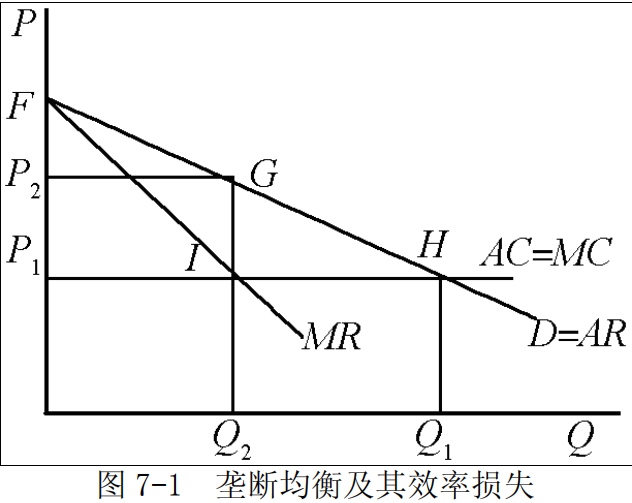

# Chapter 7 Market failure and microeconomic policy

> **Core question of this chapter**: Why does the market mechanism sometimes fail? How do monopoly, externalities, public goods and imperfect information make the allocation of resources inefficient? How should government intervene?

## Chapter roadmap

Chapter 6's conclusion was elegant: the general equilibrium of perfect competition is Pareto optimal. But it was a victory of assumptions — price equals marginal cost, private cost equals social cost, information is complete, all goods are private — and drop one and the result collapses. What this chapter does is check those preconditions one by one: **monopoly** breaks "price = marginal cost", **externalities** break "private cost = social cost", **public goods** break "excludability", **imperfect information** breaks "everyone knows what they are buying". Market failure is not a freak accident of the market; it is the negation of the welfare theorems' list of preconditions.

This "find the loophole, then prescribe the cure" framework comes from Pigou's *The Economics of Welfare* (1920): an externality can be closed by a corrective tax that fills the gap between private and social cost (a Pigouvian tax), and public goods should be supplied by government. Half a century later Coase asked, in *The Problem of Social Cost* (1960), the reverse question: externalities are reciprocal (polluting and shutting down both have costs), and so long as property rights are clear and transaction costs are low enough, the parties can bargain out an efficient outcome themselves — government's role retreats from "correcting" to "defining property rights". A decade more, and Akerlof's *The Market for Lemons* (1970) opened the last frontier: asymmetric information is not a friction, but a force that can make a market vanish altogether. Three lines of argument — the Pigouvian tradition, the Coasean tradition, the information tradition — still map the territory of microeconomic policy.

## Core concepts

### Market failure

Market failure means that the market mechanism cannot allocate resources efficiently.
Monopoly, external influences, public goods and imperfect information are all important causes of market failure and its chief manifestations.
Western economists hold that in the real world all sorts of reasons bring about market failure: the workings of the market mechanism cannot bring social resources to their optimal allocation and cannot achieve social goals such as the maximization of socio-economic welfare. Hence the power of the market mechanism is not omnipotent; it must be overcome through government intervention in the economy.

One thing is worth stating plainly: "market failure" proves the **necessity** of intervention, but not that intervention is necessarily **better** — that asymmetry is left for the "Limits and what comes next" section at the end of this chapter.

### Public goods

Goods that lack excludability and (or) rivalry — that is, once produced it is impossible to keep some people out — are called (pure) public goods. The excludability of a good means that its producer or its buyer can easily keep other people from enjoying the benefits it brings; the rivalry of a good means that the quantity consumed is tied to the cost of producing that quantity.

Excludability and rivalry combine in pairs to split the world of goods into four cells: private goods (both present, and the market's best domain), public goods (neither present, such as national defense), common resources (rival but non-excludable, such as a fishery — which gets overfished), and club goods (excludable but non-rival, such as pay video). Market failure is concentrated in the latter three cells.

### The free-rider problem

The free-rider problem is a market failure that arises because one can obtain consumer satisfaction without paying for it. Its cause is the non-excludability of the good. Since every consumer is economically rational and public goods are non-excludable, every consumer will exploit this and enjoy the utility of the good without paying. Because the good is non-excludable, those who own or consume it cannot, or find it very hard to, keep others from enjoying the satisfaction it brings. This feature and the accompanying problem are graphically called free-riding.

The trap of free-riding is that everyone separately is rational: a street lamp lights up all passers-by, so why should I alone pay for it? But the sum of all that rationality is that no one installs the lamp — individual rationality and collective rationality collide head-on.

### Externality

Externality, also called an external economic effect, is the effect that one economic agent's activity has on the welfare of another economic agent, an effect that is not reflected through market exchange. Externalities can be positive or negative, and are also called external economies and external diseconomies.

"Not reflected through market exchange" is the key: a factory discharges waste into a river without ever paying for the river's cleanliness — the price mechanism goes deaf here, which is exactly why it counts as a market failure.

### The Coase theorem

The Coase theorem is a theory of property rights.
Coase himself never wrote the Coase theorem down; the statement was first distilled by his friend Stigler from the content of Coase's paper *The Problem of Social Cost*, published in the 1960s.
Its content is: as long as property rights are clearly defined and their transaction costs are zero or very small, then no matter whom the property rights are initially assigned to, the final outcome of market equilibrium is efficient.

This conclusion has three elements:
- ①Zero transaction costs;
- ②Clearly defined property rights;
- ③Free trading.

The second theorem that follows is:
when transaction costs are not zero, different property-rights regimes affect the efficiency of resource allocation. The Coase theorem has now become an important result of institutional economics. What actually matters most is the second theorem: transaction costs are everywhere in the real world, so "how property rights are defined and how institutions are designed" is no longer a matter for jurists — it has become the resource-allocation problem itself.

### Adverse selection

Adverse selection is the phenomenon in a market for lemons in which high-quality goods are driven out while low-quality goods survive.
The party at the informational disadvantage tends to guess the quality of the goods at the average level, so that the transaction price of high-quality goods ends up too low and the quantity traded is small — even to the point that only lemons can be sold at all, an adverse selection.

### Moral hazard

Moral hazard is a behavior in which, after a contract has been signed, the informationally advantaged party harms the other party in order to maximize its own gain while bearing none of the consequences; it is the situation in which one party to a market cannot observe the other's actions, and is also called the hidden-action problem. The existence of moral hazard not only causes losses to the informationally disadvantaged party but also destroys the original market equilibrium and leads to inefficient allocation of resources.

**[Adverse selection vs moral hazard vs principal–agent problem: comparison]**

| Comparison dimension | Adverse selection | Moral hazard | Principal–agent problem |
|----------|--------------|--------------|------------------|
| Timing | Before signing (before the transaction) | After signing (after the transaction) | After signing (within the cooperative relation) |
| Type of information problem | Hidden information (Hidden Information) | Hidden action (Hidden Action) | Hidden action / effort |
| Core problem | Not knowing the other party's **type/quality** | Not knowing the other party's **behavior** | Not knowing the agent's **effort** |
| Informationally advantaged party | Seller (e.g. used-car seller) | Buyer (e.g. the insured) | Agent (e.g. employee, manager) |
| Informationally disadvantaged party | Buyer (e.g. used-car buyer) | Seller (e.g. insurance company) | Principal (e.g. shareholder, employer) |
| Typical markets | Used-car market, insurance market, credit market | Insurance market, labour market | Corporate governance, labour market |
| Classic example | Market for lemons (Akerlof) | Driving more recklessly after buying car insurance | Shareholders cannot monitor whether the manager works hard |
| Consequences | High-quality goods are driven out; the market shrinks | Risk rises, losses widen | Efficiency losses, conflicting interests |
| Remedies | Signalling (warranties, brand), government intervention | Deductibles, risk sharing | Optimal contract design, incentive schemes |

**[Intuition]**

| Problem | One-line summary |
|------|------------|
| Adverse selection | "Bad drives out good" — before signing you cannot tell who is good |
| Moral hazard | "Someone has changed" — after signing behaviour changes, and becomes less careful |
| Principal–agent | "The agent slacks" — the principal cannot monitor the agent's effort |

**[Worked examples]**

**1. Adverse selection — the used-car market**
```
买家：分不清好车坏车，只愿出「平均价」
好车卖家：平均价太低，不愿卖 → 退出市场
坏车卖家：平均价很划算，继续卖
结果：市场上只剩坏车（柠檬市场）
```

**2. Moral hazard — auto insurance**
```
投保前：小心驾驶，怕出事故
投保后：有保险兜底，开车更随意
保险公司：无法观察被保险人是否小心驾驶
结果：事故率上升，保险公司提高保费
```

**3. Principal–agent problem — corporate governance**
```
委托人（股东）：想利润最大化
代理人（经理）：想自己轻松/高薪
问题：股东无法每天监督经理是否努力工作
结果：经理可能偷懒或追求私利，损害股东利益
解决：股权激励、绩效奖金、独立董事
```

The timeline and information structure of the three problems in one sentence: adverse selection is **pre-signing** hidden information, moral hazard is **post-signing** hidden action, and the principal–agent problem is the form moral hazard takes inside an organization.

## Extended discussion

### Why do markets fail? What measures should government take?

Market failure means that the market mechanism cannot allocate resources efficiently. Monopoly, external influences, public goods and imperfect information are all important causes of market failure and its chief manifestations.

- (1) Monopoly and its corrective measures

In fact, so long as a market is not perfectly competitive (monopoly, monopolistic competition or oligopoly), then whenever price exceeds marginal cost an inefficient allocation of resources arises. Monopoly prevents resources from being optimally allocated, and so brings about market failure. Because monopoly leads to inefficient allocation, there is a need for public regulation of monopoly. Government regulation of monopoly takes the following forms or policies:

- ①Control the market structure, preventing monopolistic structures from arising;
- ②Regulate the prices of products sold by monopolies;
- ③Use taxation to adjust the conduct of monopolies;
- ④Enact anti-monopoly or anti-trust laws;
- ⑤Nationalize natural monopolies.

- (2) External influences and their corrective measures

An external influence is the effect that an agent of an economic activity has on the economic environment in which it is situated.
External influences produce an inconsistency between private cost and social cost, or between private gain and social gain, and so easily bring about market failure. Their existence has a serious consequence: the market's allocation of resources is inefficient. In other words, even if the whole economy is assumed to be perfectly competitive, the existence of external influences means the economy as a whole cannot reach a Pareto optimum. On the misallocation caused by external influences, microeconomic theory offers the following policy suggestions:
- ①Use taxes and subsidies;
- ②Use the merger of enterprises;
- ③Use the assignment of property rights.

- (3) Public goods and their corrective measures

For public goods, the market mechanism matters little or struggles to function at all.
Since public goods lose rivalry and excludability, additional consumption does not increase cost, and consumers often pay only an incomplete price for them, or nothing at all. In such circumstances the market mechanism's ability to regulate public goods is limited, or even ineffective.

Because the consumption of public goods involves the free-rider problem, it is hard to solve the efficient production of public goods through a competitive market mechanism. In such circumstances, having government produce public goods is probably the better choice. For most public goods of special significance, production or supply by government, or by state-owned enterprises set up by government, is a reasonable option — for example national defence and public security.

How much public good government should supply in order to meet social needs well and make effective use of resources is the difficult part of the question. Today it is more commonly recommended to use non-market decision procedures, such as voting, to decide the level of public-good expenditure. Obviously, although voting is a good method for regulating the production of public goods, it does not always produce an efficient level of public expenditure.

- (4) Imperfect information and its corrective measures

Imperfect information means that economic agents cannot grasp information fully and cannot fully use the information relevant to a transaction.
In real life the information held by buyers and sellers is usually asymmetric or incomplete. Once the information held by the two sides of a transaction is incomplete, it works against the effectiveness of the market mechanism in allocating resources and brings about market failure. The consequences of imperfect information usually include adverse selection, moral hazard and the principal–agent problem.
Asymmetric and incomplete information bring many problems to the working of the economy, and the market mechanism finds them hard to solve; in such circumstances government needs to regulate matters of market information. The main methods government uses to address information asymmetry and the principal–agent problem are:

- ①For the adverse selection arising from information asymmetry, effective institutional arrangements or appropriate measures can be used to eliminate the effects caused by insufficient information;
- ②The most effective way to solve the principal–agent problem is to implement an optimal contract — one in which the principal bears minimal cost while the agent takes efficient action that achieves the principal's objective.

### How does a monopolist's equilibrium cause an efficiency loss? What countermeasures does government have?

(1) Monopoly is a market structure in which a single firm supplies the whole market. The monopolist's objective is still to maximize profit, so it likewise chooses output where marginal revenue equals marginal cost.



As Figure 7-1 shows, the horizontal axis is the firm's output and the vertical axis is price; the curves $D$ and $MR$ are the firm's demand curve and marginal revenue curve, respectively.
Suppose average cost and marginal cost are equal and fixed, as represented by the straight line $AC=MC$. To maximize profit the firm sets output at $Q_2$ and price at $P_2$, which exceeds marginal cost — so Pareto optimality is not attained, because at this point what consumers are willing to pay for one extra unit (price) exceeds the cost of producing it (marginal cost). Clearly, to reach Pareto optimality output should be raised to $Q_1$ and price lowered to $P_1$, where $P=MC$. Yet the output and price set by monopoly can only be $Q_2$ and $P_2$. If output and price were the competitive output $Q_1$ and price $P_1$, consumer surplus would be the area $\Delta F P_1 H$; when the monopolist raises price to $P_2$, consumer surplus is only the area $\Delta F P_2 G$. Part of the lost consumer surplus (the area shown as $P_1P_2GI$) is converted into the monopolist's profit, while the other part (the area shown as $\Delta GIH$) is the pure loss of social welfare caused by monopoly — it represents the loss arising from the inefficiency that monopoly creates. Surplus that is merely transferred is a question of distribution; the triangle that vanishes is the efficiency question.

- (2) Because monopoly often leads to inefficient allocation of resources, and monopoly profits are also regarded as unfair, government intervention in monopoly is necessary.
Government intervention in monopoly takes the form chiefly of anti-monopoly law and the regulation of price and output. To remove the effects of monopoly, government can adopt anti-monopoly policy. For different forms of monopoly, government can take the reorganization of an industry and penalties separately or together, and these means are usually carried out under anti-monopoly law. Curbing monopolistic behaviour can draw on administrative orders, economic penalties or legal sanctions. Anti-monopoly law is the legal form of the above measures.

- ①The basic idea behind the reorganization of an industry is to recombine a monopolistic industry into one containing many firms. The means may be to break up the existing firm, or to remove the barriers to entry into a monopolistic industry. Curbing monopolistic behaviour can draw on administrative orders, economic penalties or legal sanctions.

- ②Regulation of industries mainly applies to monopolistic industries that are not suited to intense competition, such as aerospace and water supply. Government often keeps the monopoly in place while regulating the industry through price controls, or dual controls on price and output, taxation or subsidies, and direct state operation. Because the government operator does not aim at maximum profit, price can be set at marginal or average cost, in order to partly resolve the inefficiency of low output and high price produced by monopoly.

- ③Regulating a natural monopoly can also work by fixing for the monopolist a return on capital close to a "competitive" or "fair" rate — the average market return obtainable by an equal amount of capital under similar technology and similar risk. Since the return on capital is held at the average level, the monopolist's price and profit are also controlled to some extent.

### How do externalities push a perfectly competitive market away from Pareto optimality? What are the countermeasures?

**Core conclusion**: whether positive or negative, an externality pushes the allocation of resources away from Pareto optimality — even when the market is perfectly competitive. There is only one reason: private decision-makers consider only private cost/benefit, not social cost/benefit.

**I. Classifying externalities**

| Criterion | Type | Meaning | Example |
|----------|------|------|------|
| Direction of the effect | Positive externality (external economy) | Brings benefit to others | Education, vaccination, R&D |
| | Negative externality (external diseconomy) | Inflicts harm on others | Pollution, noise, second-hand smoke |
| Source | Production externality | Production activity affects others | Factory emissions |
| | Consumption externality | Consumption activity affects others | Smoking, renovation noise |

**II. Why externalities cause inefficiency**

The case of a negative externality (pollution, for instance):

| Cost type | Meaning | Relation |
|----------|------|------|
| Private cost (PMC) | Cost the firm itself bears | Small |
| Social cost (SMC) | Private cost + harm to others | Large |

$$SMC > PMC$$

The firm decides output where $PMC = PMR$, while the social optimum requires $SMC = SMR$ — so output is **too high**.

The case of a positive externality (education, for instance):

| Benefit type | Meaning | Relation |
|----------|------|------|
| Private benefit (PMR) | Benefit the actor itself obtains | Small |
| Social benefit (SMR) | Private benefit + benefit to others | Large |

$$SMR > PMR$$

The individual decides output where $PMR = PMC$, while the social optimum requires $SMR = SMC$ — so output is **too low**.

| Type of externality | Private decision | Social optimum | Outcome |
|------------|----------|----------|------|
| Negative externality | Output too high | Output should fall | Oversupply |
| Positive externality | Output too low | Output should rise | Undersupply |

**III. Remedies**

| Remedy | Concrete measure | Where it fits | Advantages | Disadvantages |
|------|----------|----------|------|------|
| ①Taxes/subsidies | Tax negative externalities (pollution tax, carbon tax); subsidize positive ones (education grants) | Areas government can supervise | Flexible; intensity adjustable | Hard to measure the externality precisely |
| ②Merger of enterprises | Merge the enterprise creating the externality with the affected enterprise | Where related firms can be merged | Internalizes the externality | Limited scope of application |
| ③Defining property rights | Coase theorem: clear property rights + zero transaction costs → the market settles it | Where rights are easy to define and transaction costs low | No government intervention needed | Transaction costs are often high in practice |
| ④Government regulation | Directly fix emission standards, technical standards | Severe pollution, urgent need to act | Direct effect | Lacks flexibility; costs may be high |

**Coase theorem (the basis for remedy ③)**: so long as property rights are clear and transaction costs are zero, market exchange attains a Pareto optimum regardless of how initial rights are allocated.

**Examples**:

| Problem | Tax/subsidy scheme | Merger scheme | Property-rights scheme |
|------|---------------|--------------|----------|
| A factory pollutes a river | Levy a pollution tax | Merge the factory with downstream fishermen | Define the right to clean water |
| A neighbour's renovation noise | Levy a noise tax | Hard to merge | Define the right to quiet |
| Under-investment in education | Give education subsidies | Hard to merge | Property rights in human capital |

An externality is in essence a market failure, rooted in the separation of private cost/benefit from social cost/benefit. The line of remedy: either make the private party bear or receive the whole social cost/benefit (taxation, merger, regulation), or let the market mechanism settle it automatically (Coase theorem).

### How does imperfect information cause market failure?

Imperfect information (or asymmetry) means that buyers and sellers lack adequate information about the goods being exchanged. Asymmetric information leads to misallocation of resources and weakens market efficiency, and can also give rise to moral hazard and adverse selection. In many cases the market mechanism cannot solve problems of asymmetric information.

- (1) Adverse selection

Adverse selection means that when buyers and sellers hold asymmetric information, inferior goods always drive good goods out of the market; or, the informationally advantaged party always tends to make choices that favour itself at others' expense in a transaction. Adverse selection prevents market prices from reflecting the true state of supply and demand, and leads to inefficient allocation. Adverse selection can arise in commodity markets over the quality of goods, in insurance markets over the condition of the applicant, and so on. The main methods for solving adverse selection are necessary government intervention in the market and the use of market signals.

- (2) Moral hazard

Moral hazard means that when both sides hold asymmetric information, people enjoy the benefits of their own actions while shifting the costs onto others, creating the possibility of losses to those others. The existence of moral hazard not only causes losses to the informationally disadvantaged party but also destroys the original market equilibrium and leads to inefficient allocation. The main field of application of moral hazard analysis is the insurance market. The main remedy for moral hazard is risk sharing.

- (3) The principal–agent problem

Because information is incomplete, the principal often does not know what action the agent will take; and even knowing that the agent will take a given action, cannot observe or measure the effort the agent puts into it. At the same time the division of interests between the two usually makes the agent act only imperfectly in line with the principal's intentions — what economists call the principal–agent problem. The efficiency losses caused by the principal–agent problem cannot be solved by government intervention, but must be addressed through the design of effective incentives. The most effective way to solve the principal–agent problem is to implement an optimal contract. An optimal contract is one in which the principal bears minimal cost while the agent takes efficient action that achieves the principal's objective.

The three forms of the information problem share one feature: the market does not merely "fail into inefficiency" — it may **fail to exist at all**. When lemons are too numerous there is no used-car market; when premia are too high there is no insurance market. This is also why the 2001 Nobel Prize was awarded to Akerlof, Spence and Stiglitz: for their analysis of markets with asymmetric information, including the explanation of why markets atrophy or disappear altogether.

## Limits and what comes next

- **Market failure does not mean government success.** The necessary condition for intervention is market failure; the sufficient condition is that government does better — and government fails too. The public choice school (Buchanan) reduces politics to exchange: politicians seek votes, bureaucrats seek to maximize budgets; Stigler's (1971) "theory of economic regulation" points out further that regulation is often captured by the regulated, becoming a tool by which incumbents keep competitors out. Market failure and government failure exist symmetrically, and the real question of policy choice is: which failure costs less.
- **Coase's idea landed: emissions trading.** "Build a market for the externality" moved from Dales's (1968) proposal to the US Acid Rain Program of 1990: government set a total cap on sulphur dioxide emissions, auctioned permits, and let firms trade freely. Ex post assessment showed the abatement cost was far lower than command-and-control estimates — the property-rights approach received its first large-scale empirical support. Carbon markets today run on the same logic; meanwhile the Pigouvian line has revived in the form of carbon taxes, and the two schools compete head-on in climate policy.
- **Information economics grew into a toolkit.** After Akerlof identified the problem, Spence (1973) supplied signalling — education may be merely a signal "proving that you are smart" without raising productivity; Rothschild and Stiglitz (1976) showed that an insurance market with asymmetric information may have no equilibrium at all. In reverse, since the information structure determines whether a market survives, one can **design** the rules of information to make markets run — auction design, matching mechanisms (kidney exchange, school choice): these "mechanism design" projects are positive applications of the market-for-lemons problem.

## References

- Gao Hongye, *Western Economics* (8th edn., micro/macro volumes, China Renmin University Press) — the main source of this chapter's framework and theoretical statements.
- Coase, *The Problem of Social Cost* (1960) — the classic text on externalities and property rights.
- For the full bibliography see [References](/reference/参考书目).
- [Wikipedia · Market failure](https://en.wikipedia.org/wiki/Market_failure)
- [Wikipedia · Externalities](https://en.wikipedia.org/wiki/Externalities)
- [Wikipedia · Public goods](https://en.wikipedia.org/wiki/Public_goods)

<!-- BACKLINKS-AUTO -->
## Related pages

- [Readme](/finance/Readme)
- [History](/western/History)
- [Readme](/western/Readme)
- [Introduction](/western/导言)
