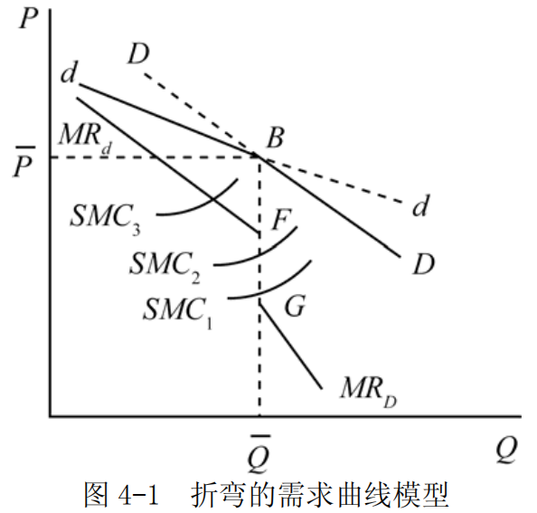

# Chapter 4 · Market theory

> **The core question of this chapter**: under different market structures (perfect competition, monopoly, monopolistic competition, oligopoly), how do firms decide output and price? Why do firm behaviour and efficiency differ across markets?

## The arc of this chapter

The supply-and-demand diagram treats the market as a single whole, but no two "markets" are the same: a grain seller at a farm market and the two carriers in telecoms are not facing the same kind of world at all. The question market theory must answer is — **what determines the intensity of competition, and how does it change firms' behaviour and efficiency?**

The chain of reasoning starts from the extreme of perfect competition. It pushes Smith's "invisible hand" to its limit: there are so many firms that no one can influence price, so price equals marginal cost, and in the long run entry grinds profit away. This benchmark was given its definitive form by the marginalists in the 1870s, but its first rigorous version came earlier still — as early as 1838 Cournot used calculus to solve both the perfect-competition and the monopoly cases. The other extreme is monopoly: the firm is the whole industry, facing the entire downward-sloping demand curve, and price is pushed above marginal cost.

Reality falls almost entirely between these two extremes. Sraffa pointed out the awkward fact in 1926: Marshall's framework could handle only "either perfect competition or monopoly", while reality was full of differentiated products and a handful of large firms. The response arrived in the same year, 1933: Chamberlin's *Theory of Monopolistic Competition* and Robinson's *Economics of Imperfect Competition* each put "product differentiation" and "buyer power" into the model. Oligopoly proved trickier still — each firm's optimal choice depends on what its rivals choose, and Cournot's 1838 duopoly model waited a hundred years for a common language: Nash's 1950 equilibrium concept. This chapter advances in the order "perfect competition → monopoly → monopolistic competition → oligopoly", relaxing one assumption at each step.

## Core concepts

### Total revenue, average revenue and marginal revenue

(1) A firm's total revenue ( $TR$ ) is the entire income a firm obtains from selling a given quantity of product at a given price, namely: $TR=p(y)\cdot{y}$

Here $TR$ is total revenue, and $p(y)$ is the price the firm faces when selling its product — under perfect competition it is a constant that does not vary with output, while when the firm has pricing power it falls as sales increase; $y$ is total sales. This one difference is the seed of every divergence in this chapter.

(2) Average revenue ( $AR$ ) is the income a firm obtains per unit of product sold on average, namely:

$$AR=TR/y=p(y)$$

Average revenue equals the price of the product, so the demand curve the firm faces is its average revenue curve.

(3) Marginal revenue ( $MR$ ) is the increment of income a firm obtains when it sells one more unit of product, namely:

$$MR=\frac{\Delta{TR}}{\Delta{y}}$$

When the firm faces a given price, its marginal revenue equals the price; but when it faces a demand curve sloping down to the right, selling one more unit requires lowering the price — and usually every unit must then be sold at the new lower price — so its marginal revenue is below the price. All the peculiarity of monopoly theory is hidden in this sentence.

### The profit-maximization principle of the firm

The profit-maximization principle of the firm is the general rule a firm follows when making production decisions: it requires that the additional revenue brought by each extra unit of product (or factor) equal the resulting increase in cost, that is, marginal revenue equals marginal cost: $MR=MC$.

This is also the equilibrium condition for the firm to achieve maximum profit: with other conditions unchanged, the firm should choose the optimal output such that the marginal revenue brought by the last unit of product equals the marginal cost paid for it. Note that this condition is independent of market structure — it applies to competitive firms, monopolists and oligopolists alike; the only difference lies in what each one's $MR$ looks like.

### The perfectly competitive market

A perfectly competitive market is a market structure in which competition is not hindered or disturbed in any way.
The assumptions of a perfectly competitive market are:

- ① In this market, firms produce homogeneous products.
- ② There are numerous consumers and firms in the market, so both consumers and firms are price takers.
- ③ Consumers and firms in the market have complete information.
- ④ Firms can enter or exit the market freely and at no cost.

In fact, such an ideal perfectly competitive market hardly exists in reality. But the perfectly competitive market makes optimal use of resources and has the highest economic efficiency, so it can serve as an ideal target of economic policy; hence Western economists always treat the analysis of perfect competition as the main content of market theory and as an ideal case against which reality can be compared. The value of a benchmark lies not in being real but in providing a yardstick for "how far reality has deviated, and what the deviation costs" — every market later in this chapter must be brought back and checked against it.

### External economies and external diseconomies

An external effect: the economic behaviour of one economic agent affects the welfare of other members of society, but the agent does not bear the consequences.

An external economy: an economic activity of an individual agent brings benefits to other members of society without receiving corresponding compensation, that is, the benefit the individual obtains is less than the total benefit brought by the activity — the agent's economic activity produces a positive external effect;

An external diseconomy: an economic activity of an individual agent imposes costs on other members of society without having to bear all of the corresponding costs itself, that is, the cost the individual bears is less than the total cost brought by the activity — the agent's economic activity produces a negative external effect.

In a perfectly competitive market, as the number of firms increases, the output of the industry as a whole rises too; if the cost of a single firm in the industry falls, the industry is said to exhibit external economies;
if the increase in the number of firms and hence in industry output raises the cost of a single firm, the industry is said to exhibit external diseconomies.

### Price discrimination

Uniform pricing leaves the regret of "a deal that could have been made but was not": someone was willing to pay 20 yuan, and pricing at 15 forgoes 5 yuan. If a firm can distinguish consumers and prevent resale, it will try to charge each person according to their willingness to pay — this is price discrimination: charging different prices for the same good at the same time. The basic conditions for practising price discrimination are:

- ① Consumers in the market have different preferences, and these different preferences can be distinguished;
- ② The different consumer groups or sales markets are separated from one another.

Price discrimination is divided into three degrees:
- First-degree price discrimination means the monopolist sells every unit of product at the highest price the consumer is willing to pay; this type is also called perfect price discrimination.
- Second-degree price discrimination means charging different prices for different segments of consumption quantity;
- Third-degree price discrimination means the monopolist charges different prices in different markets (or to different consumer groups).

### The monopolistically competitive market

A monopolistically competitive market is a market in which many firms produce and sell differentiated versions of the same product; the market contains both monopoly and competition, being neither perfectly competitive nor completely monopolistic.

A monopolistically competitive market typically has the following features:
- First, there are many sellers and buyers in the industry;
- Second, firms offer differentiated but close substitutes for one another;
- Third, firms enter and exit freely.

"Differentiation" is the keyword of this kind of market: brands, packaging, flavour, location give each firm a little pricing power over its own small patch of the market (the source of monopoly), while at every moment it faces close substitutes (the source of competition). It was precisely this structure that Chamberlin used in 1933 to portray real-world retailing, catering and light industry.

### The oligopolistic market

An oligopolistic market is a form of market organization in which only a few sellers exist in a given industry.
A typical oligopolistic market has the following characteristics:
- First, there are few firms in the market; each firm's sales account for a considerable share of the whole market, and so each has a marked influence on the market price;
- Second, the behaviour of the few oligopolists is mutually interdependent;
- Third, prices in an oligopolistic market are relatively stable, and competition mostly takes non-price forms;
- Fourth, barriers to entry exist in the market.

The second point is the essence of oligopoly and the difficulty of analysis: my optimal output depends on what you do, and yours depends on me. This interdependence makes the traditional practice of "treating price as a parameter" break down, and opens the door to game theory.

### The Cournot model

The Cournot model is a simple model containing only two oligopolists, that is, a duopoly model. It is an early oligopoly model and is usually taken as the starting point for oligopoly theory.

Suppose two firms compete facing the same market; they produce undifferentiated products and have zero costs. Each firm takes its rival's output as given and chooses the output that maximizes its own profit. In the end, each of $n$ firms chooses $\frac{1}{n+1}$ of the competitive output — when $n=2$ each takes $\frac{1}{3}$, and the remaining $\frac{1}{3}$ is the scarcity that competition has not ground away — at which point no firm has any incentive to change its output, and the market is in equilibrium. Hidden inside this 1838 model is the Nash equilibrium, which would not be named for another eighty years.

### Nash equilibrium

A Nash equilibrium is a situation in which, if the other players do not change their strategies, no player will change its own strategy. In other words, given the other players' strategies, one's own optimal strategy is the Nash equilibrium strategy.

Its value lies in its universality: Cournot's output equilibrium and the price-competition equilibrium proposed by Bertrand in 1883 are both special cases of Nash equilibrium; the analysis of industrial organization, auction design and trade negotiations has since been rewritten in this language.

## Problems and analysis

### Why is $MR=MC$ the general principle of firm equilibrium?

**[Notation]**
| Symbol | English full name | Meaning |
|------|----------|----------|
| $MR$ | Marginal Revenue | marginal revenue |
| $MC$ | Marginal Cost | marginal cost |

Economics generally holds that the purpose of a rational firm's behaviour is to obtain maximum profit. In making decisions the firm tries to make marginal revenue equal marginal cost: for each additional unit of output, first ask "is the extra gain bigger than the extra spend". Using the firm's choice of output, let us show why this plain bookkeeping logic yields $MR=MC$.

For the firm, producing output brings revenue on the one hand and generates cost on the other.
Given a certain level of output, when output is increased:
- If the revenue the firm thereby gains exceeds the cost of producing that unit, that is, $MR > MC$, then producing that unit leaves a surplus, so total profit rises. A profit-maximizing firm will therefore produce it; under this condition the firm will keep increasing output until the two are equal.
- Conversely, if the revenue added by producing one more unit is less than the cost of producing it, that is, $MR < MC$, then as far as that unit is concerned the firm makes a loss, and to raise profit the firm will cut back production of that unit. Thus when $MR < MC$ the firm reduces production until $MR=MC$.
- At $MR=MC$ the firm obtains maximum profit. At this point the firm neither increases nor decreases production — the last yuan gained by expanding exactly cancels the last yuan saved by contracting; any further move is a net loss.

Therefore $MR=MC$ is the general principle of firm equilibrium; when $MR=MC$ holds, the firm has maximized profit and has no incentive to adjust output.

### How does a perfectly competitive firm reach equilibrium in the short run and the long run? Why can it earn only normal profit in the long run?

**[Notation]**
| Symbol | English full name | Meaning |
|------|----------|----------|
| $MR$ | Marginal Revenue | marginal revenue |
| $AR$ | Average Revenue | average revenue |
| $p$ / $P$ | Price | price |
| $MC$ | Marginal Cost | marginal cost |
| $AVC$ | Average Variable Cost | average variable cost |
| $LMC$ | Long-run Marginal Cost | long-run marginal cost |
| $LAC$ | Long-run Average Cost | long-run average cost |

**(1) Short-run equilibrium**

In a perfectly competitive market every firm is a price taker, so a firm's marginal revenue equals its average revenue, and both equal the market price, that is, $MR=AR=p$. A profit-maximizing firm that produces where marginal revenue equals marginal cost chooses its optimal output where $MR=MC=p$.

Consistent with this condition, a perfectly competitive firm may be in equilibrium earning excess profit, earning normal profit, or making a loss. When the market price falls below the minimum point of average variable cost, producing loses the firm more than not producing; this is the shutdown point — fixed costs cannot be recovered anyway, and variable cost is the threshold for "whether to open for business at all".

For market prices above the minimum point of average variable cost, the firm determines the corresponding quantity supplied on its marginal cost curve. Therefore the marginal cost curve above average variable cost is the firm's short-run supply curve. Moreover, because of the law of diminishing marginal product, the firm's marginal cost curve rises, so its supply curve slopes up to the right — the "upward-sloping supply curve" of Chapter 1 here receives its first derivation.

**(2) Long-run equilibrium**

In the long run the firm keeps adjusting the quantity of its fixed inputs so that the scale of production is optimal at every level of output. Hence the long-run cost curves are the basis of the firm's decisions. As with short-run behaviour, the necessary condition for a profit-maximizing firm to choose the optimal output is that marginal revenue equal long-run marginal cost. At the same time, since in the long run there is no distinction between fixed and non-variable costs, the firm supplies only when price is above average cost; otherwise it leaves the industry.

Assume that firms' entry and exit do not affect the cost of an individual firm; then entry into or exit from the industry affects only market supply and hence the market price.

If firms in a perfectly competitive industry are earning excess profit, entry by firms from other industries is bound to follow. The result will drive the market price down to the minimum point of the firms' average cost. Therefore in this case the long-run equilibrium condition of a single firm is $P=LMC=LAC$, and no firm can earn excess profit. Excess profit is not confiscated by anyone here; it is ground away by the mechanism of "entry" itself — as long as profit remains, new firms will come to share it, until there is none left.

**[Short-run equilibrium vs long-run equilibrium: a comparison]**

| Dimension of comparison | Short-run equilibrium | Long-run equilibrium |
|----------|----------|----------|
| **Equilibrium condition** | $P = MC$ (or $MR = MC$) | $P = LMC = LAC_{\min}$ |
| **Types of cost** | Fixed costs and variable costs both exist | All costs are variable |
| **Profit position** | May earn excess profit, normal profit, or make a loss | Can only earn normal profit (excess profit is zero) |
| **Number of firms** | The number of firms is fixed | Firms may enter or exit the industry freely |
| **Price–cost relation** | Price may be above, equal to, or below average cost | Price equals the minimum point of average cost |
| **Supply curve** | The portion of the $MC$ curve above the minimum of $AVC$ | Determined by the type of industry (flat / rising / falling) |
| **Shutdown / exit** | Stop production when $P < AVC_{\min}$ | Leave the industry when $P < LAC_{\min}$ |
| **Efficiency** | May have excess or insufficient production capacity | Achieves production efficiency and allocative efficiency |

### How is the long-run industry supply curve of a perfectly competitive market derived?

The long-run industry supply curve of a perfectly competitive market is built on the long-run supply curves of the individual firms in the industry.

In the long run, perfectly competitive firms keep adjusting the quantity of fixed inputs so that the scale of production is optimal at every output. Taking long-run cost as the basis of decision, the firm supplies output where price equals marginal cost whenever price is above average cost. Meanwhile, in the long run other firms enter or exit the industry, which drives a single firm's long-run equilibrium to the point where price equals the minimum of long-run average cost.

Entry or exit by other firms affects not only market supply and hence the market price, but also the costs of firms in the industry. According to this effect, perfectly competitive industries are divided into three cases: constant-cost, increasing-cost and decreasing-cost.

- (1) Constant-cost industry: the cost of a single firm does not change with entry or exit. The final outcome is only a change in the number of firms. Hence the long-run supply curve of a constant-cost industry is a horizontal curve determined by the minimum point of the firms' long-run average cost curves.

- (2) Increasing-cost industry: suppose initially that firms and industry are both in long-run equilibrium. If industry market demand then rises, the market price will be pushed up and every firm will earn excess profit. The excess profit induces other firms to enter. External diseconomies of the industry raise the cost of a single firm, so when the industry is again in equilibrium, the minimum point of each firm's average cost is higher. In this way the industry's long-run supply curve, determined by the minimum point of firms' long-run average cost, slopes up to the right.

- (3) Decreasing-cost industry: suppose an industry is initially in equilibrium; a rise in market demand pushes up the market price, so firms in the industry earn excess profit. This induces entry by other firms. As firms enter, on the one hand the price tends to fall, and on the other hand external economies shift the industry's firms' long-run average cost curves downward. The market price again intersects the minimum point of the firms' average cost, and the industry returns to equilibrium. At this point the market equilibrium corresponds to a lower market price. The industry's long-run supply curve is therefore a curve sloping down to the right.

The three cases correspond to three kinds of reality: industries that use almost no special resources (constant cost), industries competing for scarce factors (increasing cost, the most common), and industries whose entry itself brings infrastructure and skilled labour (decreasing cost).

### How does a monopolistically competitive firm choose output and price? How should the efficiency of this market structure be assessed?

**(1) The subjective demand curve and the actual demand curve**

In a monopolistically competitive market, product differentiation lets a firm control the price of its own product to some degree and behave strategically. Under the belief that other firms will not change their prices, the firm expects that cutting its price will add more revenue; this curve constitutes the firm's subjective demand curve. But if all firms in the industry act on their own subjective demand curves, the actual demand curve facing the monopolistically competitive firm, though also sloping down to the right, is less price-elastic than the corresponding subjective demand curve. The monopolistically competitive firm sets output where the marginal revenue derived from its subjective demand curve intersects its marginal cost, but it must earn revenue at the price given by the actual demand curve, thereby obtaining the actual marginal revenue. If the subjective marginal revenue does not equal the actual marginal revenue, the firm will adjust output until the two are equal. Thus the result of a monopolistically competitive firm acting on its subjective demand curve is revenue determined by its actual demand curve.

**(2) Short-run and long-run equilibrium**

In the short run, the monopolistically competitive firm chooses output according to the principle that the marginal revenue corresponding to its subjective demand curve equals marginal cost; when the actual price corresponding to that output equals the subjective price, the firm is in short-run equilibrium. In the short run, a firm in equilibrium may earn excess profit or normal profit, or make a loss; but when making a loss, the revenue it earns must at least cover the variable costs it pays to produce. In the long run, because of entry and mutual imitation, a firm that could hold a monopoly position in the short run gradually loses it — the market demand it faces shrinks. When the average revenue corresponding to the output chosen where subjective marginal revenue equals marginal cost equals average cost, entry into and exit from the industry stop, and the firm is in long-run equilibrium. That is, the firm's long-run equilibrium condition is: long-run (subjective) marginal revenue equals marginal cost, and long-run average revenue equals long-run cost. In long-run equilibrium the monopolistically competitive firm earns only normal profit — the entry mechanism again grinds away excess profit, only "differentiation" leaves each firm a downward-sloping demand curve of its own.

**(3) Efficiency assessment: checking against perfect competition**

Because the monopolistically competitive firm's demand curve slopes down to the right, in long-run equilibrium price in a monopolistically competitive market is higher than under perfect competition, and output lower. Moreover, the advertising that monopolistically competitive firms undertake to strengthen product differentiation may well be a waste of resources. This marks the inefficiency of the monopolistically competitive market. But since the perfectly competitive market is rarely seen in reality, and since competition in monopolistic competition drives technical progress and product variety, the monopolistically competitive market is often regarded as a fairly efficient market structure. The key to the assessment is that variety is itself a valuable output — a world of only homogeneous bread would be more "efficient", but less worth living in.

**(4) Limits of the theory**

Monopolistic competition theory takes product differentiation and free competition as its main premises; its theoretical analysis rarely touches the equilibrium of monopolists formed by concentration of production. It therefore cannot analyse the deep foundations of the monopoly phenomenon — a feature of the modern capitalist economy — or its influence on social and economic life. Furthermore, the theory conflates monopoly based on product differentiation with monopoly resulting from concentration of production, so its analysis of monopolistic competition lacks generality. It should also be noted, however, that the analysis of the positive role monopolistic competition plays for competition and the negative role of monopoly is meaningful.

**A comparison of the four market structures:**

| Feature | Perfect competition | Monopolistic competition | Oligopoly | Complete monopoly |
|------|----------|----------|----------|----------|
| Number of firms | Extremely many | Many | A few | One |
| Product differentiation | Undifferentiated | Differentiated | Differentiated / undifferentiated | No substitutes |
| Barriers to entry | None | Low | High | Extremely high |
| Pricing power | None | Limited | Considerable | Complete |
| Realism | Rare | Most common | Common | Rare |

### How does the kinked demand curve explain price stickiness in oligopolistic markets?

The kinked demand curve model, also called the Sweezy model (proposed by Sweezy in 1939), is a theoretical model for analysing behaviour in oligopolistic markets. The model assumes that at a given price, if an oligopolist raises its price the others will not follow, but if it lowers its price the others will do the same. As a result, the demand curve facing a single firm has a kink.

Corresponding to the kinked demand curve, the oligopolist derives its own marginal revenue. From this marginal revenue, the firm chooses its optimal output by the principle that marginal revenue equals marginal cost, and charges the price given on the demand curve. What distinguishes this firm from the usual case is that the marginal revenue curve corresponding to the kinked demand curve is discontinuous at the kink, as shown in Figure 4-1. Note, however, that when marginal cost happens to equal marginal revenue exactly at the discontinuity, changes in marginal cost within a certain range do not affect the firm's equilibrium output and price. The model thus gives a full explanation of price stability in oligopolistic markets.

The defect of the kinked demand curve model is that it does not explain how the initial price is determined — it explains why the price does not move, but not why it settled there in the first place.

### Why is the equilibrium of the Cournot model a Nash equilibrium?

- (1) In a duopoly market, each firm sets output according to its own reaction curve, and the equilibrium level of output is obtained at the intersection of the two reaction curves; this pair of output levels is called the Cournot equilibrium.

- (2) The Cournot equilibrium is a Nash equilibrium. In a Nash equilibrium each firm's action is the best it can do given its rivals' actions, so no firm has any urge to change its behaviour. Likewise, in the Cournot equilibrium each firm's output maximizes its profit given its rivals' output, so no firm has any urge to change its output; the Cournot equilibrium is therefore stable.

This also shows the significance of game theory for oligopoly theory: the "reaction–convergence" process Cournot wrote down intuitively in 1838 is a special case of the Nash equilibrium concept — the former is a dynamic path of realization for the latter.

## Derivation and worked examples

### Given that a monopolist faces the demand curve $Q=50-3p$, find the marginal revenue function, and find the profit-maximizing output and price when $MC=4$.

**[Notation]**
| Symbol | English full name | Meaning |
|------|----------|----------|
| $Q$ / $y$ | Quantity | quantity demanded / output |
| $P$ / $p$ | Price | price |
| $TR$ | Total Revenue | total revenue |
| $MR$ | Marginal Revenue | marginal revenue |
| $MC$ | Marginal Cost | marginal cost |
| $\frac{dTR}{dQ}$ | Derivative | derivative of total revenue with respect to output |

(1) By the statement of the problem, the monopolist's demand function is:

$$P=\frac{50}{3}-\frac{Q}{3}$$

So the firm's total revenue function is:

$$TR=PQ=\frac{50Q}{3}-\frac{Q^2}{3}$$

and its marginal revenue function is:

$$MR=\frac{dTR}{dQ}=\frac{50}{3}-\frac{2Q}{3}$$

(2) From the problem, the firm's marginal cost is $MC=4$.

By the general principle of profit maximization, $MR=MC$, that is:

$$\frac{50}{3}-\frac{2Q}{3}=4$$

Solving gives: $Q = 19$.

Substituting $Q = 19$ into the inverse demand function $P=\frac{50}{3}-\frac{Q}{3}$ gives $P=\frac{50}{3}-\frac{19}{3}=10.3$.

That is, the firm's profit-maximizing output is $Q=19$ at a price of $P=10.3$.

### Given the monopolist's demand function $Q=50-P$: (1) find the marginal revenue function; (2) find the profit-maximizing output and price when $MC=20$; (3) under the same demand, how much less does monopoly sell than perfect competition? How large is the deadweight loss? To what level would first-degree price discrimination restore output?

(1) Given the monopolist's demand function $Q=50-P$, we have $P=50-Q$. The firm's total revenue is $TR = P\cdot Q = 50 Q - Q^2$, so its marginal revenue function is $MR=50-2Q$.

(2) Given the firm's marginal cost $MC=20$, the profit-maximization condition for the monopolist is $MR=MC$, giving $50-2Q = 20$, that is, $Q=15$, $P=50-Q = 35$.

(3) Compare the monopoly outcome of (2) with the perfect-competition benchmark:

- **Perfect competition**: price is pushed down to marginal cost, $P=MC=20$, and demand gives $Q=50-20=30$.
- **Monopoly**: $Q=15$, $P=35$ — output is only half the competitive benchmark, and the price is 15 higher.

Consumer surplus shrinks from $\frac{1}{2}\times(50-20)\times30=450$ under competition to $\frac{1}{2}\times(50-35)\times15=112.5$; of it, 225 becomes monopoly profit ($(35-20)\times15$), and the remaining $\frac{1}{2}\times(35-20)\times(30-15)=112.5$ is captured by no one — this is the deadweight loss of monopoly: 15 units of product whose willingness to pay exceeded cost were never produced.

If the monopolist could practise first-degree price discrimination, it would charge each unit the highest price on the demand curve until the willingness to pay for the last unit equalled marginal cost — output would return to $Q=30$, the deadweight loss would vanish, and consumer surplus would be transferred entirely to the producer. This reveals the efficiency paradox of price discrimination: perfect discrimination is allocatively efficient, yet distributionally hands the whole pie to the firm.

## Limits and what follows

- **Does structure determine conduct? — the SCP paradigm and its critics.** This chapter unfolds along the intuition "structure → conduct → performance": high concentration means high prices. The Harvard School (Bain, 1956) turned this into a testable paradigm, using industry data to support "concentration is harmful"; the Chicago School (Stigler, Demsetz) countered in the 1960s–70s: high profits are more likely to come from the efficiency of large firms than from collusion, and high concentration is the outcome of competition, not a counterexample to it. Baumol's "contestable markets" (1982) cut even deeper: as long as potential entrants can come in at any time, even a single remaining firm dare not charge the monopoly price. The debate has never been settled, and antitrust policy has swung between the two camps for a century.
- **How large is the cost of monopoly, really? — the empirical triangle.** Using US data, Harberger (1954) estimated the welfare loss of monopoly at only about 0.1% of GNP — all monopoly deadweight losses put together are just a small triangle. This "embarrassingly small" result prompted Tullock's (1967) rejoinder: monopoly profit itself (the large rectangle) will induce people to spend real resources contesting and defending it — rent seeking. The loss lies not in the triangle but in the resources consumed in acquiring and keeping the monopoly position.
- **Game theory rewrote oligopoly theory.** The kinked demand curve only described price stickiness, while the Cournot model eventually received its rigorous formulation, eighty years late: after Nash (1950), output competition, price competition (Bertrand), collusion and betrayal all became strategy profiles in a single framework. Repeated games showed further that oligopolists need no meeting to collude: as long as each keeps tomorrow's business in mind, "tacit collusion" can sustain high prices — which turned antitrust attention from "is there an agreement" to "is there a structure of repeated interaction".

## References

- Gao Hongye, *Western Economics* (8th edition, separate micro/macro volumes, China Renmin University Press) — the main source of this chapter's framework and theoretical statements.
- The full list is in the [bibliography](/reference/参考书目).
- [Wikipedia · Market equilibrium](https://en.wikipedia.org/wiki/Market_equilibrium)
- [Wikipedia · Perfect competition](https://en.wikipedia.org/wiki/Perfect_competition)
- [Wikipedia · Monopoly](https://en.wikipedia.org/wiki/Monopoly)

<!-- BACKLINKS-AUTO -->
## Related pages

- [Readme](/math/Readme)
- [History](/western/History)
- [Readme](/western/Readme)
