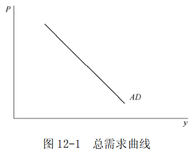
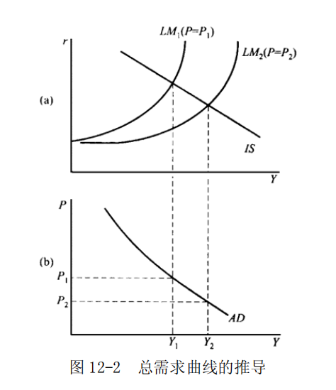
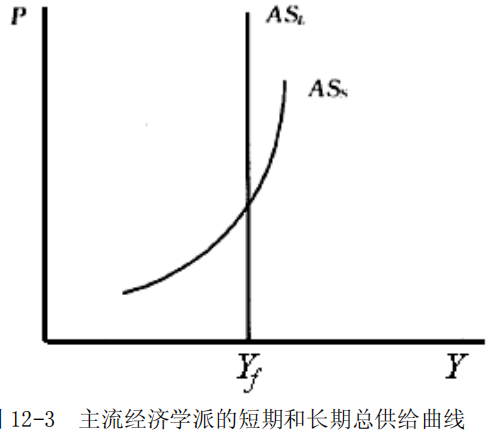

# Chapter 12 Aggregate demand and aggregate supply analysis

> **Core question of this chapter**: How does the price level interact with aggregate output? How are the aggregate demand and aggregate supply curves derived? How do the three (AD–AS–prices) together determine national income?

## Chapter roadmap

The IS-LM of Chapter 10 hides an assumption: the price level P is unchanged. That was defensible in the Depression years — when Keynes wrote, prices were falling and unemployment was near thirty percent, and output mattered far more than prices. But to discuss inflation and to explain the successive price rises after the war, P must enter the model as an endogenous variable. Set P in motion and IS-LM spits out an aggregate demand curve: each price level corresponds to a pair of output and interest rate at which both markets are in equilibrium. On the supply side the argument returns to the labour market: employment is determined by the real wage, output is determined by employment through the production function — that chain gives the aggregate supply curve.

Macroeconomics thereby gained a diagram isomorphic to the micro supply-and-demand diagram: the intersection of AD and AS determines output and prices at the same time. This is exactly the method of the "neoclassical synthesis": in the short run wages are rigid and AS slopes upward, so Keynesian demand management works; in the long run wages are flexible and AS is vertical, and the economy returns to the classical full-employment level — and Samuelson's generation sewed Keynes and the classics into one diagram. This diagram is also the foundation of the two chapters that follow: continued price rises (inflation in Chapter 14) are the dynamic version of AD or AS shifting, and the position of the vertical long-run AS is precisely the potential output that growth theory in Chapter 13 has to explain.

## Core concepts

### The aggregate demand curve

**[Meaning of the name]**
| Abbreviation | English full name | Meaning |
|------|----------|----------|
| **AD** | **Aggregate Demand** | **Aggregate demand** |

Aggregate demand is the total quantity of goods and services demanded by the economic society.

The curve showing the correspondence between the total quantity demanded in the economy and the general price level is the aggregate demand curve.

As the general price level rises, the quantities of consumption and investment demanded in the economic society fall, so the total quantity demanded usually moves inversely with the general price level. The aggregate demand curve slopes down to the right, as shown in Figure 12-1.

Why does it slope down to the right? A micro demand curve leans on the substitution effect, which does not help here — aggregate demand faces all goods, and there is no "substituting into some other market". The answer lies in money (the Keynesian effect): a fall in the price level → more real money behind a given nominal quantity of money → a lower interest rate → more investment. The slope of the aggregate demand curve is squeezed out of IS-LM little by little.

### The aggregate supply curve

**[Meaning of the name]**
| Abbreviation | English full name | Meaning |
|------|----------|----------|
| **AS** | **Aggregate Supply** | **Aggregate supply** |

Aggregate supply is the total quantity of goods and services available for use in the economic society.
The curve showing the relation between the total quantity supplied in the economy and the general price level is the aggregate supply curve. As the general price level rises, the quantities of goods and services supplied in the economic society rise, so the total quantity supplied usually moves in the same direction as the general price level. Correspondingly the aggregate supply curve slopes up to the right.

Why does it slope up to the right? Prices rise → with money wages unchanged, the real wage falls → firms are willing to hire more → output rises. It is visible that the shape of the whole curve depends on how wages adjust to prices — every divergence between the short and the long run is hidden here.

### Rigid money wages

Rigidity of money wages is the phenomenon whereby money wages do not adjust rapidly in response to changes in the demand for and supply of labour.
Many economists have found that even when there are factors forcing the wage level down, the absolute or relative level of wages may nevertheless remain unchanged; especially when the quantity of labour demanded falls short of the quantity supplied, a rigidity appears in the downward movement of money wages, that is, wages can rise but cannot fall. This is chiefly because workers suffer an illusion about money income. As a result, the influence of changes in the general price level on the demand for and supply of labour differs because money wages cannot fluctuate spontaneously. The rigidity of money wages became the theoretical basis of the Keynesian explanation of macroeconomic fluctuation. If wages cannot adjust in time, the supply and demand for labour cannot reach equilibrium, and unemployment arises.

Why do wages not fall? Labour is not a spot commodity: contracts lock wages in for a period, trade unions resist an absolute fall in money wages, and no one wants to be first to take a cut. Keynes adds a layer in Chapter 19 of the *General Theory*: even if money wages really could fall, prices would fall along with them, the real wage need not fall, and employment need not recover — rigidity is only part of the story of unemployment.

## Questions and analysis

### What is the difference between the AD-AS model and the IS-LM model?

**[Core difference]**

| Model | Object of analysis | Markets included | Level of analysis |
|------|----------|----------|----------|
| **IS-LM** | Partial equilibrium analysis | Goods market (IS) + money market (LM) | **Some markets** |
| **AD-AS** | **General equilibrium analysis** | Goods market + money market + labour market | **The whole macroeconomy** |

---

**[Intuition]**

| Curve | English full name | Scope described |
|------|----------|----------|
| **IS curve** | Investment-Saving | Looks only at the goods market (investment = saving) |
| **LM curve** | Liquidity-Money | Looks only at the money market (money demand = money supply) |
| **AD curve** | Aggregate Demand | Synthesizes IS + LM, describing aggregate demand at different price levels |
| **AS curve** | Aggregate Supply | Describes the total supply capacity determined by the labour market and the production function |

---

**[Three uses of the AD-AS model]**

1. Explaining how **national income ($Y$)** is determined
2. Explaining how the **price level ($P$)** is determined
3. Analyzing **inflation**, **unemployment** and **economic fluctuation**

> **In short**: AD-AS is the "big picture" of the macroeconomy, integrating the goods market, the money market and the labour market together.

---

### How is the aggregate demand curve derived from the IS-LM model?

**[Notation]**
| Symbol | English full name | Meaning |
|------|----------|----------|
| $I(r)$ | Investment Function | Investment function |
| $S(Y)$ | Saving Function | Saving function |
| $L_1(Y)$ | Transaction and Precautionary Demand | Transaction and precautionary money demand function |
| $L_2(r)$ | Speculative Demand | Speculative money demand function |
| $M$ | Nominal Money Supply | Nominal quantity of money supplied |
| $P$ | Price Level | General price level |
| $r$ | Interest Rate | Interest rate |
| $Y$ | Output / National Income | Aggregate output / national income |

Aggregate demand is the level of the society's total expenditure, or the total quantity demanded, corresponding to a given general price level; the aggregate demand curve is the curve showing the relation between the total quantity demanded in the economy and the price level. In a two-sector economy aggregate demand consists of consumption demand and investment demand, and the aggregate demand curve is obtained by analysing the relation between the quantities demanded for consumption and investment and the general price level.

In the view of mainstream economics, at a given general price level the quantity of money in the economy is the monetary reflection of aggregate demand. When the economy is in equilibrium these funds are used to satisfy transaction and precautionary demand as well as speculative demand. Transaction and precautionary demand make up consumption demand, while the money used for speculation is converted through financial markets into investment demand. Hence the correspondence between different general price levels and aggregate quantities demanded can be obtained from the $IS-LM$ model, namely:

$$\begin{cases}
I(r) = S(Y) \\
L_1{(Y)} +L_2(r) = \frac{M}{P}
\end{cases}$$

Eliminating the interest rate r from this system yields the aggregate demand function.

The above process can be explained further in Figure 12-2. Corresponding to different general price levels, the real quantity of money represented by a given nominal quantity of money moves inversely, and the LM curve shifts accordingly. Corresponding to different LM curves, the equilibrium of the goods and money markets determines different aggregate quantities demanded. With the IS curve given, a rise in the general price level reduces real money balances, raises the interest rate and cuts investment, so that the total quantity demanded in the economy falls — this is the complete logic of the aggregate demand curve's downward slope.

### Why do the short-run and long-run aggregate supply curves have different shapes? What does this mean for policy?

**[Notation]**
| Symbol | English full name | Meaning |
|------|----------|----------|
| $W$ | Nominal Wage | Money wage / nominal wage |
| $P$ | Price Level | General price level |
| $\frac{W}{P}$ | Real Wage | Real wage |
| $Y$ | Output / National Income | Aggregate output / national income |

---

**[Logic of the derivation of the aggregate supply curve]**

$$\text{Price level} → \text{real wage} → \text{labour supply and demand} → \text{employment} → \text{aggregate output}$$

---

**[Short run vs long run]**

| Comparison dimension | **Short-run aggregate supply curve (SAS)** | **Long-run aggregate supply curve (LAS)** |
|----------|--------------------------|--------------------------|
| **Money wages** | **Rigid** (can rise, not fall) | **Fully flexible** (freely adjustable) |
| **Workers** | Suffer **money illusion** (watch only nominal wages) | Rational, attentive to the **real wage** |
| **Shape** | **Slopes up to the right** | **Vertical line** |
| **Reason** | Prices rise → the real wage falls → firms hire more → output rises | Whatever the price, the economy is always at the **full-employment** level |

---

**[Detailed derivation]**

**(1) The short-run aggregate supply curve (SAS) — upward sloping**

**Key assumption**: money wages are rigid downwards (they can rise but not fall)

**Derivation**:

| Case | Change in the price level | Real wage $\frac{W}{P}$ | Labour demand | Employment | Output $Y$ |
|------|-------------|------------------------|----------|--------|----------|
| **Below full employment** | $P \uparrow$ | $\downarrow$ | $\uparrow$ | $\uparrow$ | $\uparrow$ |
| **Reaching full employment** | $P \uparrow$ | $\downarrow$ | Demand > supply | Money wage $\uparrow$ | Output unchanged |

**Conclusion**: below full employment, the price level and output move in the **same direction** → the SAS curve slopes up to the right.

---

**(2) The long-run aggregate supply curve (LAS) — a vertical line**

**Key assumption**: money wages are perfectly flexible

**Derivation**:

- If $P \uparrow$ → the real wage $\downarrow$ → firms want to hire more
- But workers are unwilling to supply labour at a low real wage
- Money wages $\uparrow$ → the real wage returns to its equilibrium level
- **Result**: whatever the price level, the economy is always at full employment

**Conclusion**: long-run output is determined by the **level of full employment** and is independent of the price level → the LAS curve is a vertical line.

---

**[Policy implications compared]**

| Type of policy | Short-run effect (SAS sloping) | Long-run effect (LAS vertical) |
|----------|---------------------|---------------------|
| **Expansionary policy** (more AD) | Output $\uparrow$, prices rise mildly $\uparrow$ | **Output unchanged**, prices $\uparrow\uparrow$ |
| **Contractionary policy** (less AD) | Output $\downarrow$, prices fall mildly $\downarrow$ | **Output unchanged**, prices $\downarrow\downarrow$ |

**Core conclusion**:

> - **Short run**: aggregate demand management is **effective**, and can affect output and employment
> - **Long run**: aggregate demand management is **ineffective**, affecting only the price level; output is determined by the potential level

## Derivations and worked examples

### Suppose an economy has the consumption function C=800+0.8Y, the investment function I=2200-100r, and the money demand function L=0.5Y - 250r, and the central bank's nominal money supply is M = 600. Find the aggregate demand function of the economy.

**[Notation]**
| Symbol | English full name | Meaning |
|------|----------|----------|
| $C$ | Consumption | Consumption |
| $Y$ | Output / National Income | Aggregate output / national income |
| $I$ / $I(r)$ | Investment / Investment Function | Investment / investment function |
| $r$ | Interest Rate | Interest rate |
| $L$ / $L_1(Y) + L_2(r)$ | Money Demand / Money Demand Function | Money demand / money demand function |
| $M$ | Nominal Money Supply | Nominal quantity of money supplied |
| $P$ | Price Level | General price level |
| $S(Y)$ | Saving Function | Saving function |

Solution:

The aggregate demand of the economy comes from the $IS-LM$ model, that is:

$$\begin{cases}
I(r)=S(Y) \\
L_1(Y) + L_2(r) = \frac{M}{P}
\end{cases}$$

In a two-sector economy saving is $S=Y-C=Y-800-0.8Y=0.2Y-800$. Substituting the given conditions gives:

$$\begin{cases}
2200 - 100r = 0.2Y - 800 \\
0.5Y - 250r = \frac{600}{P}
\end{cases}$$

Rearranging the first gives the IS equation $Y=15000-500r$; rearranging the second gives $500r=Y-\frac{1200}{P}$. Substituting the latter into the former and eliminating the interest rate $r$:

$$Y = 15000 - \left(Y-\frac{1200}{P}\right)$$

That is:

$$2Y-15000=\frac{1200}{P}$$

Therefore the aggregate demand function of the economy is:

$$Y=7500+\frac{600}{P}$$

In this function $Y$ falls as $P$ rises — this is the algebraic expression of the aggregate demand curve's downward slope.

## Limits and what comes next

- **The dispute over the microfoundation of the slope.** The Keynesian effect that slopes AD down rests on the chain "a fall in prices raises real money balances"; Pigou added the real balance effect (the wealth channel). But Clower, and Barro and Grossman in the 1960s–70s, pointed out that under involuntary unemployment households face quantity constraints, and standard utility maximization need not deliver a downward-sloping aggregate demand curve. New Keynesianism later sidestepped this derivation altogether and rebuilt aggregate demand directly out of optimizing behaviour — writing consumption as an intertemporal Euler equation.
- **The expectations revolution on the supply side.** The "money illusion" assumption behind this chapter's short-run AS was breached by stagflation in the 1970s: prices and unemployment rose together, and the upward-sloping SAS shifted up along with inflation expectations. Friedman and Phelps put expectations into wage setting, and Lucas went further, showing that once workers see through the nominal trick an anticipated policy cannot budge even the short-run AS. "Expectations" thereby became the protagonist of every aggregate supply model since (see Chapters 14 and 15).
- **Is the long run really neutral?** A vertical LAS means demand shocks move only prices, not output, in the long run (monetary neutrality), but Blanchard and Summers (1986) proposed "hysteresis": a deep recession can drag potential output down permanently through lost skills and the exit of long-term unemployed from the labour force — the position of the vertical line is itself dragged along by demand. Where the LAS stands is precisely the theme of the growth theory in Chapter 13.

## References

- Gao Hongye, *Western Economics* (8th edn., micro/macro volumes, China Renmin University Press) — the main source of this chapter's framework and theoretical statements.
- For the full bibliography see [References](/reference/参考书目).
- [Wikipedia · Aggregate demand](https://en.wikipedia.org/wiki/Aggregate_demand)
- [Wikipedia · AD–AS model](https://en.wikipedia.org/wiki/AD%E2%80%93AS_model)
- [Wikipedia · Keynesian economics](https://en.wikipedia.org/wiki/Keynesian_economics)

<!-- BACKLINKS-AUTO -->
## Related pages

- [History](/western/History)
- [Readme](/western/Readme)
