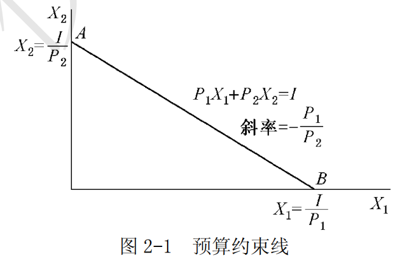
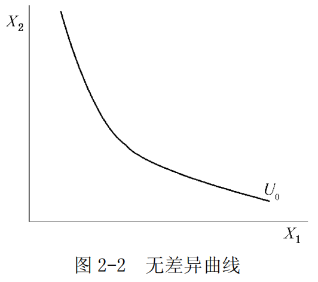
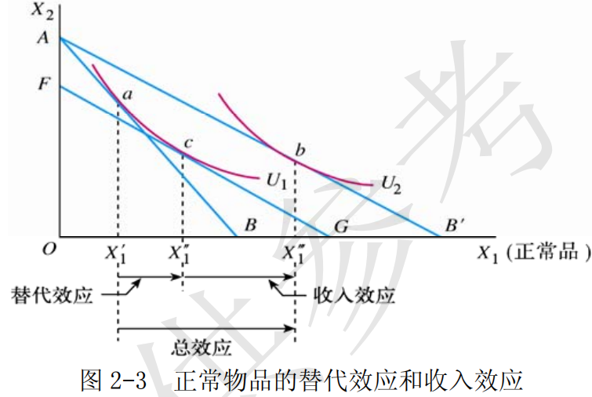
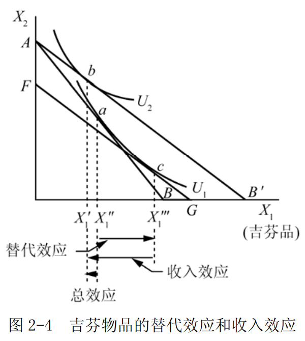

# Chapter 2 · Utility theory

> **The core question of this chapter**: how does a consumer maximise utility under an income constraint? Why does the demand curve slope down to the right? How do price changes affect consumer choice through the substitution and income effects?

## The arc of this chapter

What utility theory is really answering is an ancient question: **what determines the value of a thing?** Adam Smith left behind the famous "paradox of water and diamonds" — water is indispensable to life yet worth almost nothing, while a diamond is of little use yet fetches an astonishing price. The labour theory of value could not resolve it cleanly. In the 1870s, Jevons, Menger and Walras nearly gave the same answer at the same time: value does not depend on the satisfaction the total quantity brings, but on the satisfaction of the **last unit** — marginal utility. There is so much water that the last cup is worthless; diamonds are so rare that the last stone is still precious. The marginal revolution took its name from this, and economics began using calculus.

But the premise that "utility can be measured" itself came under challenge later on: utility is a subjective feeling, on what grounds can numbers be added up? Pareto's and Hicks's response was to recast the theory in **ordinal** terms — there is no need to measure utility, only to require that consumers be able to rank bundles of goods in preference; indifference curves and the marginal rate of substitution are that language. This chapter first treats the cardinal version (diminishing marginal utility → the equilibrium condition → the derivation of the demand curve), then the ordinal version (preference → indifference curves → the tangency condition), and finally uses the decomposition into substitution and income effects to explain the shape of the demand curve, and its famous exception — the Giffen good.

## Core concepts

### Utility

Utility is the ability of a good or service to satisfy human wants, that is the degree of satisfaction a consumer feels when consuming a good or service.

The concept is necessary because a theory of value needs one uniform "weight" for comparing goods of wildly different kinds: the fullness of bread, the pleasure of music, the reassurance of insurance — all must be converted into one and the same thing before "maximisation" can be discussed at all. Utility is the consumer's subjective preference and appraisal of a good — the same good has different utility from person to person, from time to time, from place to place, and that is precisely its position as a theory of subjective value (opposed to the labour theory of value).

### The law of diminishing marginal utility

**[Notation]**
| Symbol | English full name | Meaning |
|------|----------|----------|
| $MU$ | Marginal Utility | marginal utility |
| $TU$ | Total Utility | total utility |
| $Q$ | Quantity | quantity consumed |
| $\Delta$ | Delta | change |

The law of diminishing marginal utility states that within a given period, other goods being consumed unchanged, as a consumer continuously increases consumption of a particular good, the increment of utility obtained from each additional unit of that good gradually decreases.

$$MU=\frac{\Delta{TU}}{\Delta{Q}}$$

The reason this law is treated as a foundation is twofold: it conforms to psychological fact (the same stimulus repeated produces a weaker response), and it is the key to unlocking the water-and-diamonds paradox — the marginal (not total) utility of a good determines the price people are willing to pay. The entire demand theory of cardinal utility theory is built on this assumption.

### Consumer equilibrium

**[Notation]**
| Symbol | English full name | Meaning |
|------|----------|------|
| $MU_i$ | Marginal Utility | marginal utility of good $i$ |
| $P_i$ / $p_i$ | Price | price of good $i$ |
| $x_i$ / $X_i$ | Quantity | quantity of good $i$ consumed |
| $m$ / $I$ | Income | the consumer's income |
| $\lambda$ | Lambda | marginal utility of money / utility-to-money ratio |

For "maximise satisfaction" to become a solvable problem it must become a testable condition. Consumer equilibrium is the product of that conversion: other things being equal, a consumer is in equilibrium when the marginal utility of the last unit of money spent on every good equals the marginal utility of money, that is:

$$\begin{cases}
\frac{M U_{1}}{P_{1}}=\frac{M U_{2}}{P_{2}}=\cdots=\frac{M U_{n}}{P_{n}}=\lambda \\
p_{1} x_{1}+\cdots+p_{n} x_{n}=m
\end{cases}$$

The intuition is "the marginal utility of a yuan is the same everywhere": if the last yuan spent on bread brings more utility than the last yuan spent on books, money should be moved from books to bread until it can no longer be moved — equilibrium is the state where no further shifting is profitable. In ordinal utility theory the same equilibrium appears as the point of tangency between an indifference curve and the budget line.

#### The budget line

**[Notation]**
| Symbol | English full name | Meaning |
|------|----------|------|
| $P_1$, $P_2$ | Price | prices of goods 1 and 2 |
| $X_1$, $X_2$ | Quantity | quantities of goods 1 and 2 consumed |
| $I$ | Income | the consumer's given income |

The budget line (also called the budget constraint, the consumption possibility line or the price line) shows, given income and prices, all the combinations of the two goods that the whole of income can buy. Writing $I$ for the given income, the budget equation is:

$$P_{1}X_{1}+P_{2}X_{2}=I$$

The equation says: the consumer's total income equals the total spending on good 1 and good 2. The budget line drawn from that budget equation is the segment AB in figure 2-1.

In figure 2-1 the horizontal intercept $OB$ and the vertical intercept $OA$ show respectively the quantities of good 1 and good 2 that all income could buy. A change in price pivots the line, a change in income shifts it parallel — and everything later said about how demand changes happens between the movement of this line and the re-tangency of the indifference curves.

### Indifference curves

**[Notation]**
| Symbol | English full name | Meaning |
|------|----------|------|
| $U$ | Utility | utility |
| $X_1$, $X_2$ | Quantity | quantities of goods 1 and 2 consumed |
| $U_0$ | Utility Level | a constant, standing for some level of utility |

Indifference curves are the central tool of ordinal utility theory: since utility cannot be measured, only require that consumers be able to rank — every combination of goods that gives the consumer the same degree of satisfaction falls on the same curve. Edgeworth introduced the tool, Pareto systematised it, and Hicks and Allen used it in 1934 to rewrite the whole theory of value.

An indifference curve represents all combinations of the quantities of two goods that give the consumer the same level of utility:

In figure 2-2 the horizontal and vertical axes show the quantity of good 1, $X_1$, and the quantity of good 2, $X_2$. The corresponding utility function is

$$U=f(X_1,X_2)=U_0$$

where $X_1$ and $X_2$ are the quantities consumed of the two goods and $U_0$ is a constant standing for some level of utility. Indifference curves have three basic properties:

- First, since it is usually assumed that the utility function is continuous, there can be infinitely many indifference curves between any two on the same plane;
- Second, no two indifference curves on the same plane intersect (intersection would mean the preference ranking is self-contradictory);
- Third, indifference curves are convex to the origin, that is the absolute value of their slope is diminishing — that convexity is exactly the geometric expression of a diminishing marginal rate of substitution.

### The marginal rate of substitution between goods

**[Notation]**
| Symbol | English full name | Meaning |
|------|----------|------|
| $MRS_{1,2}$ | Marginal Rate of Substitution | marginal rate of substitution of good 1 for good 2 |
| $x_1$, $x_2$ / $X_1$, $X_2$ | Quantity | quantities of goods 1 and 2 consumed |
| $\Delta$ | Delta | change |
| $\lim$ | Limit | limit |
| $\mathrm{d}$ | Differential | the differential sign |

The marginal rate of substitution answers the question: if one less unit of good 2 is bought, how much more good 1 is needed to keep the same satisfaction? It translates "the strength of preference" into an operational exchange ratio, whose geometric meaning is the absolute value of the slope of the indifference curve. Writing $\Delta{x_1}$ and $\Delta{x_2}$ for the changes in the quantities of the two goods, the marginal rate of substitution of good 1 for good 2 is:

$$MRS_{1,2}=-\frac{\Delta{x_2}}{\Delta{x_1}}$$

As the change in quantity tends to zero:

$$MRS_{1,2}=\lim_{\Delta X_{1} \rightarrow 0}-\frac{\Delta x_{2}}{\Delta x_{1}}=-\frac{\mathrm{d} x_{2}}{\mathrm{d} x_{1}}$$

### The substitution and income effects

The effect of a price change on quantity demanded can be split into two mechanisms, and this decomposition is the basic tool for understanding the shape of the demand curve:

- **Substitution effect**: the price change of a good changes relative prices, which changes quantity demanded while real income (utility level) is held constant — the thing has become cheaper in relative terms, so buy more of it in place of others.
- **Income effect**: the price change changes the level of real income, which changes quantity demanded — the same money is now worth more, and the change in purchasing power changes consumption.

The substitution effect does not change the utility level (it moves along the original indifference curve), while the income effect moves to a new indifference curve. For a normal good the two effects point the same way, so the demand curve slopes down to the right steadily; for an inferior good they point opposite ways, and normally the substitution effect still dominates — unless the income effect is large enough to overtake it, which is the case of a Giffen good (see "Problems and analysis").

## Problems and analysis

### Why does a consumer's demand curve slope down to the right? Explain with cardinal utility theory.

**[Notation]**
| Symbol | English full name | Meaning |
|------|----------|------|
| $MU$ | Marginal Utility | marginal utility |
| $p$ / $P$ | Price | the price of the good |
| $\lambda$ | Lambda | the marginal utility of money |

Cardinal utility theory starts from the law of diminishing marginal utility and the equilibrium condition $\frac{MU}{p}=\lambda$, and derives that the demand curve must slope down to the right. The chain of reasoning has only two steps:

First, the demand price depends on marginal utility. The larger the marginal utility of a unit of some good, the higher the price the consumer is willing to pay for that unit, and the smaller, the lower. Since marginal utility diminishes, as consumption rises continuously the marginal utility falls, and the demand price the consumer is willing to pay falls too — that is exactly the shape of the demand curve.

Second, the equilibrium condition requires that the marginal utility of the "last yuan" be the same everywhere: $\frac{MU}{p}=\lambda$. Since the $MU$ of any good diminishes as quantity demanded rises, with the marginal utility of money $\lambda$ unchanged the demand price $P$ of the good must diminish in proportion to $MU$. That price and quantity move in opposite directions is thereby proved.

### For a normal good, why does the demand curve slope down to the right? Explain with the income and substitution effects.

A normal good is one whose quantity consumed rises as income rises. The total effect of a price fall on it can be split into two parts pointing the same way:

(1) Total effect = substitution effect + income effect. The substitution effect is caused by the change in relative prices (without changing the utility level), and the income effect by the change in real purchasing power (which changes the utility level).

(2) As figure 2-3 shows, the horizontal axis $OX_1$ and the vertical axis $OX_2$ show the quantities of goods 1 and 2, and good 1 is a normal good. ${X_{1}}^{'}$ is the quantity of good 1 demanded before the price change. After the price of good 1 falls, the quantity demanded rises to ${X_1}^{'''}$, so the total effect is ${X_{1}}^{'}{X_{1}}^{'''}$.

Draw the compensating line $FG$: parallel to the post-change budget line $A{B}^{'}$ and tangent to the pre-change indifference curve $U_1$. The quantity ${X_1}^{''}$ corresponding to the tangency point $c$ is the quantity of consumption with the income effect removed. So ${X_1}^{'}{X_1}^{''}$ is the substitution effect, and ${X_1}^{''}{X_1}^{'''}$ is the income effect.

For a normal good, the substitution effect moves opposite to price and the income effect moves opposite to price too, so adding the two, the total effect must move opposite to price — the demand curve slopes down to the right.

### What is a Giffen good? Why does its demand curve slope up to the right?

A Giffen good is one in which demand and price move the wrong way: the lower the price, the less is bought, and a rise in price brings more buying. The observation comes from potato consumption during the nineteenth-century Irish famine (Robert Giffen noticed it, and Marshall recorded the case in the *Principles of Economics*): a rise in the price of bread as the staple made poor families poorer, so they could only buy more potatoes to fill up.

(2) As figure 2-4 shows, good 1 is a Giffen good. The equilibrium points before and after the fall in $P_1$ are $a$ and $b$, and the quantity of good 1 demanded falls instead, ${X_1}^{'}{X_1}^{''}$, which is the total effect. Through the compensating budget line $FG$ it can be split as:

- ${X_1}^{''}{X_1}^{'''}$ is the substitution effect (opposite to price, positive);
- ${X_1}^{'}{X_1}^{'''}$ is the income effect (same direction as price, negative).

A Giffen good is a special kind of inferior good: as an inferior good its substitution effect moves opposite to price and its income effect with price; what is special about it is that **the income effect is large enough to overtake the substitution effect**, so the total effect moves the same way as price and the demand curve shows the rare shape of sloping up to the right. It also reminds us that the law of demand is an empirical law conditioned on "other things being equal," not a logical necessity.

## Limits and what follows

- **Can utility be measured?** Cardinal utility theory requires utility to be additive and comparable, which is convenient theoretically but not observable. Hicks and Allen (1934) showed that as long as preference can be ranked, the same conclusions (the demand curve, the equilibrium condition) can be derived with indifference curves, without measuring utility — the ordinal revolution put utility theory on weaker, more defensible ground.
- **Can preference be observed?** Samuelson (1938) went further: even "preference" need not be assumed, only actual purchasing behaviour observed — revealed preference theory defines "A is at least as good as B" by "A was chosen and B was not (with B within the budget)," reducing utility theory to operational empirical claims.
- **The challenge of behavioural economics**: the prospect theory of Kahneman and Tversky (1979) shows that people evaluate gains and losses relative to a reference point and are more sensitive to losses (loss aversion), and that preferences are not stable when the framing changes; present bias in intertemporal choice also departs from the assumption of exponential discounting. The "rational ranking" of utility theory is still the textbook baseline, but it is now treated as an approximation rather than an axiom.

## References

- Gao Hongye, *Western Economics* (8th edition, separate micro/macro volumes, China Renmin University Press) — the main source of this chapter's framework and theoretical statements.
- The full list is in the [bibliography](/reference/参考书目).
- [Wikipedia · Utility](https://en.wikipedia.org/wiki/Utility)
- [Wikipedia · Consumer theory](https://en.wikipedia.org/wiki/Consumer_theory)
- [Wikipedia · Marginal utility](https://en.wikipedia.org/wiki/Marginal_utility)

<!-- BACKLINKS-AUTO -->
## Related pages

- [Readme](/math/Readme)
- [History](/western/History)
- [Readme](/western/Readme)
