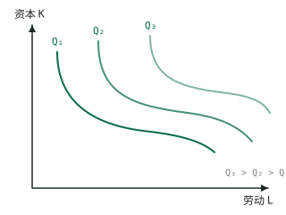
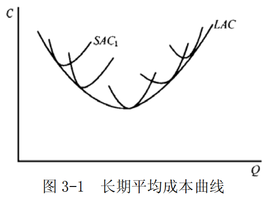
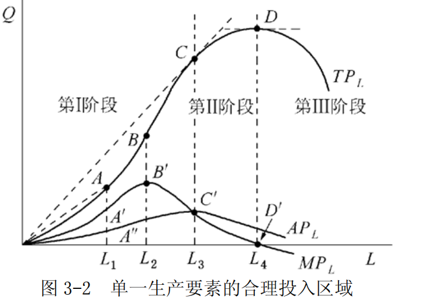
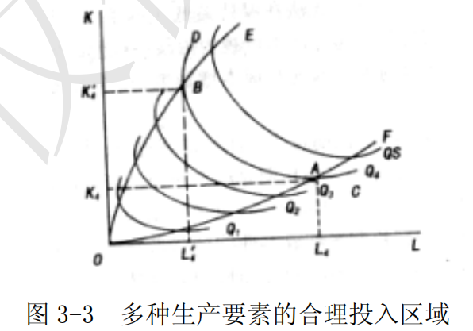

# Chapter 3 · Production and cost

> **The central question of this chapter**: How does a firm choose its factor inputs and its output so as to maximise profit? Why does the law of diminishing marginal returns exist? What separates short-run costs from long-run costs?

## The arc of this chapter

In Chapter 1's supply-and-demand diagram the supply curve was taken as given; utility theory explained the demand side's "how much they are willing to pay," and what was still missing was the other side's "what production costs." What the theory of production and cost does is open the black box of the firm: how inputs become output and output becomes cost, so giving the supply curve a microfoundation.

The starting point of this chain of reasoning is a plain empirical regularity: **diminishing marginal returns**. Its original form was the late-eighteenth-century debate over diminishing returns to land (Petty, Anderson and Malthus all took part), and Marshall generalised it — so long as one factor is fixed, the returns to successive additions of a variable factor will eventually diminish. This regularity creates the distinction between the short run and the long run: in the short run there is always something that cannot be changed (the plant, the equipment), so costs first fall and then rise and $MC$ takes a U shape; in the long run everything can be adjusted, and the shape is left to economies and diseconomies of scale. The isoquant curve and the marginal rate of technical substitution, meanwhile, carry the geometric language of Chapter 2's indifference curves over into production unchanged — the tangency condition for cost minimisation and the tangency condition for utility maximisation are mathematically the same proposition (duality).

The order of this chapter: the laws of production with a single variable factor (marginal product, the three stages) → substitution between two variable factors (isoquants, MRTS, the optimal factor combination) → deriving cost from production (the family of short-run costs, the long-run envelope).

## Core concepts

### Marginal product

Marginal product refers to the increase in total product obtained from each additional unit of a variable input factor, with the level of technology and other input factors unchanged.

For example, if in production only labour L is the variable input, the marginal product of labour can be written:

$$MP=\frac{\Delta{Q}}{\Delta{L}}$$

Suppose the production function is continuous and differentiable, so that marginal product can be obtained by differentiating total product with respect to the variable input, that is $MP=\frac{dQ}{dL}$ .
Thus the marginal product at a given output is the slope of the total product curve at that point.

### The law of diminishing marginal returns

With the level of technology unchanged, while equal amounts of some one variable factor of production are added continuously to one or several other factors held in fixed quantity: when the quantity of this variable factor is below a certain critical value, the marginal product brought by adding more of the factor is increasing; when the quantity of this variable factor continues to increase past that critical value, the marginal product brought by adding more of it is decreasing. This is the law of diminishing marginal returns.

The law is also called the law of diminishing marginal rewards — the "reward" means output. It is not derived from deeper axioms but summarises a technological fact: "a variable factor will in the end dilute the fixed factor." Crowd more and more workers into the same workshop and the workshop does not grow with them. Yet it is the engine of the whole short-run theory: $MP$ rises then falls, and through the reciprocal relation this flips into $MC$ falling then rising, from which all the later U-shaped curves descend.

### The isoquant curve

An isoquant curve is the locus of all the different combinations of quantities of two factors of production that produce the same output, with the level of technology unchanged.
Let $Q$ denote a given output level; the production function corresponding to the isoquant is: $Q=f(L,K)$
An isoquant shows that a given amount of product can be produced by many combinations of labour and capital. Isoquants have the following important features:
- ① An isoquant slopes down from upper left to lower right and has a negative slope. It shows that increasing the input of one factor can reduce the input of the other. Only a negatively sloped isoquant indicates that substituting labour for capital is efficient.
- ② There can be countless isoquants on the coordinate diagram. They are arranged in order of output: the closer an isoquant is to the origin, the less output it represents, and the farther from the origin, the more.
- ③ No two isoquants can intersect.
- ④ Isoquants are convex to the origin. This shows that as one factor is increased unit by unit, the quantity of the other factor it can replace falls each time. This point is explained by the law of the diminishing marginal rate of technical substitution.

**Isoquant diagram:**



*Figure: an isoquant curve*

**How to read the figure:**
- **Vertical axis (the K axis)**: the quantity of capital input
- **Horizontal axis (the L axis)**: the quantity of labour input
- **What the curve means**: each point on an isoquant stands for a different capital-labour combination, yet all produce **the same output**
- **Shape**: sloping down to the right and convex to the origin, reflecting the diminishing marginal rate of technical substitution
- **Key feature**: an isoquant **never meets either axis**, because production requires both factors working together

**Key properties:**
1. **Negative slope**: to keep output unchanged, increasing one factor requires decreasing the other
2. **Convex to the origin**: the marginal rate of technical substitution diminishes
3. **No intersections**: two isoquants never cross
4. **The farther from the origin, the higher the output**: $Q_3 > Q_2 > Q_1$

### The marginal rate of technical substitution

Holding the level of output unchanged, the quantity of the other factor's input given up when one additional unit of some factor is added is called the marginal rate of technical substitution, abbreviated $MRTS$ . Let $\Delta{K}$ and $\Delta{L}$ denote respectively the change in the capital input and the change in the labour input; then the marginal rate of technical substitution of labour for capital is:

$$MRTS_{LK}=-\frac{\Delta{K}}{\Delta{L}}$$

or

$$MRTS_{LK}=-\frac{dK}{dL}$$

### The law of the diminishing marginal rate of technical substitution
The law of the diminishing marginal rate of technical substitution says that, holding output unchanged, as the input of one factor of production is continuously increased, the quantity of the other factor that each unit of it can replace diminishes.
The main reason for the diminishing MRTS is that the technology for producing any product requires the factor inputs to be in appropriate proportions, which means substitution between factors is limited.

Take two factors, labour and capital. When the labour input is small and the capital input large, a reduction in capital can easily be made good by increasing labour, keeping the original output level — labour substitutes easily for capital. But once the labour input has grown quite large and the capital input has shrunk quite small, substituting labour for capital becomes very difficult.

### The isocost equation

A firm's isocost equation is the algebraic expression for all the different factor combinations the firm can use while spending the same cost, given factor prices.

Let $r_L$ and $r_K$ denote the prices of labour and capital respectively and $c$ the firm's cost; the isocost equation can be written:

$$C=r_{L}L+r_{K}K$$
Changes in the factor prices the firm faces or in the total amount spent will rotate or shift the isocost equation.

### The optimal combination of factors of production

The optimal combination of factors of production refers to the combination of quantities of the factors a producer uses when, with technology and factor prices unchanged, the producer maximises output at a given cost or minimises cost at a given output.

To that end the firm seeks the highest-output combination point on a given isocost equation and isoquant. Whether maximising output at a given cost or minimising cost at a given output, a profit-maximising firm will choose the quantities of factors at the point where the marginal product produced per unit of cost spent on each factor is equal.

### Economies and diseconomies of scale

Economies and diseconomies of scale describe the relation between a firm's output, and hence its scale, and its costs.
For a producer, if output doubles while total cost rises by less than double, production exhibits economies of scale; if output doubles while cost rises by more than double, production exhibits diseconomies of scale.

The sources of economies of scale are concrete: the division of labour and specialisation, the indivisibility of large equipment, fixed costs spread over more output; diseconomies of scale mostly come from management — the more layers, the slower information travels and the higher the cost of coordination. The ebb and flow of the two forces fixes the typical shape of long-run average cost, first falling and then rising.

### Increasing, constant and decreasing returns to scale

As a special case of economies and diseconomies of scale, if the increase in output is achieved by scaling all factors of production up in the same proportion,
then the notion of returns to scale can be defined:
- ① If output increases by a larger proportion than the factors of production, production has increasing returns to scale;
- ② If output increases in the same proportion as the factors of production, production has constant returns to scale;
- ③ If output increases by a smaller proportion than the factors of production, production has decreasing returns to scale.

### Average cost

Average cost is the cost a firm incurs on average for each unit of product it makes.
In formula form: $AC=\frac{TC}{y}$ .
- In the short run, the firm's average cost takes a $U$ shape.
- In the long run, the state of economies of scale determines the shape of the firm's long-run average cost curve.

### Marginal cost

Marginal cost is the change in cost brought about by a change of some amount in output; that is, the addition to total cost when the firm, in the short run, produces one more unit of output.
In formula form:

$$MC(Q)=\frac{\Delta{TC(Q)}}{\Delta{Q}}=\frac{TC(Q+\Delta{Q})-TC(Q)}{\Delta{Q}}$$

or

$$MC(Q)=\lim_{\Delta Q \rightarrow 0} \frac{\Delta T C(Q)}{\Delta Q}=\frac{\mathrm{d} T C}{\mathrm{d} Q}$$

- In the short run, by force of the law of diminishing marginal returns, the firm's marginal cost takes a U shape.
- In the long run, the state of economies of scale determines the shape of the firm's long-run marginal cost.

### The long-run average cost curve

The long-run average cost curve ( $LAC$ ) is the curve used to describe the relation between long-run average cost and output.
Long-run average cost is the total cost per unit of output the firm incurs on average in the long run.
The long-run average cost curve is derived from the long-run total cost curve.
Over the range where production moves from economies of scale to diseconomies, the long-run total cost curve takes a U shape.
Geometrically, the long-run average cost curve is the envelope of all the short-run average cost curves, as Figure 3-1 shows. The reason is that at each output the firm, in the long run, adjusts the factors of production to their optimal combination, so that the average cost achieved at that output is the smallest.



## Problems and analysis

### How are the rational input ranges for one and for several factors of production determined? What is true of average product and marginal product within them?

**[Notation]**

Before answering, three key concepts must be understood:

| Symbol | English full name | Meaning | Formula |
|------|----------|----------|------|
| $TP_L$ | Total Product of Labor | total product of labour | $TP_L = Q = f(L,\bar{K})$ |
| $AP_L$ | Average Product of Labor | average product of labour | $AP_L = \frac{TP_L}{L} = \frac{Q}{L}$ |
| $MP_L$ | Marginal Product of Labor | marginal product of labour | $MP_L = \frac{\Delta TP_L}{\Delta L} = \frac{dQ}{dL}$ |

- **$TP_L$ (total product)**: all the output obtained from employing a given quantity of labour, with the capital input unchanged
- **$AP_L$ (average product)**: output per unit of labour on average
- **$MP_L$ (marginal product)**: the addition to total product from each extra unit of labour

The rational input range of the factors of production is the range of factor quantities chosen by a producer pursuing maximum profit.

**(1) The short run: with only one variable factor, the rational input range lies between the point of maximum average product and the point where marginal product equals 0**



The three stages of short-run production are divided according to the relations among the total product curve, the average product curve and the marginal product curve. As Figure 3-2 shows:
- Stage I, the stage of increasing average product: the average product of labour rises throughout and reaches its maximum. This stage runs from the origin to the intersection of the $AP_L$ and $MP_L$ curves, that is, the range of labour input from 0 to $L_3$ .
- Stage II, the stage of decreasing average product: marginal product is still greater than 0, so total product is still increasing, until total product reaches its highest point. This stage runs from the intersection of the $AP_L$ and $MP_L$ curves to the point where the $MP_L$ curve meets the horizontal axis, that is, the range of labour input from $L_3$ to $L_4$ .
- Stage III, where marginal product is negative and total product is decreasing: this stage lies beyond the point where the $MP_L$ curve meets the horizontal axis, that is, the range of labour input beyond $L_4$ .

- First, the firm will certainly not produce in Stage III, because marginal product there is negative and production brings no benefit at all.
- Second, the firm will not produce in Stage I either, because average product is still increasing, the factor being used has not yet done its fullest work, and the firm has not reaped the expected gain; it pays to keep expanding the use of the variable input and so expanding output, at least until average product reaches its maximum. Therefore the firm normally produces in Stage II.

**(2) The long run: the rational input range with two variable factors**

In the long run the quantities of all factor inputs are variable. Suppose the two inputs $K$ and $L$ are both variable; then the rational input region of the two variable factors is the region where the isoquant has a negative slope, that is, the region contained between the ridge lines $OE$ and $OF$ in Figure 3-3. If an input combination falls outside the ridge lines (above $OE$ or below $OF$), then holding output unchanged one can reduce both $L$ and $K$ at the same time — which shows that the marginal product of one of the factors has turned negative, and that adding more of it actually reduces output. A rational firm therefore confines its input combination to the economic region between the ridge lines.



**[The meaning and role of the ridge lines OE and OF]**

**What is a ridge line?**

Ridge lines are the two lines joining particular points on the isoquants, and they delimit the "economic region" of factor inputs:

| Ridge line | English name | Definition | Mathematical character |
|------|----------|------|----------|
| **$OE$ (upper ridge line)** | Upper Ridge Line | joins the points on each isoquant where the **marginal product of capital is zero** | the tangent to the isoquant at that point is **vertical**, $MP_K = 0$ |
| **$OF$ (lower ridge line)** | Lower Ridge Line | joins the points on each isoquant where the **marginal product of labour is zero** | the tangent to the isoquant at that point is **horizontal**, $MP_L = 0$ |

**The role of the ridge lines:**

1. **They delimit the economic region (the economic region of production)**
   - The region between the two ridge lines is called the **economic region**
   - Within this region the isoquants have negative slopes, $MRTS_{LK} > 0$
   - The firm will choose its factor combination only within the economic region

2. **They exclude the non-economic regions**
   - **Above $OE$**: $MP_K < 0$, the marginal product of capital is negative, and adding capital reduces output
   - **Below $OF$**: $MP_L < 0$, the marginal product of labour is negative, and adding labour reduces output
   - A rational firm will not produce in either region

3. **They guarantee that substitution between factors works**
   - Within the economic region, increasing one factor can reduce the other while output stays the same
   - Beyond the ridge lines the substitution relation fails, and both factors must be increased at once to hold output

**Diagram:**

```
        K（资本）
         ↑
         |   上脊线 OE
         |  /|  以上：非经济区（MP_K < 0）
         | / |
         |/  |   经济区域（合理投入区）
         +---|--------------→ L（劳动）
             |\
             | \  下脊线 OF
             |  \
                  以下：非经济区（MP_L < 0）
```

The ridge lines separate "substitution works" from "substitution fails": inside the ridge lines the isoquants slope downward, and output lost by reducing one factor can be made up by increasing the other; outside them the slope of the isoquant turns positive, and holding output actually requires increasing both factors together.

### Why does the marginal rate of technical substitution diminish?

- (1) The law of the diminishing marginal rate of technical substitution says:
	Holding output unchanged, as the input of one factor of production is continuously increased, the quantity of the other factor that each unit of it can replace diminishes.

- (2) The main reason for the diminishing MRTS is:
	the technology for producing any product requires the factor inputs to be in appropriate proportions, which means substitution between factors has limits, so as the input of one factor keeps increasing, the quantity of the other factor it can replace keeps shrinking.
	For labour and capital, technical constraints put the two in appropriate proportions: when the labour input is small and the capital input large, a reduction in capital is easily made good by adding labour, keeping the original output — labour substitutes easily for capital. But once the labour input has grown quite large and the capital input has shrunk quite small, substituting labour for capital becomes very difficult.

### How is the optimal factor combination determined, and how does it relate to the firm's profit maximisation?

**[Notation]**

The key symbols involved in the optimal factor combination are:

| Symbol | English full name | Meaning |
|------|----------|----------|
| $MP_L$ | Marginal Product of Labor | marginal product of labour |
| $MP_K$ | Marginal Product of Capital | marginal product of capital |
| $r_L$ (or $w$) | Price of Labor / Wage Rate | the price of labour (the wage rate) |
| $r_K$ (or $r$) | Price of Capital / Rental Rate | the price of capital (the rental rate) |
| $MRTS_{LK}$ | Marginal Rate of Technical Substitution | the MRTS of labour for capital |
| $L$ | Labor | the labour input |
| $K$ | Capital | the capital input |
| $c$ (or $C$) | Cost | cost |
| $y$ (or $Q$) | Output / Quantity | output |
| $\pi$ | Profit | profit |

**[Answer]**

**(1) Determining the optimal factor combination**

The optimal factor combination refers to the firm's optimal decision under either of two constraints: **maximising output at a given cost**, or **minimising cost at a given output**.

Taking labour $L$ and capital $K$ as the two factors, the firm's technology is represented by the isoquants and its cost constraint by the isocost line. The optimal combination is the **tangency point** of an isoquant with an isocost line.

**Case one: maximising output at a given cost**

With cost $c$ given, the firm chooses factor inputs satisfying:

The following two conditions must hold together:

$$MRTS_{LK} = \frac{r_L}{r_K}$$

$$r_{L}L + r_{K}K = c$$

Or equivalently:

The following two conditions must hold together:

$$\frac{MP_L}{r_L} = \frac{MP_K}{r_K}$$

$$r_{L}L + r_{K}K = c$$

**Case two: minimising cost at a given output**

With output $y$ given, the firm chooses factor inputs satisfying:

The following two conditions must hold together:

$$MRTS_{LK} = \frac{r_L}{r_K}$$

$$f(L,K) = y$$

Or equivalently:

The following two conditions must hold together:

$$\frac{MP_L}{r_L} = \frac{MP_K}{r_K}$$

$$f(L,K) = y$$

**Core conclusion**: in either case the firm chooses the quantities of factors at the point where **the marginal product produced per unit of cost spent on each factor is equal**, that is:

$$\frac{MP_L}{r_L}=\frac{MP_K}{r_K}$$

---

**[Why does this condition hold? From tangency to equality]**

**The economics**: the marginal product a yuan spent on labour buys exactly equals the marginal product a yuan spent on capital buys. The derivation takes three steps, all from the geometry of the tangency:

1. The (absolute) slope of the isoquant = the marginal rate of technical substitution:
   $$MRTS_{LK} = \frac{MP_L}{MP_K}$$

2. The (absolute) slope of the isocost line = the ratio of factor prices:
   $$\frac{r_L}{r_K}$$

3. The optimal point is a tangency, so the two slopes are equal; cross-multiplying gives:
   $$\frac{MP_L}{MP_K} = \frac{r_L}{r_K} \quad\Longleftrightarrow\quad \frac{MP_L}{r_L} = \frac{MP_K}{r_K}$$

---

**[Why $\frac{MP_L}{r_L}$ and not $MP_L$?]**

The firm is not comparing "1 unit of labour vs 1 unit of capital" but "a yuan spent on labour vs a yuan spent on capital — which buys more," so the marginal product must be divided by the price to bring both onto the same monetary scale:

| Indicator | Formula | Meaning | Unit |
|------|------|------|------|
| $MP_L$ | $\frac{\partial y}{\partial L}$ | the addition to output from 1 more unit of labour | output / unit of labour |
| $\frac{MP_L}{r_L}$ | $\frac{MP_L}{r_L}$ | the addition to output a yuan spent on labour buys | output / yuan |

Comparing only $MP$ gives the wrong answer. Let $MP_L = 10$ with $r_L = 5$ yuan, and $MP_K = 6$ with $r_K = 2$ yuan: on marginal products alone, $MP_L = 10 > MP_K = 6$, which suggests using more labour; but converted to output per yuan, labour brings only $2$ units of output while capital brings $3$ — so the firm should use more capital and less labour until the two are equal. A factor's physical productivity is not its monetary efficiency, and this is exactly what the optimality condition means by "every yuan buys the same wherever it is spent."

---

**(2) The relation to the firm's profit maximisation**

The condition for the optimal factor combination is consistent with the firm's goal of profit maximisation. Take the given-cost case as an example:

If $\frac{MP_L}{r_L} > \frac{MP_K}{r_K}$, the marginal product per unit of cost spent on labour is **greater** than the marginal product per unit of cost spent on capital.

The firm then shifts one unit of cost from capital $K$ to labour $L$; with total cost unchanged, total output rises, and so does profit.

Conversely, if $\frac{MP_L}{r_L} < \frac{MP_K}{r_K}$, the firm should shift cost from labour to capital.

Only when $\frac{MP_L}{r_L} = \frac{MP_K}{r_K}$ can the firm no longer raise output or profit by adjusting its factor combination; this is the **optimal state**.

So pursuing the optimal factor combination is precisely a necessary condition for maximising profit; the two are fully consistent.

### Explain the relation between the short-run total product curve and the short-run total cost curve.

**[Notation]**
| Symbol | English full name | Meaning |
|------|----------|----------|
| $Q$ / $y$ | Output / Total Product | output / total product |
| $TC$ | Total Cost | total cost |
| $TVC$ | Total Variable Cost | short-run variable cost |
| $TFC$ | Total Fixed Cost | fixed / invariable cost |
| $L$ | Labor | the labour input |
| $K$ | Capital | the capital input |
| $W$ / $r_L$ | Wage Rate / Price of Labor | the price of labour |
| $MC$ | Marginal Cost | marginal cost |
| $MP_L$ | Marginal Product of Labor | marginal product of labour |
| $\frac{dTC}{dQ}$ | Derivative | the derivative of total cost with respect to output |
| $\frac{dQ}{dL}$ | Derivative | the derivative of output with respect to labour |

The following correspondences hold between the short-run total product curve and the short-run total cost curve:
- ① The stage of increasing marginal returns on the total product curve corresponds to the stage of decreasing marginal cost on the total cost curve;
- ② The stage of diminishing marginal returns on the total product curve corresponds to the stage of increasing marginal cost on the total cost curve;
- ③ The point of maximum marginal returns on the total product curve corresponds to the point of minimum marginal cost on the total cost curve. The correspondence is set out in detail below.

Let the short-run production function be:

$Q=f(L,K)$  ①

The short-run total cost function is:

$TC(Q)=TVC(Q)+TFC$  ②

$TVC(Q)$  : short-run variable cost
$TFC$ : invariable cost

The short-run total variable cost function is:

$TVC(Q)=W\cdot{L}(Q)$  ③

$W$ or $r_L$ : the price of labour

and let the factor prices be given.

From equation ②:

$MC=\frac{dTC}{dQ}=\frac{dTVC}{dQ}+\frac{dTFC}{dQ}$  ④

Since $TFC$ is a constant, $\frac{dTFC}{dQ}=0$

So equation ④ can be written:

$$MC=\frac{dTC}{dQ}=W\cdot\frac{dL}{dQ}$$
Marginal product: $MP_L=\frac{dQ}{dL}$

hence

$MC=W\cdot\frac{1}{MP_L}$, or $MC=\frac{r_L}{MP_L}$ ⑤

It follows that:

$MC$ corresponds inversely to $MP_L$. By force of the law of diminishing marginal returns, the marginal product $MP_L$ of the variable input first rises and then falls, tracing an inverted U, so marginal cost $MC$ bears a convex relation to total cost: when the total product curve is concave the total cost curve is convex, and when the total product curve is convex the total cost curve is concave. When the total product curve has an inflection point, the total cost curve has a corresponding inflection point.

## Derivation and worked examples

### A firm's production function is $y=5L-L^{2}$, where L is the number of workers employed. Find the rational range of the firm's labour input.

**[Notation]**
| Symbol | English full name | Meaning |
|------|----------|----------|
| $y$ / $Q$ | Output / Total Product | output / total product |
| $L$ | Labor | labour input / number of workers employed |
| $AP_L$ | Average Product of Labor | average product of labour |
| $MP_L$ | Marginal Product of Labor | marginal product of labour |

From the statement, the firm's only variable factor is labour L, so the firm should produce in Stage II of production (the rational input range). From the production function $y=5L-L^{2}$:

- average product is: $AP_L=y/L=5-L$
- marginal product is: $MP_L=\frac{dy}{dL}=5-2L$

The left end of Stage II is where average product is at its maximum, fixed by $MP_L=AP_L$:

$$5-2L=5-L$$
Solving: $L=0$

That is, average product is already diminishing from the origin (for every $L>0$, $MP_L<AP_L$), so Stage II starts at $L=0$.

The right end of Stage II is where marginal product is zero; beyond it total product begins to fall:

$$5-2L=0$$
Solving: $L=2.5$

So the rational range of the firm's labour input is $L\in [0,2.5]$.

### A firm's production function is $y=AL^{\alpha}K^{\beta}$

**[Notation]**
| Symbol | English full name | Meaning |
|------|----------|----------|
| $y$ / $Q$ | Output | output |
| $A$ | Technology Parameter | technology parameter / total factor productivity |
| $L$ | Labor | the labour input |
| $K$ | Capital | the capital input |
| $\alpha$, $\beta$ | Output Elasticity | output elasticity |
| $r_L$ | Price of Labor | the price of labour |
| $r_K$ | Price of Capital | the price of capital |
| $c$ / $C$ | Cost | cost |

, the prices of the factors $L$ and $K$ being $r_L$ and $r_K$ respectively.

- (1) Find the firm's optimal factor combination.
- (2) If the quantity of capital is $K = 1$ , find the firm's short-run cost function.
- (3) Find the firm's long-run cost function.

Solution:

**[Preliminaries]**

For the Cobb-Douglas production function $y=AL^{\alpha}K^{\beta}$:

- $\alpha$ = the output elasticity of labour (a 1% increase in labour input raises output by $\alpha$%)
- $\beta$ = the output elasticity of capital (a 1% increase in capital input raises output by $\beta$%)

**Step 1: compute the marginal products**

Take the partial derivatives of the production function:

$$MP_L=\frac{\partial y}{\partial L}=\alpha A L^{\alpha -1} K ^ \beta$$

$$MP_K=\frac{\partial y}{\partial K}=\beta A L^{\alpha} K ^{\beta-1}$$

**Step 2: apply the optimality condition**

By the condition for the optimal factor combination:

$$\frac{MP_L}{r_L} = \frac{MP_K}{r_K}$$

Substituting the marginal products:

$$\frac{\alpha A L^{\alpha -1} K ^ \beta}{r_L} = \frac{\beta A L^{\alpha} K ^{\beta-1}}{r_K}$$

**Step 3: simplify and solve**

Cancel the common factor $A L^{\alpha-1} K^{\beta-1}$ from both sides:

$$\frac{\alpha \cdot K}{r_L} = \frac{\beta \cdot L}{r_K}$$

Cross-multiply:

$$\alpha K \cdot r_K = \beta L \cdot r_L$$

Rearranging gives the optimal factor input ratio:

$$\frac{K}{L}=\frac{\beta r_L}{\alpha r_K}$$

**[The economic reading]**

This result exposes the three determinants of the optimal factor ratio:

| Factor | Effect | Economic intuition |
|------|------|----------|
| **Labour price $r_L$ ↑** | $K/L$ ↑ | labour is dearer, so use more capital in its place |
| **Capital price $r_K$ ↑** | $K/L$ ↓ | capital is dearer, so use more labour in its place |
| **Output elasticity of capital $\beta$ ↑** | $K/L$ ↑ | capital's marginal contribution is larger, so use more capital |

So the firm's optimal factor combination is: $\frac{K}{L}=\frac{\beta r_L}{\alpha r_K}$ .

- (2) In the short run,
	with $K = 1$, $y=AL^{\alpha}$, so $L=(y/A)^{\frac{1}{\alpha}}$.
	Substituting into the firm's cost function $c=r_L L+r_K K$,
	the short-run cost function is: $c=r_L (y/A)^{\frac{1}{\alpha}}+r_K$; this is the firm's short-run cost function.

- (3) In the long run,
	 both $L$ and $K$ are variable, and the firm's long-run cost function is determined by:

$$y=f(L,K)$$

$$\frac{MP_L}{r_L}=\frac{MP_K}{r_K}$$

$$c=r_L L + r_K K$$

the three conditions holding **together**.

Substituting and simplifying:

$$y=A L^{\alpha} K ^ {\beta}$$

$$c=r_L L + r_K K$$

$$\beta r_L L = \alpha r_K K$$

Derivation:

$$L=\frac{\alpha r_K K}{\beta r_L}$$

$${r_L L}=\frac{\alpha r_K K}{\beta}$$

$$y=A {\frac{\alpha r_K K}{\beta r_L} }^{\alpha} K ^ {\beta}$$
$${\frac{y}{A}}={\frac{\alpha r_K K}{\beta r_L} }^{\alpha} K ^ {\beta}$$

$${\frac{y}{A}}={\frac{\alpha r_K}{\beta r_L} }^{\alpha} K ^ {\alpha+\beta}$$

$$K= {\frac{y}{A}}^{\frac{1}{\alpha +\beta}}\cdot {\frac{\beta r_L}{\alpha r_K}}^{\frac{\alpha}{\alpha + \beta}}$$

$$c=\frac{\alpha r_K K}{\beta} + r_K K$$

$$c=(\frac{\alpha r_K}{\beta}\cdot{\frac{\beta r_L}{\alpha r_K}}^{\frac{\alpha}{\alpha+\beta}} + r_K (\frac{\beta r_L}{\alpha r_K})^{\frac{\alpha}{\alpha + \beta}})(\frac{y}{A})^{\frac{1}{\alpha+\beta}}$$

$$c=(\frac{\alpha r_K}{\beta}\cdot{\frac{\beta r_L}{\alpha r_K}}\cdot{\frac{\beta r_L}{\alpha r_K}}^{\frac{-\beta}{\alpha+\beta}} + r_K (\frac{\beta r_L}{\alpha r_K})^{\frac{\alpha}{\alpha + \beta}})(\frac{y}{A})^{\frac{1}{\alpha+\beta}}$$

$$c=({r_L}\cdot({\frac{\alpha r_K}{\beta r_L}})^{\frac{\beta}{\alpha+\beta}} + r_K (\frac{\beta r_L}{\alpha r_K})^{\frac{\alpha}{\alpha + \beta}})(\frac{y}{A})^{\frac{1}{\alpha+\beta}}$$

Solving:

$$c=\left[r_{L}\left(\frac{\alpha r_{K}}{\beta r_{L}}\right)^{\frac{\beta}{\alpha+\beta}}+r_{K}\left(\frac{\beta r_{L}}{\alpha r_{K}}\right)^{\frac{\alpha}{\alpha+\beta}}\right]\left(\frac{y}{A}\right)^{\frac{1}{\alpha+\beta}}$$

, and this is the firm's long-run cost function.

### Prove: a firm pursuing maximum profit will necessarily choose its input combination on the expansion path.

**[Notation]**
| Symbol | English full name | Meaning |
|------|----------|----------|
| $L$ | Labor | the labour factor |
| $K$ | Capital | the capital factor |
| $Q$ / $f(L,K)$ | Output / Production Function | total output / the production function |
| $MP_L$ | Marginal Product of Labor | marginal product of labour |
| $MP_K$ | Marginal Product of Capital | marginal product of capital |
| $TC$ | Total Cost | total cost |
| $TR$ | Total Revenue | total revenue |
| $\pi$ | Profit | profit |
| $P$ | Price | the price of the product |
| $r_L$ | Price of Labor | the price of labour |
| $r_K$ | Price of Capital | the price of capital |

Proof:

Suppose the firm uses only the two factors labour $L$ and capital $K$; then
total output:

$$Q=f(L,K)$$
marginal products:

$$MP_L=\frac{dQ}{dL}$$

$$MP_K=\frac{dQ}{dK}$$

total cost:
$$TC=r_L L + r_K K$$

the firm's profit:
$$\pi=TR-TC=PQ-TC$$
Pursuing maximum profit comes down to:
1. maximising output at a given cost
2. minimising cost at a given output

Differentiate with respect to each factor $L$ and $K$ and set the derivatives to zero to obtain the profit-maximisation conditions,

$$P\cdot{MP_L}-r_L=0$$

$$P=\frac{r_L}{MP_L}$$

$$P\cdot{MP_K}-r_K=0$$
$$P=\frac{r_K}{MP_K}$$

$$\frac{r_L}{MP_L}=\frac{r_K}{MP_K}$$

Hence $\frac{MP_L}{MP_K}=\frac{r_L}{r_K}$ , which is the input combination of a firm pursuing maximum profit.

Further, the expansion path is the line joining the tangency points of a series of isocost lines with isoquants. The slope of the tangent at any point on an isoquant is the marginal rate of technical substitution $RTS_{L,K}=\frac{MP_L}{MP_K}$ , while the isocost line $c=r_L L + r_K K$ has slope $\frac{r_L}{r_K}$ . Hence the equation of the expansion path is $\frac{MP_L}{MP_K}=\frac{r_L}{r_K}$ , the same as the input combination of a firm pursuing maximum profit. Therefore a firm pursuing maximum profit will necessarily choose its input combination on the expansion path.

## Limits and what follows

- **Why do firms exist?** This chapter treats the firm as a "production function" — a black box with inputs going in and outputs coming out — and says not a word about why the firm's boundary exists or why the market does not directly coordinate all production. Coase answered in "The Nature of the Firm" (1937): using the market itself has costs (finding trading partners, negotiating, monitoring performance), the firm is a substitute for the market, and the boundary is drawn where "the marginal cost of organising internally equals the marginal cost of the market." That question later grew into the new institutional economics.
- **Can total capital be aggregated?** Adding plant, machinery and inventories into one number $K$ implicitly assumes capital can be measured by a price independent of distribution. Robinson and Sraffa pointed out the circularity in the 1950s and 60s: the "quantity" of capital depends on the rate of profit, and the rate of profit depends on the quantity of capital — Cambridge (UK) and MIT ("the two Cambridges") fought over this for nearly twenty years. The aggregate-level critique did not overturn the micro analysis, but it is a reminder that success in macro fitting does not make "capital" genuinely measurable.
- **The limits of estimation and of substitution.** Cobb and Douglas (1928) fitted $y=AL^{\alpha}K^{\beta}$ to US data for 1899–1922 and found $\alpha$ closely matched labour's income share; this empirical regularity made the form the standard specification. Arrow, Chenery, Minhas and Solow (1961) relaxed the elasticity of substitution from 1 to an estimable parameter in the CES production function. At the other end, Leontief's fixed-proportions technology has L-shaped isoquants and an elasticity of substitution of zero, the limiting counterexample to the assumption of smooth substitution between factors — real technologies lie between the two, and the elasticity of substitution itself thus became a parameter to be estimated.

## References

- Gao Hongye, *Western Economics* (8th edition, separate micro / macro volumes, China Renmin University Press) — the main source for this chapter's framework and exposition.
- The full list is on the [bibliography](/reference/参考书目).
- [Wikipedia · Production function](https://en.wikipedia.org/wiki/Production_function)
- [Wikipedia · Diminishing returns](https://en.wikipedia.org/wiki/Diminishing_returns)
- [Wikipedia · Marginal cost](https://en.wikipedia.org/wiki/Marginal_cost)

<!-- BACKLINKS-AUTO -->
## Related pages

- [Readme](/math/Readme)
- [History](/western/History)
- [Readme](/western/Readme)
