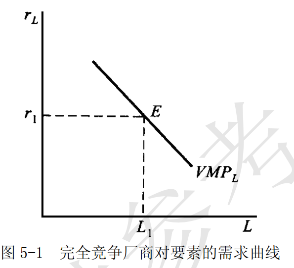
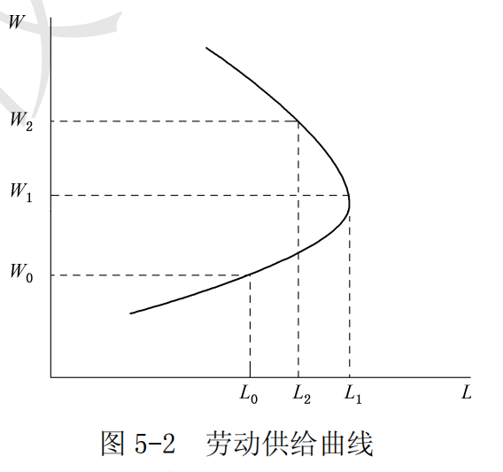
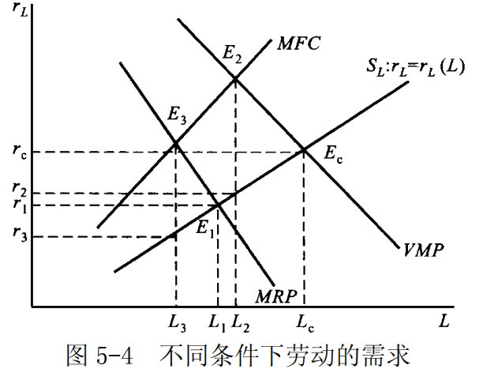

# Chapter 5: Markets for Factors of Production

> **Core question of this chapter**: How are the prices of factors of production (wages, interest, rent, profit) determined? How does a firm's demand for factors differ from consumers' demand for products?

## Chapter Overview

The preceding chapters answered "how much does the product sell for"; this chapter returns to the question classical economists cared about first: **how is what has been produced divided among labor, capital, and land?** Say summarized it as the "three-factor theory"—labor receives wages, capital receives interest, land receives rent—but this correspondence is a mere assertion, explaining nothing about why each factor "deserves" that much.

After the marginal revolution, Clark provided the mechanism in *The Distribution of Wealth* (1899): under perfect competition, each factor's return equals exactly its **marginal product**—not because it "ought" to receive that much, but because if the gain from hiring one more unit of a factor exceeded its price, the firm would keep hiring until the two were equal. Distribution thereby turned from an ethical proposition into a supply-and-demand proposition: factor prices are determined by supply and demand in factor markets, and the firm's demand for factors is **derived** from consumers' demand for products (derived demand).

Two extensions complete this chapter's framework. First, Wicksteed (1894) used Euler's theorem to show that under constant returns to scale, paying each factor its marginal product exactly exhausts the total product—the theory of distribution is arithmetically consistent. Second, the market structures of Chapter 4 are brought into factor markets: monopoly on the seller side of the product market depresses marginal revenue ($MRP<VMP$), and monopsony in the factor market raises marginal factor cost ($MFC>$ factor price)—workers may face markets that are imperfect on both sides. On the labor supply side there is also a famous exception: as early as 1871 Jevons derived, from the utility trade-off between income and leisure, the **backward-bending labor supply curve**.

## Core Concepts

### Derived Demand

Derived demand, also called "derivative demand," refers to firms' demand for factors of production arising from consumers' demand for products. Derived demand comes from firms—it is the firm's demand for factors of production, distinct from consumers' demand for goods.

In product markets, demand comes from consumers, who buy products for their own consumption and the satisfaction derived from it; the purchase process ends there. Differently, in factor markets, demand comes from firms, which buy factors of production in order to produce and thereby earn profit. A firm's purchase of factors is not the end of an economic act. Whether a firm earns a profit depends not on itself but on consumers' demand for the products it makes, on whether consumers are willing to pay a sufficient price for them. If there is no consumer demand for a product, the firm cannot earn revenue from producing and selling it, and will therefore not buy the means of production to make it. In other words, consumers' direct demand for products induces and derives firms' demand for factors of production. The shape of the demand curve for any factor of production is derived from the demand curve for the final goods that use that factor—were there no demand for bread, there would be no demand by bakeries for ovens.

### Value of the Marginal Product

The value of the marginal product is the value of the additional output obtained by adding one unit of a factor of production; it equals the marginal product multiplied by the price of the product, i.e.: $VMP=P\cdot{MP_L}$. In a perfectly competitive market, the value of the factor's marginal product reflects the factor's marginal revenue, and it is the firm's demand curve for the factor.

Because the marginal product obeys the law of diminishing returns, the perfectly competitive firm's demand curve for a factor slopes downward to the right.

### Marginal Revenue Product

The marginal revenue product is the revenue brought by adding one unit of a factor of production while the inputs of all other factors are held fixed. It equals the product of the marginal product ( $MP$ ) and marginal revenue ( $MR$ ), i.e.:

$$MRP=MR \cdot MP$$

In a monopolistic product market, the price a firm can charge for a given output is related to the firm's output, typically moving in the opposite direction; hence the addition to a firm's revenue from a factor's marginal product equals not the existing price times the marginal product, but the marginal product times marginal revenue. The division of labor between $VMP$ and $MRP$ is thus clear: under perfect competition in the product market the two are equal; under monopoly in the product market $MR<P$, and the factor's capacity to generate revenue is pushed below its capacity to create value—the gap between them is the monopoly markup.

### Average Factor Cost

Average factor cost is the cost a firm pays on average for each unit of a factor of production it buys.

In a perfectly competitive market the price of the factor is given, so the firm's average factor cost equals the market price of that factor. Under monopsony in the factor market, the average factor cost curve is the factor supply curve facing the firm. The firm's marginal cost of using the factor exceeds the factor price, because the firm then faces an upward-sloping factor supply curve; hence the quantity of the factor the firm uses affects the factor's price. Here the average factor cost curve rises as factor employment rises—a monopsonist who wants to hire more must raise wages for everyone, including those already on the job.

### Marginal Factor Cost

Marginal factor cost is the addition to cost from a one-unit increase in the firm's input of a factor of production. Denoted $MFC$.

The firm's profit-maximizing rule for factor employment is:

$$MRP=MFC$$

In a perfectly competitive market the factor price is unchanged, so the cost of adding one unit of the factor equals that factor's price. In a monopsonistic factor market, the firm's marginal factor cost of using the factor exceeds the factor's price.

### The Backward-Bending Labor Supply Curve

From workers' optimizing behavior, at each given wage rate the worker determines the optimal labor supply at the utility-maximizing point, thereby yielding the labor supply curve. At low wage levels, the substitution effect of a wage increase on labor exceeds the income effect, so people are willing to supply more labor and reduce leisure; once the wage rises beyond a certain point, the substitution effect falls below the income effect, so people increase leisure and reduce work time. Hence the labor supply curve bends backward (to the left).

## Problems and Analysis

### How is a perfectly competitive firm's demand curve for a factor derived? Why does it slope downward to the right?

**[Notation]**
| Symbol | English full name | Meaning |
|------|----------|----------|
| $VMP$ | Value of Marginal Product | Value of the marginal product |
| $P$ | Price | Product price |
| $MP$ / $MP_L$ | Marginal Product | Marginal product / marginal product of labor |
| $r$ | Rental Rate | Price of the factor |

- (1) As in the product market, a perfectly competitive factor market contains many firms and many factor suppliers, all choosing optimal quantities of factor use and supply at the given factor price. In the product market the firm is also a perfect competitor, i.e., the market price of the product is the basis of the firm's decisions. For the firm, the principle governing its choice of factor employment is profit maximization, i.e., the factor's "marginal revenue" and "marginal cost" must be equal.

- (2) In a perfectly competitive market, the firm's "marginal revenue" from using a factor is the value of that factor's marginal product, i.e., the marginal product times the price. This is because the additional output from one more unit of the factor equals the factor's marginal product, and that output sells at an unchanged product price; so the revenue the firm gains from one more unit of the factor equals the product price times the marginal product, i.e., $VMP= P\times MP$.

	Considering the factor's "marginal cost": since the factor price the firm faces is determined by market supply and demand and does not change with the quantity of the factor the firm uses, the added cost of one more unit of the factor equals that factor's price. Hence the firm's profit-maximizing rule for factor employment takes the form:

	$$VMP=P \times MP =r$$

	where $r$ is the price of the factor.

- (3) For the market-determined factor price $r$, the firm chooses the profit-maximizing quantity of factor employment; the value of the factor's marginal product therefore constitutes the firm's demand curve for that factor. Since the factor's marginal product $MP$ obeys the law of diminishing returns while the product price in a perfectly competitive market stays constant, the value of the factor's marginal product $VMP$ also declines as factor employment increases; hence the perfectly competitive firm's demand curve for a factor slopes downward to the right, as shown in Figure 5-1.



### Why does the labor supply curve bend backward? Explain using the income and substitution effects.

- (1) That the labor supply curve bends backward means that as the price of labor, i.e. the wage rate, rises, the quantity of labor supplied at first gradually increases, but after the price of labor rises beyond a certain point the quantity supplied instead decreases. Assuming each worker's supply depends only on the wage, the backward-bending labor supply curve can be drawn as in Figure 5-2.



- (2) The backward bending of the labor supply curve can be analyzed from the following three aspects:

- ① That the labor supply curve bends backward is the combined result of the substitution and income effects generated by the wage rate. The amount of labor a worker is willing to supply at different wage rates depends on the worker's evaluation of the utility yielded by wage income and by leisure. The consumer's total utility is provided by income and leisure. Income brings satisfaction through the purchase of consumer goods: the more income, the higher the level of consumption and the greater the utility. Likewise, leisure is a special kind of consumption—the longer the leisure time, the higher the utility level. Yet the time available to the worker is fixed, so the worker's labor supply behavior can be stated as: under a given time constraint, arrange work and leisure time sensibly so as to achieve maximum utility.

- ② Generally speaking, the higher the wage rate, the greater the compensation for sacrificing leisure, and the more labor the worker is willing to supply in place of leisure. In other words, as the wage rate rises, the opportunity cost of leisure rises correspondingly and the worker's leisure time shortens. Hence the substitution effect of a rising wage rate increases the quantity of labor. At the same time, a higher wage rate raises the worker's income level, and the worker then wants more leisure. That is, once the wage rate has risen, workers can raise their standard of living without supplying more labor. This shows that the income effect of a higher wage reduces the quantity of labor.

- ③ The substitution and income effects are the two aspects of a wage increase. If the substitution effect exceeds the income effect, the demand for leisure falls as its price rises; conversely, if the income effect exceeds the substitution effect, the demand for leisure rises with its price. This is precisely what makes the labor supply curve bend backward. If the original wage, i.e. the price of leisure, is low, the quantity of labor supplied is then small and the income effect of a wage rise cannot offset the substitution effect; but if the wage rate is already high, the quantity of labor supplied is relatively large, so the wage rise produces a large addition to total labor income and the income effect outweighs the substitution effect. That is, once higher wages have made people rich enough, they value leisure more. Hence when the wage keeps rising beyond a certain height, the quantity of labor people supply not only fails to increase but decreases—the labor supply curve passes its turning point and begins to bend backward.

### What does Euler's theorem mean for the theory of factor income distribution?

**[Notation]**
| Symbol | English full name | Meaning |
|------|----------|----------|
| $Q$ | Output / Total Product | Total output |
| $L$ | Labor | Labor (factor) |
| $K$ | Capital | Capital (factor) |
| $MP_L$ / $\frac{\partial Q}{\partial L}$ | Marginal Product of Labor | Marginal product of labor |
| $MP_K$ / $\frac{\partial Q}{\partial K}$ | Marginal Product of Capital | Marginal product of capital |

**(1) Euler's theorem and its distributional meaning**

Euler's theorem, also called the **product-exhaustion theorem**, is a mathematical theorem concerning homogeneous functions.

**Core meaning**: under perfect competition and constant returns to scale, the total product is exactly enough to distribute among the factors—no more and no less.

Suppose there are two factors of production, labor $L$ and capital $K$, with production function $Q=Q(L,K)$; if production exhibits constant returns to scale, then:

$$Q=L\cdot\frac{\partial Q}{\partial L}+K\cdot\frac{\partial Q}{\partial K}$$

This is Euler's theorem. Here:
- $\frac{\partial Q}{\partial L} = MP_L$ (marginal product of labor)
- $\frac{\partial Q}{\partial K} = MP_K$ (marginal product of capital)

**Economic interpretation**: the total product $Q$ exactly equals the income received by labor plus the income received by capital.

**(2) The arithmetic of income distribution**

| Factor | Quantity employed | Marginal product | Income received |
|------|--------|----------|------------|
| Labor | $L$ | $MP_L$ | $L \times MP_L$ |
| Capital | $K$ | $MP_K$ | $K \times MP_K$ |
| **Total** | — | — | $= Q$ (total output) |

In a perfectly competitive market:
- Factor price = value of the marginal product ($w = P \times MP_L$, $r = P \times MP_K$)
- Each factor receives income according to its marginal contribution
- Total income is exactly exhausted, with nothing left over

Example: suppose a factory employs 100 workers and 10 machines and produces 1,000 units of output. The workers' marginal product is 5 units per worker, so labor income $=100\times5=500$ units; the machines' marginal product is 50 units per machine, so capital income $=10\times50=500$ units; in total $500+500=1000$ units, exactly exhausting the product.

**(3) Why it matters**

Wicksteed introduced this theorem into the theory of distribution in 1894: as long as returns to scale are constant, "paying by marginal product" exhausts output exactly in the aggregate—with neither a shortfall nor a surplus—and the marginal productivity theory of distribution is arithmetically consistent. But the boundary lies here too: if returns to scale are **increasing**, distribution by marginal product falls short (the gap must be filled by profit or a residual); if **decreasing**, it over-distributes. The theorem therefore marks "constant returns to scale" as the domain of applicability of this theory of distribution—it does not say that such a distribution is "fair": a factor's marginal product itself depends on the distribution of factor endowments, and who owns what remains a question outside this theory.

### With monopoly in the product market and monopsony in the factor market, how is the price of labor determined?

- (1) The price of a factor of production is determined by its supply and demand. The labor market consists of the supply of labor and the demand for labor. The supply of labor comes from workers, and the demand for labor comes from producers. The price of the factor labor is a market equilibrium price determined by supply and demand in the labor market, but it is constrained by market conditions.

- (2) In the factor market, the general principle by which the firm decides the quantity of labor and other factors to employ is that marginal revenue product equals marginal factor cost.

	For profit maximization, the cost to the firm of employing each unit of labor must equal the revenue that unit of labor brings: if the former exceeds the latter, the firm reduces its use of that factor; if the former is less than the latter, the firm increases it. By definition, the cost to the firm of using the last unit of labor is that unit's marginal factor cost, and the revenue obtained from selling the product produced by that unit of labor is labor's marginal revenue product, i.e., marginal product times marginal revenue.

	Under monopsony in the factor market, the firm's rule for hiring labor is still that labor's marginal revenue product equals marginal factor cost. Monopsony in the labor market means only one firm in the market buys labor as a factor of production. The labor supply curve facing that firm is therefore the market supply curve, sloping upward to the right; the firm's marginal factor cost of using labor is no longer constant—it rises faster than the average factor cost of labor increases, i.e., labor's marginal factor cost lies above the labor supply curve.

- (3) Under monopoly in the product market, the market demand curve the firm faces when selling the product made with labor slopes downward. This makes the marginal revenue of the product smaller than the market price, and hence labor's marginal revenue product lower than the value of its marginal product.

- (4) The firm determines the employment of labor by **setting marginal revenue product equal to marginal factor cost** ($MRP=MFC$), and then sets the price of labor on the labor supply curve corresponding to that quantity of employment—the monopsonist pays the "lowest price it can get away with" on the supply curve rather than the marginal value the factor creates. As shown in Figure 5-4, under perfect competition the equilibrium price of labor is $r_e$; with monopoly in the product market and monopsony in the factor market, the price of labor is $r_3$.



From the above analysis it can be seen that, compared with a perfectly competitive firm, because the monopsonist's marginal factor cost of using the factor lies above the factor supply curve while the value of the factor's marginal product is the same, it employs less of the factor and pays a lower price.

**[Product monopoly + factor monopsony: summary]**

**Basic concepts:**

| Concept | Meaning | Mathematical expression |
|------|------|----------|
| Marginal revenue product (MRP) | Revenue added by one more unit of the factor | $MRP = MP_L \times MR$ |
| Marginal factor cost (MFC) | Cost added by one more unit of the factor | $MFC = \frac{\Delta TC}{\Delta L}$ |
| Value of marginal product (VMP) | Market value of the marginal product | $VMP = MP_L \times P$ |

**Effects of double monopoly:**

| Market | Firm's position | Curve faced | Relation |
|------|----------|------------|------|
| Product market | Monopoly (seller) | Downward-sloping demand curve | $MR < P$ → $MRP < VMP$ |
| Factor market | Monopsony (buyer) | Upward-sloping supply curve | $MFC > \text{factor price}$ |

**Decision rule:**

$$MRP = MFC$$

i.e., marginal revenue product = marginal factor cost.

**Comparison of market structures:**

| Market type | Product market | Factor market | Equilibrium condition | Factor price | Factor employment |
|----------|----------|----------|----------|----------|------------|
| Perfect competition | Perfect competition | Perfect competition | $VMP = \text{factor price}$ | Highest | Largest |
| Product monopoly | Monopoly | Perfect competition | $MRP = \text{factor price}$ | Middle | Middle |
| Factor monopsony | Perfect competition | Monopsony | $VMP = MFC$ | Middle | Middle |
| Double monopoly | Monopoly | Monopsony | $MRP = MFC$ | Lowest | Smallest |

**Diagram of double monopoly:**

```
工资(W)
  ↑
  |           S (供给曲线)
  |          /
  |         / MFC (边际要素成本) > S
  |        /
  |       /   ← MFC在S上方
  |      /
  |     ·  ← 均衡点：MRP = MFC
  |    /|
  |   / |
  |  /  |
  | /   |
  |/    | ← 实际工资在供给曲线上
  +----------------→ 劳动量(L)
      L*  (比完全竞争少)
```

**Conclusion**: double monopoly yields the lowest factor price and the smallest employment—the market structure least favorable to workers.

## Derivations and Examples

### In the factor market, what is the firm's profit-maximizing rule? Prove your conclusion.

**[Notation]**
| Symbol | English full name | Meaning |
|------|----------|----------|
| $\pi$ | Profit | Profit |
| $TR$ | Total Revenue | Total revenue |
| $TC$ | Total Cost | Total cost |
| $MRP$ | Marginal Revenue Product | Marginal revenue product |
| $VMP$ | Value of Marginal Product | Value of marginal product |
| $MFC$ | Marginal Factor Cost | Marginal factor cost |
| $MR$ | Marginal Revenue | Marginal revenue |
| $P$ | Price | Product price |
| $MPP$ / $MP$ | Marginal Physical Product | Marginal physical product / marginal product |
| $L$ | Labor | Labor input |
| $w$ | Wage | Wage rate (factor price) |

**[Distinguishing the core concepts]**

Before beginning the proof, two easily confused concepts must be distinguished:

| Concept | English | Definition | Formula | Applicable condition |
|------|------|------|------|----------|
| Value of marginal product | VMP | Market value of the marginal product | $VMP = P \times MP_L$ | Perfectly competitive product market |
| Marginal revenue product | MRP | Revenue added by more of the factor | $MRP = MR \times MP_L$ | Any product market |

**Key relations**:

- Perfectly competitive product market: $P = MR$, hence $VMP = MRP$
- Monopolistic product market: $MR < P$, hence $MRP < VMP$

**[Conclusion]**

The general profit-maximizing rule in the factor market is:

$$MRP = MFC$$

i.e., marginal revenue product = marginal factor cost.

**[Proof]**

Step 1: set up the profit function. Assume all factors other than labor $L$ are fixed. The firm's profit is:

$$\pi = TR - TC$$

Step 2: profit maximization requires the first derivative with respect to $L$ to be zero:

$$\frac{d\pi}{dL} = \frac{dTR}{dL} - \frac{dTC}{dL} = 0$$

i.e.,

$$\frac{dTR}{dL} = \frac{dTC}{dL}$$

Step 3: analyze the left side. The addition to total revenue from one more unit of labor can be decomposed into "extra output produced × marginal revenue per unit of output":

$$\frac{dTR}{dL} = \frac{dTR}{dQ} \times \frac{dQ}{dL} = MR \times MP_L = MRP$$

This is the **marginal revenue product (MRP)**.

Step 4: analyze the right side. The addition to total cost from one more unit of labor:

$$\frac{dTC}{dL} = MFC$$

This is the **marginal factor cost (MFC)**.

Step 5: conclusion:

$$MRP = MFC$$

**[Economic interpretation]**

| Case | Condition | Firm's decision |
|------|------|----------|
| $MRP > MFC$ | Revenue from more of the factor > cost | Increase factor input |
| $MRP < MFC$ | Revenue from more of the factor < cost | Reduce factor input |
| $MRP = MFC$ | Revenue from more of the factor = cost | Optimum reached; no further adjustment |

**[Specific forms under different market structures]**

| Product market | Factor market | Equilibrium condition | Notes |
|----------|----------|----------|------|
| Perfect competition | Perfect competition | $VMP = w$ | $MRP = VMP$, $MFC = w$ |
| Monopoly | Perfect competition | $MRP = w$ | $MRP < VMP$, $MFC = w$ |
| Perfect competition | Monopsony | $VMP = MFC$ | $MRP = VMP$, $MFC > w$ |
| Monopoly | Monopsony | $MRP = MFC$ | $MRP < VMP$, $MFC > w$ |

where $w$ is the wage rate (price of labor).

The factor market's $MRP = MFC$ is exactly symmetric to the product market's $MR = MC$: the former asks "is one more unit of the factor worth hiring," the latter asks "is one more unit of the product worth producing"—the same marginal analysis, with only the decision variable changed.

## Limitations and Beyond

- **Is marginal productivity a "law of nature"?** Clark treated it as a proof of distributive justice: each factor receives the share it itself creates. Criticism followed at once—a factor's marginal product itself depends on the distribution of factor endowments (who owns capital, who can obtain education); the theory explains "how it is divided" but never answers "by what right it is divided this way." The capital aggregation problem at the end of the previous chapter (the Cambridge capital controversy) applies here as well: the marginal product of capital can only be computed after capital has been aggregated into a single number.
- **A testable corollary of monopsony: a minimum wage need not reduce employment.** The competitive model predicts that a minimum wage depresses employment; the monopsony model instead predicts that a wage set between the monopsony wage and the competitive wage raises employment. Card and Krueger (1994), using a comparison of fast-food restaurants in New Jersey and Pennsylvania, found that employment did not fall after the minimum wage was raised, a result that shook the profession—it cannot prove that monopsony is ubiquitous, but it shows that the default assumption "the labor market is perfectly competitive" is not empirically safe. Monopsony has since become, alongside monopolistic competition, one of the mainstream frameworks for explaining "wages below productivity" (search frictions and efficiency wages are the other two).
- **Has the backward-bending supply curve found evidence?** In short-run and individual labor supply data the substitution effect usually dominates, and the supply curve is basically upward sloping with small elasticity; but stretched to a century-long scale the picture reverses: real wages in industrialized countries rose several-fold, while weekly working hours fell from over 60 hours in the nineteenth century to around 40—the income effect does take over the direction in the long run, once income is high enough. The backward-bending curve of the textbook is an image of the "long-run historical trend" and the "short-run individual response" superimposed.

## References

- Gao Hongye, *Western Economics* (8th ed., microeconomics/macroeconomics volumes, China Renmin University Press)—the main source of this chapter's framework and theoretical exposition.
- See the full bibliography at [Bibliography](/reference/参考书目).
- [Wikipedia · Economic rent](https://en.wikipedia.org/wiki/Economic_rent)
- [Wikipedia · Monopsony](https://en.wikipedia.org/wiki/Monopsony)

<!-- BACKLINKS-AUTO -->
## Related Pages

- [History](/western/History)
- [Readme](/western/Readme)
