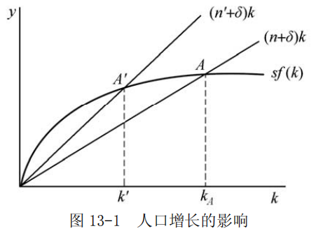

# Chapter 13 · Economic growth

> **The central question of this chapter**: Why does some countries' growth run fast and others' slow? How do capital, labour and technology drive growth? Can growth go on?

## The arc of this chapter

The earlier chapters explained short-run fluctuations in income. This chapter switches questions: why does per-capita income multiply several times over in a few decades in some countries, while in others it stays put? Growth theory was born in the first generation after Keynes: Harrod (1939) and Domar (1946) tried to stretch the General Theory's short-run analysis into a dynamic story — investment creates not only demand but also productive capacity, and the economy must keep the two in balance as it grows. Their conclusion was pessimistic: stable growth requires that three growth rates, each set by a different force, happen to be exactly equal, so the economy walks a "knife-edge" and diverges at the slightest deviation.

In 1956 Solow and Swan dismantled that pessimism with neoclassical tools: as long as capital and labour can substitute for one another, the price mechanism pulls the economy back to a steady state — the knife-edge becomes the bottom of a bowl. But the new price was this: in a steady state without technological progress, per-capita income no longer grows, and the only engine of long-run growth per head was pushed outside the model. Solow (1957) then measured that "residual" with growth accounting and found that most of the growth in US output per head could not be explained by capital and labour — technological progress had turned from an assumption into a puzzle. Romer and Lucas took up that puzzle in the mid-1980s and internalised technological progress, giving rise to the new growth theory of this chapter's last section.

## Core concepts

### The Harrod-Domar model

**[Notation]**
| Symbol | English full name | Meaning |
|------|----------|----------|
| $G$ | Economic Growth Rate | the economic growth rate |
| $s$ / $S$ | Savings Rate | the savings rate |
| $v$ | Capital-Output Ratio | the capital-output ratio |

---

The Harrod-Domar model is a model for analysing the problem of economic growth, proposed in turn by Harrod and Domar in the 1940s. Because the basic lines of analysis are the same, the two are combined and called the Harrod-Domar model. Its basic form is:

$$G=\frac{s}{v}$$

**Core conclusions**:
- the economic growth rate is directly proportional to the savings rate
- the economic growth rate is inversely proportional to the capital-output ratio

Why does it exist? Because it is the first attempt to make Keynes long-run: the General Theory only answers "what determines this year's employment," while Harrod and Domar asked "investment creates demand and productive capacity alike — what then determines next year's employment?" $G=\frac{s}{v}$ is the algebra of investment's dual identity. After the war it was for a time the standard instrument of development planning — the more growth you wanted, the proportionately greater the savings needed to back it.

---

**[Why does the population growth rate appear?]**

**Note**: the basic formula $G=\frac{s}{v}$ contains **no population growth rate** variable.

The population growth rate appears in the **stable growth condition**:

$$G_A = G_W = G_N$$

| Symbol | English full name | Meaning |
|------|----------|----------|
| $G_A$ | Actual Growth Rate | the actual growth rate |
| $G_W$ | Warranted Growth Rate | the warranted growth rate |
| $G_N$ | Natural Growth Rate | the population growth rate (the natural growth rate) |

**Why must it equal the population growth rate?**

| Condition | Meaning | Consequence of failing it |
|------|------|-------------|
| $G_A = G_N$ | economic growth rate = population growth rate | $G_A > G_N$ → labour shortage $G_A < G_N$ → more unemployment |

**Intuition**:
- if the economy grows faster than the population → not enough labour
- if the economy grows slower than the population → people cannot find work

So the population growth rate appears as a **constraint on stable growth**, not as part of the basic formula.

---

The economy is in a state of stable growth only when the actual economic growth rate equals the growth rate capitalists intend, and also equals the population growth rate. Harrod held at the same time that this path of growth is hard to reach, and so is an existence of the "knife-edge" kind.

### The warranted growth rate

**[Notation]**
| Symbol | English full name | Meaning |
|------|----------|----------|
| $G_A$ | Actual Growth Rate | the actual growth rate |
| $G_W$ / $G_w$ | Warranted Growth Rate | the warranted growth rate |
| $G_N$ | Natural Growth Rate | the natural growth rate (the population growth rate) |
| $s$ | Actual Savings Rate | the actual savings rate |
| $s_d$ / $S_d$ | Desired Savings Rate | the desired savings rate |
| $v$ | Actual Capital-Output Ratio | the actual capital-output ratio |
| $v_r$ | Desired Capital-Output Ratio | the desired capital-output ratio |

---

**[The three growth rates of the Harrod-Domar model]**

| Growth rate | Formula | Meaning | Determined by |
|--------|------|------|----------|
| **Actual growth rate $G_A$** | $G_A = \frac{s}{v}$ | the growth rate that actually occurs | the actual savings rate, the actual capital-output ratio |
| **Warranted growth rate $G_W$** | $G_W = \frac{s_d}{v_r}$ | the growth rate that satisfies entrepreneurs | the **desired** savings rate, the **desired** capital-output ratio |
| **Natural growth rate $G_N$** | $G_N = n$ | the population growth rate (+ technological progress) | population growth, technological progress |

---

**[How the three relate]**

$$\text{stable growth condition: } G_A = G_W = G_N$$

| Case | Condition | Result |
|------|------|------|
| **Ideal state** | $G_A = G_W = G_N$ | full-employment stable growth (the "knife-edge") |
| **Expansion** | $G_A > G_W$ | firms increase investment → output rises further → cumulative expansion |
| **Contraction** | $G_A < G_W$ | firms cut investment → output falls further → cumulative contraction |
| **Labour shortage** | $G_A > G_N$ | economic growth outruns population growth → labour is insufficient |
| **More unemployment** | $G_A < G_N$ | economic growth lags population growth → unemployment |

---

**[What the warranted growth rate means]**

$$G_W = \frac{s_d}{v_r}$$

**Core meaning**: the growth rate at which the investment demand entrepreneurs **expect** exactly equals the supply of savings this period.

| Point | Explanation |
|------|------|
| **What is it adapted to?** | the capital-output ratio $v_r$ that entrepreneurs' intentions require |
| **What condition does it meet?** | it is the stable growth rate at which investment can equal savings |
| **Entrepreneurs' behaviour** | at this growth rate entrepreneurs neither increase nor cut investment |
| **Stability condition** | when the growth rate set by the desired savings rate and the desired capital-output ratio is realised, the economy can grow steadily |

### The neoclassical growth model

**[Notation]**
| Symbol | English full name | Meaning |
|------|----------|----------|
| $s$ | Savings Rate | the savings rate |
| $k$ / $\frac{K}{L}$ | Capital per Worker | capital per worker |
| $\Delta k$ | Change in Capital per Worker | the increase in capital per worker |
| $n$ | Population Growth Rate | the population growth rate |
| $f(k)$ | Output per Worker | output per worker |
| $sf(k)$ | Savings per Worker | savings per worker |

---

**Basic assumptions**:
| No. | Assumption |
|------|----------|
| ① | The whole society uses two factors of production, labour and capital, to make only one product |
| ② | Labour and capital can substitute for one another (but not perfectly) |
| ③ | Production has constant returns to scale |
| ④ | The savings rate stays constant |
| ⑤ | There is no technological progress and no depreciation of capital |
| ⑥ | The population grows at a fixed rate |

---

**Basic formula**:

$$sf(k)=\Delta k+nk$$

**What each term means**:
| Item | Formula | Meaning |
|------|------|------|
| **Savings per worker** | $sf(k)$ | society's saving per head |
| **Capital deepening** | $\Delta k$ | equipping each person with more capital equipment |
| **Capital widening** | $nk$ | equipping the additional population with equipment at the original capital per head |

---

**Equilibrium condition** (capital per worker unchanged, $\Delta k = 0$):

$$sf(k)=nk$$

At this point:
- the growth rate of output (or of income) equals the rate of increase of the labour force
- the economy grows in equilibrium
- total output grows at the population growth rate, while output per head and capital per head stay unchanged

Solow's (1956) answer is called "neoclassical" because it used the neoclassical price mechanism to break Harrod's knife-edge: capital and labour can substitute — when capital is scarce its rate of return is high and it attracts investment, and when it is plentiful the rate of return is low and investment slows — so the economy is like a ball falling into the bottom of a bowl, rolling back to the steady state on its own. The price was this: in a steady state without technological progress, per-capita income no longer grows.

---

**The golden rule** (the golden rule of capital accumulation):

$$f'(k)=n$$

If an economy's goal is to maximise consumption per head, then with technology and the growth rate of labour fixed and unchanging, the capital-labour ratio in the economy should be such that the marginal product of capital equals the growth rate of labour. This is the golden rule.

The rule was named the "golden rule" by Phelps in 1961. More capital is not better: beyond the golden-rule level, the savings needed to maintain a very large capital stock eat up too much output and consumption per head actually falls — society has accumulated "too much" capital for itself.

---

**[Harrod-Domar model vs neoclassical growth model]**

| Dimension of comparison | **Harrod-Domar model** | **Neoclassical growth model (Solow)** |
|----------|---------------------|---------------------------|
| **When proposed** | the 1940s | the 1950s |
| **Core formula** | $G = \frac{s}{v}$ | $sf(k) = \Delta k + nk$ |
| **Capital-output ratio $v$** | **fixed and unchanging** | **variable** (capital and labour are substitutes) |
| **Production function** | fixed-coefficient production function | capital and labour **can substitute for one another** |
| **Adjustment mechanism** | **no automatic adjustment** | **automatic price adjustment** |
| **Nature of the steady state** | **a "knife-edge"** (hard to reach) | **automatic convergence to the steady state** |
| **Long-run growth** | depends on the **population growth rate $n$** | depends on **technological progress** |
| **Policy implication** | government intervention is needed | the market adjusts itself |

---

**[Core difference 1: is the capital-output ratio variable?]**

| Model | Capital-output ratio | Consequence |
|------|-------------|------|
| Harrod-Domar | **fixed** | the growth rate easily deviates and cannot recover on its own |
| Neoclassical | **variable** | capital and labour can substitute, so automatic adjustment restores the steady state |

---

**[Core difference 2: can the steady state be reached on its own?]**

$$\text{Harrod-Domar: } G_A = G_W = G_N \quad (\text{almost impossible} \to \text{a knife-edge})$$

$$\text{Neoclassical: the economy converges to the steady state automatically} \quad (\text{inevitable})$$

| Model | Nature of the steady state | Vivid metaphor |
|------|----------|----------|
| Harrod-Domar | **a "knife-edge"** | like walking a tightrope — one slip and you fall |
| Neoclassical | **automatic stability** | like a spring — displaced, then bouncing back on its own |

**Reason**: the neoclassical model assumes that **capital and labour can substitute for one another**; when capital is scarce, the rate of return on capital is high and it attracts investment, and when capital is plentiful, the rate of return on capital is low and investment falls. This adjustment mechanism carries the economy to the steady state on its own.

---

**[Core difference 3: the source of long-run growth]**

| Model | What does the long-run growth rate depend on? |
|------|------------------------|
| Harrod-Domar | the **population growth rate $n$** |
| Neoclassical | **technological progress** (without it, per-capita income stagnates) |

**An important conclusion of the neoclassical model**: only technological progress can bring long-run growth in per-capita income; raising the savings rate only raises the growth rate temporarily, and in the end it returns to the steady state.

---

## Problems and analysis

### What are the basic formula and assumptions of the Harrod-Domar model? Why is stable growth so hard to achieve?

**[Notation]**
| Symbol | English full name | Meaning |
|------|----------|----------|
| $G$ | Economic Growth Rate | the economic growth rate |
| $s$ / $S$ | Savings Rate | the savings rate |
| $v$ | Capital-Output Ratio | the capital-output ratio |
| $G_A$ | Actual Growth Rate | the actual growth rate |
| $G_W$ | Warranted Growth Rate | the warranted growth rate |
| $G_N$ | Natural Growth Rate | the population growth rate |

(1) The Harrod-Domar growth model is the collective name for the analytical models of economic growth put forward separately by the British economist Harrod and the American economist Domar in the 1940s (Harrod published the founding paper in 1939 and set out the theory systematically in *The Dynamics of Economic Progress* in 1948; Domar published papers in 1946–1947 proposing it independently).
Because the basic lines of analysis are the same, the two are combined and named together. The model studies mainly the relation between the growth of savings and investment and the growth of income, under the condition of full employment being maintained. Its unified basic formula is:

$$G=\frac{s}{v}$$

where $v$ is the capital-output ratio and $s$ is the savings rate. The model states that the economic growth rate is directly proportional to the savings rate and inversely proportional to the capital-output ratio.

- (2) The assumptions of the Harrod-Domar growth model include:
- ① the whole society uses two factors of production, labour and capital, to make only one product;
- ② the savings rate, that is the share of savings in income, stays constant;
- ③ the capital-output ratio stays constant;
- ④ there is no technological progress and no depreciation of capital;
- ⑤ the population grows at a fixed, unchanging rate.

- (3) The model's full-employment stable growth condition is: the actual economic growth rate equals the intended or warranted economic growth rate, and equals the population growth rate. The first condition says that only when the actual and the intended growth rates are equal is the economy in equilibrium. The actual economic growth rate equaling the population growth rate means that growth is not constrained by labour and produces no unemployment. Therefore the Harrod-Domar model's stable growth condition under full employment is expressed as:

$$G_A=G_W=G_N$$

where $G_A$, $G_W$ and $G_N$ denote respectively the actual growth rate, the warranted growth rate and the population growth rate in the economy.

The economy does not achieve stable growth on its own. This is because if the actual growth rate exceeds the warranted growth rate ($G_A > G_W$), then given the savings rate the actual capital-output ratio must fall below the ratio capitalists intend, so firms increase investment in order to raise it. More investment increases output, and the actual growth rate rises further. The result is that $G_A>G_W$ drives the actual growth rate ever upward until the expansion is limited by labour. If the actual growth rate is below the warranted rate, that is $G_A < G_W$, the result is exactly the reverse: the actual growth rate keeps falling until there is large-scale unemployment.

It follows that stable equilibrium growth in the Harrod-Domar model is very hard to attain, which is why Harrod called it, vividly, a "knife-edge."

### Why does the new growth theory move technological progress inside the model? What policies does it argue for?

The new growth theory is a new theory that appeared in the West from the mid-1980s onwards. From the mid-1980s, a group of western scholars represented by the American economists Romer and Lucas took another path and made major breakthroughs in growth theory, forming the "new growth theory."

The theory's basic view is to explain the sources of long-run growth through endogenous technological progress, human-capital investment and the accumulation of knowledge, which is why it is also called the "endogenous growth theory."

- (1) The basic ideas of the new growth theory

The new growth theory cannot as yet be summed up in one simple model; strictly speaking, it is a set of growth models that hold similar views or use the same methods. Its basic views include the following points:
- ① growth is the result of internal factors in the economic system acting on one another, not the result of being pushed by outside forces, and these endogenous factors can also sustain continuous equilibrium growth;
- ② among the many factors, technological progress is the decisive factor in growth. Like the other endogenous factors that drive growth, technological progress is the result of the optimum autonomous choices of self-interested economic agents, and so technological progress is endogenously determined;
- ③ technology, the accumulation of knowledge and human-capital investment all have external effects, which make production tend towards increasing returns to scale, and it is precisely this externality that forms an indispensable condition for the economy's continued growth;
- ④ because of these external effects, when the economy is in equilibrium growth it normally cannot reach the social optimum, that is, the equilibrium growth rate is normally below the socially optimal growth rate;
- ⑤ policies that affect the optimum choices of economic agents, such as tax policy and industrial policy, can affect the economy's long-run growth rate.

Building on the neoclassical growth theory, the new growth theory has two main ways of endogenising the steady-state growth rate:
- ① examine the technological factor among the determinants of growth under conditions of increasing returns and externalities; technology is affected by the amount the economy devotes to research and development, and that input in turn is determined endogenously in the model;
- ② where accumulable factors of production have fixed returns, the steady-state growth rate is determined by the accumulation rate of those factors.

By the 1990s the new growth theory further dropped the assumption of perfect competition and began to analyse the effect of variety and quality improvement on growth within a monopolistic competition framework; since the framework is one of monopolistic competition, behaviours such as imitation and innovation were also brought into the growth models.

- (2) The policy implications of the new growth theory

Since the growth rate depends not only on the population growth rate but also on the savings rate and on technological progress, government policy promoting accumulation and raising the level of technology will also be important for growth. The new growth theory therefore recommends that governments increase investment in physical capital, equipment and infrastructure, while encouraging the accumulation of human capital and greater investment in science and technology. For example, increase investment by reducing the crowding out of private investment caused by budget deficits and by offering tax incentives; encourage investment in human capital, that is, spend more resources on education and training; increase investment in infrastructure; offer tax incentives for research and development spending, and so on.

## Synthetic essay

### What does the neoclassical growth model say? What lessons does it hold for developing countries?

**[Notation]**
| Symbol | English full name | Meaning |
|------|----------|----------|
| $n$ / $n^{'}$ | Population Growth Rate | the population growth rate |
| $\delta$ | Depreciation Rate | the depreciation rate of capital |
| $k$ | Capital per Worker | capital per worker |
| $s$ / $S$ | Savings Rate | the savings rate |
| $y$ | Output per Worker | output per worker |
| $Y$ | Total Output | total output |
| $K$ | Capital | capital |
| $L$ | Labor | labour |

- (1) The neoclassical growth model was proposed in the 1950s by Solow and others.
Because its basic assumptions and method of analysis follow the neoclassical approach, it is called the neoclassical growth model.

- (2) The neoclassical growth model has clear policy implications. It shows that there are three ways to raise output per head:
- ① with capital per head given, raise the level of technology and so increase output. Raising the level of technology changes the capital-labour ratio and so brings about equilibrium growth of the economy;
- ② raise the savings rate so that capital per head increases. The country's vast rural areas have low incomes and a low share devoted to savings, so it is necessary to raise accumulation by raising farmers' incomes;
- ③ slow the rate of population growth so that capital per head increases. Controlling population in order to raise the stock of capital per head is a lesson of real value to many developing countries whose populations grow fast.

The neoclassical growth theory assumes that labour grows at a constant rate $n$, but when $n$ is treated as a parameter it can explain the effect of population growth on output growth, as Figure 13-1 shows.

In the figure the economy starts at the steady-state equilibrium $A$. Now suppose the population growth rate rises from $n$ to $n^{'}$; then the $(n+\delta)k$ line in Figure 13-1 moves to the $(n^{'} +\delta)k$ line, and the new steady-state equilibrium is point $A^{'}$. Comparing $A^{'}$ with $A$ shows that the higher population growth rate has lowered the steady-state level of capital per head (from the original $k_A$ down to $k^{'}$), and has therefore also lowered the steady-state level of output per head. This is another important conclusion drawn from the neoclassical growth theory.

The fall in output per head caused by a rise in the population growth rate is exactly the problem many developing countries face. Two countries with the same savings rate can have very different levels of per-capita income simply because one's population growth rate is higher than the other's. Developing countries can therefore raise capital per head by controlling population growth.

## Limits and what follows

- **The Solow residual: a measure of ignorance.** Solow (1957) used growth accounting on US data for 1909–1949 and found that seven eighths of the growth in output per head could not be explained by capital and labour — he booked that "residual" to technological progress. Abramovitz's comment has survived: the residual is "a measure of our ignorance." Later work has kept unpacking new things out of it — human capital, economies of scale, better resource allocation, measurement error — and "technological progress" turns out to be more like a pocket full of unexplained things.
- **The convergence debate.** The Solow model predicts that poor countries grow faster than rich ones (convergence), but absolute convergence does not hold in cross-country data, and the gap between poor and rich countries actually widened during the twentieth century. Baumol (1986) found convergence among industrial countries after all, de Long (1988) pointed out that this was a sample-selection bias, and Mankiw, Romer and Weil (1992) added human capital to the model, after which conditional convergence roughly holds. Growth empirics has since become a long-running war over "which variables to control for."
- **The failure of endogenous scale effects and the East Asian lesson.** Early endogenous growth models predicted that "the bigger the economy, the faster it grows" (a scale effect); Jones (1995) refuted this with time series: research input rises continuously while the growth rate shows no corresponding rise. On the other side, Yang's (1995) accounting shows that most of the East Asian "miracle" came from factor accumulation rather than technological progress — high savings, heavy investment in education, the transfer of labour, not bursts of inspiration. The policy list growth theory writes out (education, R&D, infrastructure) therefore looks more like a set of necessary conditions than a recipe of sufficient ones.

## References

- Gao Hongye, *Western Economics* (8th edition, separate micro / macro volumes, China Renmin University Press) — the main source for this chapter's framework and exposition.
- The full list is on the [bibliography](/reference/参考书目).
- [Wikipedia · Economic growth](https://en.wikipedia.org/wiki/Economic_growth)
- [Wikipedia · Economic development](https://en.wikipedia.org/wiki/Economic_development)

<!-- BACKLINKS-AUTO -->
## Related pages

- [Readme](/math/Readme)
- [History](/western/History)
- [Readme](/western/Readme)
