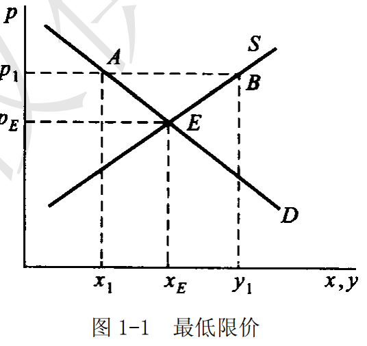
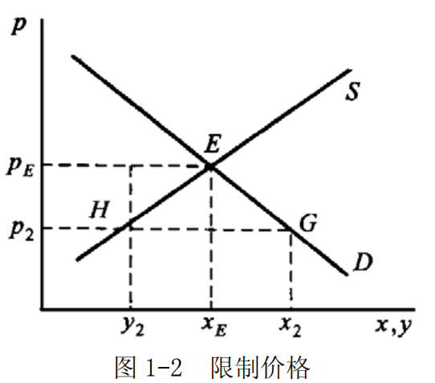
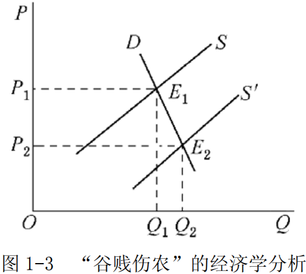
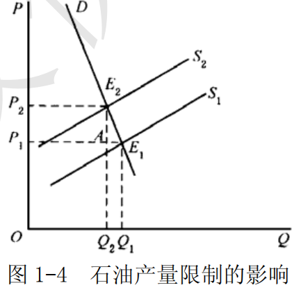

# Chapter 1 · Demand and supply

> **The core question of this chapter**: how is the market price determined jointly by the two sides of supply and demand? Why does the demand curve slope down to the right while the supply curve slopes up to the right? And how does elasticity shape the effect of a price change on buyers and sellers?

## The arc of this chapter

Why does economics start from supply and demand? Because for the hundred years after Smith, economists kept running into the same fact: with nobody directing anything, price somehow always gets goods into the hands of those who need them. Explaining that takes only two behavioural laws — the higher the price, the less is bought (demand); the higher the price, the more is offered (supply) — plus a market mechanism that pulls the two together. In 1890 Marshall drew the three on one diagram; the crossing point is the equilibrium price, and microeconomics gained its most durable foundation stone.

This chapter moves in that order: first the two laws of demand and supply in turn, then how the market adjusts the two into equilibrium, and finally elasticity — the measure of "when the price changes, how big is the response of buyers and sellers". Elasticity is what turns the supply-and-demand diagram from geometry into a policy tool: cheap grain hurting the farmer, the oil embargo, the incidence of taxation — all of them are answered by it.

## Core concepts

### Demand

A consumer's demand for a good is the quantity of that good which, within a specific period, the consumer is willing and able to buy at each of various possible prices.

Demand stresses both the consumer's desire to buy and the consumer's ability to buy. Through the law of demand, the quantity a consumer demands of a good moves in the opposite direction to its price.

### The law of demand

The law of demand, also called the theorem, rule or principle of demand, states that the quantity demanded moves in the opposite direction to the price of the good.

Concretely, other things being equal, in general, as the price of a good rises, the quantity consumers are willing and able to buy falls;
conversely, as the price of a good falls, the quantity consumers are willing and able to buy rises.
When the law of demand holds, the consumer's demand curve slopes down to the right, so that slope is the visual expression of the law of demand.

### Supply

Supply is the quantity of a good that, other things being equal and within a given period, producers are willing and able to offer at each of various possible prices.

A producer's supply of a good must have both willingness and ability. If a producer has only the desire to offer the good for sale but no ability to supply it, no effective supply is formed and it does not count as supply.
The quantity supplied of a good depends on many factors, the main ones being:
- the price of the good itself
- the cost of production
- the state of production technology
- the prices of related goods
- producers' expectations of the future

### The law of supply

The law of supply, also called the theorem, rule or principle of supply, states that the quantity supplied moves in the same direction as the price of the good.

Concretely, other things being equal, in general, as the price of a good rises, the quantity producers are willing and able to offer increases; conversely, as the price of a good falls, the quantity producers are willing and able to offer decreases.
If the law of supply holds, the producer's supply curve slopes up to the right.

### Equilibrium price

The equilibrium price is the price at which the market quantity demanded and the market quantity supplied of a good are equal.

In the market, through the interaction of the forces of supply and demand, the market price tends toward the equilibrium price. If the market price is above the equilibrium price, the quantity supplied exceeds the quantity demanded, some producers, unable to sell their goods, are forced to cut the price, and the market price falls;
conversely, if the market price is below the equilibrium price, the quantity demanded exceeds the quantity supplied, some consumers, unable to buy the good they demand, are willing to pay more, and the market price rises. The outcome of market competition is therefore that the market settles at the equilibrium price.

### Comparative static analysis

Comparative static analysis is the method of comparing different static equilibrium states.

When an exogenous variable of an economic model changes, it affects the equilibrium values of the endogenous variables. Comparative static analysis examines the magnitude and direction of that effect. Like static analysis, it abstracts away time.
Unlike dynamic analysis, comparative static analysis ignores the path along which the endogenous variables move, and looks only at the difference between the new equilibrium and the old one once the original conditions have changed.

### Price elasticity of demand

The price elasticity of demand reflects how sensitively the quantity demanded responds to a change in price. It is measured by an elasticity coefficient, defined as the percentage change in quantity demanded divided by the percentage change in price.

#### (I) The basic formula and its derivation

**1. The general definition**

Let the demand function be $Q = f(P)$, where $Q$ is quantity demanded and $P$ is price.

The price elasticity coefficient of demand $E_d$ is defined as the ratio of the rate of change of quantity demanded to the rate of change of price:

$$E_d = \frac{\text{percentage change in quantity demanded}}{\text{percentage change in price}} = \frac{\Delta Q/Q}{\Delta P/P} = \frac{\Delta Q}{\Delta P} \cdot \frac{P}{Q}$$

**2. The derivation**

**Step one: start from the definition**

The elasticity concept grows out of measuring the relative change between two variables. Let the price move from $P_1$ to $P_2$ and the quantity demanded from $Q_1$ to $Q_2$.

- the absolute change in price: $\Delta P = P_2 - P_1$
- the absolute change in quantity demanded: $\Delta Q = Q_2 - Q_1$

Absolute changes cannot be compared directly (the units differ), so they must be turned into relative changes (percentages):

- percentage change in price: $\frac{\Delta P}{P} = \frac{P_2 - P_1}{P_1}$
- percentage change in quantity demanded: $\frac{\Delta Q}{Q} = \frac{Q_2 - Q_1}{Q_1}$

**Step two: defining the elasticity coefficient**

The elasticity coefficient $E_d$ is the ratio of the percentage change in quantity demanded to the percentage change in price:

$$E_d = \frac{\Delta Q/Q}{\Delta P/P} = \frac{\Delta Q}{\Delta P} \cdot \frac{P}{Q}$$

**Step three: handling the sign**

By the law of demand, $\frac{dQ}{dP} < 0$ (price up, quantity demanded down). For ease of comparison a minus sign is usually placed in front:

$$E_d = -\frac{dQ}{dP} \cdot \frac{P}{Q}$$

so that $E_d$ is positive and easy to classify.

**3. The point elasticity formula**

As the price change tends to zero, use point elasticity:

$$E_d = \lim_{\Delta P \to 0} -\frac{\Delta Q/Q}{\Delta P/P} = -\frac{dQ}{dP} \cdot \frac{P}{Q}$$

**4. The arc elasticity formula**

When the price change is large, to avoid differences arising from the choice of starting point, use arc elasticity (the midpoint formula):

$$E_d = -\frac{\Delta Q}{\Delta P} \cdot \frac{(P_1 + P_2)/2}{(Q_1 + Q_2)/2} = -\frac{\Delta Q}{\Delta P} \cdot \frac{P_1 + P_2}{Q_1 + Q_2}$$

#### (II) Classification and properties of elasticity

| Elasticity value | Type | Meaning | Graph feature |
|--------|------|------|----------|
| $E_d > 1$ | Elastic | quantity demanded changes proportionally more than price | demand curve relatively flat |
| $E_d = 1$ | Unit elastic | quantity demanded changes proportionally as much as price | rectangular hyperbola |
| $E_d < 1$ | Inelastic | quantity demanded changes proportionally less than price | demand curve relatively steep |
| $E_d = 0$ | Perfectly inelastic | a price change does not affect quantity demanded | vertical line |
| $E_d \to \infty$ | Perfectly elastic | an infinitesimal price change produces an unlimited change in quantity demanded | horizontal line |

**Illustrations of the elasticity types:**

**(1) Perfectly elastic $E_d \to \infty$**

<svg width="400" height="250" viewBox="0 0 400 250" style="border: 1px solid #ddd; background: #f9f9f9; display: block; margin: 10px auto;">
  <line x1="50" y1="200" x2="380" y2="200" stroke="#333" stroke-width="2"/>
  <line x1="50" y1="200" x2="50" y2="30" stroke="#333" stroke-width="2"/>
  <text x="35" y="25" font-size="16">P</text>
  <text x="385" y="205" font-size="16">Q</text>
  <line x1="50" y1="80" x2="350" y2="80" stroke="#e74c3c" stroke-width="3"/>
  <line x1="350" y1="80" x2="350" y2="200" stroke="#666" stroke-width="1" stroke-dasharray="5,5"/>
  <text x="355" y="85" font-size="14">D</text>
  <text x="340" y="220" font-size="14">Q₀</text>
  <text x="15" y="85" font-size="14">P₀</text>
  <text x="200" y="240" font-size="14" font-weight="bold" fill="#2c3e50" text-anchor="middle">Perfectly elastic: horizontal demand curve</text>
</svg>

**(2) Perfectly inelastic $E_d = 0$**

<svg width="400" height="250" viewBox="0 0 400 250" style="border: 1px solid #ddd; background: #f9f9f9; display: block; margin: 10px auto;">
  <line x1="50" y1="200" x2="380" y2="200" stroke="#333" stroke-width="2"/>
  <line x1="50" y1="200" x2="50" y2="30" stroke="#333" stroke-width="2"/>
  <text x="35" y="25" font-size="16">P</text>
  <text x="385" y="205" font-size="16">Q</text>
  <line x1="200" y1="40" x2="200" y2="200" stroke="#e74c3c" stroke-width="3"/>
  <line x1="200" y1="200" x2="50" y2="200" stroke="#666" stroke-width="1" stroke-dasharray="5,5"/>
  <text x="205" y="50" font-size="14">D</text>
  <text x="185" y="220" font-size="14">Q₀</text>
  <text x="15" y="45" font-size="14">P</text>
  <text x="200" y="240" font-size="14" font-weight="bold" fill="#2c3e50" text-anchor="middle">Perfectly inelastic: vertical demand curve</text>
</svg>

**(3) Elastic $E_d > 1$ (flat curve)**

<svg width="400" height="250" viewBox="0 0 400 250" style="border: 1px solid #ddd; background: #f9f9f9; display: block; margin: 10px auto;">
  <line x1="50" y1="200" x2="380" y2="200" stroke="#333" stroke-width="2"/>
  <line x1="50" y1="200" x2="50" y2="30" stroke="#333" stroke-width="2"/>
  <text x="35" y="25" font-size="16">P</text>
  <text x="385" y="205" font-size="16">Q</text>
  <line x1="60" y1="50" x2="350" y2="150" stroke="#e74c3c" stroke-width="3"/>
  <text x="60" y="40" font-size="14">D</text>
  <line x1="50" y1="80" x2="50" y2="120" stroke="#27ae60" stroke-width="2"/>
  <line x1="100" y1="200" x2="280" y2="200" stroke="#27ae60" stroke-width="2"/>
  <text x="15" y="105" font-size="12" fill="#27ae60">ΔP small</text>
  <text x="170" y="195" font-size="12" fill="#27ae60">ΔQ large</text>
  <text x="200" y="240" font-size="14" font-weight="bold" fill="#2c3e50" text-anchor="middle">Elastic: a flatter curve</text>
</svg>

**(4) Inelastic $E_d < 1$ (steep curve)**

<svg width="400" height="250" viewBox="0 0 400 250" style="border: 1px solid #ddd; background: #f9f9f9; display: block; margin: 10px auto;">
  <line x1="50" y1="200" x2="380" y2="200" stroke="#333" stroke-width="2"/>
  <line x1="50" y1="200" x2="50" y2="30" stroke="#333" stroke-width="2"/>
  <text x="35" y="25" font-size="16">P</text>
  <text x="385" y="205" font-size="16">Q</text>
  <line x1="100" y1="40" x2="180" y2="190" stroke="#e74c3c" stroke-width="3"/>
  <text x="95" y="35" font-size="14">D</text>
  <line x1="50" y1="60" x2="50" y2="160" stroke="#27ae60" stroke-width="2"/>
  <line x1="110" y1="200" x2="160" y2="200" stroke="#27ae60" stroke-width="2"/>
  <text x="15" y="115" font-size="12" fill="#27ae60">ΔP large</text>
  <text x="125" y="195" font-size="12" fill="#27ae60">ΔQ small</text>
  <text x="200" y="240" font-size="14" font-weight="bold" fill="#2c3e50" text-anchor="middle">Inelastic: a steeper curve</text>
</svg>

**(5) Unit elastic $E_d = 1$ (rectangular hyperbola)**

<svg width="400" height="250" viewBox="0 0 400 250" style="border: 1px solid #ddd; background: #f9f9f9; display: block; margin: 10px auto;">
  <line x1="50" y1="200" x2="380" y2="200" stroke="#333" stroke-width="2"/>
  <line x1="50" y1="200" x2="50" y2="30" stroke="#333" stroke-width="2"/>
  <text x="35" y="25" font-size="16">P</text>
  <text x="385" y="205" font-size="16">Q</text>
  <path d="M 70 180 Q 130 120, 180 90 Q 260 50, 350 40" fill="none" stroke="#e74c3c" stroke-width="3"/>
  <text x="65" y="195" font-size="14">D</text>
  <rect x="80" y="50" width="150" height="130" fill="rgba(52, 152, 219, 0.1)" stroke="#3498db" stroke-width="1" stroke-dasharray="3,3"/>
  <text x="140" y="120" font-size="12" fill="#3498db">P×Q = constant</text>
  <text x="200" y="240" font-size="14" font-weight="bold" fill="#2c3e50" text-anchor="middle">Unit elastic: rectangular hyperbola</text>
</svg>

**Reading the illustrations:**

| Type | Curve shape | Economic meaning | Typical example |
|------|----------|----------|----------|
| Perfectly elastic | horizontal line | the slightest price change produces an unlimited change in quantity demanded | a single firm in a perfectly competitive market |
| Perfectly inelastic | vertical line | whatever the price does, quantity demanded does not change | emergency medicine, coffins |
| Elastic | flat curve | ΔQ% > ΔP%, sensitive to price | luxuries, goods with many substitutes |
| Inelastic | steep curve | ΔQ% < ΔP%, insensitive to price | necessities, salt |
| Unit elastic | rectangular hyperbola | ΔQ% = ΔP%, P×Q = constant | a theoretical case |

#### (III) Elasticity and total revenue

**Total revenue (TR)**: all the income a firm obtains from selling a given quantity of output, equal to price times quantity sold.

| Symbol | English | Meaning |
|------|------|------|
| TR | Total Revenue | total revenue |
| P | Price | price |
| Q | Quantity | quantity demanded / sold |

Let total revenue be $TR = P \cdot Q$; differentiating with respect to $P$:

$$\frac{d(TR)}{dP} = \frac{d(P \cdot Q)}{dP} = Q + P \cdot \frac{dQ}{dP} = Q\left(1 + \frac{dQ}{dP} \cdot \frac{P}{Q}\right) = Q(1 - E_d)$$

- **When $E_d > 1$**: $1 - E_d < 0$, $\frac{d(TR)}{dP} < 0$, cutting the price raises total revenue
- **When $E_d < 1$**: $1 - E_d > 0$, $\frac{d(TR)}{dP} > 0$, raising the price raises total revenue
- **When $E_d = 1$**: $\frac{d(TR)}{dP} = 0$, total revenue is at its maximum

### Income elasticity of demand

The income elasticity of demand is the sensitivity of quantity demanded to a change in consumer income; its coefficient is defined as the percentage change in quantity demanded divided by the percentage change in income.

#### (I) Formulas

Let the demand function be $Q = f(I)$, where $Q$ is quantity demanded and $I$ is consumer income.

**General definition:**

$$E_m = \frac{\text{percentage change in quantity demanded}}{\text{percentage change in income}} = \frac{\Delta Q/Q}{\Delta I/I} = \frac{\Delta Q}{\Delta I} \cdot \frac{I}{Q}$$

**Point elasticity:**

$$E_m = \frac{dQ}{dI} \cdot \frac{I}{Q}$$

**Arc elasticity:**

$$E_m = \frac{\Delta Q}{\Delta I} \cdot \frac{I_1 + I_2}{Q_1 + Q_2}$$

#### (II) Income elasticity and the classification of goods

By the sign and size of the income elasticity, goods fall into these classes:

| Value of $E_m$ | Type of good | Meaning | Example |
|-----------|----------|------|------|
| $E_m > 0$ | Normal good | income rises, demand rises | most goods |
| $E_m > 1$ | Luxury | demand rises faster than income | designer bags, jewellery |
| $0 < E_m < 1$ | Necessity | demand rises more slowly than income | grain, basic daily goods |
| $E_m < 0$ | Inferior good | income rises, demand falls | second-hand clothes, instant noodles |

#### (III) Engel's law

Engel's law: as the level of income rises, the share of food spending in total spending gradually falls.

In income-elasticity terms: the income elasticity of food $E_m < 1$, that is the demand for food grows more slowly than income.

### Cross elasticity of demand

The cross elasticity of demand is, within a given period, the ratio of the percentage change in the quantity demanded of one good or service to the percentage change in the price of another related good or service.

It measures how sensitively the relative change in the quantity demanded of one good responds to the relative change in the price of another. The prices of related goods are an important determinant of the quantity demanded of a good, and a change in them changes the quantity demanded.

The arc cross-price elasticity of demand is:

$$E_{XY}=\frac{\Delta{Q_{X}/Q_{X}}}{\Delta{P_{Y}}/P_{Y}}=\frac{\Delta{Q_X}}{\Delta{P_Y}}\cdot\frac{P_Y}{Q_X}$$

The point cross-price elasticity of demand is:

$$E_{XY}=\frac{dQ_{X}}{dP_{Y}}\cdot\frac{P_{Y}}{Q_{X}}$$

The sign of the cross-price elasticity coefficient depends on the relation between the two goods under study.
The properties of the coefficient:
- ① When $E_{XY}>0$, goods X and Y are substitutes.
- ② When $E_{XY}<0$, goods X and Y are complements.
- ③ When $E_{XY}=0$, goods X and Y are unrelated.

### Price elasticity of supply

The price elasticity of supply is the degree to which, within a given period, the quantity supplied of a good responds to a change in the price of that good.

It is the ratio of the rate of change of quantity supplied to the rate of change of price. It divides into arc elasticity and point elasticity. The arc price elasticity of supply measures the elasticity between two points on the supply curve of a good; the point price elasticity of supply measures the elasticity at one point on the curve.

### Support price

A support price, also called a minimum price or price floor, is the lowest price of an industry's product set by the government in order to support production in that industry. A support price is always above the market-determined equilibrium price.

As figure 1-1 shows, suppose that to support the industry's development the government sets a minimum price of $p_1$ for its product. At the level $p_1$, quantity supplied exceeds quantity demanded, the gap being $(y_1 - x_1)$. With supply exceeding demand, the spontaneous working of the law of market supply and demand puts downward pressure on the price. So, to keep the price from falling, the government, in setting the minimum price, must at the same time buy up the excess supply.

### Ceiling price

A ceiling price is the maximum price set by the government for certain daily necessities in order to prevent their prices from rising. A ceiling price is one of the government's price-control measures and always sits below the market equilibrium price.

As figure 1-2 shows, the market equilibrium price is $P_E$ and the government imposes a ceiling of $P_2$, which leaves an excess demand of $HG$ in the economy.
Ceiling prices are often used in wartime or after natural disasters, and some countries apply them to certain necessities over long periods.
A ceiling price helps social stability, but has many drawbacks.
Because goods are scarce, the government, to maintain the ceiling, usually resorts to rationing, limiting how much each consumer may buy; then panic buying, black-market dealing and speculation commonly appear; it also discourages production, creating chronic losses; and it distorts prices, producing waste.

## Problems and analysis

### What factors shift the demand curve itself?

Demand expresses the quantity of a good that, other things being equal, consumers are willing and able to buy over a given period at each possible price. That definition assumes that apart from the good's own price, the other factors affecting quantity demanded do not change.
If any factor other than price changes, the consumer's demand changes. The main such factors are:

- (1) The consumer's level of income.
When consumers' income rises, the quantity demanded of normal goods increases and the quantity demanded of inferior goods decreases.
Conversely, when income falls, the quantity demanded of normal goods decreases and that of inferior goods increases.

- (2) The prices of related goods.
If two goods are substitutes, a rise in the price of the other good increases the quantity demanded of this one;
if two goods are complements, a rise in the price of the other good decreases the quantity demanded of this one.

- (3) The consumer's preferences.
When a consumer's liking for a good strengthens, the quantity demanded of that good increases.
Conversely, when the liking weakens, quantity demanded falls.

- (4) The consumer's price expectations.
When consumers expect the price of a good to rise at some future date, they increase their current quantity demanded;
when they expect the price to fall, they decrease it.

### What factors shift the supply curve itself?

Supply expresses the quantity of a good that, other things being equal, producers are willing and able to offer for sale over a given period at each possible price.
That definition was obtained under the assumption of other things being equal. Quantity supplied is affected not only by price but by other factors. When any one of these other factors changes, the producer's supply changes. The main ones are:

- (1) The cost of production.
With the good's own price unchanged, a rise in production cost cuts profit and so reduces the quantity supplied. Conversely, a fall in production cost raises profit and increases quantity supplied.

- (2) The state of production technology.
In general, an improvement in technology lowers production cost and raises producers' profit, so producers offer more output.

- (3) The prices of related goods.
If a firm produces two goods that compete for the same inputs, a rise in the price of the related good reduces the quantity supplied of the one; conversely, if the other good is a joint by-product, a rise in its price increases the quantity supplied of the one.

- (4) Producers' expectations of the future.
If producers expect good things — say, that the price will rise — they increase planned output. If their expectations are pessimistic — say, they expect the price to fall — they reduce planned output.

### Use supply, demand and elasticity to analyse two real cases: cheap grain hurting the farmer, and the oil output cuts

**[Notation]**
| Symbol | English full name | Meaning |
|------|----------|----------|
| $S$ / $S'$ | Supply Curve | supply curve / shifted supply curve |
| $P_1$, $P_2$ | Price | initial price / price after the change |
| $Q_1$, $Q_2$ | Quantity | initial quantity demanded / quantity demanded after the change |
| $E_1$, $E_2$ | Equilibrium Point | initial equilibrium / equilibrium after the change |
| $E_d$ | Price Elasticity of Demand | price elasticity coefficient of demand |

- (1) What is the logic behind "cheap grain hurting the farmer"?
- (2) Why did OPEC restrict oil output in the 1970s?

"Cheap grain hurting the farmer" is the phenomenon in which, in a good harvest year, the farmer's grain output rises yet income from selling grain falls.

The economic logic is: with other factors unchanged, a bumper harvest lowers the grain price, and the fall in the grain price is proportionally larger than the rise in output.

The root cause of the phenomenon is that the price elasticity of demand for agricultural products is usually below 1 — when the price of agricultural products changes, demand for them is usually inelastic. The analysis is shown in figure 1-3.

In figure 1-3 the demand curve D for agricultural products is inelastic. The bumper harvest shifts the supply curve from the position $S$ rightward to $S^{'}$; against an inelastic demand curve, the equilibrium price of agricultural products falls sharply from $P_1$ to $P_2$. Because the fall in the equilibrium price is proportionally larger than the rise in the equilibrium quantity, the farmer's total income ends up lower. The loss in total revenue equals the difference between the areas of the rectangles $OP_{1}E_{1}Q_{1}$ and $OP_{2}E_{2}Q_{2}$.

(2) By the same logic, since oil is a vital energy source for every country, its price elasticity of demand is small.
With the demand for oil unchanged, OPEC's restriction of oil supply drives the price of oil up. Because every country's demand for oil is inelastic, the price rise increases OPEC's total revenue; if supply were not restricted, the increase in supply would drive the price down, and the extra volume could not make up for the revenue lost to the lower price — hence their restricting output.

OPEC restricts oil output because, with demand unchanged, the price of oil rises. See figure 1-4.
The output restriction shifts the supply curve from $S_1$ leftward to $S_2$, the equilibrium point moves from $E_1$ to $E_2$, and the price rises from $P_1$ to $P_2$. After the price rise, quantity demanded falls from $Q_1$ to $Q_2$, but $Q_{2}AE_{1}Q_{1}$ is smaller than $P_{1}AE_{2}P_{2}$ — total revenue increases.

## Derivations and worked examples

### A firm faces the market demand curve Q = 20 − 3P. Find the point elasticity of demand at price P = 2. How should the firm adjust its price to raise total revenue?

**[Notation]**
| Symbol | English full name | Meaning |
|------|----------|----------|
| $Q$ / $Q_d$ | Quantity Demanded | quantity demanded |
| $P$ / $p$ | Price | price |
| $E_d$ | Price Elasticity of Demand | price elasticity coefficient of demand |
| $\frac{dQ}{dP}$ | Derivative | the derivative of quantity demanded with respect to price |

- (1) Point elasticity is the elasticity at a single point on the demand curve, computed as:

$$E_d=-\frac{dQ}{dP}\cdot\frac{P}{Q}$$

At the price $P = 2$, market demand is $Q=20-3\times2=14$, and $\frac{dQ}{dP}=-3$.

So the point elasticity of demand at the price $P = 2$ is:

$$E_d=-(-3)\times{2/14}=\frac{3}{7}$$

- (2) From (1),

$$E_d=\frac{3}{7}<1$$

that is, demand for this firm's product is quite inelastic. So, by demand theory, the firm should raise its price to increase its revenue. For a good with inelastic demand, total sales revenue moves in the same direction as price — it rises as the price rises and falls as the price falls. So to raise the firm's revenue, raising the price of a good with inelastic demand increases total revenue.

## Limits and what follows

- **The scissors cut only one market.** The supply-and-demand diagram assumes "other markets unchanged", while in reality the price of beef pulls on pork and mutton. The more important the spillovers between markets, the more this diagram can serve only as a first approximation — the task of putting every market into one system of equations waits for the general equilibrium of Chapter 6.
- **Can the curves be seen?** What we observe are points of price and quantity traded, and each point is the joint outcome of supply and demand — from data alone you cannot tell "movement along the curve" from "movement of the curve itself". Identifying the demand curve from supply shocks such as weather or policy was one of the earliest simultaneous-equation problems of econometrics (the identification problem); making the supply-and-demand framework empirical is far harder than it looks.
- **Prices do not always clear instantly.** The adjustment story of this chapter takes freely moving prices for granted, yet in reality price stickiness is common: queues, quotas and black markets in shortages, layoffs and stoppages in gluts. Why prices do not move, and how the economy works when they do not, is the starting point of macroeconomics (from Chapter 8) — Keynes began exactly from "the market does not necessarily clear by itself".

## References

- Gao Hongye, *Western Economics* (8th edition, separate micro/macro volumes, China Renmin University Press) — the main source of this chapter's framework and theoretical statements.
- The full list is in the [bibliography](/reference/参考书目).
- [Wikipedia · Supply and demand](https://en.wikipedia.org/wiki/Supply_and_demand)
- [Wikipedia · Elasticity](https://en.wikipedia.org/wiki/Elasticity_(economics))
- [Wikipedia · Law of demand](https://en.wikipedia.org/wiki/Law_of_demand)

<!-- BACKLINKS-AUTO -->
## Related pages

- [about](/about)
- [Readme](/math/Readme)
- [History](/western/History)
- [Readme](/western/Readme)
- [Introduction](/western/导言)
